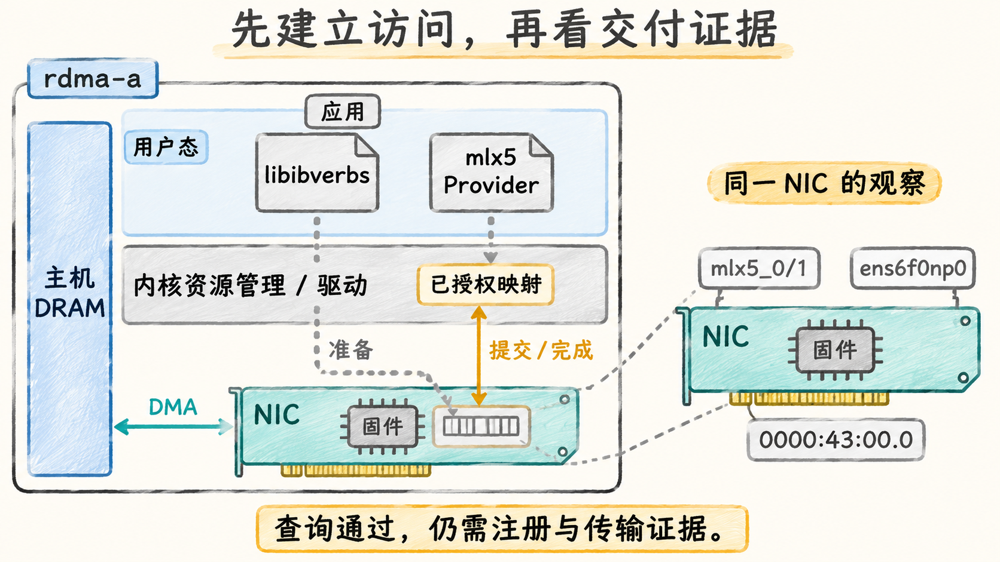

# 把软件栈与主机证据对应起来

## 一条接口需要上下两套实现

用户态调用 `libibverbs` 后，需要 Provider 实现对具体网卡的操作；资源管理又需要相配的内核 RDMA 核心、用户态访问接口和硬件驱动。网卡固件在设备上运行，负责相应硬件功能与协议行为，不是应用进程里装载的 `.so`。对于本章 `mlx5` 网卡，可以这样组织职责：

| 层次 | 组件示例 | 负责的工作与可观察证据 |
| --- | --- | --- |
| 应用/通信库 | Verbs 应用、高层通信库 | 选择设备、注册内存、投递请求、解释完成 |
| 通用用户态接口 | `libibverbs`；采用 CM 时的 `librdmacm` | 暴露资源与操作接口；CM 另负责连接管理 |
| 设备 Provider | `mlx5` 用户态 Provider | 将相应快路径操作转换为该设备的队列与通知格式 |
| 内核 RDMA 与设备驱动 | `ib_core`、`ib_uverbs`、`mlx5_ib`、`mlx5_core` | 管理资源、授权访问、映射、驱动硬件；CM 路径另涉及 `rdma_cm` 等 |
| NIC 与固件 | 网卡、固件、端口 | 执行传输、DMA 与完成报告，暴露能力与错误状态 |

这是一张职责表，不表示每条数据都依次经过表中每个软件组件。资源准备走用户/内核接口，硬件快路径可直接访问映射的队列与寄存器。[rdma-core v56.0 README](https://raw.githubusercontent.com/linux-rdma/rdma-core/v56.0/README.md)明确它提供 Linux RDMA 子系统的用户态组件和设备 Provider；`rdma-core` 不是一套替代 Linux 内核的驱动。

`mlx5_core` 提供设备基础及相应以太网支持，`mlx5_ib` 提供该设备的 RDMA/RoCE 支持。因此以太网接口可用，不代表 RDMA 接口已经可用；名字含 `ib` 也不代表端口一定运行原生 InfiniBand。驱动分工见 [Linux mlx5 驱动文档：Enabling the driver and kconfig options](https://www.kernel.org/doc/html/v5.5/networking/device_drivers/mellanox/mlx5.html)。这里引用稳定分工，不用其旧版功能清单判定当前全部能力。

## 内核自带栈与厂商软件栈是什么关系

**Inbox 驱动栈**指随所选发行版/内核提供的驱动及其配套用户态软件；发行版也可能回移补丁。它并不意味着“只能运行普通 TCP”。当硬件、内核、Provider 和所需功能均支持时，Inbox 栈可以承担 RDMA。

**厂商栈**提供受支持组合的驱动、用户态库、工具以及扩展或修复。NVIDIA 文档中可见 MLNX_OFED、DOCA-OFED 等名称。按核对日的官方说明，MLNX_OFED 的后续交付已转入 DOCA-Host 的 DOCA-OFED；旧文档和已有部署仍会使用原名称，见 [DOCA 3.4.0：MLNX_OFED to DOCA-OFED Transition Guide](https://networking-docs.nvidia.com/doca/archive/3-4-0/mlnx_ofed-to-doca-ofed-transition-guide)。这些名称不是两个可任意叠加的独立通信协议。

判断选哪套栈，应从所需 GPU 内存注册路径、设备型号、内核、固件与功能支持表反推。不能仅凭包名新旧决定支持性，也不能把任意厂商 Provider 与不同来源内核模块拼成“更完整”的组合。一次升级可能改变模块、Provider 或固件中的一项，原先可枚举设备仍不保证原先注册和传输都成立。第 19 章再展开变更流程。

## 先把同名设备映射到同一块 NIC

以下命令以 Linux 宿主机为背景；本节提供完整材料供阅读，无需执行。它们回答的是不同问题：

```bash
rdma link show
ibv_devinfo -d mlx5_0 -i 1
readlink -f /sys/class/infiniband/mlx5_0/device
cat /sys/class/infiniband_verbs/uverbs0/ibdev
ethtool -i ens6f0np0
```

下面是 **rdma-a 上自拟、删节的输出组合**；每段的来源在行首注明，未保留无关能力字段。设备查询的字段按对应命令组织，人工标号不属于原始输出。

```text
[rdma link show]
link mlx5_0/1 state ACTIVE physical_state LINK_UP netdev ens6f0np0

[ibv_devinfo -d mlx5_0 -i 1]
hca_id: mlx5_0
    phys_port_cnt: 1
        port: 1
            state: PORT_ACTIVE (4)
            link_layer: Ethernet

[readlink -f /sys/class/infiniband/mlx5_0/device]
/sys/devices/pci0000:00/0000:00:01.0/0000:3f:00.0/0000:40:03.0/0000:43:00.0

[cat /sys/class/infiniband_verbs/uverbs0/ibdev]
mlx5_0

[ethtool -i ens6f0np0]
driver: mlx5_core
bus-info: 0000:43:00.0
```

`mlx5_0/1` 把 RDMA 设备与端口联系起来，`netdev` 将它关联到以太网接口，两个 PCI BDF 证据再把两种接口视角落回同一设备。sysfs 路径保留根端口及交换桥层级，不能删除这些中间桥后再据此判断物理距离。`uverbs0` 是用户态访问设备节点的本地编号，应读取映射，而不是假定它永远对应 `mlx5_0`。换一台主机后，即使名字、BDF 和编号相同，也是另一套资源。

`ibdev` 属性返回对应 RDMA 设备名称，其实现可对照 [Linux v6.12 uverbs_main.c 中的 ibdev_show](https://raw.githubusercontent.com/torvalds/linux/v6.12/drivers/infiniband/core/uverbs_main.c)。真实基线还应保留 `ibv_devinfo` 的固件版本、`ethtool -i` 的驱动/固件版本字段，并用包管理与已加载模块信息核对来源；本例删去它们是因为没有给定一套经过部署验证的版本组合。

这一组材料支持：A 的该端口处于 Active、链路为 Ethernet，相应 RDMA 查询接口可工作，接口身份映射一致。它没有展示 QP 对端参数、MR 注册和消息结果，因此接下来应该读取这些阶段的材料。`link_layer: Ethernet` 下仍可以使用 RoCE，不能把它判断成“不支持 RDMA”。要区分 RoCEv1/v2，还需要具体地址/路径类型证据；本章模型已在导读中给定 RoCEv2。

## 注册失败时，把资源限制纳入因果链

以下为**独立的教学故障快照**，不表示前述健康模型已经运行过测试。普通非特权进程，本次 `ulimit -l` 的显示单位为 KiB；排除其他锁页，已计入队列内部消耗后，只剩 64 KiB 可用于新增普通 MR。缓冲已经分配成功且未启用 ODP。

```text
设备打开、PD/CQ/QP 创建：成功
本次新增 MR：8 MiB 主机缓冲
实际剩余可锁页额度：64 KiB
应用记录：ibv_reg_mr 返回 NULL
```

需要注册 `8 × 1024 = 8192 KiB`，剩余只有 64 KiB，因此这份条件已足以说明注册额度不满足需求。它发生在负载提交之前，不能将当前失败归为交换机拥塞。单独一个 `NULL` 或通用内存类错误在真实环境中可能有多种原因；本例额外给出的额度与分配条件，才使判断确定。相应权限还包括进程访问 `/dev/infiniband/uverbsN` 的文件权限及策略限制，见 [rdma-core：Using libibverbs](https://github.com/linux-rdma/rdma-core/blob/v56.0/Documentation/libibverbs.md)。

正确的证据顺序由所处阶段决定：无法发现设备先查驱动/设备访问；创建资源失败查 Provider、能力与资源限制；注册成功但完成访问错误查当前范围和授权；只有进入传输后，才把端口、网络及重试证据与请求放在一起解释。下一篇新增 GPU 内存时，前面这些条件仍然存在，还会增加跨驱动的显存映射与 CUDA 顺序要求。



图 06-04-01　rdma-a 的访问机制与身份观察。资源准备依赖用户态、内核及设备固件；准备后的已授权映射支持用户态硬件快路径，琥珀双向箭头概括提交和完成观察，不表示每次提交进入内核。DMA 负载不依次穿过软件文件。右侧是同一 NIC 的放大，RDMA 设备/端口与 netdev 共同落到本机 BDF；右侧两条灰色虚线只是放大定位，与标有“准备”的控制虚线分开理解。图示机制不等于查询快照已证明注册或传输。

[上一篇：先建链，再提交并判断完成](03_先建链再提交并判断完成.md) · [下一篇：从主机内存走到 GPUDirect RDMA](05_从主机内存走到GPUDirectRDMA.md)
