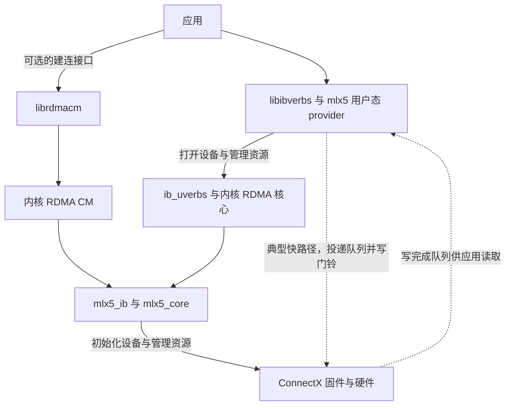

# 一条 Verbs 请求由哪些软件和固件接力

Linux 上能看见一张 ConnectX 网卡，普通网络接口也能收发，`ibv_devinfo` 却没有列出预期的 RDMA 设备。普通网络和 RDMA 可以共用一张物理卡，但用户态程序要使用 RDMA，还需要设备侧的 RDMA 驱动、内核的用户态接口和匹配的用户态设备库。查这一类问题时，先用 PCI 地址确认看到的是同一张卡，再区分在哪一层已经有证据。 [Linux 内核 · mlx5 驱动](https://docs.kernel.org/next/networking/device_drivers/ethernet/mellanox/mlx5.html) · [Linux 内核 · Userspace Verbs](https://docs.kernel.org/infiniband/user_verbs.html)

## 创建资源与提交请求走不同路径

应用用 `libibverbs` 打开 RDMA 设备并创建保护域、队列和完成队列。`libibverbs` 提供通用接口，mlx5 用户态 provider 实现设备相关的操作。打开设备和管理资源要通过 `ib_uverbs` 提供的内核接口，设备文件通常形如 `/dev/infiniband/uverbsN`。`mlx5_core` 为设备提供核心支持，`mlx5_ib` 将 RDMA 功能接入内核 RDMA 子系统。内核的 `CONFIG_MLX5_CORE`、`CONFIG_MLX5_INFINIBAND` 和 `CONFIG_INFINIBAND_USER_ACCESS` 分别对应这些支持的不同层次。应用还可以用 `librdmacm` 处理地址、路由和连接事件。 [Linux 内核 · mlx5 驱动](https://docs.kernel.org/next/networking/device_drivers/ethernet/mellanox/mlx5.html) · [Linux 内核 · Userspace Verbs](https://docs.kernel.org/infiniband/user_verbs.html) · [rdma-core v57.0 · rdma_cm](https://github.com/linux-rdma/rdma-core/blob/v57.0/librdmacm/man/rdma_cm.7)

资源建好后，mlx5 用户态 provider 的典型快路径在映射给进程的发送队列中准备工作项，再写门铃通知设备。设备执行队列工作、处理 RDMA 传输并发起 DMA，应用从已映射的完成队列读结果。网卡固件运行在设备侧，参与设备初始化、资源和功能管理，固件版本因此也是兼容性记录的一部分。已经能枚举 PCI 设备，只说明系统看到了这个 PCI 功能，后续还要验证 RDMA 入口和请求是否可用。 [rdma-core v57.0 · mlx5 QP 和门铃实现](https://github.com/linux-rdma/rdma-core/blob/v57.0/providers/mlx5/qp.c) · [Linux 内核 · mlx5 devlink](https://docs.kernel.org/networking/devlink/mlx5.html)

图中的虚线表示已经完成资源准备之后的典型用户态快路径。可用的队列、映射和设备访问权限来自前面的内核路径。

## inbox 与厂商软件栈描述的是组件来源

**inbox** 指发行版内核随附的驱动。配上与发行版内核接口匹配的 `rdma-core` 用户态库和 provider，在受支持的网卡与固件上即可提供硬件 RDMA。**MLNX_OFED** 和 **DOCA-OFED** 则是 NVIDIA 面向其网络设备发行的软件组合，包含内核驱动、用户态库和工具。目标功能是否可用，要按所用发行版、内核版本、NIC 型号、运行固件和软件栈的支持范围核对。功能相同的模块可以继续叫 `mlx5_ib`，模块名本身无法区分来源。 [NVIDIA · OFED Software Stack](https://docs.nvidia.com/base-command-manager/product-manuals/installation/nvidiamlnxofed) · [NVIDIA · MLNX_OFED 到 DOCA-OFED 迁移指南](https://docs.nvidia.com/doca/archive/2-8-0/nvidia-mlnx-ofed-to-doca-ofed-transition-guide.pdf)

排查刚升级过的主机时，把**实际运行的内核和模块**、**程序实际加载的库与 provider**、**网卡正在运行的固件**分别记录。`uname -r` 给出当前内核版本。`modinfo -n mlx5_ib` 查的是当前内核模块树中能找到的模块文件，再用发行版的包查询确认候选文件归属。运行态要另查设备当前绑定和已加载模块。用户态也应核对进程实际加载的库文件及其包归属，避免用已经安装但未加载的库版本解释运行结果。 [Linux 内核 · mlx5 驱动](https://docs.kernel.org/next/networking/device_drivers/ethernet/mellanox/mlx5.html) · [NVIDIA · OFED Software Stack](https://docs.nvidia.com/base-command-manager/product-manuals/installation/nvidiamlnxofed)

## 把只读证据对回同一张卡

下表使用**自拟设备标识**。假定在一台裸机 Linux 服务器上检查 `mlx5_0/1`，它对应 PCI 功能 `0000:83:00.0`。PCI 地址由域、总线、设备和功能组成，以下称 BDF。实际排查应先读取设备映射，示例的 RDMA 设备名和端口号只在这台主机内有意义。

| 证据 | 可确认的层次 |
| --- | --- |
| `lspci -nnk -s 0000:83:00.0` 的 PCI ID 和 `Kernel driver in use` | 核对设备已枚举以及该 PCI 功能当前绑定的驱动。mlx5 的 PCI 绑定和 RDMA 子系统中的设备分开看。 |
| `readlink -f /sys/class/infiniband/mlx5_0/device` 指向的设备路径 | 在本例的物理卡上，把 RDMA 设备名对回 BDF，避免把另一张卡的端口状态拿来解释当前卡。 |
| `rdma link show mlx5_0/1` 的端口及状态 | 内核中已出现相应 RDMA 设备和端口。`ACTIVE` 是该端口的状态证据。 |
| `ibv_devinfo -d mlx5_0 -i 1` 的 `state`、`active_mtu`、`link_layer` | 该工具能打开对应设备并查询端口。业务进程若使用不同权限或库环境，应在业务的运行条件下重新核对。 |
| `devlink dev info pci/0000:83:00.0` 的 `running`、`stored` 下的 `fw.version` | 区分设备当前运行的固件与设备保存的版本。在判断当前行为时采用 `running` 的版本。 |

查询字段依据上游工具和驱动接口。端口已出现但用户态查询失败时，先看 `uverbs` 权限和 provider。用户态查询成功但跨机请求失败时，再用两端的连接和完成记录验证传输。 [iproute2 v6.12.0 · rdma-link](https://github.com/iproute2/iproute2/blob/v6.12.0/man/man8/rdma-link.8) · [rdma-core v57.0 · ibv_devinfo](https://github.com/linux-rdma/rdma-core/blob/v57.0/libibverbs/man/ibv_devinfo.1) · [Linux 内核 · mlx5 devlink](https://docs.kernel.org/networking/devlink/mlx5.html)
