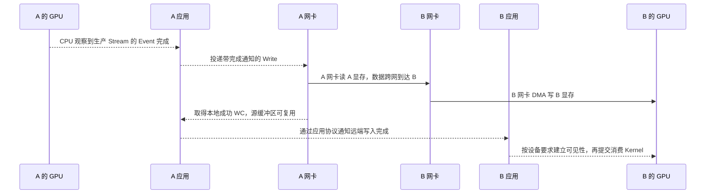

节点 A 的 GPU 产生数据，节点 B 的 GPU 消费数据。A、B 的网卡已经能在两端的主机内存之间执行 RDMA Write。继续沿用这条连接，如果两端还用主机内存作为网卡的 DMA 端点，就要在各自主机上多做一次显存与主机内存之间的复制。**GPUDirect RDMA** 是 NVIDIA GPU 与其他设备之间的直接数据交换能力。本例中，GPU 驱动与 RDMA 驱动协作，将设备显存注册为网卡可访问的缓冲区，使 A 的网卡能直接读 A 的显存，B 的网卡能直接写 B 的显存。跨节点传输继续由两端网卡承担。 [CUDA 13.1.2 的 GPUDirect RDMA 概览](https://docs.nvidia.com/cuda/archive/13.1.2/gpudirect-rdma/index.html)

## 从缓冲区位置推导中转量

| A → B 的路径 | A 的网卡读哪里 | B 的网卡写哪里 | 显存与主机内存之间的中转 |
| --- | --- | --- | --- |
| 两端主机内存中转 | A 的已注册主机缓冲区 | B 的已注册主机缓冲区 | A 先做 GPU → 主机，B 完成接收后做主机 → GPU |
| 两端显存直达 | A 的已注册 GPU 缓冲区 | B 的已注册 GPU 缓冲区 | 两端均省去中转 |
| 仅 A 端显存直达 | A 的已注册 GPU 缓冲区 | B 的已注册主机缓冲区 | B 仍做主机 → GPU |

中转缓冲区可用页锁定主机内存，由 CUDA 安排与显存之间的异步复制。A 的网卡要等源数据复制完成，在 B 侧则要等网卡已写完主机缓冲区，才能安排向显存的复制。主机缓冲区和显存缓冲区可以分别作为一个 Write 的源和目标，应用需要明确管理两端各自的分配、注册和交接。 [CUDA 13.1.2 的拷贝同步行为](https://docs.nvidia.com/cuda/archive/13.1.2/cuda-driver-api/api-sync-behavior.html) · [GPUDirect RDMA 概览](https://docs.nvidia.com/cuda/archive/13.1.2/gpudirect-rdma/index.html)

这次将载荷设为 `8 MiB`，两端中转时，A 做 `8 MiB` 的 GPU → 主机拷贝，B 做 `8 MiB` 的主机 → GPU 拷贝，合计 `16 MiB`。两端直达将中转量降到 `0`，只让 A 直达则剩下 B 的 `8 MiB`。三种路径的单向跨网有效载荷均为 `8 MiB`。这个计数省略协议头、重传和设备内部访存。时间收益还取决于 PCIe 读写速率、中转与计算或网络是否重叠，以及直达访问本身的成本。

**图 06-05-01**　教学拓扑中，两端各有一对挂在同一 PCIe Switch 下的 GPU 与网卡（NIC）。左栏到主机缓冲区的双向箭头合画了每端对该缓冲区的写入和读出，主桥和内存控制器的内部路径已简化。右栏突出显存到网卡、网卡到显存的载荷方向，省略控制和完成消息。橙色箭头表示载荷方向，例如 A 端网卡的读请求朝向显存，读回的载荷朝向网卡。

## 网卡如何取得显存的 DMA 映射

CUDA 程序看到的是 GPU 的虚拟地址。PCIe 网卡访问显存时，需要 GPU 驱动与 RDMA 驱动建立设备可用的映射。在本章讨论的传统 PCIe 路径中，GPU 可以通过 PCIe 地址窗口向对等设备暴露所需内存。BAR（Base Address Register，基址寄存器）描述此类设备地址资源，BAR1 是 NVIDIA GPU 用于映射显存的一类窗口。定位窗口资源问题时，可参考 `nvidia-smi -q` 的 `BAR1 Memory Usage`。GPU 的显存容量与窗口容量应分别核对。 [CUDA 13.1.2 的 PCI BAR 尺寸与查询](https://docs.nvidia.com/cuda/archive/13.1.2/gpudirect-rdma/index.html#pci-bar-sizes)

主线采用 **DMA-BUF**，即 Linux 驱动间共享缓冲区的机制。CUDA 在本机为指定分配导出一个文件描述符，支持该路径的 RDMA 驱动导入它，再生成可供请求使用的内存区域（MR）。另一条 **Peer Memory** 路径由 RDMA 栈调用 GPU 驱动提供的对等内存接口取得映射。两条路径最终都要约束访问地址、范围、密钥和权限，应用须在操作结束前保留 MR 与底层分配。是否在注册失败时切换到中转，由发起注册的应用决定。 [Linux 内核 DMA-BUF](https://docs.kernel.org/driver-api/dma-buf.html) · [rdma-core v57.0 的 DMA-BUF MR 接口](https://github.com/linux-rdma/rdma-core/blob/v57.0/libibverbs/man/ibv_reg_mr.3) · [CUDA 13.1.2 的 nvidia-peermem](https://docs.nvidia.com/cuda/archive/13.1.2/gpudirect-rdma/index.html#using-nvidia-peermem)

## 从 GPU 生产到 GPU 消费的顺序

CUDA Kernel 是提交给 GPU 执行的计算。CPU 将生产任务排入 CUDA Stream（有序工作队列）后，GPU 可能仍未写完源缓冲区。对本例的一条生产 Stream，可在最后一次写之后记录 CUDA Event，由 A 的 CPU 观察该事件完成，再投递 RDMA Write。若多个 Stream 都参与生产，要先把相关依赖汇合。Write 投递后，源显存须保留到 A 取得相应成功完成，且没有其他在途请求继续使用这段源数据。 [CUDA 13.1.2 的 CUDA Event](https://docs.nvidia.com/cuda/archive/13.1.2/cuda-driver-api/group__CUDA__EVENT.html) · [rdma-core v57.0 的 WR 缓冲区生命周期](https://github.com/linux-rdma/rdma-core/blob/v57.0/libibverbs/man/ibv_post_send.3)

普通 Write 的成功 WC 出现在 A。这里假设双方采用经验证的通知协议，A 完成后通知 B，B 收到通知时，相关 DMA 写入已经完成到可建立 CUDA 可见性顺序的阶段。B 的 CPU 随后按照所用映射和设备的 CUDA 顺序要求，建立写入对后续工作的可见性，再提交消费 Kernel。若所需可见范围和平台能力要求显式 flush，可使用相应的 CUDA 接口，例如支持条件满足时用 `cuFlushGPUDirectRDMAWrites()` 等待写入对指定范围可见。已在运行的并发 Kernel 可能看到陈旧值、部分更新或乱序数据，因此本例在通知和顺序条件满足后才启动消费。 [CUDA 13.1.2 的同步与内存顺序](https://docs.nvidia.com/cuda/archive/13.1.2/gpudirect-rdma/index.html#synchronization-and-memory-ordering) · [CUDA 13.1.2 的设备可见性与 flush 接口](https://docs.nvidia.com/cuda/archive/13.1.2/cuda-driver-api/group__CUDA__DEVICE.html)

图省略网卡间的可靠传输确认。重复写同一个目标槽位时，B 还要等消费 Stream 完成对该槽位的访问，再把它交回 A，避免下一次 DMA 写和本次 GPU 读重叠。要实现这条路径，还得确认两个本机 PCIe 设备能彼此访问，以及软件能将这段分配注册给所选网卡。
