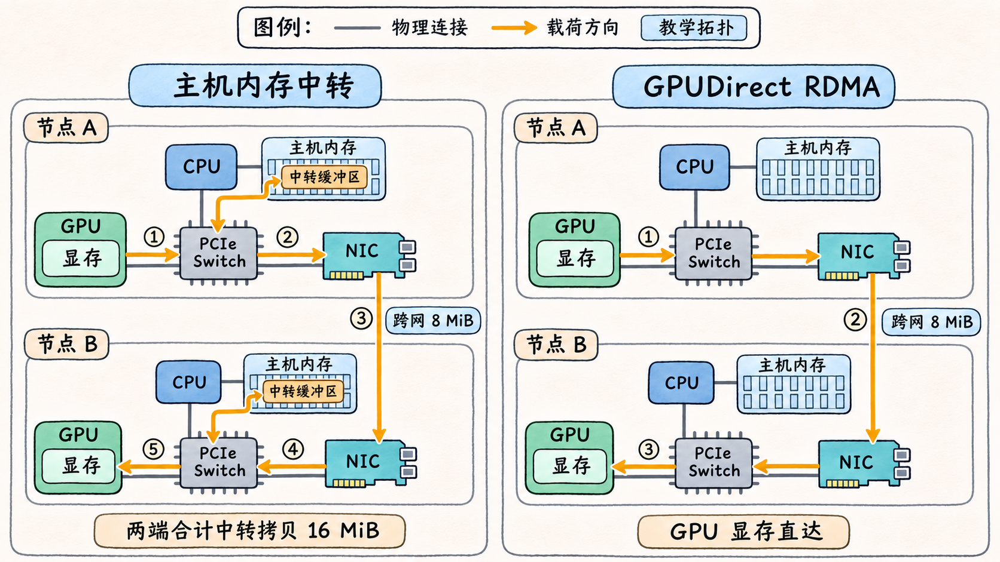
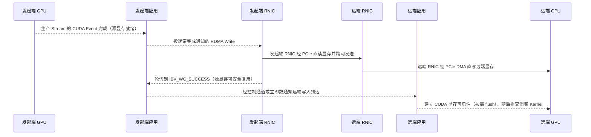

# GPUDirect RDMA 的显存路径与同步

前面的主机内存 RDMA 已经帮我们甩掉了内核 TCP 协议栈与 CPU 拷贝。但回到 AI 集群现场，无论是训练产生的梯度与激活值，还是大模型推理生成的 KV Cache，它们既不在发起端的主机内存里出生，也不在远端的主机内存里消费——它们的起点和终点都在 **GPU 显存（HBM）** 里。

如果网卡的 DMA 端点还停留在主机内存，每一次跨机通信都必须绕一大圈：发起端先把数据从 GPU 显存拷进主机中转缓冲，跨网发到对端主机中转缓冲后，远端再把它拷进 GPU 显存。

**GPUDirect RDMA（简称 GDR）** 正是为了打通这“最后一公里”而生：GPU 驱动与 RDMA 驱动协同把设备显存直接注册为网卡可访问的 MR，让发起端 RNIC 经 PCIe 直接读取本地显存，远端 RNIC 直接写入目标显存，全程彻底绕开主机内存。

## 对比三种显存路径：省下的不只是拷贝量

假设发起端 GPU 产出一段 `8 MiB` 的张量需要交给远端 GPU 消费。根据两端是否把显存直接注册给网卡，数据流会分化成三种路径：

| 跨机显存传输路径 | 发起端 RNIC 读哪里 | 远端 RNIC 写哪里 | 主机内存中转拷贝量（以 $S = 8\text{ MiB}$ 计） |
| --- | --- | --- | --- |
| **两端主机内存中转** | 发起端锁页主机缓冲 | 远端锁页主机缓冲 | 发起端 D2H $8\text{ MiB}$ + 远端 H2D $8\text{ MiB}$ = **$16\text{ MiB}$** |
| **仅发起端显存直达** | 发起端已注册 GPU 显存 | 远端锁页主机缓冲 | 远端 H2D **$8\text{ MiB}$**（发起端省去中转） |
| **两端显存直达（Full GDR）** | 发起端已注册 GPU 显存 | 远端已注册 GPU 显存 | **$0\text{ MiB}$**（两端主机内存完全旁路） |

三种方案在网线上传输的单向有效载荷都是 $S = 8\text{ MiB}$，但在服务器内部 PCIe 与内存总线上激起的流量截然不同：

$$
\text{中转拷贝总量} =
\begin{cases}
2S = 16\text{ MiB}, & \text{两端主机内存中转（D2H + H2D）} \\
S = 8\text{ MiB}, & \text{仅单端显存直达} \\
0, & \text{两端 GPUDirect RDMA 直达}
\end{cases}
$$

走主机内存中转时，即便中转区选用锁页内存并配合 CUDA 异步拷贝，发起端网卡也必须等 D2H 拷贝落地才能发包，远端则要等网卡写完主机缓冲后再发起 H2D。而且主机缓冲与显存缓冲在 Verbs 里彼此解耦——单端支持直达时，完全可以把一端设为显存 MR、另一端设为锁页主机 MR，逐端渐进启用。

*图 06-05-01：发起端（图中节点 A）到远端（图中节点 B）传输 8 MiB 载荷的主机内存中转与 GPUDirect RDMA 路径对照。两端 GPU 与网卡均挂在同一 PCIe Switch 下，右侧显存直达路线让数据直接在 Switch 内部完成 GPU ↔ NIC 转发，不再触碰 CPU 与主机内存。*

## 训推双主线：为什么 PD 分离推理同样离不开 GPUDirect RDMA

在**分布式训练**里，GPUDirect RDMA 的价值很好理解：AllReduce、ReduceScatter 和 MoE All-to-All 每步都要跨机吞吐海量梯度与激活值，绕开主机内存能避免 PCIe 根复合体与主机内存带宽拥塞，直接压缩同步步时。

而在 [第 05 章](../05_为什么一个作业需要多张GPU/00_内容大纲.md) 拆解过的**在线大模型推理（尤其是 PD 分离架构）** 中，GPUDirect RDMA 更是决定业务体验生死的关键枢纽。

回顾 PD 分离的工作流：当一条长上下文请求到来时，算力密集的 **Prefill 节点**先并行计算整段提示词，在自己的显存里产出完整的 KV Cache；随后，它必须把这份 KV Cache 迅速交接给访存密集的 **Decode 节点**，Decode 节点拿到后才能吐出第一个有效回复 token。也就是说，**KV Cache 跨节点迁移耗时直接叠加在用户的首字延迟（TTFT）上**。

现代推理传输引擎（例如 NVIDIA **NIXL**、vLLM 的 `NixlConnector` 或 Mooncake 传输引擎）在底层普遍使用 **GPUDirect RDMA 单边操作**——由 Prefill 发起 **RDMA Write** 推送，或由 Decode 发起 **RDMA Read** 拉取，把 KV 块直接送进目标显存。

用第 05 章的 70B GQA 模型 `16K` 上下文为例，单请求 KV Cache 体积约为 $5\text{ GiB} \approx 5.37\text{ GB}$。假设主机与 GPU 间有效 PCIe Gen4 x16 拷贝速率与单口 `200 Gb/s` RDMA 理论线速均按 $25\text{ GB/s}$ 估算（暂不计协议开销与分块重叠）：

$$
t_{\text{跨网线速}} \approx \frac{5.37\text{ GB}}{25\text{ GB/s}} \approx 215\text{ ms}
$$

- **若被迫走两端主机内存中转**：即便网络仍走 RDMA，仅发起端 D2H 拷贝与远端 H2D 拷贝各自就需要额外消耗约 $215\text{ ms}$。若分块流水衔接不佳或主机内存总线正被其他并发请求抢占，端到端迁移耗时很容易翻倍至 $400\text{--}600\text{ ms}$ 以上，还会把两端 CPU 与内存带宽拖进拥堵，直接击穿在线服务的 TTFT SLO。
- **启用 GPUDirect RDMA 后**：Prefill 侧网卡直接从 HBM 读取 KV 块，经高速网络直写 Decode 侧预分配好的显存块（甚至结合层间流水线，算完第 $L$ 层就异步推送第 $L$ 层 KV）。不仅省去了双倍主机内存中转延迟，更关键的是**单边 RDMA Write/Read 全程不中断 Decode 节点正在冲刺 P99 TPOT 的 CPU 线程与 GPU 计算流**。

> [!summary] 核心结论
> 在训练集群中，GPUDirect RDMA 保护的是**高吞吐步时与主机总线余量**；在 PD 分离推理集群中，GPUDirect RDMA 搭配单边 Write/Read 直接守护着**首字延迟（TTFT）上限与 Decode 节点的 P99 尾延迟稳定**。

## 网卡如何拿到显存的 DMA 映射：BAR1、DMA-BUF 与 Peer Memory

CUDA 应用持有的是 GPU 虚拟地址，网卡并不能直接拿它发起 PCIe 读写。在传统 PCIe 路径上，GPU 借助 PCIe 地址窗口向对等设备暴露显存——描述这类地址资源的寄存器称为 **BAR（Base Address Register，基址寄存器）**，其中 **BAR1** 正是 NVIDIA GPU 用来把显存映射到 PCIe 空间的窗口。

排查窗口耗尽问题时，可以检查 `nvidia-smi -q` 输出里的 `BAR1 Memory Usage`，切记将 GPU 的 HBM 总容量与 BAR1 映射窗口大小分开核对。

为了让 RDMA 驱动获取这份显存 DMA 映射并生成合法的 MR，Linux 生态存在两条技术路径：

1. **DMA-BUF（主线推荐路径）**：Linux 内核标准的跨设备缓冲区共享机制。CUDA 驱动在本地把指定显存分配导出为一个文件描述符（`fd`），支持该特性的 RDMA 驱动将其导入并注册为 MR。它完全走内核标准接口，无需维护脆弱的第三方内核旁路模块。
2. **Peer Memory（传统旁路路径）**：由 NVIDIA 驱动附带的 `nvidia-peermem` 内核模块向支持对等内存回调接口的 RDMA 栈提供映射。无论走哪条路径，最终生成的显存 MR 都遵循完全相同的 `lkey`/`rkey`、范围和权限检查规则，在途请求结束前不得注销或释放底层显存。

## 跨设备同步顺序：从 GPU 生产到 GPU 消费的完整交接

把主机内存换成显存后，参与接力的角色从“CPU + 网卡”升级成了“GPU + CPU + 网卡”，异步乱序的风险陡然增加。因为 CUDA Kernel 与 RDMA 请求都是异步排队的，漏掉任何一道同步栅栏都会导致发出半成品或读到陈旧显存。

一次严谨的端到端显存 Write 必须守住四道顺序门禁：

1. **发起端生产就绪（GPU → CPU）**：计算 Kernel 排入 CUDA Stream 后会立刻异步返回，此时 GPU 可能尚未写完源显存。
   - 必须在最后一次写入后记录 **CUDA Event**（多流生产则先汇合依赖），待发起端 CPU 确认该 Event 完成后，才调用 `ibv_post_send()`。
2. **发起端源显存保护（NIC → CPU）**：Write 投递后，发起端必须等到本地 CQ 返回 `IBV_WC_SUCCESS` 且无其他在途请求引用该段显存，才允许后续 Kernel 覆写源缓冲区。
3. **远端数据落盘通知（发起端 → 远端）**：普通 RDMA Write 不在远端产生完成记录。双方通过约定协议（控制通道消息或 `RDMA Write with Immediate`）告知远端数据已经写入显存。
4. **远端显存可见性建立（NIC → GPU）**：网卡经 PCIe 写入远端显存后，并发 Kernel 若未刷新缓存，可能读到旧值或半更新数据。
   - 按 CUDA 13.2.1 内存顺序规范，远端 CPU 收到通知后先按平台与映射路径要求建立可见性（必要时调用 `cuFlushGPUDirectRDMAWrites()`），再向 Stream 提交消费 Kernel。

*图 06-05-02：GPUDirect RDMA 端到端数据流与跨设备同步时序。若发起端需要循环复写远端同一槽位，远端还必须等消费 Stream 执行完毕后再归还槽位，防止新一轮网卡 DMA 写与正在运行的消费 Kernel 冲突。*

> [!warning] 常见误区：远端消费 Kernel 可以提前启动“边等边读”
> 不要试图在远端预先启动一个轮询显存标志位的常驻 Kernel 来省掉同步步骤，除非严格遵循平台文档规定的设备侧同步语义。普通并发 Kernel 在可见性栅栏建立之前读取目标显存，极易因 PCIe 写合并与 GPU 缓存一致性边界观察到残缺数据。

清楚了显存直达的收益与同步纪律之后，下一篇我们下探到服务器主板与内核底层：究竟要满足哪些 PCIe 拓扑、ACS、IOMMU 和内核注册条件，GPUDirect RDMA 才能真正跑通而不悄悄回退？

> [!info]- 参考资料
> - **CUDA 13.2.1 GPUDirect RDMA 核心文档**：[GPUDirect RDMA Overview](https://docs.nvidia.com/cuda/archive/13.2.1/gpudirect-rdma/index.html)、[PCI BAR Sizes](https://docs.nvidia.com/cuda/archive/13.2.1/gpudirect-rdma/index.html#pci-bar-sizes)、[Using `nvidia-peermem`](https://docs.nvidia.com/cuda/archive/13.2.1/gpudirect-rdma/index.html#using-nvidia-peermem)、[Synchronization and Memory Ordering](https://docs.nvidia.com/cuda/archive/13.2.1/gpudirect-rdma/index.html#synchronization-and-memory-ordering)
> - **CUDA 13.2.1 Driver API（同步、事件与 flush）**：[API Synchronization Behavior](https://docs.nvidia.com/cuda/archive/13.2.1/cuda-driver-api/api-sync-behavior.html)、[Event Management (`group__CUDA__EVENT`)](https://docs.nvidia.com/cuda/archive/13.2.1/cuda-driver-api/group__CUDA__EVENT.html)、[Device Management (`group__CUDA__DEVICE`)](https://docs.nvidia.com/cuda/archive/13.2.1/cuda-driver-api/group__CUDA__DEVICE.html)
> - **Linux DMA-BUF 与 Verbs 接口**：[Linux Kernel DMA-BUF](https://docs.kernel.org/driver-api/dma-buf.html)、[rdma-core v57.0 `ibv_reg_mr(3)`](https://github.com/linux-rdma/rdma-core/blob/v57.0/libibverbs/man/ibv_reg_mr.3)、[`ibv_post_send(3)`](https://github.com/linux-rdma/rdma-core/blob/v57.0/libibverbs/man/ibv_post_send.3)
> - **大模型推理 KV Cache RDMA 传输库**：[NVIDIA Inference Xfer Library (NIXL)](https://github.com/ai-dynamo/nixl)
