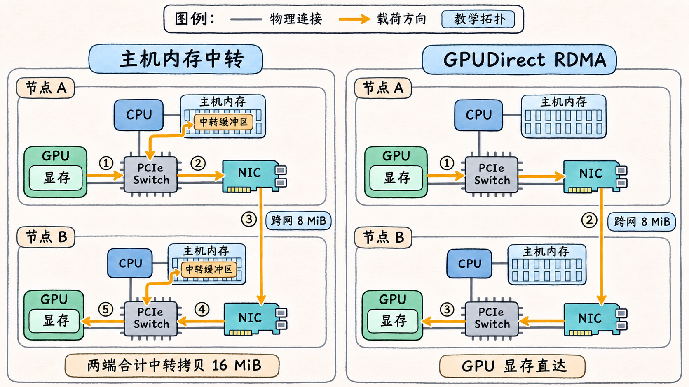
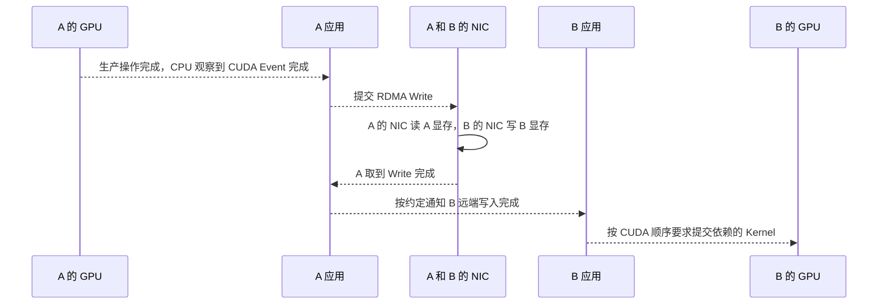

# RDMA 如何从主机缓冲区走到 GPU 显存

两台服务器已经能用 RDMA Write 在主机内存之间传数据。现在 A 的数据由 GPU 产生，B 也要在 GPU 上消费。决定路径的还是两个缓冲区的位置。只要 NIC 看到的 MR 背后是主机内存，GPU 与主机内存之间就要另有一段搬运。GPUDirect RDMA 让具备相应支持的 NIC 能把 GPU 显存作为 DMA 的端点。 [CUDA 13.1.2 · GPUDirect RDMA](https://docs.nvidia.com/cuda/archive/13.1.2/gpudirect-rdma/index.html)

## 同一次 Write 可以经过两条路径

| 路径                | A 侧如何取数                                         | 跨机载荷                   | B 侧如何写入缓冲区                               |
| ----------------- | ----------------------------------------------- | ---------------------- | ----------------------------------------- |
| 主机内存中转            | A 从 GPU 显存复制到页锁定主机缓冲区，A 的 NIC 从已注册的主机缓冲区 DMA 读。 | A 的 NIC → 网络 → B 的 NIC | B 的 NIC DMA 写入已注册的主机缓冲区，B 再将数据复制到 GPU 显存。 |
| 两端 GPUDirect RDMA | A 的 NIC 经本机 PCIe 对等 DMA 从已注册的 GPU 缓冲区取数。        | A 的 NIC → 网络 → B 的 NIC | B 的 NIC 经本机 PCIe 对等 DMA 直接写入已注册的 GPU 缓冲区。 |

中转时，GPU 与页锁定主机缓冲区之间可以由 CUDA 发起异步复制。只有上游的复制完成，下一段才可以使用该缓冲区。直达时，这两段中转复制可以省去。仍由两台机器各自的 NIC 操作本机内存。两端的路径可以独立选择，例如 A 的源 MR 在 GPU 上，B 的目标 MR 在主机内存中，B 再把收到的数据复制到 GPU。上层能否采用这种混合路径，取决于它能否为两端选择并管理相应的缓冲区。 [CUDA 13.1.2 · GPUDirect RDMA](https://docs.nvidia.com/cuda/archive/13.1.2/gpudirect-rdma/index.html) · [CUDA 13.1.2 · API Synchronization Behavior](https://docs.nvidia.com/cuda/archive/13.1.2/cuda-driver-api/api-sync-behavior.html)

假设应用要单向发送 `8 MiB`，两端各中转一次。A 做一次 `8 MiB` 的 GPU 到主机拷贝，B 做一次 `8 MiB` 的主机到 GPU 拷贝，合计 `16 MiB` 的 GPU 与主机之间的拷贝载荷。改用两端直达，省下的就是这 `16 MiB`，两种路径的跨网有效载荷仍各为 `8 MiB`。这个算例只数指定路径上的载荷，省略协议头、重传和其他内存访问。两段拷贝能否与通信或计算重叠、PCIe 读写各自的带宽是多少，决定了省去拷贝能节约多少时间。

**图 06-05-01**　两端各有一对接在同一 PCIe Switch 下的 GPU 与 NIC。左栏的双向箭头合画了各自中转缓冲区的写入和读出，主桥与内存控制器的内部路径已简化。右栏的 NIC 直接读写已注册的显存，两端合计省去 `16 MiB` 的中转拷贝。两栏的跨网有效载荷均为 `8 MiB`。

## 注册让 NIC 得到可用的设备映射

应用拿到的 CUDA 指针对应一段 GPU 虚拟地址。NIC 发起 PCIe 访问时，需要的是设备能够访问的地址。以传统 PCIe 路径为例，GPU 驱动把指定 GPU 内存映射进可由 PCIe 访问的 BAR 窗口，RDMA 驱动根据该映射为 NIC 建立对应的访问。BAR1 是这种映射窗口的一个例子。`nvidia-smi -q` 中的 `BAR1 Memory Usage` 反映窗口资源，显存容量和可用于设备访问的窗口空间需要分别看。 [CUDA 13.1.2 · PCI BAR Sizes](https://docs.nvidia.com/cuda/archive/13.1.2/gpudirect-rdma/index.html#pci-bar-sizes) · [CUDA 13.1.2 · Displaying GPU BAR Space](https://docs.nvidia.com/cuda/archive/13.1.2/gpudirect-rdma/index.html#displaying-gpu-bar-space)

映射建好之后，MR 继续约束操作的地址范围、密钥和访问权限。DMA-BUF 路径用 CUDA 导出的文件描述符，把某段分配交给支持导入的 RDMA 驱动注册。Peer Memory 路径通过 `nvidia-peermem` 与内核 RDMA 栈合作取得 GPU 内存映射。无论采用哪种方式，应用都要在相关操作结束前保持分配与 MR 有效，并在释放分配前结束访问、撤销注册。注册失败时，应用能否改走主机中转取决于该应用的实现。 [CUDA 13.1.2 · CUDA Driver API Memory Management](https://docs.nvidia.com/cuda/archive/13.1.2/cuda-driver-api/group__CUDA__MEM.html) · [rdma-core v57.0 · MR 注册接口](https://github.com/linux-rdma/rdma-core/blob/v57.0/libibverbs/man/ibv_reg_mr.3) · [CUDA 13.1.2 · Using nvidia-peermem](https://docs.nvidia.com/cuda/archive/13.1.2/gpudirect-rdma/index.html#using-nvidia-peermem)

## 把 GPU 生产、网卡访问和 GPU 消费排成先后顺序

A 的 CPU 提交 GPU Kernel 后，GPU 可能仍在生产数据。若此时就投递 RDMA Write，A 的 NIC 可能先读到旧内容。一个可读的顺序是让生产操作所在的 CUDA Stream 在完成所需写入后记录 Event，CPU 等该 Event 完成，再提交 NIC 工作。若多个 Stream 都写这个缓冲区，要先汇合相关依赖。A 也要等到有相应的传输完成证据，再安排改写源缓冲区。 [CUDA 13.1.2 · CUDA Driver API Events](https://docs.nvidia.com/cuda/archive/13.1.2/cuda-driver-api/group__CUDA__EVENT.html) · [rdma-core v57.0 · ibv_post_send](https://github.com/linux-rdma/rdma-core/blob/v57.0/libibverbs/man/ibv_post_send.3)

B 的普通 Write 目标 MR 不会自动产生远端接收完成。下面假定 A 在 Write 完成后发出控制通知，而且所选传输、映射及应用协议保证，B 收到通知时，相关 DMA 写入已经完成到可建立 CUDA 顺序的阶段。B 的 CPU 在得到这一信号后，按所用 CUDA 接口和设备所需的顺序保证来安排后续 Kernel。若同一缓冲区已经被一个并发运行的 Kernel 读取，即使 NIC 已发出 PCIe 写事务，该 Kernel 也可能看到旧值、部分更新或乱序的数据。负责发起和等待的 CPU 工作仍在。 [CUDA 13.1.2 · Synchronization and Memory Ordering](https://docs.nvidia.com/cuda/archive/13.1.2/gpudirect-rdma/index.html#synchronization-and-memory-ordering) · [CUDA 13.1.2 · `cuFlushGPUDirectRDMAWrites` 的设备与可见范围条件](https://docs.nvidia.com/cuda/archive/13.1.2/cuda-driver-api/group__CUDA__DEVICE.html)

判断一个缓冲区能否交给下一段时，先辨认谁刚写完，再找能把这个完成传给下一位读者的证据。A 侧的证据从 GPU 传给 NIC，B 侧的证据从 NIC 经应用传给 GPU。
