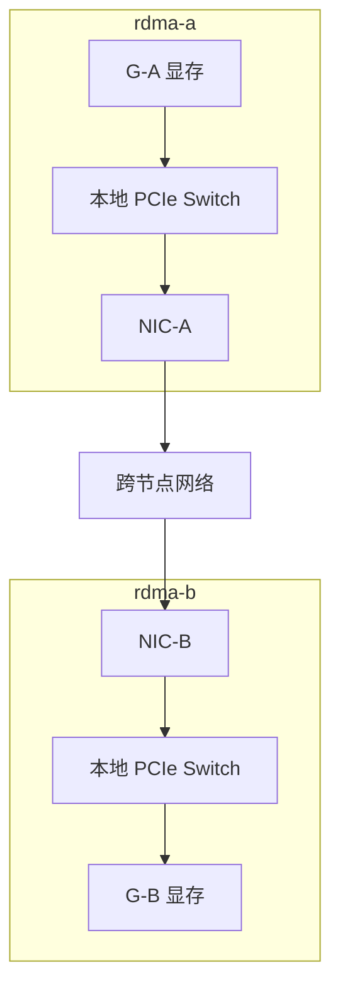
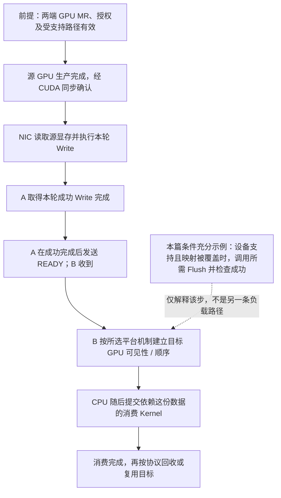

# 从主机内存走到 GPUDirect RDMA

## 主机内存 RDMA 不会自动消除显存中转

现在让 G-A 的 Kernel 生成数据，最终交给 G-B 的 Kernel 使用。即使两台主机之间已经用 RDMA，通信缓冲仍可能是 H-A 与 H-B：

```text
G-A 显存 → D2H → H-A → NIC-A → 网络 → NIC-B → H-B → H2D → G-B 显存
```

这条安排省去了普通 Socket 的部分用户/内核复制，但保留 GPU 与主机缓冲间的两次搬运。中转缓冲可以是锁页内存，仍需 DMA 访问主机 DRAM，受主机内存位置、PCIe 路径和复制时序约束。看到“网络使用 RDMA”，还没有说明注册的到底是哪类内存。

**GPUDirect RDMA** 在受支持条件下让本地 NIC 直接 DMA 访问本地 GPU 显存，跨节点的整体负载路径成为 G-A→NIC-A→网络→NIC-B→G-B。GPU 侧仍由 CUDA 与驱动管理内存，NIC 侧仍需要注册和授权；它没有用 NVLink 替代跨机网络。技术定位见 [CUDA 12.8.1 GPUDirect RDMA：Overview 与 How GPUDirect RDMA Works](https://docs.nvidia.com/cuda/archive/12.8.1/gpudirect-rdma/index.html#how-gpudirect-rdma-works)。

下面是**条件已满足时的物理数据路径图**。本节新给定：每台机器的 GPU、NIC 处于同一 PCIe Switch 下，端口选择正确，支持该 P2P 路径；不存在迫使事务绕行根侧的配置。A 的 NIC 接在第四篇 `3f:00.0` 对应交换结构的 `40:03.0` 下，GPU 则经同一结构的 `40:01.0` 接到 `41:00.0`；B 同构。范围框表示节点，箭头表示 A→B 的有效负载，网卡内部及网络内部细节省略。



两端都直接访问显存时，负载不落入两端主机 DRAM；CPU 仍参与控制和同步。也可以只有一端采用显存直达、另一端使用主机缓冲，这时只能消除直达端对应的中转。**“两端 GPUDirect”需要两端分别成立**，不能用发送端注册成功代替接收端证据。

## GPU 指针如何变成 NIC 可以访问的 MR

前面的 `ibv_reg_mr` 面对普通主机内存时，可以依靠系统管理的主机页。GPU 指针属于另一类内存，NIC 驱动不能把它任意当作主机页处理。通信库必须识别内存类型，把 CUDA 分配对应的存储通过受支持机制交给 NIC 驱动映射，再形成能被该 QP 使用的 MR。

两类常见路径需要分开理解：

| 路径 | 如何把同一份 GPU 存储交给 NIC | 应观察什么 |
| --- | --- | --- |
| DMA-BUF | GPU 侧导出缓冲句柄，RDMA 侧导入并建立 MR | 导出能力与结果、dma-buf FD、`ibv_reg_dmabuf_mr` 的成功及对应范围 |
| Peer Memory / `nvidia-peermem` | RDMA 栈通过 Peer Memory 协作取得 NVIDIA 管理的显存映射 | 相容的 GPU/NIC 驱动、Peer Memory 支持、模块状态及 GPU MR 注册结果 |

**DMA-BUF** 是 Linux 跨驱动共享 DMA 缓冲的框架，FD 是本进程持有的句柄，不是负载所在的主机内存。导出/导入共享存储，不要求把整份数据复制进某个“DMA-BUF 文件”。框架角色见 [Linux：Buffer Sharing and Synchronization，Shared DMA Buffers](https://docs.kernel.org/driver-api/dma-buf.html#shared-dma-buffers)。`ibv_reg_dmabuf_mr` 接收 FD、偏移、长度、IOVA 与权限，建立 RDMA 可用的 MR，见 [rdma-core v56.0 的注册接口](https://raw.githubusercontent.com/linux-rdma/rdma-core/v56.0/libibverbs/man/ibv_reg_mr.3)。**IOVA** 在这里是 MR 对访问方呈现的 I/O 虚拟基址，不应自行等同于 CPU 物理地址。

`nvidia-peermem` 是内核模块，负责相应 Peer Memory 协作，属于准备访问映射的环节；它不是一块软件中转内存。早期的外部模块 `nv_peer_mem` 与 NVIDIA 驱动提供的 `nvidia-peermem` 不是同名写法，不应混用。相关演进见 [CUDA 12.8.1：Changes in CUDA 11.4 与 Changes in CUDA 12.2](https://docs.nvidia.com/cuda/archive/12.8.1/gpudirect-rdma/index.html#changes-in-cuda-11-4)。

如果选择 DMA-BUF 且已满足该路径的条件，未加载 `nvidia-peermem` 并不构成失败；若选择 Peer Memory，则该协作是否具备就是待核实条件。判断应从**通信软件实际选用的注册方式**出发，不能只查一张模块列表。

## 用带版本的条件表约束支持性判断

借用 [GPU Operator 25.3.0：Common Prerequisites](https://docs.nvidia.com/datacenter/cloud-native/gpu-operator/25.3.0/gpu-operator-rdma.html#common-prerequisites) 的宿主机依赖对照，不涉及其部署步骤：

| 项目 | 该版 DMA-BUF 路径列出的条件 | 该版 legacy nvidia-peermem 路径的差异 |
| --- | --- | --- |
| GPU 内核模块 | 要求 NVIDIA Open GPU Kernel Modules | 可使用该组合支持的 GPU 驱动类型 |
| CUDA 与内核 | CUDA 11.7 或以上；Linux 5.12 或以上 | 不能拿左栏门槛直接判断右栏全部组合 |
| GPU | 表中列明 Turing 或更新的受支持数据中心/RTX 类产品 | 产品范围按该表及具体支持矩阵读取 |
| NIC 驱动来源 | 可使用支持所需功能的发行版驱动包；MLNX_OFED/DOCA-OFED 可选 | 表中要求 MLNX_OFED 或 DOCA-OFED |

这张表是所引版本的先决条件，**不是“超过四个版本门槛就保证可用”的认证矩阵**。Open GPU Kernel Modules 指 GPU 内核驱动类型，不代表整套 CUDA 用户态组件都变成开源软件。Linux 主版本满足门槛，也不能代替具体发行版内核、NIC 驱动与 Provider 是否实现导入功能的核对。

本章 GPU 材料因此不虚构一套已经验证的部署版本组合，而是明确给出“导出成功、相应注册成功、路径已获支持”等教学条件。真实节点要补入 GPU/NIC 型号、驱动及 Provider 包版本、内核构建、固件、内存分配方式和通信库版本，才能判断其组合是否受支持。普通设备分配、可迁移的统一内存及特殊分配方式也不应仅凭“都是 GPU 地址”相互替代。

## PCIe、IOMMU 和 ACS 分别影响哪一环

这些条件可放回同一条推理链：

| 条件 | 影响的机制 | 对应证据与判断 |
| --- | --- | --- |
| GPU—NIC PCIe 拓扑 | P2P 事务经过哪些交换和根侧组件 | BDF、`lspci -t`、拓扑矩阵；同 Switch 是优先核对的候选，不能代替注册与传输 |
| IOMMU：设备地址翻译与隔离 | NIC 使用的设备地址是否按该路径可解释 | 实际 IOMMU 模式、平台与驱动支持；普通主机内存 DMA 的可用性不能证明显存 P2P |
| ACS：PCIe Access Control Services | 桥上的访问控制和重定向是否改变事务路径 | 沿 GPU—NIC 路径读取相关桥配置，不能只看终端设备或一个总开关 |
| 显存映射与资源 | 所选分配能否导出/映射、相应资源是否充足 | GPU 分配类型、注册方式与返回结果；显存空闲量不是所有映射资源的额度 |

CUDA 12.8.1 的 [Supported Systems：IOMMUs](https://docs.nvidia.com/cuda/archive/12.8.1/gpudirect-rdma/index.html#supported-systems)对其描述的 PCIe GPUDirect 路径要求设备视角下的地址一致，列明非 1:1 翻译的限制。应保留该路径、平台与版本条件，不能将它扩展成“所有 RDMA 都必须关闭 IOMMU”。

ACS 和 IOMMU 也不是同一机制：一个影响桥的 P2P 控制/路由，一个影响设备地址翻译。相关 PCIe GPU Direct 排查及裸机/虚拟机差异见 [NCCL 2.31.2：PCI Access Control Services](https://docs.nvidia.com/deeplearning/nccl/archives/nccl_2312/user-guide/docs/troubleshooting/gpu_troubleshooting.html#pci-access-control-services-acs)。这里使用其解释支持条件，不展开 NCCL 算法。读取配置后应先与目标平台支持方式对照；隔离配置的变更需纳入该平台变更方案，不能从拓扑标签直接推导一个适用于所有节点的寄存器修改。

## 数据到了显存，Kernel 何时才可以使用

GPUDirect 新增一条独立于 CUDA Stream 的设备数据流。网卡提交和完成不自动成为 CUDA Event；一个已经运行的 Kernel 也不能仅凭“远端说写完了”就假定自己的并发读取没有数据竞争。

对本章由 CPU 发起的串行协议，理解下面的依赖关系即可：

```text
发送侧：GPU 生产数据完成并经 CUDA 同步确认 → NIC 才开始读源显存
接收侧：确认本轮 NIC 写入完成 → 满足该平台的 GPU 可见性/顺序要求
       → CPU 提交依赖这份数据的 CUDA Kernel → 消费完成后再回收目标缓冲
```

其中“满足可见性/顺序要求”不能省掉。通信库需按所选平台和内存注册路径使用受支持的机制；CUDA 12.8.1 还提供 `cuFlushGPUDirectRDMAWrites`，按目标与作用范围等待相应远端写对消费者可见。设备的写排序能力和支持属性决定是否需要、以及能否使用相关操作；它不是所有平台上一律要插入的调用。见 [CUDA Driver API 12.8.1：Device Management，cuFlushGPUDirectRDMAWrites 与相关设备属性](https://docs.nvidia.com/cuda/archive/12.8.1/cuda-driver-api/group__CUDA__DEVICE.html)。

给一个**条件充分的串行示例**：B 已确认设备支持由主机执行的 Flush，所选 GPU 内存映射在该接口覆盖范围内，且其写排序能力尚不足以自动满足目标 GPU 的可见性要求。B 先收到在 A 的成功 Write 完成之后发出的 READY；随后对当前 G-B 的 CUDA Context 调用受支持的 Flush，作用范围取拥有该内存的 GPU，并检查返回成功；然后才提交校验 Kernel，等待其完成并读取校验结果。这里没有与写入并发读取目标的 Kernel，也没有混用其他硬件路径或 QP 的顺序。若设备自身已保证所需排序，相关 Flush 可按能力省略，但“写完成→允许 GPU 消费”的依赖仍须成立。

因此，本章主机内存例子中的“写完成后发 READY，B 随后读取主机内存”，不能只把 H-B 三个字换成 G-B 就当作完整 GPU 协议。GPU 记录还应说明生产同步、注册路径、接收端完成如何确认、GPU 可见性如何建立，以及后续 Kernel 如何依赖该数据。应用通常交由通信库实现这些细节，排查时仍需知道这几条依赖应当存在。



图 06-05-02　本章 CPU 发起串行协议的依赖顺序。实线箭头表示前提和因果依赖，不是网线或统一全局时钟；虚线仅解释可见性步骤。Flush 仅用于正文已给定设备支持、映射覆盖且需要显式建立相应可见性的示例，不能推广为每种 DMA-BUF/Peer Memory 组合必需的同一调用。已有排序能力足够时可按支持条件省略相应 Flush，但不能省略可见性保证。

## 用完整材料判断直达，而不是只看一个计数

以下是**自拟的双端测试记录摘要**，字段名由作者设计，不是现有工具的固定输出。假定设备支持、拓扑和地址映射条件均已按本节要求核对，采用普通设备显存分配；底层实现明确报告未回退到主机中转。

```text
源端：G-A 设备显存；生产 Kernel 完成并经 CUDA 同步确认
目的端：G-B 设备显存；GPU 消费尚未启动
两端注册：DMA-BUF 导出成功；ibv_reg_dmabuf_mr 成功
目标 MR/QP：允许本轮远端写；地址、Key、范围及生命周期已核对
传输：两端使用 GPU MR；普通 RC Write 成功完成；没有主机中转
目的端：在写完成通知后，按已核对的平台机制建立 GPU 可见性
消费：随后提交校验 Kernel，完成后读取结果，PASS
```

这组题设支持本轮从源显存到目标显存的直接交付与数据正确性，未给出性能结果。删掉“使用 GPU MR/无中转”，只剩 `ibv_devinfo` 成功与“支持 DMA-BUF”，就退回能力证据；只测 H-A→H-B，则只验证了主机内存 RDMA。真实测试中应保留完整参数、实现与日志，不能用作者汇总字段假装某个工具已自动证明路径。

直达减少了中转和对应 DRAM 流量，但仍受网络、GPU—NIC 方向性 PCIe 访问、消息大小和同步成本限制。下一篇给定所有速率与时间边界后，再计算收益，而不从“GPUDirect”这个名字直接推出某个带宽。

[上一篇：把软件栈与主机证据对应起来](04_把软件栈与主机证据对应起来.md) · [下一篇：用两节点材料完成综合推演](06_用两节点材料完成综合推演.md)
