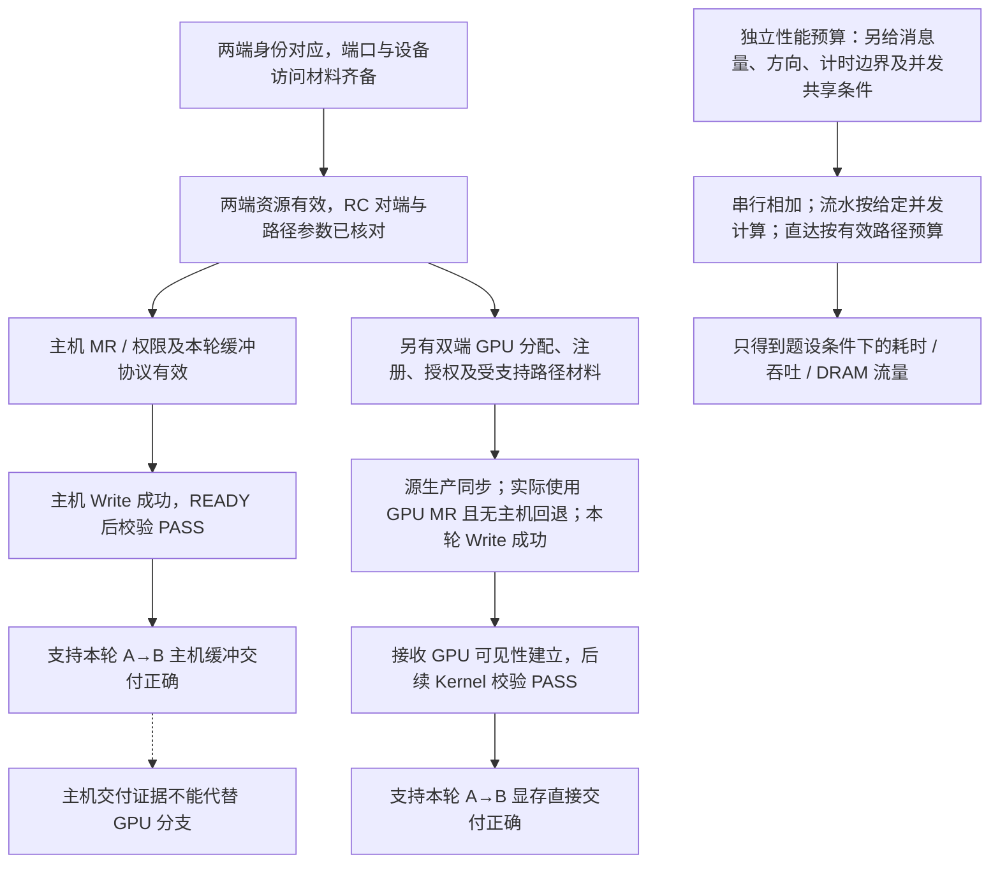

# 用两节点材料完成综合推演

## 先完成一份双节点交付判断

以下是**自拟、人工整理的教学交接单**，按 A→B 方向组织；没有采集真实设备。除单独声明的异常快照外，A、B 使用导读中的身份映射，网络已给定为匹配的 RoCEv2 路径。

| 阶段 | 已有材料 | 能得出的结论 |
| --- | --- | --- |
| 设备与身份 | 两端 `mlx5_0/1` Active、Ethernet；RDMA/netdev 均映射到各自主机的 `0000:43:00.0` | 端口和设备身份已对应，可继续查建链与注册 |
| 资源与建链 | 两端 Provider 工作；PD/CQ 创建成功；QP-A `0x101` 与 QP-B `0x202` 均 RTS，对端及路径参数已核对 | 本轮 RC 端点已准备，不代表负载已传输 |
| 主机内存 | 第二篇 64 KiB MR 均有效；A 普通 Write 4096 B 到 B 偏移 `0x2000` 成功；B 在 READY 后校验 PASS | 本轮主机缓冲交付正确 |
| GPU 准备 | 两端 GPU 可计算；GPU/NIC 同本地 Switch；选择 DMA-BUF，两端导出和 GPU MR 注册成功 | 本轮显存缓冲具备所选注册条件 |
| GPU 交付 | 使用第五篇完整协议：源生产同步、GPU MR、无中转、RC Write 成功、目的端可见性建立、后续 Kernel 校验 PASS | 本轮显存直接交付正确；尚无大消息性能结论 |

这份材料不是把所有“成功”合并成一个状态。若最后一行尚未取得，就只能确认 GPU 准备条件；主机内存测试不能替它补齐。若需要双向验收，也应反向完成相应缓冲、权限、同步与数据校验；A→B 的成功不能自动代替 B→A。

真实记录还应携带：节点、GPU UUID/BDF、NIC BDF/端口、内核与驱动/Provider/固件版本、通信库与测试版本、分配/注册方式、QP 类型、消息量、并发和计时范围。命令前缀 `ib_` 也不能单独辨认负载是否走原生 InfiniBand、是否使用 GPU 缓冲。第 08 章将解释 perftest 与 NCCL 测试各自的覆盖；本章不要求安装测试工具来补完学习材料。

## 给足条件以后再比较搬运成本

以下是**独立的大消息教学预算**，替换前文 64 KiB MR：两端为本题新准备至少 64 MiB 的相关缓冲及注册，交付 64 MiB 最终有效负载，只算 A→B。两端网络端口单向标称 100 Gb/s，题设网络有效预算为 12 GB/s；D2H、H2D 以及直达所需本地 GPU—NIC 路径，相关方向均给定有效预算 24 GB/s。内存、NIC 与共享资源不再形成更小限制；各段在给定大小上稳定运行，忽略协议启动、同步通知等固定时间。

先比较两种串行安排。准备、注册、预热和数据生产已在计时外完成；计时终点是整份负载可供 GPU 消费，GPU 计算本身不计入。

| 安排 | 已给定的时序 | 时间推导 | 最终交付吞吐 |
| --- | --- | --- | --- |
| 整块主机中转 | 整块 D2H 完成，再经主机 RDMA，最后整块 H2D | `S/24 + S/12 + S/24` | 6 GB/s |
| 两端显存直达 | 连续传输按路径最小有效预算 12 GB/s，忽略填充/排空固定成本 | `S/12` | 12 GB/s |

其中 `S = 64 × 2^20 B = 0.067108864 GB`。中转三段分别为 `2.796203 ms`、`5.592405 ms`、`2.796203 ms`，合计约 **11.185 ms**；直达约 **5.592 ms**。100 Gb/s 除以 8 是 12.5 GB/s，题设的 12 GB/s 没有超出这条单向线速；不能把 100 Gb/s 直接写成 100 GB/s。

中转方案每端的主机 DRAM 都承载一份写入、一份读出，所以每端因这份负载产生约 `2S = 128 MiB` 的有效负载读写量，两端共 256 MiB；这里忽略队列、包头和其他访问。直达省去的是这些负载中转流量，并未省去 GPU 显存读写或跨机网络流量。

现在只改变中转的时序：分为 8 块，每块 8 MiB，每段使用独立缓冲，允许 D2H/网络/H2D 对不同块形成三段流水；题设额外保证各段并发时仍分别保持上述有效速率，包括内存和 PCIe 的共享约束已满足。每块两端复制各约 0.349525 ms，网络约 0.699051 ms，因此：

```text
总时间 = 首块经过三段的时间 + 后续 7 块 × 最慢段时间
       = (0.349525 + 0.699051 + 0.349525) + 7 × 0.699051
       ≈ 6.291456 ms
最终交付吞吐 = 0.067108864 GB / 0.006291456 s ≈ 10.667 GB/s
```

流水减少了等待的串行相加，没有减少两端的主机 DRAM 负载量。在本题条件下，直达与流水中转的差距小于前表整块中转的两倍差距；若再计入注册、同步或路径差异，必须重新计算。不能将这里人为设定的收益比例作为 GPUDirect 的通用性能结论。

## 独立练习

以下题目均可由正文与题设完成，先推导再读答案。异常快照互不累积，不把一题失败后的 QP 状态带入另一题。

### 1. 画出三条路径

从 A 的主机缓冲到 B 的主机缓冲，分别画普通复制型 TCP Socket 和硬件 RDMA 的路径，标出用户/内核复制与 NIC DMA。再画 G-A 到 G-B 的“主机内存 RDMA 中转”和“两端 GPUDirect RDMA”。指出后者减少了哪几段，CPU 还要做什么。

### 2. 检查一个明确可执行的 Write

使用第二篇注册清单，QP 配置与 MR 均有效。A 从 `0x10001000` 发送 4096 B，目标为 `0x20002000`。写出本地 SGE 的三项、远端地址和 rkey；计算两个区间终点。若只将目标地址改为 `0x2000f800`，其余不变，能否通过范围检查？

### 3. 改成 Read 或 Send 后，权限怎样变化

A 现在要用 RDMA Read 把 B 的数据取回 H-A；B 的 MR 仍只有 `LOCAL_WRITE | REMOTE_WRITE`，A 的 MR 仍未设 `LOCAL_WRITE`，其他条件正常。两处缺少什么？再恢复原始清单，改为 A Send、B Receive 4096 B，B 的 Receive 指定 H-B 内一个足够大的目标区间：A 是否需要 B 的 rkey？Receive 本身是否需要 B 授予 `REMOTE_WRITE`？

### 4. 提交和完成各说明什么

某普通 Write 的 `ibv_post_send` 返回 0；第一次 poll 返回 0；第二次返回一条请求 17 的成功 Write WC。A 随后立即发下一轮 Write，覆盖 B 的同一目标，而 B 尚未消费第一轮。这一过程哪些步骤有足够证据，哪里破坏了应用约定？如果第二次返回的是失败 WC，能否用其中的 `byte_len=4096` 宣称写入成功？

### 5. RQ 空了，哪类操作会受影响

一对健康 RC QP，B 的 RQ 当前为空。其他资源、MR 与权限都满足，对端不会补 Receive，重试次数有限。分别判断：A Send、普通 RDMA Write、RDMA Write with Immediate 是否会因缺 Receive 而受阻？如果 B 不愿公布目标地址/rkey，希望自己安排每条消息的落点，应选择哪种基础操作？

### 6. 按阶段定位三份记录

记录甲：端口 Active，`libibverbs` 可以查询设备，没有 QP/MR 材料。记录乙：已创建端点，新增 8 MiB 普通 MR 时返回 NULL，已知只剩 64 KiB 可锁页额度。记录丙：本地 Write 提交成功，WC 为 `IBV_WC_REM_ACCESS_ERR`，其余信息未采集。分别能判断到哪里、优先补什么证据？

### 7. 区分两条 GPU 注册路径

方案 D：所选 GPU/驱动支持 DMA-BUF，导出和 `ibv_reg_dmabuf_mr` 均成功；`nvidia-peermem` 未加载。方案 P：通信软件明确使用 Peer Memory，相关协作组件未就绪，GPU MR 注册失败，但主机 MR 传输通过。D 能否仅因模块未加载而判失败？P 的主机测试能否代替 GPU 注册？哪一份还缺少真实 GPU 传输证据？

### 8. 找出 GPU 消费时序的问题

B 先启动一个持续读取目标显存的 Kernel，随后 A 用 NIC 向该区域 Write；A 最终收到成功 WC 并发 READY。B 声称“GPU 已经在读，早晚能读到，所以不需要额外顺序安排”。指出问题，并给出本章范围内一个正确的串行依赖顺序。

### 9. 重算大消息预算

用本篇 64 MiB 条件，计算整块中转与直达耗时、吞吐，以及每端中转带来的主机 DRAM 有效负载量。然后计算 8 块流水中转的耗时。只把主机内存改绑到另一 NUMA Node、使复制速率变化后，是否可继续照抄本表数字？

### 10. 把注册成本放回时间线

一个**独立的简化小消息模型**：每次注册/注销这一对缓冲的准备成本合计 200 μs；建立好 MR 后，每条消息从提交到所需完成为 4 μs，串行传输 1000 条。方案一每条重新准备 MR；方案二只在起始准备一次、复用到全部传输结束。无其他开销，求总耗时。随后 A 收到 B 发布的旧地址/rkey，但 B 已撤销旧 MR、释放内存，并在同地址重新分配了新缓冲；A 能否仅凭地址相同沿用旧描述？

## 参考答案与推导

### 1. 先标出负载落在哪里

复制型 Socket：H-A→A 内核缓冲→NIC-A→网络→NIC-B→B 内核缓冲→H-B，两端用户/内核边界各有一次负载复制，NIC 与相应内核缓冲间为 DMA。主机 RDMA：H-A→NIC-A→网络→NIC-B→H-B，使用注册缓冲，不需要模型中的两次用户/内核负载复制。

GPU 中转：G-A→D2H→H-A→NIC-A→网络→NIC-B→H-B→H2D→G-B。两端显存直达：G-A→本地 PCIe→NIC-A→网络→NIC-B→本地 PCIe→G-B，省去两端的主机负载缓冲和相应 D2H/H2D 中转。CPU 仍负责资源、提交、完成处理与 CUDA 依赖；主机内存 RDMA 本身已使用 NIC DMA。

### 2. Key、方向和半开区间一起检查

本地 SGE 为 `addr=0x10001000, length=4096, lkey=0xa1`；远端地址 `0x20002000`，rkey 为 `0xb2`。源终点 `0x10002000`，目标终点 `0x20003000`，均未越过各自 MR 末端。变更目标后终点为 `0x20010800`，比 H-B 末端 `0x20010000` 超出 `0x800=2048 B`，因此不能通过范围检查；提交时未必立即检测到，应看后续完成结果。

### 3. Read 写的是发起侧目标

Read 需要 B 的源 MR 授予 `REMOTE_READ`，A 的目标 MR 允许 `LOCAL_WRITE`，并核对 QP 相应远端读设置及其他条件。题设中的原始权限不够。Send 则由 B 的 Receive SGE 指定落点，A 不需要 B 的 rkey；Receive 不要求 B 的 MR 有 `REMOTE_WRITE`，需要的是允许 NIC 写入的本地目标权限。原始 B 的 `LOCAL_WRITE` 已满足这一项，仍需范围、lkey、PD 以及接收就绪等条件。

### 4. 缓冲两端的回收条件不同

提交返回 0 支持已提交；第一次 poll=0 只表示当次未取到完成；成功 Write WC 支持请求 17 成功完成，A 的本次源缓冲可复用。它没有证明 B 消费了目标。下一轮覆盖同一目标破坏“消费后才复用”的约定，应先得到 B 的消费确认或切换到协议允许的其他缓冲。失败 WC 的 `byte_len` 不属于保证有效的字段，不能据此认定成功。

### 5. 普通 Write 不从 RQ 领取目标

Send 与 Write with Immediate 都需要消耗接收请求，题设下会因接收未就绪而受阻，有限重试耗尽可报错。普通 Write 的目标由远端地址/rkey 给出，不因这个 RQ 空条件而受阻。B 希望自己安排消息落点时可用 Send/Receive；它要维护和补充 Receive，并检查接收完成。这里“单边”省的是逐次投递接收，不是事先的授权与协商。

### 6. 相似现象处于不同阶段

甲只确认查询和端口状态，接下来补 QP 建链、MR、访问权限与实际完成/校验。乙已知新增锁页需求为 8192 KiB，大于 64 KiB 额度，当前注册条件明确不足；应核对并安排进程资源限额/缓冲方案及其他创建资源，而非改交换机。丙优先收集 B 当前 MR 的范围、rkey、权限和有效期，以及两端 QP 设置、A 提交的远端字段。错误提供方向，但在未取得这些材料前，不能唯一归因为某个 Key 错误。

### 7. 能力、注册和运行逐层成立

D 不能仅因 `nvidia-peermem` 未加载判失败，它选择的是 DMA-BUF；但导出/注册只到准备阶段。P 的主机 MR 通过不能弥补 GPU Peer Memory 注册失败，应先核对所选路径的组件、驱动组合和失败信息。两份都还没有完整 GPU 数据传输、接收可见性及校验材料；P 更早停在 GPU 注册阶段。

### 8. 并发读取不建立可见性保证

持续运行的 Kernel 与 NIC 对同一数据的并发读写缺少同步，可能观察到旧值或部分更新；READY 不自动变成该 Kernel 的内存顺序。串行方案是：源端生产完成并同步→NIC 读取/传输→接收写完成获得确认→按平台机制建立 GPU 可见性→CPU 再提交消费 Kernel→消费完成后反馈缓冲可复用。接收端必须实际采用受支持的顺序机制，不能只改一条日志。

### 9. 单位与流水前提决定结果

`S=0.067108864 GB`，整块中转 `S/24+S/12+S/24≈11.185 ms`，最终吞吐 6 GB/s；直达 `S/12≈5.592 ms`，12 GB/s。每端 DRAM 有效负载读写合计 `2S=128 MiB`。8 块流水约 6.291456 ms，约 10.667 GB/s。NUMA 放置使某段速率改变后，应替换该段速率并重新判断共享和并发条件，原表不再适用。

### 10. 复用映射减少准备次数

每条准备为 `1000×(200+4)=204000 μs=204 ms`；一次准备为 `200+1000×4=4200 μs=4.2 ms`。这只是给定成本下的算术，不是某种网卡的性能承诺。B 重分配后的地址数值相同，不代表旧 MR 与授权继续有效；应停止使用旧描述，由 B 建立并发布当前有效的注册与生命周期约定，双方再开始新访问。

本章把一次交付连接为：**设备身份 → 资源与建链 → 内存注册和授权 → 数据生产就绪 → 提交 → 完成与接收可见性 → 消费和回收**。第 07 章将在端点之外继续展开网络协议、寻址、拥塞与拓扑；第 08 章再研究通信库如何组织这些传输。

<!-- fig-06-06-01 -->


图 06-06-01　十组练习后的证据回顾。实线表示本轮分析所需的证据依赖，虚线是不能跨分支替代的提示，不代表资源引用、物理连接或自动执行。主机成功不是 GPU 分支的前置测试要求，也不能替代该分支；A→B 不代表反向已经验收。右侧/下方性能预算是独立教学条件，不冒充功能测试测得的带宽。

[上一篇：从主机内存走到 GPUDirect RDMA](05_从主机内存走到GPUDirectRDMA.md) · [返回导读](00_导读.md) · [返回学习大纲](../00_学习大纲.md)
