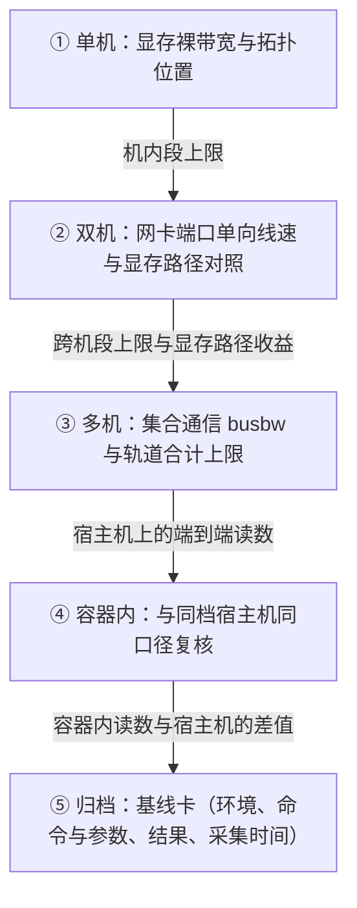

---
tags:
  - AI-Infra
  - perftest
  - 性能基线
  - 体系
  - 交付验收
  - 测量链
created: 2026-10-13
---

# 一次交付验收的完整旅程

一次交付验收要交出的不是一句「这台机器快不快」的判语，而是一条按固定顺序走完的测量链上的读数：机内搬运段、跨机端口段、集合通信整条链、业务实际所在的容器、以及收尾的归档。顺序不是流程习惯，而是归因能力——每一段的读数都是下一段的对照上限：没有机内段的裸带宽读数，跨机读数偏低时分不清是网络还是机内；没有跨机端口这一段的读数，集合通信读数偏低时分不清是网段还是通信库的选路。跳段的代价不落在验收当天，而落在第一次出问题的那天：链上每一段都是嫌疑，定位从读一处字段变成把整条链重测一遍。

下表把这五段排开，它是后面逐段展开的目录。

| 段 | 这一段在做什么 | 到这里要能说清 |
| --- | --- | --- |
| 1 单机 | 读机内搬运能力与设备位置关系，给出机内段的上限 | 显存到显存、主机到显存、显存到主机三个方向的裸带宽各是多少；GPU、网卡与内存域的归属是否符合该机型的设计 |
| 2 双机 | 在两台机器之间量网卡端口这一段，并对照两条内存路径 | 单向带宽与端口线速的关系；显存直接路径相对主机内存路径的收益是多少 |
| 3 多机 | 在整条链上量集合通信，含轨道选择 | `busbw` 与参与通信的链路合计上限的关系；各条轨道上的流量与它承载的 rank 数是否相称 |
| 4 容器内 | 在业务实际所在的容器里按同一口径重跑 | 容器内读数与同档宿主机读数的差值落在哪里 |
| 5 归档 | 把前四段的读数连同环境写成基线卡 | 环境、命令与参数、结果、采集时间四要素是否齐备 |

五段依次衔接，每一段把上一段的读数当作自己的对照对象；不通过时链条不向后走——回到该段按失败落点定位并重测这一段，而不是把后面的段先跑完。每一段的读数只在该段所属的环境档内成立，软件模拟的网卡（soft-RoCE）的读数不进入这条链的任何一段。

## 段 1：单机——机内搬运段与位置关系

这一段回答两个问题：这台机器内部的搬运能力是多少，以及设备位置是否与该机型的设计相符。工具是显存裸带宽工具（具体名称以现场可用为准）与拓扑矩阵的读数：前者量显存到显存、主机到显存、显存到主机三个方向的裸带宽，后者给出 GPU、网卡与内存域的归属。

判据分两条。带宽一条：三个方向的读数与该机型该位置应有的水平同量级——显存到显存走 NVLink 还是 PCIe，由两块 GPU 的相对位置决定，读数要与那条通道对得上。位置一条：每块 GPU 与它出线用的网卡在内存域归属上符合该机型的设计——跨了 PCIe 主机桥或归属错配都算不符合。位置不符时，这一段没有通过的余地，后面的段也不用开始。

**前置条件**：这一段是整条链的起点，不依赖任何前面的段；它的产物有两类——机内段的上限读数，以及后面各段测量对象的选择依据（用哪块网卡出线由位置关系确定）。

**失败落点**：不通过时，失败落在位置关系或机内搬运段本身。位置问题是先决的：它没有解决时，跨机与多机的读数都无从归因，因为同一块网卡在不同位置上到同一条链路的搬运代价不同。读数本身的字段读法转向「基线测量与结果判读」。

这一段属于单机档：它的读数只支撑机内结论，不支撑任何跨机判断。

## 段 2：双机——端口线速与显存路径对照

这一段把测量对象移到两台机器之间，回答两个问题：网卡端口到端口这一段的能力是多少，以及显存直接路径（GPUDirect RDMA，简称 GDR）相对主机内存路径的收益是多少。工具是点对点 verbs 级工具（perftest），两端各起一个进程，一次只量一条连接。

第一个问题的判据有两条，要一起看。第一条：单向带宽读数折到与链路速率同一单位之后，与端口协商出的线速（line rate，链路在单方向上的理论最大速率）同量级，并且不超过它——不折到同一单位，两者的比值不成立，折法只有位与字节、二进制与十进制两处换算。第二条：测试期间被测网卡的端口计数器出现增量——计数器是累计量，取测试前后两次读数之差，差值非零才说明这段流量真的经过这张网卡，而不是落在别的路径上。

第二个问题用对照测量回答：同一组参数只切换内存类型——默认走主机内存，加 `--use_cuda=<gpu 序号>` 走显存——两次读数之差才是这条路径的收益。任何别的变量混进这个差里，收益就无法归因；显存路径的读数还额外受 GPU 与网卡相对位置的影响，这个位置关系在上一段已经定下来。逐条测量步骤不是本篇负责的内容。

**前置条件**：用哪块网卡出线、GPU 与网卡的相对位置已经确定；两端的网卡型号、固件与驱动四元组一致——两端不一致时，读数是两套配置共同作用的结果，差值里混着与路径无关的东西。

**失败落点**：不通过时，失败落在网络段（端口、线缆、协商速率、MTU 的生效值）或内存访问段（亲和绑定、GPU 与网卡的位置）。双向读数低于预期时，先把两个方向分开测，找出弱的那一侧，再谈处置。把单连接峰值当承诺带宽、把双向读数的一半当单向能力这类现象，按「高频误判」核对；单位与方向的折算按「结果的两个口径」核对。

这一段属于双机档：点对点工具与显存路径的对照测量都在这一档完成。

## 段 3：多机——集合通信与轨道

这一段把测量对象放大到多机：集合通信在整条链上的表现是多少，以及轨道选择有没有把流量摊开。工具是集合通信测试（nccl-tests），跨机用 MPI 拉起多个进程；rank 总数是进程数乘以每进程的 GPU 数。

判据有三条。第一条：总线带宽（bus bandwidth，`busbw`）与「这次通信里每个 rank 实际使用的链路合计上限」对照——单块网卡出线时，上限就是该端口协商出的单向线速，一块 GPU 挂多条链路参与同一次通信时，上限是这几条链路的合计；读数与上限同量级说明这一段接近压满，明显偏低时结合单机与双机两段的上限判断瓶颈落在哪一段。第二条：算法带宽（`algbw`）与 `busbw` 成对记录，rank 数不同的两次读数只比 `busbw`——`algbw` 的上限随 rank 数下降是公式决定的，它的下降本身不是退化。第三条：轨道对称。多机时每块 GPU 从本机的一块网卡出线，同号网卡接在同一条轨道（rail）上；集合通信的耗时由最慢的参与者决定，某一条轨道明显偏慢会把整次操作拖住。判据的读法是各条轨道对应网卡端口的计数器增量：都有增量，且增量与它承载的 rank 数相称；某条轨道流量过高而另一条闲置时，先核对 rank 与网卡的映射，再谈带宽。轨道与多平面（plane）在 fabric 侧的完整取舍不是本篇负责的内容。

**前置条件**：机内段的上限与跨机段的上限都已就位。端到端读数偏低时，把这两个上限拿来对照：落在机内段就与段 1 的读数对照，落在跨机段就与段 2 的读数对照，两个上限都对得上而端到端仍低，嫌疑才转到通信库的选路与算法。

**失败落点**：不通过时，失败落在选路（rank 与网卡、轨道的映射），或前后两段（与两个上限对照的结果）。读数属于哪一段、由哪件工具确认或排除，按「三类测量工具各自的覆盖范围」核对；数字口径与对照方式按「结果的两个口径」核对。

这一段属于多机档：规模与拓扑一变，选路与轨道的作用就进来了，双机档的读数不能外推到多机。

## 段 4：容器内——与宿主机同口径复核

业务实际在容器里运行，因此验收的最终读数必须来自容器内：容器内的读数与宿主机上同口径的读数是否一致，是这一段唯一要回答的问题。工具与参数取宿主机上对应档位那一轮的原样，只在容器里重跑一遍；哪几段要在容器里重跑，取决于业务实际在哪一档运行。

判据是两次读数的差值：落在重复测量的散布之内，说明容器内与宿主机同口径；系统性偏低，说明差值落在容器配置上——设备可见性、内存注册能力、CPU 亲和与内存域归属——而不落在硬件上。容器不构成单独的环境档：它的对照对象永远是同一档宿主机上的读数。容器运行时把设备暴露进去的注入机制不是本篇负责的内容；这一段只确定一件事——容器内的读数与宿主机读数之间的差值，归到容器配置还是归到路径。

**前置条件**：宿主机上对应档位的读数已经就位——没有宿主机的同口径读数，容器内的数字没有对照对象，差值无从谈起。

**失败落点**：不通过时，先逐项核对两轮的变量是否真的对齐——工具与子命令、消息大小、队列深度（一次投递出去尚未完成的请求数）、单双向、亲和绑定——对齐之后差值仍系统性存在，才轮到容器配置本身。变量逐项核对的方法按「基线为什么必须同口径」。

## 段 5：归档——基线卡

这一段不产生新读数，回答的是记录问题：这次验收的读数，在变更之后还能不能作为参照。做法是把前四段的读数连同各自的环境记录写成一张基线卡：环境、命令与参数、结果、采集时间，四项要素齐备。四项各自的颗粒度要求不是本篇负责的内容；这一段的判据只有一条——拿掉任何一项，这次读数在第一次变更之后就作废，因为口径无法还原。

**前置条件**：前四段都已通过各自的判据。任何一段不通过时，先回到那一段定位并重测，归档的是重测通过之后的读数，不是过程稿。

**失败落点**：不通过（记录缺项）时，失败落在记录本身，不落在任何一段路径上；这张卡怎么支撑后续的回归对照，按「基线归档与变更后的回归验证」。

## 五段的判据与失败落点

| 段 | 通过判据（读哪个字段） | 不通过时优先落在哪一段 | 转向哪一篇 |
| --- | --- | --- | --- |
| 1 单机 | 三个方向的裸带宽读数；拓扑矩阵里的位置归属 | 位置关系（先决）；机内搬运段 | 位置先解决；读数异常按「基线测量与结果判读」核对 |
| 2 双机 | 单向带宽读数与端口线速（折到同一单位）；端口计数器差值；两条内存路径的两次读数之差 | 网络段；内存访问段 | 单位与方向的核对按「结果的两个口径」；峰值当承诺一类按「高频误判」 |
| 3 多机 | `busbw` 与链路合计上限；各条轨道端口计数器的增量；`algbw` 与 `busbw` 成对 | 选路与轨道映射；机内段或跨机段 | 读数归属按「三类测量工具各自的覆盖范围」；对照与单位按「结果的两个口径」 |
| 4 容器内 | 容器内与同档宿主机同口径读数之差 | 容器配置（设备可见性、内存注册、亲和） | 变量逐项对齐按「基线为什么必须同口径」 |
| 5 归档 | 基线卡四要素齐备 | 记录缺项 | 写法与回归对照按「基线归档与变更后的回归验证」 |

**第一反应不要做什么**：不要把五段当成可以任选的检查项，从中间任何一段开始；不要在位置关系没有确定时就开始测跨机带宽；不要把单机档的读数用于跨机结论，也不要把双机档的读数外推到多机；不要把软件模拟网卡（soft-RoCE）的读数放进这条链的任何一段；不要在没确认流量真的经过被测网卡之前接受任何带宽读数；不要把容器内的低读数直接归成硬件问题，也不要在基线卡四要素不齐时宣布验收完成。

## 参考文档

- perftest 仓库 README 的 GPUDirect usage 一节：`--use_cuda=<gpu 序号>` 的语义，以及显存路径与主机内存路径的切换方式。
- nccl-tests 仓库 README 的 Usage 与 Performance 两节：MPI 拉起方式与 rank 总数的构成，以及 `busbw` 列的指向。
- nccl-tests 源码 `src/util.cu` 的结果表与页脚：`algbw`、`busbw`、`#wrong` 各列，以及 `Avg bus bandwidth` 一行。
- NVIDIA GPUDirect RDMA 文档：显存直接路径的语义。
- NVIDIA System Management Interface 文档的拓扑一节：`nvidia-smi topo -m` 的取值与列含义。
