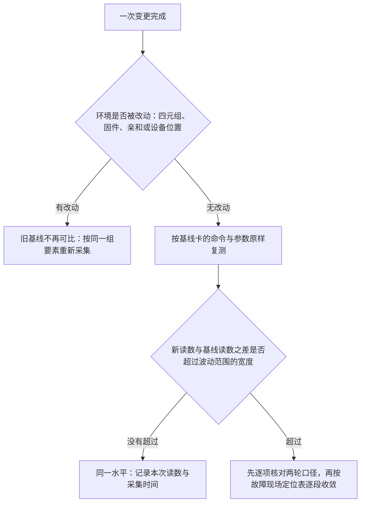

---
tags:
  - AI-Infra
  - perftest
  - 性能基线
  - 治理
  - 基线归档
  - 回归验证
created: 2026-10-14
---

# 基线归档与变更后的回归验证

验收当天，基线的用途只有一个：证明这台机器达到了约定的水平。它真正的考验在之后——任何一次变更、故障或扩容之后，都会有人拿新读数与它相减，问「比当时差了多少」。届时要比较的两个数字里，新的随时可以再测，旧的那个只存在于记录里；记录没有写全环境、命令与参数、结果与采集时间这四项要素时，这个问题就只能靠重测整组条件来回答，而重测出来的值回答的是「现在是多少」，不是「差了多少」。归档的颗粒度、交付文档里必须写进的项、以及变更之后判断一次差值是否正常的判据，因此不是记录格式问题，而是这份参照能不能被下一次比较使用的问题。

## 基线卡的四项要素，逐项到颗粒度

基线卡要装进四项要素——环境、命令与参数、结果、采集时间，四项齐备的记录才具备参照资格。每项写到什么颗粒度，判据只有一条：后来的人拿着这张卡，能不能把这次测量原样重跑，并确认两次属于同一口径。

| 要素 | 写到什么颗粒度 | 缺了它，差值里无法排除什么 |
| --- | --- | --- |
| 环境 | 机型与 GPU 型号；驱动四元组（驱动、CUDA、集合通信库、RDMA 栈）；网卡型号与固件版本；内核版本；是否容器内——五项逐项写到具体值 | 两次测量是不是同一个对象；四元组或固件不同时，差值里混着版本差异 |
| 命令与参数 | 工具与子命令；消息大小（单点取值或整段序列）；队列深度与队列对数；单向还是双向；亲和绑定（处理器与内存的域号）；GPU 序号；带宽读数的单位选项——写到照抄即可重跑 | 两次测量是不是同一组条件；写「按默认」无法执行，默认值随四元组变化 |
| 结果 | 工具的原始输出整段保留，含表头、页脚与警告行；写进结论的每个数字标明它来自哪一行、哪一列 | 数字的行上下文：在哪个消息大小上取得、是峰值还是平均值 |
| 采集时间 | 日期与时刻；同一轮的两端读数、以及测量前后两次计数器读数，属于同一个时间窗 | 两次读数是不是同一次测量；跨时间窗的读数不能相减 |

环境这一项有两个容易写偏的地方。其一，版本一律现场取——用各自的版本查询输出，不凭记忆、不从别处抄；同一个命令在两套四元组下的默认行为可以不同，写错一项，后面所有对照都建在错误的前提上。其二，「是否容器内」不是备注而是环境项：容器不构成单独的环境档，它的读数永远与同档宿主机的读数对照，记录里不写这一项，两次读数就无法确认是不是同一档。

命令与参数这一项的要求是可原样重跑，因此记录里出现「按默认」这类字样就是不合格的：默认值随四元组变化，复测的人无法知道当时生效的是什么。队列深度要写这一轮实际生效的数字，单双向要写成「单向」或「双向」两个词，单位选项要写明带宽读数是按 `MiB/sec` 还是按 `Gb/sec` 报出——这一项决定后面对照时用哪套换算。

结果这一项要单独说明为什么不能只留结论数字。一个带宽值离开了它的行就失去含义：同一个数字可能是某个小消息大小上的读数、也可能是峰值列而不是平均值列；警告行也是结果的一部分——迭代次数过大时工具会打印警告并停用峰值计算，丢掉这行警告，后来的人会把这个空档当成数据缺失，而不是工具行为。

## 交付文档里写进的项与口径

交付文档里的测量部分不是一句「带宽达标」，而是一组可以逐项复核的写法。口径的意思是：这一项写成什么样子，后来的人才能不改一个字地拿它做对照。

| 项 | 口径（写成什么） | 为什么必须是这个口径 |
| --- | --- | --- |
| 基线卡 | 四项要素整卡附上，不做摘要 | 摘要必然丢掉口径，被丢掉的往往是「哪一行、哪个单位、哪一次」 |
| 对照的上限 | 端口协商出的速率与宽度（生效值），不写声明上限 | 降档不产生事件，只在与生效值对照时显形；声明上限对照不出降档 |
| 单位与方向 | 每个带宽数字随列头单位与这一轮的单双向设置一起写 | 单位之间差着位与字节、二进制与十进制两处换算；双向读数是两个方向之和 |
| 路径证据 | 测量期间被测设备端口计数器的两次读数与差值，发起端读发送方向、对端读接收方向 | 没有它，读数归属不到设备，后面所有对照作废 |
| 波动范围 | 交付时同一组条件下重复测量的每次读数、样本数与范围 | 变更后判断「超出正常波动」的分母；没有它，差值只能靠印象判断 |
| 判定 | 这次读数与哪个上限对照、落在什么量级算通过 | 「通过」必须能被后来的人用同一份记录复核 |

这张表是下限而不是上限：与本次交付的路径直接相关的观测项都可以随卡附带，但上表六项里缺任何一项，交付文档里的测量部分就不能作为后续的参照。

## 波动范围：交付时建立，复测时使用

判断「变慢了」需要一个分母：两次读数之间的差值，多小算测量本身的抖动、多大算真实变化。这个分母不能凭经验设一个百分比，它只能来自本机本档位的实测分布。

建立方式：在交付验收的同一组条件下连续重复测量，把每次的读数与样本数记进基线卡，范围取这组读数的最小值与最大值。样本数是范围的一部分——样本少时范围偏窄，把范围当判据之前先看样本数。带宽与延迟各自建立范围：两类读数的抖动来源与量级不同，不能共用一个。

为什么不用固定阈值：一个固定的百分比没有来源——它既不来自这台机器的实测散布，也不区分字段与规模，同一个百分比在小消息段可能过松、在大消息段可能过紧。判据的来源只有一处：同一组条件下重复测量得到的分布。

散布的性质要写清：重复测量之间的散布是测量误差的表现，增加重复次数可以把观察收窄；两次测量之间的系统性偏移（变量不同造成的）不会因为重复而消失，只能靠逐项对齐变量排除。反推判据：把新读数与基线读数之差除以范围宽度（最大值减最小值），得到这次变化相当于测量抖动的几倍——不超过 1 倍时，差值没有超出测量本身的抖动，先按同一水平处理；数倍于 1 时，差值已经不能由测量解释，进入归因顺序。

把波动范围接进告警阈值与看板，属于告警设计，不是本篇负责的内容。

## 变更之后的回归

变更完成之后要回答的不是「变更本身成没成」，而是「这台机器的水平变没变」。回归的顺序固定：先判断这次变更有没有动到环境，再按原样复测，再读增量，最后才谈归因。

复测是只读观测，生产节点上也可以做；测量命令不改变任何配置，但会给链路加负载，安排在不影响业务的窗口。读增量有四条规则，违反任何一条，差值里就混进与变化无关的东西：

| 规则 | 怎么取 | 违反时差值里混进什么 |
| --- | --- | --- |
| 同字段 | 带宽比 `BW average`，延迟比分位值 | 峰值是整轮里最好的一段窗口，散布大于平均值，差值混着窗口选择 |
| 同行 | 取同一个消息大小的那一行 | 不同行的读数由不同机制主导：小消息看延迟、大消息看带宽 |
| 同方向 | 单向对单向、双向对双向 | 双向读数包含另一侧的量，与单向相减得不到任何一侧的变化 |
| 同单位 | 折到同一单位再相减（1 Gb/s 约合 119.2 MiB/sec，反向 1 MiB/sec 约合 8.39 Mb/s） | 位与字节、二进制与十进制两处换算未折进来，差值差出一个数量级 |

集合通信的回归用 `busbw`，并且只在同 rank 数之间比：`algbw` 的上限随 rank 数上升而下降，跨规模相减得到的是公式差异，不是水平变化。

环境被改动时（四元组、固件、亲和或设备位置），旧基线不再可比——这不是「变慢」的问题，而是重新建立基线的问题：按同一组要素重测并归档新基线，旧读数保留但退出参照序列。回滚也是一次变更，同样走这条顺序。

超出范围之后，第一步不是怀疑链路，而是按固定顺序过两关：先逐项核对两轮的口径——环境与命令参数的每一项——排除「条件不同」；再确认读数的归属——被测设备与业务设备是不是同一张、测量期间端口计数器的差值是否非零——排除「测的不是这张卡」。两关都过之后，差值才轮到按故障现场定位表逐段收敛。这个顺序的依据是：差值稳定、可复现，恰恰是「参数或环境不同」这类误判的典型特征，不能把它当作链路行为的证据。

**第一反应不要做什么**：不要在记录里写「按默认」而不写实际生效的取值；不要把结论数字当结果，丢掉原始输出；不要拿声明上限当对照对象写进交付文档；不要在没有实测分布时用固定百分比当「正常波动」；不要在四元组或固件被改动之后拿旧读数相减；不要在两次测量没有逐项对齐之前把差值归因给链路；不要把峰值与基线的平均值相减；不要先设计告警与看板再补基线。正确的顺序是先让四项要素齐备，再用实测分布定范围，最后按「先口径、后归属、再定位」的顺序处理超出范围的差值。

## 参考文档

- perftest 仓库 README 第 3 节 Notes on Testing Methodology（迭代次数与测量精度）与源码中带宽报告函数：峰值与平均值的取法，作为「同字段」比对规则的依据。
- nccl-tests 仓库 README 的 Usage 与 Performance 两节：`busbw` 与 rank 数的关系，作为集合通信同规模比对的依据。
- Linux 内核 `Documentation/ABI/stable/sysfs-class-infiniband`：RDMA 设备端口计数器（累计量）的读取位置与语义，作为路径证据项的取值入口。
- NVIDIA CUDA Compatibility 文档与 NVIDIA Driver Installation Guide：驱动四元组的约束方向与版本记录口径。
- verbs 手册页与 `ibv_devinfo` 手册页：端口速率与宽度字段（生效值）的语义。
- `numactl(8)` 手册页与 NVIDIA System Management Interface 文档的拓扑一节：亲和绑定与拓扑矩阵的亲和列，作为环境项的记录入口。
