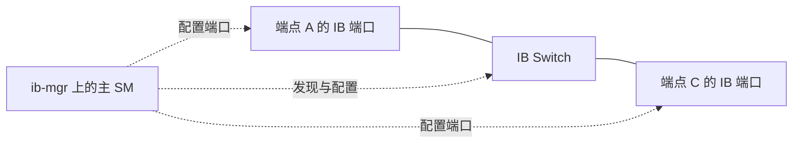

# 先让 InfiniBand 子网成为可通信的网络

## 相同的 RDMA 接口可以落在不同网络上

第 06 章的 QP 是端点收发队列，MR 是已注册并授权的内存区域。应用向 QP 投递请求后，NIC 仍要把报文发到远端端口。**InfiniBand（IB）**提供自己的链路、网络寻址、交换和传输体系；**RoCEv2**把 RDMA 传输承载在以太网/IP/UDP 上。二者都能提供本章使用的 RC 可靠连接服务，但下面的网络准备不同。

| 当前问题 | 原生 InfiniBand | RoCEv2 |
| --- | --- | --- |
| 相邻设备靠什么接通 | IB 端口与 IB 链路 | 以太网端口与链路 |
| 交换/路由主要看什么 | 子网内按目的 LID；跨 IB 子网另有 IB Router 与全局寻址 | 二层按 MAC；三层按目的 IP |
| 谁准备网络转发 | SM 发现并配置子网，安装相应转发表 | 以太网交换、IP 路由及其控制机制 |
| RDMA 端点怎样描述地址 | LID、GID、P_Key、路径属性等 | GID 值/类型、关联 netdev、IP 路径等 |
| 本章如何控制缓冲压力 | 链路信用流控与适用的端到端拥塞控制 | 以太网优先级、PFC 与端点拥塞控制等部署方案 |

这张表描述职责差别，不比较某一代产品的性能。原生 IB 报文不需要先变成 IP 数据报；使用 Verbs 也不能单凭 `mlx5`、`ib` 这样的名字确定链路类型。

## 从物理 LinkUp 到端口 Active，中间还有管理工作

IB 的 **Subnet（子网）**是由 IB 链路和交换机连接、由同一主 SM 管理的网络范围，不等于 Linux 上配置的一段 IPv4 网段。**Subnet Manager，SM**负责发现设备与连接，分配本地标识，计算并配置转发路径，同时组织分区和服务质量策略。SM 可以运行于主机服务，也可以由支持该能力的交换设备承担。每个子网有一个主 SM，其他实例可作为备用；并非给每台交换机单独起一个互不协调的主 SM。

下面是**IB 对照场景的控制与数据关系图**：实线只表示物理 IB 连接，虚线箭头表示管理配置。SM 运行在 `ib-mgr`，管理报文也经 IB 网络传送；图中省略其接入链路。端点 A、C 是两个 IB 端口，不使用第二篇的以太网地址。



管理关系见 [MLNX-OS 3.12.2002：Subnet Manager，正文与 Partitions](https://networking-docs.nvidia.com/mlnxosum/3122002/subnet-manager)；多实例主备分工可对照 [Base Command Manager：Configuring The Cluster，3.6.3 Subnet Managers](https://docs.nvidia.com/base-command-manager/product-manuals/admin/configuring)。这里没有采用某个交换机内置 SM 的规模上限来限制所有 SM 实现。

端口要先完成物理训练，再经过 IB 的逻辑初始化、管理配置，才能成为可用的数据端口。`Physical state: LinkUp` 说明物理链路已经建立；`State: Active` 说明逻辑端口已激活。看见前者而没有后者时，应继续查 SM、逻辑端口与配置阶段。主 SM 后续短时退出也不必立即清空所有已有硬件转发表，因此“SM 服务停止”与“所有现有数据立刻中断”之间没有这样的直接等号。

## 用 LID 找子网内的位置，用 GID 表达全局端点

**GUID**是设备/端口的标识；**LID（Local Identifier）**是子网内用于本地转发的地址。这里取 LMC=0，每个端口一个单播 LID，不展开多 LID 路径。**GID（Global Identifier）**是 128 位标识，原生 IB 中由子网前缀及接口标识等部分构成。其长度和 IPv6 地址相同，不代表原生 IB 报文必经 IPv6 协议栈。

单播报文的 LRH（Local Route Header，本地路由头）携带目的 LID，子网内交换机据此选择出口。跨 IB 子网需要适用的 GRH（Global Route Header，全局路由头）、GID 与 IB Router，不能把一台普通 IP 路由器插进 IB 线缆来替代。应用还需要 QP、传输属性与权限匹配，网络地址只解决其中的一部分。地址与管理基础见 [RFC 4392：1.2 Overview、1.2.1 InfiniBand Addresses 与 2 Management of InfiniBand Subnet](https://www.rfc-editor.org/rfc/rfc4392.html#section-1.2)。

端点建链前可以向 **SA（Subnet Administration，子网管理服务，通常随 SM 提供）**查询 Path Record（路径记录），取得目的 LID、服务等级和路径 MTU 等参数，再用于准备 QP。路径查询与硬件转发表的配置属于控制工作；负载报文经交换机转发，不必先送到 SM 服务进程。Path Record 与策略的关系见 [DOCA 3.5.0：InfiniBand QoS，QoS Architecture](https://networking-docs.nvidia.com/doca/archive/3-5-0/infiniband-qos)。

以下为**自拟的 `ibstat` 关键字段摘编**，未保留其他设备和能力字段；后面的转发表是人工教学表，非命令原文。

```text
[端点 A，ibstat mlx5_0]
Port 1:
    State: Active
    Physical state: LinkUp
    Base lid: 17
    SM lid: 1
    Port GUID: 0x0200000000000011
    Link layer: InfiniBand

[端点 C，同类查询]
Port 1:
    State: Active
    Physical state: LinkUp
    Base lid: 33
    SM lid: 1
    Port GUID: 0x0200000000000021
    Link layer: InfiniBand

[已知布线与人工整理的转发表]
Switch p1 —— A；Switch p2 —— C
目的 LID 17 → Switch p1
目的 LID 33 → Switch p2
```

A 发给 C 时，目的 LID 是 33，交换机走 p2；返回 A 时目的 LID 是 17，走 p1。`SM lid: 1` 指管理者所在的 LID，不能作为数据接收者 C 的地址。SM 重配置后 LID 可以变化，因此长期资产关联应保留 GUID 与端口位置，再核对当前 LID。

独立的异常快照若只有 `State: Initializing`、`Physical state: LinkUp`、`Base lid: 0`，可确定物理链路已训练但逻辑端口尚未准备完成。它支持把管理初始化作为下一层调查对象，却不能单凭三行断言“根因一定是没启动 SM”：不匹配的管理配置、异常的 SM 状态等也要区分。

## P_Key 决定哪些成员允许通信

**Partition（分区）**是 IB Fabric 上允许通信的一组端口，可以跨多台交换机，端口也可以属于多个分区。**P_Key（Partition Key）**是 16 位值：低 15 位标识分区，最高位表示成员类型，1 为 Full、0 为 Limited。同分区通信还要求至少一端为 Full；两个 Limited 成员不能直接通信。它不是传输加密，也不对应一条独占链路。

假设教学分区的低 15 位为 `0x1234`，其他路径和访问条件均满足：

| A 的成员值 | C 的成员值 | 判断及原因 |
| --- | --- | --- |
| `0x9234`（Full） | `0x1234`（Limited） | 允许双向通信，分区相同且至少一端 Full |
| `0x1234`（Limited） | `0x1234`（Limited） | 不允许，两个 Limited 不满足成员匹配规则 |
| `0x9234`（Full） | `0x9235`（Full） | 不允许通过这两个成员项通信，分区号不同 |

成员规则见 [NVIDIA Infra Controller：Configuring InfiniBand Partitions，Membership: Full vs Limited](https://docs.nvidia.com/infra-controller/documentation/configuration-day-1/infini-band/infini-band-partitioning)。更底层的字段定义见 [NVIDIA InfiniBand Security Overview and Guidelines，WP-11995-001，第 16 页](https://docs.nvidia.com/networking/display/nvidia-infiniband-security-overview-and-guidelines.pdf#page=16)。这里采用文档中的位定义自行计算例值，没有复用材料中的示例设备。

端点 QP 使用的是本地 P_Key 表中的索引；A 的索引 2 与 C 的索引 2 不保证包含同一分区值。检查应比较索引所指的值及成员规则。该思路与下一篇的 GID 表相似：本地表位置不能替代条目含义。

## 原生 IB RDMA 与 IPoIB 走的不是同一套上层语义

**IPoIB（IP over InfiniBand）**让 Linux 提供 `ib0` 这样的 IP 网络接口，把 IP 报文承载在 IB 之上。因而普通 `ping`、TCP Socket 可以使用 IB 物理网络。原生 IB RDMA 则由应用或通信库使用 RDMA 端点、注册内存和相应传输；不用先经过 `ib0` 的 TCP 数据流。IPoIB 的网络接口职责见 [MLNX_OFED 24.10-1.1.4.0：IP over InfiniBand，Upper Layer Protocol](https://networking-docs.nvidia.com/mlnxofedswum/24101140lts/ip-over-infiniband-ipoib)。

如果一份记录写“`ping ib0` 可达，但某 RC QP 的 P_Key 选择错误”，两者可以同时成立：IP 接口的流量与该 QP 不必使用同一分区条目。反过来，IPoIB 没配置业务 IP，也不表示原生 IB RDMA 必定不可用。作业的会合服务可以走单独的管理 IP 网络，负载数据再走原生 IB。

IB 的数据虚拟通道通过接收缓冲信用控制发送：只有下一跳为相应虚拟通道提供了可用信用，发送方才继续发。这里的虚拟通道 VL 是共享一条物理链路的逻辑流控通道；SL 是报文的服务等级，网络策略把 SL 映射到各跳 VL。信用流控见 [DOCA 3.5.0：RDMA-aware Networks Programming Guide，Comparison of RDMA Technologies](https://networking-docs.nvidia.com/doca/archive/3-5-0/rdma-aware-networks-programming-guide)，SL→VL 的逐跳映射见上述 InfiniBand QoS 页。管理用的 VL15 不属于这里讨论的普通数据信用通道。

这种背压使缓冲压力可以向上游传播，**没有因拥塞丢包也可能有等待和拥塞扩散**。它不能修复光链路误码，也不保证多个发送者同时进入一个出口时没有排队。

下一篇把网络替换为 Ethernet/IP，先从一张 GID 表找到对应接口和路由，再解释优先级如何把报文送入不同队列。

[返回导读](00_导读.md) · [下一篇：沿 RoCEv2 地址走过一条路由路径](02_沿RoCEv2地址走过一条路由路径.md)
