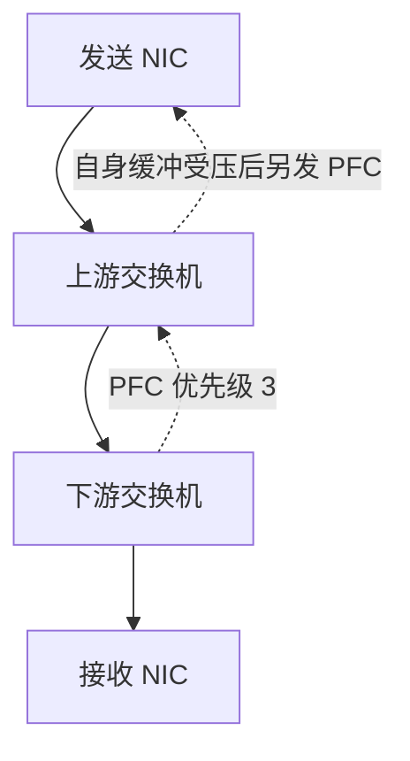
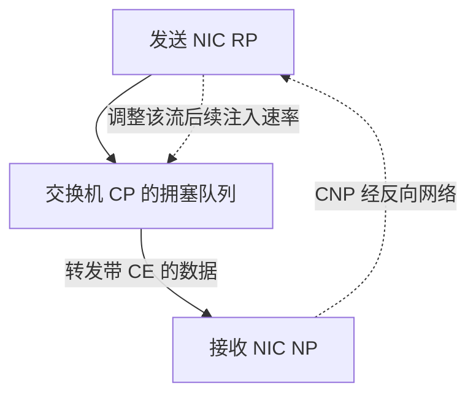

# 从排队推导 PFC 与 ECN 的配合

## 链路都没有降速，为什么报文仍在等

设 Rail 0 上两个发送者同时向一个 400 Gb/s 出口发送。为集中讨论排队，以下**自拟流体模型**把所有速率折算到同一种队列字节口径，忽略包粒度、调度开销及起始延迟；每个发送者提供 300 Gb/s，出口服务率是 400 Gb/s。计算窗口内给定缓冲足够、没有丢弃或其他暂停，反馈生效前输入速率不变；此后再分别讨论真实的流控与反馈。

```text
输入合计 = 300 + 300 = 600 Gb/s
队列净增长率 = 600 - 400 = 200 Gb/s = 25 GB/s
连续 20 μs 的积压 = 25×10^9 B/s × 20×10^-6 s = 500,000 B = 0.5 MB
```

即使每根线缆都以额定速率工作，两个输入也会在出口相遇。多个发送者集中发往一个接收者的现象称为 **Incast**；All-to-All 等模式也可能在某个时间片产生这样的汇聚。平均一秒的输入没有超额，不能排除几十微秒内已经把缓冲填满。缓冲只能吸收一段突发，不能消化无限持续的 `输入 > 输出`。

这时存在三个不同动作：丢弃无法接住的报文；暂时阻止上游继续送入；让真正的发送者持续降低注入速率。PFC 主要承担第二个动作，ECN/CNP 与发送端算法一起承担第三个动作。

## PFC 的暂停只在邻接链路生效

**PFC（Priority-based Flow Control，基于优先级的流控）** 允许接收方通过链路控制帧，要求邻居暂停某个优先级的发送。它的作用单位是这条链路上的优先级，不是单个 QP、一个 Rank 或某个作业。IEEE 对该机制的目标与范围说明见 [802.1Qbb 项目页](https://1.ieee802.org/dcb/802-1qbb/)。

沿 `发送 NIC → 上游交换机 → 下游交换机 → 接收 NIC` 看，某设备的入口缓冲压力达到触发条件时，可以向上游邻居发送 PFC。邻居收到后暂停对应优先级，其他未被暂停的优先级仍可发送，前提是调度和共享资源也允许。暂停按时长执行，并可刷新或提前解除；设备通常用 Xoff/Xon 条件形成滞回，避免在单个阈值附近频繁切换。

下面是**局部物理路径与暂停方向图**。实线箭头表示本次数据方向；虚线箭头是本链路上反向发送的 PFC 控制帧。`上游交换机`内部聚合多个输入，故省略发送 NIC 的其他同行。



下游给上游的 PFC 不会作为普通数据报文穿过上游、直接抵达源 NIC。只有上游自己的缓冲也受压并产生新一跳暂停时，影响才继续向源头扩散。上游若把发往多个目的端的流量放在同一被暂停优先级中，一条慢路径就可能阻塞同类的其他流，形成队头阻塞和拥塞扩散。循环等待还可能构成 PFC 死锁；具体是否存在，要看路径与缓冲依赖，不能仅凭“拓扑无环”排除。

**Headroom（缓冲余量）** 用于接住触发暂停后仍在路上的数据。单独考虑一条 400 Gb/s 入口链路，给定从触发到对端停止且在途数据全部到达的等效时间为 4 μs，则在途量为：

```text
400×10^9 bit/s ÷ 8 × 4×10^-6 s = 200,000 B
```

实际还要容纳最大帧、硬件反应与分配粒度等余量。这个式子使用该入口仍会送来的**总速率**，不能换成前节队列的 200 Gb/s 净增长率。真实 Headroom 和 Xoff/Xon 由 ASIC 缓冲结构、线速、线长及配置共同决定；入口优先级组的阈值与出口 ECN 阈值也未必对同一块缓冲计数，不能把两个数直接比较后宣称配置正确。缓冲及反应延迟依赖可查 [Cumulus Linux 5.14：QoS，Flow Control Buffers 与 Priority Flow Control](https://docs.nvidia.com/networking-ethernet-software/cumulus-linux-514/Layer-1-and-Switch-Ports/Quality-of-Service/)。

## ECN 标记要经过接收端反馈才能改变发送速率

**ECN（Explicit Congestion Notification，显式拥塞通知）** 让网络在报文上标记“已经遇到拥塞”，而不必先丢掉这份报文。前篇的 ECT 表示报文允许被标记；交换机按队列占用与策略把低两位改成 CE（Congestion Experienced）。DSCP 分类值不因此变化。

在本章采用的 **DCQCN（Data Center Quantized Congestion Notification）** 闭环中，有三个角色：交换机是 CP（拥塞点），接收 NIC 是 NP（通知点），发送 NIC 是 RP（反应点）。接收 NIC 看到带 CE 的 RoCEv2 报文后，按通知策略产生 **CNP（Congestion Notification Packet，拥塞通知包）** 给发送端；发送端对相应流降速，再按算法逐步恢复。CNP 生成可能受节流，因此不能要求“标记多少包就必须有多少 CNP”。机制依据见 [DOCA 3.5.0：DCQCN CC Algorithm，CP、NP、RP 三节](https://networking-docs.nvidia.com/doca/archive/3-5-0/dcqcn-cc-algorithm)。

下面是**反馈过程图**，不是物理布线图。实线是数据报文推进；虚线是反馈及其逻辑作用，CNP 实际会经过反向网络，图中省略。



交换机标记后，数据要继续到接收端，CNP 要返回源 NIC，降速还要影响后续注入。若这个闭环延迟为 8 μs，且在此期间队列继续按前例 25 GB/s 增长，就会再积压 `200,000 B`。因此 ECN 需要为反馈生效留出时间。只看到“启用了 ECN”而没有标记、CNP、发送端响应的证据，不能说明闭环工作完毕。

PFC 则能在临近缓冲压力时局部挡住流量。二者可以配合：端到端降速处理持续过量注入，逐跳暂停吸收尚未来得及控制的突发。持续的大量暂停意味着某处仍频繁施加背压；不应把它当成吞吐健康的目标。反过来，出现 ECN 标记、CNP 增量而没有 PFC，也可以表示拥塞反馈已经在暂停前发挥作用。

这里没有给出一个“ECN 必须小于多少、PFC 必须大于多少”的通用配方。Cumulus Linux 5.14 就分别提供带 PFC 的 lossless 模式和不启用 PFC 的 lossy 模式，见 [RoCE：Default RoCE Configuration、RoCE lossless 与 RoCE lossy](https://docs.nvidia.com/networking-ethernet-software/cumulus-linux-514/Layer-1-and-Switch-Ports/Quality-of-Service/RDMA-over-Converged-Ethernet-RoCE/)。这说明“所有 RoCE 都必须开 PFC”过度泛化；也不能反过来认为任意 NIC、算法和网络都可直接关闭 PFC。无 PFC 的设计需要与丢包恢复、拥塞算法、业务负载和支持组合一并验证。

## 从方向和时间窗读计数器

暂停计数中的 Rx/Tx 相对于**被查询的端口**：发送 NIC 收到暂停，意味着它被邻居要求暂缓发送；NIC 发出暂停，意味着它要求邻居暂缓给它送入该优先级的数据。方向读反，会把下游压力归到另一端。

以下为**自拟的 1 秒双快照差值**，数据取自 `net-a/N0`。名字按 mlx5 `ethtool -S ens6f0np0` 的计数方式组织；本例所有计数器没有清零、回绕或端口替换。时间单位按所引驱动文档为 μs。

```text
                          t0          t1          增量
rx_prio3_pause             100         140         40 帧
rx_prio3_pause_duration    500000      700000      200000 μs
tx_prio3_pause             20          20          0 帧
```

在这 1 秒里，N0 因接收优先级 3 暂停而停止该优先级发送的累计时长为 0.2 秒，占窗口 20%。40 帧不是 40 个数据包，也不代表 40 个 QP。它确定了 A 端受到了网络方向的背压，尚不能定位究竟是接收端、某台交换机，还是错误的队列映射导致压力。字段语义见 [Linux mlx5：Ethtool counters，Priority Port Counters](https://docs.kernel.org/networking/device_drivers/ethernet/mellanox/mlx5/counters.html#priority-port-counters)。

继续把同一窗口的交换机出口占用、ECN 标记、接收 NIC 的 CNP 发送、源 NIC 的 CNP 处理与吞吐关联，才可以区分反馈停在哪一段。CNP 发送和接收量不要求逐包相等：观测范围、节流、丢包和其他发送者都会改变计数关系。本章第六篇会给出包含映射错误与出口容量的材料，练习把这条证据链走完整。

[上一篇：沿 RoCEv2 地址走过一条路由路径](02_沿RoCEv2地址走过一条路由路径.md) · [下一篇：把拓扑和布线换算成通信预算](04_把拓扑和布线换算成通信预算.md)
