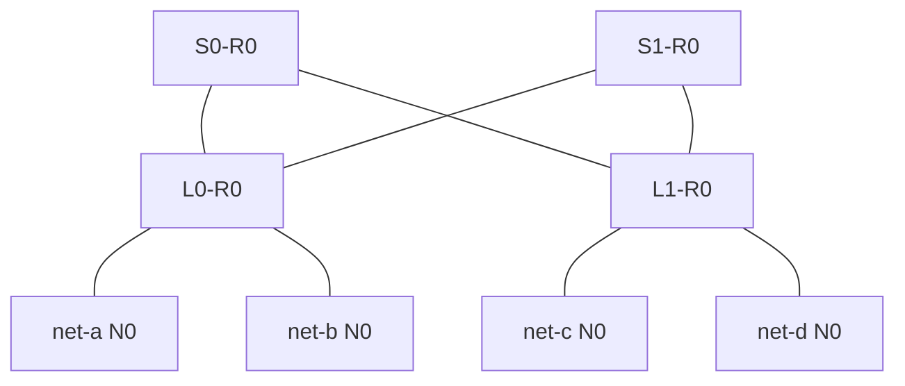

# 把拓扑和布线换算成通信预算

## 从一台交换机扩展到 Spine-Leaf

端点少时，所有 NIC 可以接到同一台交换机。继续增加端点后，端口数量与交换容量会推动网络扩为多级。**Leaf**接端点，**Spine**连接多个 Leaf；两层 Spine-Leaf 让不同 Leaf 的端点经某台 Spine 互通，不要求 Leaf 之间直接相连。

**Clos**是用多个交换单元组织多级互联的一类结构；数据中心常把相应结构折叠成 Leaf/Spine 或更高层级。**Fat-tree**强调越靠近汇聚方向，聚合容量要能够承担下方流量。现场这些名称存在重叠，名字本身不提供容量证明。判断“非阻塞”需要给出端口数、每方向容量、流量矩阵和可用路径；两层画法也可以被做成超售网络。

下面是主模型 **Rail 0 的物理连接图**，线为可双向传输的独立 400 Gb/s 链路，不画实际流量箭头；S0/S1 是两台不同 Spine。Rail 1 有同样结构，设备名后缀为 R1，没有两 Rail 之间的连线。



同 Leaf 的 A→B 走 `A—L0—B`，不占 Spine 上联；跨 Leaf 的 A→C 可以走 `A—L0—S0—L1—C`，也可以用 S1。这里跨 Leaf 经过三台交换设备、四条物理链路。讨论“几跳”时需先说明是在数交换设备还是数链路，不能用混杂口径比较延迟。

更大规模可以增加级数与中间交换组，代价是更多端口、线缆、路径和故障组合。具体架构实例见 [DGX SuperPOD GB200 Reference Architecture：Network Fabrics，Compute Fabric 与 Scale-out 图](https://docs.nvidia.com/dgx-superpod/reference-architecture-scalable-infrastructure-gb200/latest/network-fabrics.html)。本章两 Leaf 模型用于复算，并未复刻该平台的交换数量。

## 把本地设备接到交换端口账本上

以下是**自拟完整主机接线表**。各主机的 G0—N0、G1—N1 和 BDF/NUMA 对应关系见导读。端口 `p1` 等是本章通用代号，不代表某厂商 CLI 语法。

| 主机 / GPU—NIC | RDMA 端口 | Leaf / 端口 | 线缆编号 | IPv4 地址 |
| --- | --- | --- | --- | --- |
| net-a / G0—N0 | `mlx5_0/1` | L0-R0 / p1 | C-a0 | `192.0.2.11/24` |
| net-b / G0—N0 | `mlx5_0/1` | L0-R0 / p2 | C-b0 | `192.0.2.12/24` |
| net-c / G0—N0 | `mlx5_0/1` | L1-R0 / p1 | C-c0 | `198.51.100.11/24` |
| net-d / G0—N0 | `mlx5_0/1` | L1-R0 / p2 | C-d0 | `198.51.100.12/24` |
| net-a / G1—N1 | `mlx5_1/1` | L0-R1 / p1 | C-a1 | `203.0.113.11/25` |
| net-b / G1—N1 | `mlx5_1/1` | L0-R1 / p2 | C-b1 | `203.0.113.12/25` |
| net-c / G1—N1 | `mlx5_1/1` | L1-R1 / p1 | C-c1 | `203.0.113.139/25` |
| net-d / G1—N1 | `mlx5_1/1` | L1-R1 / p2 | C-d1 | `203.0.113.140/25` |

Rail 1 的两个 `/25` 分别是 `203.0.113.0/25` 与 `203.0.113.128/25`；没有与 Rail 0 互路由。Leaf 的跨交换链路已采用可用的独立三层地址，省略其具体地址和协议配置，但保留全部连接关系：

| Rail r（r 分别为 0、1） | Leaf 端口 | 对端端口 | 线缆编号 | 每方向速率 |
| --- | --- | --- | --- | --- |
| r | L0-Rr / p49 | S0-Rr / p1 | U-0r-0 | 400 Gb/s |
| r | L0-Rr / p50 | S1-Rr / p1 | U-0r-1 | 400 Gb/s |
| r | L1-Rr / p49 | S0-Rr / p2 | U-1r-0 | 400 Gb/s |
| r | L1-Rr / p50 | S1-Rr / p2 | U-1r-1 | 400 Gb/s |

这四行对两个 r 展开，共八条上联，加上八条主机链路，共十六条链路。单个 Rail 有四条主机链路、四条 Leaf—Spine 链路。`r` 是代入规则，不是现场设备名中的字母。

例如 net-a 的 G0 向 net-c 的 G0，经 S0-R0 的路径能完整写为：

```text
net-a G0 → 本地 PCIe → N0(mlx5_0/1, ens6f0np0, 0000:43:00.0)
→ C-a0 → L0-R0/p1 → L0-R0/p49 → U-00-0 → S0-R0/p1
→ S0-R0/p2 → U-10-0 → L1-R0/p49 → L1-R0/p1 → C-c0
→ net-c N0 → 本地 PCIe → net-c G0
```

线缆没有方向性，因而同一根 `U-10-0` 在表中从 Leaf 指向 Spine，在该数据流中却从 Spine 走向 Leaf。GPU 编号、RDMA 设备号、前面板槽位和交换端口是不同层次的标识，需要这种账本连接起来，不能都凭数字 0 或 1 对齐。

## 收敛比与全双工必须固定方向

本章把某个 Leaf 的**收敛比/超售比**定义为“面向端点的总带宽 : 面向上层的总带宽”，两边都取同一个方向的容量。有的资料用倒数，引用时应重写定义。

```text
单个 Leaf 的下联容量 = 2×400 = 800 Gb/s
单个 Leaf 的上联容量 = 2×400 = 800 Gb/s
本章收敛比 = 800:800 = 1:1
```

若只保留一个上联，则为 `800:400=2:1`，所有本地下联同时向外满速发送时，汇聚容量不足。A→B 等留在本 Leaf 内的流量不经过这个割面，不能全部计入外发需求。

**全双工**意味着一条 400 Gb/s 链路可同时提供 A→B 方向 400 Gb/s 和 B→A 方向 400 Gb/s。把两方向相加可写成双向聚合 800 Gb/s，但一个单向报文流仍只有该方向 400 Gb/s。两方向也无需互相平分成每方向 200 Gb/s。

协议、编码口径、包长、确认和端点实现会影响有效负载。后面的**自拟吞吐模型**统一给定每条 400 Gb/s 链路可承担 45 GB/s 同方向有效负载，所需反向协议流量已留出预算；不再另外扣一遍开销。交换结构无内部超售，端点与本地 GPU 路径没有更小上限。

## 用割面和目的端口检查流量矩阵

**割面**是把一组端点与另一组端点分开后，流量必须经过的连接集合。对 `{A,B}` 到 `{C,D}`，Rail 0 中每台 Spine 形成一条 45 GB/s 可用分支，合计外发上界为 90 GB/s。流量先穿 L0 上联，再穿 L1 下行，两段串联，不能把它们相加成 180 GB/s。

| 同一时刻的单向需求 | 需求合计 | 可确定的结论 |
| --- | --- | --- |
| A→C 45，B→D 45 GB/s，已分到两条 Spine 分支 | 90 GB/s | 两上联、两目的端口各自不超预算，模型允许承载 |
| A→C 45，B→C 45 GB/s | 90 GB/s | C/N0 的接入链路只有 45 GB/s，持续需求超出 45 GB/s |
| A→C 30，B→D 30 GB/s，但 L0 只剩一个上联 | 60 GB/s | 割面只有 45 GB/s，持续超出 15 GB/s |

第一行是容量条件充分时的肯定判断，不声称真实应用一定跑出 90 GB/s。第二行即使 Leaf 收敛比为 1:1 仍会拥塞：本来就不存在“同一接收端口同时接住两个满速端口”的容量。只有另给公平调度假设，才能继续推导两个发送者各得 22.5 GB/s；拓扑本身不规定公平性。

若在第一行同时加入 C→A 45、D→B 45 GB/s，给定反向资源与端点也满足，反向也可以达到总计 90 GB/s，双向聚合 180 GB/s。不能用这个聚合数字去估算单向搬运时间。两 Rail 分别承载独立的两组 GPU 流量时，可再累加两 Rail 的容量；前提是负载确实使用了它们。

## ECMP 提供可选路径，流量仍可能碰到同一条路

在本模型的 IP Fabric，**ECMP（Equal-Cost Multi-Path，等价多路径）**让目的路由拥有经 S0/S1 的等价下一跳。本例明确采用按流散列，在一个稳定路由时间段内，同一条流固定到同一分支；不假设逐包喷洒。实际设备的散列输入和算法需要读取配置，RoCEv2 UDP 源端口可提供散列信息。

因此，A→C 与 B→D 若都散列到 S0，就共用 L0→S0 的 45 GB/s，即使 S1 仍空闲，总需求 90 GB/s 也不能自动得到满足。需要实际的分布记录，而不是只统计“有两根上联”。增加通信流有助于获得更多散列机会，但不能证明均匀，更不能证明一个 QP 同时获得所有路径的带宽。ECMP 的稳定流映射原则可对照 [RFC 2992：Analysis of an Equal-Cost Multi-Path Algorithm，1、2 节](https://www.rfc-editor.org/rfc/rfc2992.html#section-1)。

某些 RDMA 网络支持更细粒度的自适应路由与乱序恢复，要同时核对交换与端点能力；这不属于本例的普通流散列。IB 网络则由 SM 配置的 IB 路径及适用的自适应机制转发，不应将“IP ECMP”这个实现名直接套给所有 IB 路由。

## 多 Rail 是端点与网络共同形成的路径组织

**Rail**在这里表示一组对应 NIC 端口及其所接的网络路径。主模型把所有节点的 N0 连到 Rail 0，把所有 N1 连到 Rail 1；同位置的 GPU—NIC 组合能够通过相应 Rail 互通。这样的对应关系有利于通信软件组织同类数据路径，也便于把错误收敛到具体网络。

**Rail-optimized**设计会有意让相应位置的 NIC 在低层交换范围内互通，减少某类通信的上层绕行。但实际设计可能允许跨 Rail 路由，也可能像本模型一样完全分离，甚至一台 Leaf 汇聚多个 Rail；名称不能替代连接图。官方对照可看 [DGX SuperPOD H200：Network Fabrics，Compute Fabric](https://docs.nvidia.com/dgx-superpod/reference-architecture/scalable-infrastructure-h200/latest/network-fabrics.html)。

主模型中 G0 的跨机数据走 N0，G1 的跨机数据走 N1。若应用需要 G0 与另一节点 G1 交换，必须另行组织可达路径，例如先在节点内转交数据再使用对应 Rail，并重新计入本地搬运成本；图上并没有一条 R0→R1 的交换机连接。通信库怎样分组、转交和选 NIC 留到第 08 章。

两个 Rail 同时提供服务，不等于一条现有 RC QP 在断线后会自动迁移到另一 Rail。某些软件可以重建连接、重试或重新组织通信，需要其明确支持。Rail 0 全失效时，剩余名义网络容量只剩一半；作业能否继续还取决于恢复机制，不能直接保证“吞吐减半但作业无感”。

故障域也要沿实物连接定义：一根上联损坏影响部分路径；一台 Leaf 故障影响其所有相连主机端口；一个 Rail 故障影响该 Rail；节点电源故障同时带走该节点的两个 Rail 端点。分 Rail 分散了部分网络故障，仍共享节点等上层依赖。下一篇进一步区分 NVLink 域和这种跨节点 Fabric，避免把“同一个机架”当成同一种通信能力。

[上一篇：从排队推导 PFC 与 ECN 的配合](03_从排队推导PFC与ECN的配合.md) · [下一篇：区分 NVLink 域内与跨域的扩展](05_区分NVLink域内与跨域的扩展.md)
