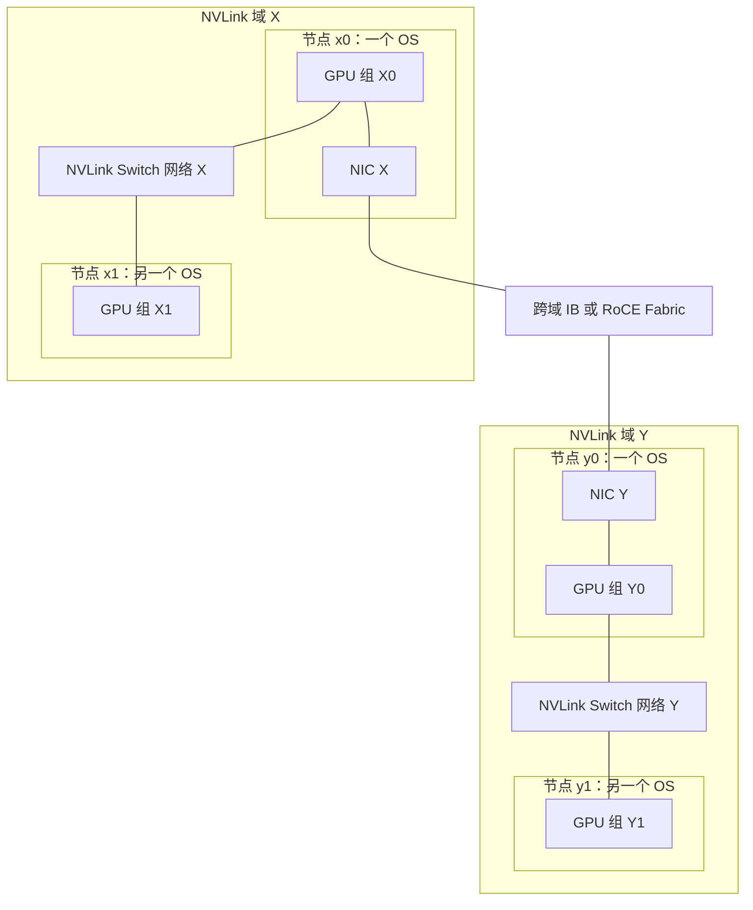

# 区分 NVLink 域内与跨域的扩展

## Scale-up 的边界可以大于一台主机

在前面的普通服务器模型里，GPU 通过本地 PCIe/NVLink 交换数据，跨主机再交给 NIC。**Scale-up**强调在紧密互联的计算域内扩展 GPU 间的访问与通信能力；**Scale-out**通过网络连接多个节点或这样的计算域。它们是架构分工，不能机械地翻译为“单机”和“多机”。

第 04 章的 HGX H100 示例属于服务器内 NVSwitch 互联；它没有因为旁边再放一台服务器，就获得跨服务器 NVLink。本篇另用 **DGX GB200 NVL72** 对照：该平台通过 NVLink Switch 互联多个 Compute Tray，组成包含 72 张 GPU 的机架级 NVLink 域。所引硬件说明列出 18 个 Compute Tray、每 Tray 4 张 GPU，以及 9 个 NVLink Switch Tray，见 [DGX GB Rack Scale Systems User Guide：Hardware，Rack Configuration 与 Compute Trays](https://docs.nvidia.com/dgx/dgxgb200-user-guide/hardware.html)。`18×4=72` 是该平台的数量关系，不是所有机架的固定规格。

这里的 Compute Tray 运行各自的 OS，NVLink 数据连接可以跨过 OS/节点边界。因此“跨节点”本身已不足以判断一定走 NIC。仍要看两 GPU 是否位于同一个受支持、已经配置好的 NVLink 域或分区，以及所用软件是否支持相应访问。

## 同域和跨域对应两种物理路径

下面是**平台职责示意图**，没有复刻 NVL72 的全量托盘、GPU 和端口。每个 GPU 节点代表一个节点上的 GPU 子集；NVLink Switch 框聚合该域内的交换网络。实线表示物理数据连接，范围框表示 NVLink 域及 OS 节点。两个域间的 IB/RoCE Fabric 是独立网络，NIC 连接本地 GPU 的适用路径在图中简化为一条线。



若 X0 与 X1 在同一可访问的 NVLink 域内，数据可以走 `X0→NVLink Switch 网络 X→X1`，不必经过 NX。X0 与 Y0 则在不同域中，本图给出的路径为 `X0→NIC X→IB/RoCE→NIC Y→Y0`。若 X1 要经 X0 的 NIC 跨域，节点内/域内转交还要有受支持的软件安排并计入成本；图没有把任意远端 GPU 自动挂到 NIC 上。

这种域内 NVLink、域间网络的混合分工见 [DGX GB Rack Scale Systems User Guide：Networking，开篇与 NVLink Networking](https://docs.nvidia.com/dgx/dgxgb200-user-guide/networking.html)。其他产品可能定义不同大小和布线的域，不能由“同机架”“同型号”或“多机 NVLink”四个字推断任意两设备直达。把两机架的普通 IB 接通，也不会把它们自动合成一个 NVLink 域。

## Fabric 就绪、内存映射和应用使用是三件事

物理 NVLink 已接好以后，平台仍要发现拓扑、配置转发表和分区、使 GPU 驱动看到可用的互联。跨 OS 使用远端 GPU 存储，还需要建立受控的内存导出/导入。它们分别解决不同的问题：

| 层次 | 本篇采用的组件或机制 | 完成的工作 |
| --- | --- | --- |
| 物理连接 | NVLink 与 NVLink Switch | 提供同域的数据通路 |
| Fabric 配置 | 该平台的 Fabric Manager、NVLSM 等 | 发现、配置路由/分区并维护相应互联状态 |
| 跨 OS 的内存共享管理 | GPU 驱动、内存导出/导入接口与 IMEX | 管理受支持内存共享的授权、映射和生命周期 |
| 实际发起通信 | CUDA 应用、NCCL/NVSHMEM 等受支持软件 | 请求访问或传输，组织数据与同步 |

**NVLSM（NVLink Subnet Manager）**借鉴 IB 管理机制，管理这里的 NVLink Fabric；看到其 LID、P_Key 等名称，不表示 NVLink 数据变成了经以太网转发的 RoCE 报文。Fabric Manager 与 NVLSM 在该平台的职责见 [DGX GB Rack Scale Systems User Guide：Software，Fabric Manager 与 NVLink Subnet Manager](https://docs.nvidia.com/dgx/dgxgb200-user-guide/software.html)。不要照搬旧平台上一个守护进程的安装位置和参数去描述所有新平台。

**IMEX（Internode Memory Exchange/Management）**协助在多节点 NVLink 环境中管理 GPU 内存的导出/导入。它不是搬运有效负载的网络代理：其服务间协调使用 IP 网络，并不意味着 GPU 数据也经过该服务的 TCP 连接。本篇据同一 Software 页的 **Internode Memory Exchange Service** 区分这两条路径。

IMEX 的管理范围还可以按域、分区或作业组织，并非名字里有 Domain 就必然覆盖整机架。所引 [IMEX：Deployment Models，Constraints 与三个部署范围](https://docs.nvidia.com/multi-node-nvlink-systems/imex-guide/deployment.html)要求先完成相应服务初始化；节点列表、连接与一致性影响共享的准备阶段。本文不把核对日的部署方式推广为未来所有版本的唯一实现。

## Channel 约束共享权限，不提供额外物理带宽

IMEX Channel 是 GPU 驱动用于多用户内存隔离的逻辑资源，在系统中表现为相应设备节点。同一受支持共享操作的导出者和导入者，需要正确的 Channel 关联与访问权限。Channel 不是一条新的 NVLink 电缆，也不是申请后就获得独占带宽的队列。

以下是**自拟、人工整理的就绪材料**，不用某个版本的原始日志语法。假设两节点物理同域、处于相容分区，其他版本和内存类型条件已满足：

```text
x0/x1：NVLink Fabric 配置完成，可用分区一致
x0/x1：IMEX 节点列表一致，服务已就绪
用户 U：x0 获准使用 channel7；x1 仅获准使用 channel8
本次共享：x0 导出，x1 导入；两端没有共同获准的 Channel
```

现在可以把本次失败定位为共享授权条件不成立，不能用 Fabric 已配置来否定它。给两端正确且相同的 Channel 访问后，还要看到导出/导入成功与依赖顺序，才能说明这次共享准备完毕。多用户 Channel 规则、默认 Channel 的干扰以及重启后的设备节点行为见 [IMEX Channels：Multi-user channel usage](https://docs.nvidia.com/multi-node-nvlink-systems/imex-guide/imexchannels.html)。这里关注权限机制，不提供用户应直接执行的设备创建命令。

映射成功也不使所有显存自动变成一个无条件可分配的大池。存储仍有归属、容量、分配方式、访问权限、带宽路径和同步要求；应用需要使用适用接口。一个进程看见 GPU、一个 Fabric 就绪、一份内存被成功共享，以及一次计算正确消费该数据，是逐层增加证据的过程。

## 用通信关系选择应关注的边界

假设一个作业的 GPU 分成两组，组内高频交换，组间每一步只交付一次数据。把每个组放在一个可用 NVLink 域内，可以让组内通信使用域内路径，把域间交付放到 Scale-out 网络。这是依据流量关系作出的放置思路；实际收益还取决于每组容量是否够、访问方式和域内/域间的有效吞吐。

如果把同一个高频通信组拆到两个域，增加的不只是设备距离，还包括跨域网络的容量、拥塞与故障依赖。反过来，一个几乎不交换数据的独立任务，未必需要消耗同域紧密互联位置。第 15 章才把这些约束交给调度，本章只建立判断所需的物理和访问边界。

下一篇回到四节点 RoCE 模型，从端口速率、误码、队列和路径记录综合判断。NVL72 对照不参与其中的 45 GB/s 网络数值计算。

[上一篇：把拓扑和布线换算成通信预算](04_把拓扑和布线换算成通信预算.md) · [下一篇：从端口记录完成综合推演](06_从端口记录完成综合推演.md)
