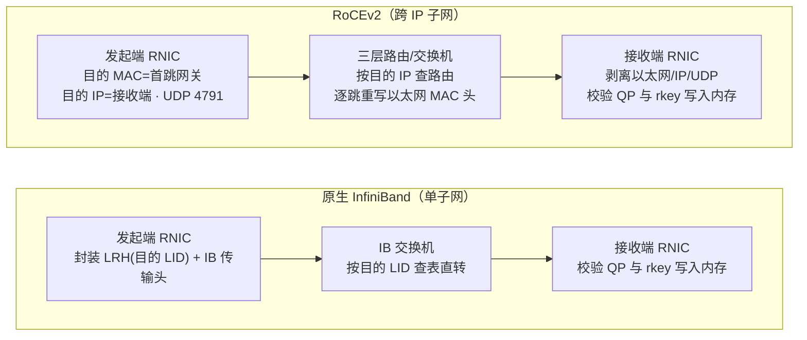

# InfiniBand 与 RoCE 的协议位置和报文路径

在第 06 章里，我们已经走通了一次跨机 RDMA Write：发起节点的进程把请求提交给本地 RNIC，数据就越过 CPU 直接落到了接收节点的已注册内存里。

但网线中间并不是一根真空管道。把两台服务器连进几十上百台机器的集群后，问题立刻浮出水面：发送网卡明明只填了目标内存地址和远端密钥，**沿途的交换机根本看不懂显存地址，它们到底凭什么把成千上万个数据包准确送到对端机器？**

答案取决于你搭的是哪一套底层网络架构。目前 GPU 集群的高速计算网主要有两条技术路线：**InfiniBand（IB）** 与 **RoCE（RDMA over Converged Ethernet，融合以太网上的 RDMA）**。

## 一、两条技术路线的本质区别

用一句最直观的话来区分两者：**InfiniBand 是为高性能集群从零定制的“专用高铁网”，而 RoCE 是把 RDMA 车厢直接搬上通用以太网轨道的“兼容列车”。**

- **InfiniBand（IB）**：一套独立的端到端互联架构，从物理链路、链路层流控、子网寻址到传输协议全部自成体系。部署原生 IB 时，网卡端口、线缆、交换机以及负责全局编排的子网管理器必须全栈运行 IB 协议。
- **RoCE（RDMA over Converged Ethernet）**：保留了源自 IB 的上层 RDMA 传输语义，但把底层换成了以太网交换机。其中早期 **RoCEv1** 直接封装在以太网二层帧内，只能在同一个广播域通信；当前集群广泛使用的 **RoCEv2** 则进一步套上了 IP 与 UDP 外壳，可以像普通业务流量一样跨 IP 子网三层路由。

> [!tip] 工程直觉：上层代码几乎无感，底层运维天差地别
> 无论是原生 IB 还是 RoCEv2，上层训练框架、推理引擎和通信库都可以沿用几乎一致的 Verbs 接口提交 RDMA 请求。真正随网络类型剧烈变化的，是**外层封装头部、寻址建连机制，以及交换机侧的路由与拥塞治理手段**。

## 二、一次远端写入中的三方职责边界

沿用第 06 章的最小写入场景：发起节点的进程通过一条已建立的 RC 连接，向接收节点的已注册缓冲区发起一次 RDMA Write。把发送端、沿途交换网络和接收端拆开看，三方各司其职、互不越界。

| 参与者 | 依赖的核心信息 | 在本次写入中完成的动作 |
| --- | --- | --- |
| **应用或通信库** | 本地缓冲区、远端虚拟地址与 `rkey`、已建好的 QP | 提交 Write 请求，按完成队列或显式信号判定完成 |
| **两端 RNIC** | 本地 RDMA 端口、对端路径属性、QP 状态与内存权限 | 组装和解析 RDMA 传输头，负责 RC 顺序、确认、重传与 DMA 搬运 |
| **沿途交换设备** | IB 目的地址、以太网目的 MAC 或 IP 目的地址 | 查转发表选出下一跳或出口端口，只管把报文送往对端网卡 |

这层分工非常干净：可靠性、顺序校验和内存权限检查全部由两端 RNIC 兜底，中间的交换机完全不需要感知 QP 或内存密钥。如果数据缓冲区从主机内存换成 GPU 显存，只是在两端节点内部额外叠加了第 06 章讲过的 GPUDirect RDMA 条件，中间交换网的转发逻辑丝毫不变。

## 三、单子网 InfiniBand 与跨子网 RoCEv2 的报文路径

下面把两套路线放在同一视野里对照，看同一个 RDMA 载荷在不同网络上究竟套了什么“信封”，交换机又读了信封上的哪个字段。

*图 07-01-01：原生 InfiniBand 单子网与跨子网 RoCEv2 的封装及转发路径对比。*

### 1. 原生 InfiniBand：靠子网内 LID 查表直达

在单个 IB 子网内，所有端口都由子网管理器统一分配一个 16 位的**本地标识符（Local Identifier，LID）**，并把全局转发表下发给每台 IB 交换机。

发起端发送报文时，在最外层的本地路由头（LRH）填上接收端的目的 LID（例如 `19`）。沿途每台 IB 交换机只查目的 LID 对应的出端口，就能直接把报文送达接收端。IB 端口同时也拥有 128 位的**全局标识符（Global Identifier，GID）**，需要跨 IB 子网时才会额外携带全局路由头（GRH）并借助 IB 路由器转发。

### 2. RoCEv2：借道标准 IP 路由与 UDP 4791

在跨子网的 RoCEv2 网络中，发起节点和接收节点分属不同 IP 网段。发起端网卡先用传统三层路由规则把以太网帧交给本地网关，因此第一跳的以太网目的 MAC 填的是网关的 MAC。

沿途三层交换机或路由器读取目的 IP，查路由表选出下一跳，并**逐跳重写以太网帧的源、目的 MAC**；直到抵达接收端所在的直连网段，目的 MAC 才换成接收端网卡的 MAC。整个过程中（无 NAT 干扰时），外层目的 IP 始终指向接收节点，UDP 目的端口固定为 **`4791`**，用来向交换机和对端网卡声明“里面装的是 RoCEv2 报文”。

## 四、三种封装模式一目了然

把原生 InfiniBand、历史过渡形态 RoCEv1 与主流的 RoCEv2 放在一张表里对照，就能瞬间看清为什么 RoCEv2 成了大型以太网 GPU 集群的事实标准：

| 协议形态 | 简化报文封装顺序（外 → 内） | 转发边界与核心前提 |
| --- | --- | --- |
| **原生 InfiniBand** | IB 本地路由头（LRH） →（可选 GRH）→ IB 传输头 → 载荷 | 单子网内按目的 LID 交换，依赖全套 IB 交换机与子网管理器 |
| **RoCEv1** | 以太网头（EtherType `0x8915`）→ GRH → IB 传输头 → 载荷 | 仅在单一二层广播域内按 MAC 转发，无法跨越三层路由器 |
| **RoCEv2** | 以太网头 → IPv4/IPv6 头 → UDP 头（目的端口 `4791`）→ IB 传输头 → 载荷 | 支持大规模跨子网三层路由，需对齐 IP 路由、邻居解析与路径 MTU |

*(注：上表略去了各级校验和与可选扩展字段。)*

> [!warning] 常见误区：以太网口“亮灯”不等于 RoCEv2 已通
> 两台服务器的以太网端口都显示链路连通，并不自动意味着它们跑在 RoCEv2 上。同一块支持 RoCE 的网卡通常会同时生成 RoCEv1 和 RoCEv2 两套端点标识；如果建连时错选了 RoCEv1，报文一出本地二层子网就会被路由器丢弃。

> [!summary] 核心结论
> 原生 IB 与 RoCEv2 共享上层 RDMA 传输语义，却分属两套截然不同的控制面：IB 靠集中式子网管理器分配 LID 并统一下发转发表，RoCEv2 则复用数据中心的 IP 路由与 UDP `4791` 封装。因此接下来两篇，我们把这两条控制面拆开逐层追查。

> [!info]- 参考资料
> - **InfiniBand 架构与寻址**：[IETF RFC 4392 - IP over InfiniBand Architecture](https://www.rfc-editor.org/rfc/rfc4392)、[NVIDIA InfiniBand Cluster Bring-up Procedure](https://docs.nvidia.com/infiniband-cluster-bring-up-procedure.pdf)
> - **RoCEv2 协议封装与 GID 机制**：[NVIDIA MLNX_OFED v24.10 Documentation（RoCE & GID Table）](https://docs.nvidia.com/networking/display/nvidia-mlnx-ofed-documentation-v24-10-0-7-0-0.0.pdf)
> - **RDMA 传输模式与 IPv4 转发**：[NVIDIA RDMA Aware Networks Programming User Manual](https://docs.nvidia.com/rdma-aware-networks-programming-user-manual-1-7.pdf)、[IETF RFC 1812 §5.2.1 - IPv4 Forwarding](https://www.rfc-editor.org/rfc/rfc1812#section-5.2.1)
