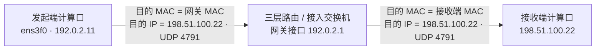

# RoCEv2 的 IP 路由、GID 与 RDMA 端口

把底层从原生 InfiniBand 换成以太网的 **RoCEv2** 后，再也不用折腾 Subnet Manager 和 LID 了——但新的麻烦接踵而至。

一台 GPU 服务器上通常同时插着管理网口、存储网口和多张高速计算网卡。当你准备跨 IP 子网建立一条 RC 连接时，必须把三样东西严丝合缝地扣在一起：**Linux 路由表选出的网络出口、该出口背后的 RDMA 硬件端口，以及这个端口上标记为 RoCEv2 的本地 GID 索引**。只要其中一环错位，报文不是误闯管理网，就是在网关被当成二层包直接丢掉。

## 一、沿着 IP 路由追到 RDMA 端口与首跳 MAC

在采用 IP 寻址建连的场景下，RoCEv2 复用宿主机的标准 Linux 路由与邻居表来决定报文往哪走。我们用一台拥有管理口 `eno1` 和计算口 `ens3f0` 的发起节点 `node-1`（计算 IP `192.0.2.11/24`）访问跨子网的接收节点 `node-2`（计算 IP `198.51.100.22/24`），走一遍标准核查命令：

```bash
# 1. 显式指定计算网源 IP，核对 Linux 选出的出口网卡和首跳网关
$ ip route get 198.51.100.22 from 192.0.2.11
198.51.100.22 from 192.0.2.11 via 192.0.2.1 dev ens3f0

# 2. 确认出口网卡对应的首跳网关 MAC 已通过 ARP 解析成功
$ ip neigh show dev ens3f0
192.0.2.1 lladdr 00:1c:73:aa:bb:01 REACHABLE

# 3. 将 Linux 网络接口 ens3f0 映射到对应的 RDMA 设备和硬件端口
$ rdma link show
link mlx5_0/1 state ACTIVE physical_state LINK_UP netdev ens3f0
```

这三条命令把“IP 层 → 二层邻居 → RDMA 硬件口”连成了一条无歧义的证据链。报文离开网卡后的逐跳封装变化如下图所示：



*图 07-03-01：跨 IP 子网 RoCEv2 报文的二层 MAC 逐跳改写与三层目的 IP 保持不变示意图。*

如果中间经过多级三层交换机，每一跳都重复同样的动作：按目的 IP 查路由表、查下一跳邻居 MAC、重写外层以太网头；唯有目的 IP 和 UDP 目的端口 `4791` 始终保持不变。

## 二、从 GID 表中选出正确的 RoCEv2 索引

确认了硬件端口是 `mlx5_0/1`，下一步要给 QP 指定本地源 **GID（Global Identifier，128 位全局端点标识）**。

在以太网 RDMA 网卡上，只要你给关联的 Linux 接口配上了 IP 地址，驱动就会自动在端口的 GID 表里生成对应条目。IPv4 地址会被编码成 **IPv4 映射的 IPv6 格式**（例如 `::ffff:192.0.2.11`），而且**同一个 IP 地址往往会同时生成 RoCEv1 和 RoCEv2 两条索引**。

你可以直接通过 Linux sysfs 读取 `gids/<索引>`、`gid_attrs/types/<索引>` 和 `gid_attrs/ndevs/<索引>`（或使用 `show_gids` 工具汇总），下面摘录与计算 IP 对应的关键两行：

```bash
# 按相同索引核对 GID 值、协议版本类型与关联 Linux 网口
$ cat /sys/class/infiniband/mlx5_0/ports/1/gids/3
0000:0000:0000:0000:0000:ffff:c000:020b   # 即 ::ffff:192.0.2.11
$ cat /sys/class/infiniband/mlx5_0/ports/1/gid_attrs/types/3
RoCE v2
$ cat /sys/class/infiniband/mlx5_0/ports/1/gid_attrs/ndevs/3
ens3f0
```

| 本地索引 | GID 值 | 协议类型 | 关联 Linux 接口 | 跨子网是否可用 |
| --- | --- | --- | --- | --- |
| `2` | `::ffff:192.0.2.11` | `IB/RoCE v1` | `ens3f0` | 不可用（仅限二层域） |
| `3` | `::ffff:192.0.2.11` | `RoCE v2` | `ens3f0` | **选用此项**（支持三层路由） |

这正是 RoCEv2 排障里最经典的“双胞胎陷阱”：**索引 `2` 和索引 `3` 的 GID 数值一模一样，唯一差别是协议类型。** 一旦误选索引 `2`，网卡发出的就是无 IP/UDP 头的 RoCEv1 帧，到了首跳网关就会因无法三层路由而被直接丢弃。

> [!tip] 工程直觉：两端 GID 索引号不需要相同
> 发起端选索引 `3`，不意味着接收端也必须是 `3`。接收端只需在自己的 RDMA 端口上找到匹配目标 IP、关联正确网口且类型为 `RoCE v2` 的本地索引即可。若使用 RDMA CM 自动建连，则需检查节点默认 RoCE 模式是否已设为 v2。

## 三、出口变化、VLAN 与路径 MTU 的验证边界

在多网卡集群中，下面三类配置变动最容易让原本正常的 RoCEv2 链路突然失灵，变更后必须重新走一遍校验链：

- **出口误漂移到管理口**：如果查 `ip route get` 发现流量改走了 `eno1`，先排查应用是否漏绑了计算网源 IP、策略路由表是否丢失。此时就算 `mlx5_0/1` 的 GID 表项完好无损，也只说明网卡配置还在，流量压根没往高速口走。
- **迁移到 VLAN 子接口**：当计算网启用 VLAN 隔离（如 `ens3f0.100`）时，驱动会为带标签的子接口生成新的 GID 索引。必须重新核对路由出口和 `gid_attrs/ndevs` 指向的是子接口，并确认沿途交换机端口放行了对应的 VLAN 标签。
- **路径 MTU 不匹配**：RDMA QP 的 `path_mtu` 决定了单个报文载荷的上限。如果 QP 配了 `4096 B` 的路径 MTU，而中间某一跳以太网接口的 IP MTU 只有标准的 `1500 B`，满载的 RDMA 数据包（载荷 `4096 B` 再叠加 RDMA、UDP、IP 和以太网头部）必然超长被丢弃。

> [!warning] 常见误区：短 `ping` 畅通 ≠ 满载 RoCEv2 畅通
> 普通的 `ping` 只发几十字节的小包，即使中间某跳交换机漏开了巨型帧（Jumbo Frame，如 9000 B 或 4200+ B），短 `ping` 依然一路绿灯。真正有效的验收必须在两端明确指定目标设备、端口、RoCEv2 GID 索引和业务路径 MTU，跑通一次真实尺寸的 RDMA Write（或带 `-M do -s` 禁止分片的大包探测配合 `perftest`）并校验结果。

> [!info]- 参考资料
> - **Linux 路由与 RDMA 端口工具**：[iproute2 v6.12.0 `ip-route(8)`](https://github.com/iproute2/iproute2/blob/v6.12.0/man/man8/ip-route.8.in)、[iproute2 v6.12.0 `rdma-link(8)`](https://github.com/iproute2/iproute2/blob/v6.12.0/man/man8/rdma-link.8)
> - **RoCEv2 GID 表与建连**：[NVIDIA MLNX_OFED v24.10 Documentation（RoCEv2 & GID Table Population）](https://docs.nvidia.com/networking/display/nvidia-mlnx-ofed-documentation-v24-10-0-7-0-0.0.pdf)、[Linux Kernel InfiniBand sysfs ABI](https://docs.kernel.org/6.6/admin-guide/abi-stable.html)
> - **路径 MTU 与底层排障**：[rdma-core `ibv_modify_qp(3)`（`path_mtu`）](https://github.com/linux-rdma/rdma-core/blob/master/libibverbs/man/ibv_modify_qp.3)、[IETF RFC 1812 §5.2.1](https://www.rfc-editor.org/rfc/rfc1812#section-5.2.1)、[NVIDIA NCCL Networking Troubleshooting](https://docs.nvidia.com/deeplearning/nccl/user-guide/docs/troubleshooting/networking_troubleshooting.html)
