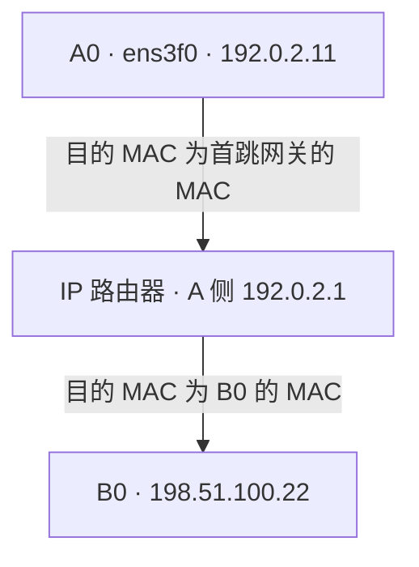

A0 仍通过可靠连接（RC）的队列对（QP）向 B0 的主机内存提交写入。这次两张网卡接入以太网，使用可跨 IP 子网的 RoCEv2。A0 有管理接口 `eno1` 和计算接口 `ens3f0`，其中 `ens3f0` 对应 RDMA 设备 `mlx5_0` 的端口 `1`。在这个教学快照里，计算口的 IPv4 地址为 `192.0.2.11/24`，B0 的计算地址为 `198.51.100.22/24`。要配置这条路径，需将 Linux 为这对 IP 选出的出口、对应的 RDMA 端口和该端口上可用于 RoCEv2 的本地标识对齐。

## 追踪下一跳与二层交付

以按 IP 地址解析的建连方式为例，给定 A0 的计算源地址后，在 A0 用 `ip route get` 查询出口和下一跳。再用 `rdma link show` 把 Linux 接口映射到 RDMA 端口。这里的记录是教学节录，省略其余接口和状态。 [iproute2 v6.12.0，ip-route 手册](https://github.com/iproute2/iproute2/blob/v6.12.0/man/man8/ip-route.8.in) · [iproute2 v6.12.0，rdma-link 手册](https://github.com/iproute2/iproute2/blob/v6.12.0/man/man8/rdma-link.8)

```text
$ ip route get 198.51.100.22 from 192.0.2.11
198.51.100.22 from 192.0.2.11 via 192.0.2.1 dev ens3f0

$ rdma link show
link mlx5_0/1 state ACTIVE physical_state LINK_UP netdev ens3f0
```

A0 的首跳是 `192.0.2.1`。IPv4 下用地址解析协议（ARP）取得该下一跳的 MAC，可通过 `ip neigh show dev ens3f0` 检查邻居项。下图用一台同时直连两个子网的路由器说明二层交付。扩展为多台路由设备时，每段同样先确定自己的下一跳，最后一段才交给 B0 的 MAC。普通路由场景中，目的 IP 始终为 `198.51.100.22`，UDP 目的端口维持 `4791`。 [IETF RFC 1812，IPv4 转发](https://www.rfc-editor.org/rfc/rfc1812#section-5.2.1) · [NVIDIA MLNX_OFED v24.10-0.7.0.0，RoCEv2](https://docs.nvidia.com/networking/display/nvidia-mlnx-ofed-documentation-v24-10-0-7-0-0.0.pdf)



## 从出口找到本地的 RoCEv2 GID

全局标识符（Global Identifier，GID）是在 RDMA 路径中使用的 128 位端点标识。这里采用 NVIDIA MLNX_OFED v24.10-0.7.0.0 文档描述的 GID 表行为。为关联的以太网接口配置 IP 地址后，驱动可为该地址生成相应的 GID 表项。IPv4 用 IPv4 映射的 IPv6 形式存放，同一地址可同时有两种 RoCE 类型的表项。 [NVIDIA MLNX_OFED v24.10-0.7.0.0，GID Table Population](https://docs.nvidia.com/networking/display/nvidia-mlnx-ofed-documentation-v24-10-0-7-0-0.0.pdf)

在 A0 的 `/sys/class/infiniband/mlx5_0/ports/1/` 下，用相同索引读 `gids/<索引>`、`gid_attrs/types/<索引>` 和 `gid_attrs/ndevs/<索引>`，依次取得 GID、类型和关联接口。教学表只列计算源 IP 对应的两行。 [Linux v6.6，InfiniBand sysfs ABI](https://docs.kernel.org/6.6/admin-guide/abi-stable.html)

| A0 本地索引 | GID 值 | 类型 | 关联接口 |
| --- | --- | --- | --- |
| `2` | `::ffff:192.0.2.11` | `IB/RoCE v1` | `ens3f0` |
| `3` | `::ffff:192.0.2.11` | `RoCE v2` | `ens3f0` |

本例需要跨 IP 子网，因此 A0 选择的是 `mlx5_0/1` 上的索引 `3`。如果配错为 `2`，即使 GID 值相同，v1 报文也只能在本二层域内交付，无法依靠网关按 B0 的 IP 转发。B0 应在自己的设备上匹配 `198.51.100.22` 及 v2 类型，索引可能与 A0 不同。若建连使用 RDMA Connection Manager（RDMA CM），本地源 GID 的选择还受设备及其 RoCE 模式配置影响。显式指定 Verbs 路径时，应直接核对 QP 实际使用的本地 GID 索引和对端路径。 [NVIDIA MLNX_OFED v24.10-0.7.0.0，RDMA-CM 与 GID Table](https://docs.nvidia.com/networking/display/nvidia-mlnx-ofed-documentation-v24-10-0-7-0-0.0.pdf)

## 更换出口或 MTU 后重新验证

若同一个目标的路由查询改为返回管理口 `eno1`，先核对是否用了正确源地址，以及策略路由和接口绑定。若 `mlx5_0/1` 的 GID 表项仍在，只能确认该计算口仍有该地址和类型的条目。在另一种变体里，如果计算地址迁到虚拟局域网（VLAN）子接口，应重查路由出口和 GID 条目的关联接口，并核对每段链路对带标签帧的支持。 [NVIDIA MLNX_OFED v24.10-0.7.0.0，GID Table Population](https://docs.nvidia.com/networking/display/nvidia-mlnx-ofed-documentation-v24-10-0-7-0-0.0.pdf)

路径上的最大传输单元（Maximum Transmission Unit，MTU）约束单个报文可以有多大。设某跳 IP MTU 只有 1500 B，QP 若使用 4096 B 的路径 MTU，满尺寸 RDMA 数据包的载荷已超过这段 IP MTU，还要加上 UDP、IP 等头部。此时应使整条路径支持所选尺寸，或降低 RDMA 路径 MTU。短 `ping` 即使通过，也只验证了该尺寸下的 IP 往返。端口 `ACTIVE`、路由和邻居解析各提供局部证据。最终需明确两端实际使用的设备、端口、RoCE 版本与路径参数，完成一次指定路径和报文尺寸的 RDMA Write 并校验目标缓冲区，才能验证这一条件组合下的 RC 写入。 [rdma-core，ibv_modify_qp 的 path_mtu](https://github.com/linux-rdma/rdma-core/blob/master/libibverbs/man/ibv_modify_qp.3) · [NVIDIA NCCL Networking Troubleshooting，RoCE 与低层测试](https://docs.nvidia.com/deeplearning/nccl/user-guide/docs/troubleshooting/networking_troubleshooting.html)
