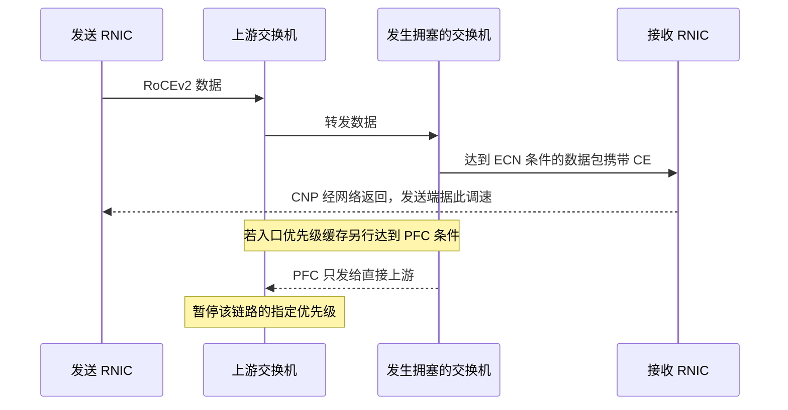

# RoCEv2 遇到拥塞时，谁暂停、谁标记、谁降速

机架 A 的两台裸机同时向机架 B 的一个计算端口写数据。两条输入链路各以 200 Gb/s 送入流量，出口只有 200 Gb/s。假设两路流量进入同一流量类，初始队列为空，且 40 µs 内速率固定、暂不计封装开销和反馈，净积压是 `(2 × 200 − 200) Gb/s × 40 µs ÷ 8 = 1 MB`，按十进制计。这个算例只说明排队可以在短突发内出现。实际达到标记、暂停或丢弃的时点取决于缓冲结构、阈值和当时的竞争流量。

## 先确定流量进了哪个队列

主机发出的 RoCEv2 报文可以在 IP 头携带 DSCP。若以太网帧带 VLAN 标签，还可以携带三位 PCP。交换机按入口端口的信任配置采纳相应标记，映射为内部优先级，再映射到流量类。调度策略决定不同流量类怎样分享出口，ECN 标记与 PFC 则各有触发条件。经过三层路由时会重建二层头，每跳要单独核对分类和映射。只改一端的 DSCP，可能让报文从预期的队列落到默认队列。 [NVIDIA Cumulus Linux 5.11，RoCE 配置与验证](https://docs.nvidia.com/networking-ethernet-software/cumulus-linux-511/Layer-1-and-Switch-Ports/Quality-of-Service/RDMA-over-Converged-Ethernet-RoCE/) · [NVIDIA Cumulus Linux Network Reference Design Guide，RoCE](https://docs.nvidia.com/networking-ethernet-software/PDFs/Cumulus-Linux-Network-Reference-Design-Guide.pdf)

## 两种反馈沿不同范围起作用

ECN 是 IP 层的拥塞标记。达到标记条件时，交换机可将具备 ECN 能力的包标为 CE（Congestion Experienced）。包继续走到接收 RNIC，接收端回送 CNP（Congestion Notification Packet）。启用了相应拥塞控制的发送 RNIC 据此降低发送速率，并按其算法决定何时恢复。DCQCN 是这一反馈环的实现例。启用交换机侧 ECN 只完成标记一环，实际降速还依赖接收端产生反馈、CNP 能回到发送端，以及发送端处理反馈。 [IETF RFC 3168，§5](https://www.rfc-editor.org/rfc/rfc3168) · [Zhu 等，Congestion Control for Large-Scale RDMA Deployments](https://conferences.sigcomm.org/sigcomm/2015/pdf/papers/p523.pdf)

PFC（Priority Flow Control）在一条以太网链路上按优先级暂停。以一台出现缓存压力的交换机为例，入口侧相应优先级达到暂停条件时，交换机发 PFC 帧给该入口的直接上游。上游收到并处理后，暂停在那条链路上发送该优先级的流量。缓存预留的 headroom 用来吸收上游停发前仍在途的数据。来自同一上游、共享该优先级的其他流也可能被挡住。若上游自身的缓冲随后积压，它还可能对更上游发暂停，形成拥塞扩散。 [NVIDIA Cumulus Linux 5.11，RoCE lossless](https://docs.nvidia.com/networking-ethernet-software/cumulus-linux-511/Layer-1-and-Switch-Ports/Quality-of-Service/RDMA-over-Converged-Ethernet-RoCE/) · [Zhu 等，DCQCN 论文，PFC 与拥塞扩散](https://conferences.sigcomm.org/sigcomm/2015/pdf/papers/p523.pdf)

图中两种触发分别取决于对应的缓冲和配置。若优先级错配，实际流量可能避开了预设的标记或暂停队列。若瞬时在途数据超过 headroom，已经发出 PFC 的端口也可能丢包。只用 ECN 时，持续入流超过出口且缓存耗尽也会丢包。RC 可以在重试条件允许时恢复，代价可能体现在尾延迟和有效吞吐上。链路速率、线长、报文大小、设备反应时间、端点恢复能力与流量突发程度共同影响配置是否适用。 [NVIDIA Cumulus Linux 5.11，RoCE 缓冲与模式](https://docs.nvidia.com/networking-ethernet-software/cumulus-linux-511/Layer-1-and-Switch-Ports/Quality-of-Service/RDMA-over-Converged-Ethernet-RoCE/) · [Zhu 等，DCQCN 论文](https://conferences.sigcomm.org/sigcomm/2015/pdf/papers/p523.pdf)

## 读 Cumulus Linux 5.11 的两种模式

以下是 NVIDIA 文档给出的 NVUE 命令，用于阅读两种互斥配置。该版本的默认配置把 RoCE 数据放到交换机优先级和流量类 `3`，把 CNP 放到 `6`。这两个编号来自该预设。设备之间仍需核对分类、PFC 收发和拥塞控制能力。Cumulus Linux 5.12 才引入 `lossless-single-ipool`。同为 5.11 时，不同 ASIC 的生成配置也要分别核对。 [NVIDIA Cumulus Linux 5.11，RoCE 默认配置与模式](https://docs.nvidia.com/networking-ethernet-software/cumulus-linux-511/Layer-1-and-Switch-Ports/Quality-of-Service/RDMA-over-Converged-Ethernet-RoCE/) · [NVIDIA NVUE QoS，版本记录](https://docs.nvidia.com/networking-ethernet-software/nvue-reference/Set-and-Unset-Commands/QoS/)

| NVUE 模式命令，变更后以 `nv config apply` 应用 | 数据流量类启用 ECN | 数据优先级启用 PFC | 配置核查重点 |
| --- | --- | --- | --- |
| `nv set qos roce mode lossless` | 是 | 是 | 逐跳核对优先级、PFC 收发、缓冲与 headroom，端到端核对 CE/CNP |
| `nv set qos roce mode lossy` | 是 | 否 | 端到端核对 CE/CNP，再以目标负载验证丢包恢复与尾延迟 |

先用 `nv show qos roce` 和 `nv show interface swp16 qos roce status` 读运行配置。`trust-mode` 和映射表解释报文怎么归类，`enabled-tc` 和阈值解释何处会标记，`pfc-priority`、`rx-enabled` 和 `tx-enabled` 解释何种暂停会生效。再用 `nv show interface swp16 qos roce counters` 查实际观测。将 `tc-max-usage` 按其记录区间理解为峰值，结合当前 `tc-usage`、`unicast-no-buffer-discard` 的采样差值和 `rx-pfc-stats`、`tx-pfc-stats` 下的 `pause-packets`、`pause-duration` 判断发生了什么。端点的 CE、CNP 及速率观测要按同一测试窗口和方向对齐。 [NVIDIA Cumulus Linux 5.11，Verify RoCE Configuration](https://docs.nvidia.com/networking-ethernet-software/cumulus-linux-511/Layer-1-and-Switch-Ports/Quality-of-Service/RDMA-over-Converged-Ethernet-RoCE/)

例如 B 侧 leaf 在主机下联的出口缓存升高，同时面向 spine 的某入口发出 PFC。沿这条链路应在对端 spine 查到对应方向的 PFC 接收，再看它是否产生发送等待。若发送 RNIC 收到 CNP 且速率随之回落，支持端到端反馈已起作用。只看某个端口的暂停次数，仍需沿流量方向查哪处先出现队列积压。 [NVIDIA Cumulus Linux 5.11，RoCE 端口计数器](https://docs.nvidia.com/networking-ethernet-software/cumulus-linux-511/Layer-1-and-Switch-Ports/Quality-of-Service/RDMA-over-Converged-Ethernet-RoCE/)
