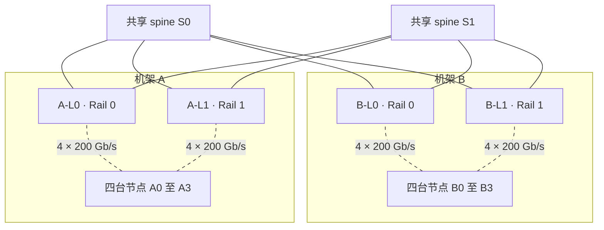

从 A0 向 B0 写一次数据，只需走通一条网络路径。现在增加并行节点。如果多条流同时穿过同一个交换机出口，单个网口的标称速率就不足以说明整组通信能跑多快。先画出设备之间的连接，再区分物理上有多少条链路和本次发送实际会用到哪些链路。

## 同 leaf 和跨 leaf 的交换路径

Spine-Leaf 是一种分层交换拓扑。服务器接入边缘层的 leaf，每台 leaf 都连接骨干层的所有 spine。在两层拓扑中，同一 leaf 下的两个端点可在该 leaf 内交付数据。跨 leaf 时，报文从源 leaf 经某台 spine 到目的 leaf。接入与汇出共用同一层 leaf，这种组织也称为两层折叠 Clos。更大的网络可以再增加交换级，路径和共享位置要按实际连接重画。 [NVIDIA HGX AI Factory，Spine-Leaf Networking](https://docs.nvidia.com/enterprise-reference-architectures/hgx-ai-factory-h100-h200-b200/latest/network-logical-architecture.html)

下图是本章后续使用的 RoCEv2 教学网络。机架 A 和 B 各有四台裸机，每台有两个独立的单端口网卡。用 `Rail 0` 和 `Rail 1` 标记成组的接入路径。同一组在每个机架接一台 leaf，例如 A 侧的 `A-L0` 和 `A-L1`。四台 leaf 都分别连接同一对 spine `S0`、`S1`。每条物理链路标称 200 Gb/s 全双工，即两个方向各可同时承载至多 200 Gb/s。图中的虚线各汇总四条主机接入链路，实线各代表一条上联。

例如 A0 和 A1 都用 Rail 0 端口且在同一二层域时，数据可以直接经 `A-L0` 交付。A0 写 B0 的 Rail 0 地址时，两端位于不同 IP 子网。A0 将帧交给 `A-L0` 上的网关，源 leaf 再经 `S0` 或 `S1` 把流量转给 `B-L0`，最后从 B0 的接入链路交付。

## 由下联和上联推算收敛比

在 `A-L0` 上，四条主机接入链路的单向容量合计 `4 × 200 = 800 Gb/s`。往两台 spine 的上联合计 `2 × 200 = 400 Gb/s`。本章把下联容量与上联容量之比写作收敛比，这里是 `2:1`。如果四台主机同时尝试以 200 Gb/s 向其他 leaf 发数据，本 leaf 的上行最多合计承载 400 Gb/s。若通信双方都接在 `A-L0` 下，数据留在 leaf 内，约束它们的是主机接入链路、交换能力和实际共享的出口。

估算整个机架 A 到机架 B 的容量时，画一道**割面**，也就是把设备分到两侧，再找出所有跨越分界的链路。把 A 侧节点和两台 leaf 画在一侧，其余设备画在另一侧，所有 A→B 流量必经 A 侧 leaf 的上联。也可在 B 侧画同样的线，再比较两侧的可用容量。这里假设交换机内部有足够转发能力，无背景流量，收敛后的路由能使用各条计入的上联，B 侧下联有足够接收能力。

| 网络状态 | A 侧剩余上联 | B 侧剩余上联 | A→B 单向割面上界 |
| --- | --- | --- | --- |
| 全部可用 | 四条 | 四条 | `min(800, 800) = 800 Gb/s` |
| `A-L0 → S0` 的物理上联失效 | 三条 | 四条 | `min(600, 800) = 600 Gb/s` |
| 整台 `S0` 失效 | 两条，均通往 `S1` | 两条，均通往 `S1` | `min(400, 400) = 400 Gb/s` |

这个上界成立于统计所选方向和链路集合的模型。要接近它，还需足够的端点和流量，并分布到这些链路。故障检测和路由更新期间可能有在途丢失或重试。正常状态下两个方向的结构上界可合计为 `800 + 800 = 1.6 Tb/s`，A→B 仍按 800 Gb/s 计。若讨论整个网络的二分带宽，要考察端点数量均分后不同划分的跨组容量，找出其中最小的值。机架 A、B 的划分只是一个可计算的割面。

## ECMP 如何把流量落到某一条上联

假设 `A-L0` 到 B0、B1 所在网段有两个等价下一跳。传统按流的等价多路径（Equal-Cost Multipath，ECMP）将报文头中的若干字段作为散列输入，用散列结果选择下一跳。在路由和散列配置稳定时，同一流通常固定走一个出口，便于保持包的顺序。RoCEv2 的 UDP 源端口可提供额外的区分信息，能否参与散列由交换机配置决定。 [NVIDIA Cumulus Linux 5.11，Equal Cost Multipath Load Sharing](https://docs.nvidia.com/networking-ethernet-software/cumulus-linux-511/Layer-3/Routing/Equal-Cost-Multipath-Load-Sharing/) · [NVIDIA MLNX_OFED v24.10-0.7.0.0，RoCEv2 UDP 封装](https://docs.nvidia.com/networking/display/nvidia-mlnx-ofed-documentation-v24-10-0-7-0-0.0.pdf)

用 A0→B0 和 A1→B1 两条 Rail 0 长流做教学推演。两条流各尝试以 180 Gb/s 向 `A-L0` 送数据。设 B0 和 B1 的接入链路均空闲，先忽略封装开销和反馈。

| 散列结果 | `A-L0 → S0` 的需求 | `A-L0 → S1` 的需求 | 形成的约束 |
| --- | --- | --- | --- |
| 两条流分开 | 180 Gb/s | 180 Gb/s | 每条上联都可容纳分给它的流量 |
| 两条流落到 `S0` | 360 Gb/s | 0 Gb/s | `S0` 方向至多送出 200 Gb/s，此时净积压速率为 `360 − 200 = 160 Gb/s` |

两种情况下网络都提供同样的物理容量，第二种却先耗尽了某个出口的服务能力。给定一条传统按流转发的长流，即使 leaf 有两条等价上联，单流还要受所选链路的 200 Gb/s 和沿路更窄位置的限制。路由表可用来认出候选出口，实际分布要结合分方向的端口速率、队列和测得的路径判断。原生 IB 则从目的 LID 和交换机转发表推导路径。支持并启用自适应路由的 IB 网络可能按 SM 配置的路径组选择不同出口，应按实际能力和配置核实。 [NVIDIA Cumulus Linux 5.11，ECMP 散列字段](https://docs.nvidia.com/networking-ethernet-software/cumulus-linux-511/Layer-3/Routing/Equal-Cost-Multipath-Load-Sharing/) · [NVIDIA InfiniBand Cluster Bring-up Procedure v1.0，Adaptive Routing](https://docs.nvidia.com/networking/display/infiniband-cluster-bring-up-procedure-v1-0.0.pdf)
