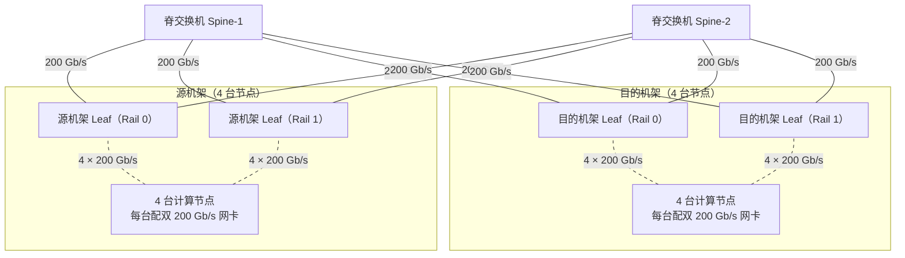

# Spine-Leaf 拓扑、割面容量与 ECMP

两台服务器点对点传输时，网口速率就是你的带宽天花板。可一旦把几十上百台 GPU 服务器装进多排机架、同时发起跨机通信，工程师常会撞上一个反直觉现象：**明明每张网卡都是 `200 Gb/s`、机架之间也有充足的闲置光纤，作业的聚合吞吐却死死卡在半路动弹不得。**

要看透瓶颈究竟卡在哪，必须分清两件截然不同的事：物理拓扑**一共铺了多少条路**（收敛比与割面容量），以及路由协议**实际把多条流送进了哪几条路**（ECMP 哈希选路）。

## 一、两层 Spine-Leaf（Clos）架构如何连接机架

现代 AI 集群计算网普遍采用 **Spine-Leaf（脊-叶）拓扑**，本质上是一种两层折叠 Clos 架构：

- **接入交换机（Leaf）**：放在机架顶部（ToR），向下连接本机架服务器的计算网卡，向上连接骨干层的所有脊交换机。
- **脊交换机（Spine）**：构成核心转发层，不直接接服务器，专门负责在不同 Leaf 之间高速交换流量。

在这种拓扑里，任意两台节点的通信路径异常规整：**同一台 Leaf 下的两台节点只需经过本机架 Leaf 一跳直达**；跨越不同 Leaf 时，报文先上行到某台 Spine，再下行交付给目的机架 Leaf，永远是等长的“Leaf → Spine → Leaf”三段路径。

为了后续定量推导清晰，本章构建一个标准的**双机架、双 Rail RoCEv2 参考拓扑**：两个机架各部署 4 台服务器，每台服务器配两张独立的 `200 Gb/s` 全双工高速网卡，分别接入本机架的 **Rail 0 接入交换机**与 **Rail 1 接入交换机**；四台接入交换机全部上联至两台共享脊交换机（每条物理链路均为 `200 Gb/s` 全双工）。

*图 07-04-01：双机架双 Rail 两层 Spine-Leaf 拓扑结构（虚线各代表 4 条主机下联，实线各代表 1 条上联，单链路标称 200 Gb/s 全双工）。*

## 二、收敛比与跨机架割面容量

看到一张拓扑图，先别急着看路由配置，第一步先算清物理链路的硬天花板。

### 1. 收敛比（Oversubscription Ratio）

单看图中的任意一台接入交换机：它向下连了 4 台服务器（下联总带宽 $4 \times 200 = 800\text{ Gb/s}$），向上只连了两台脊交换机（上联总带宽 $2 \times 200 = 400\text{ Gb/s}$）。**下联总容量与上联总容量之比称为收敛比**，这里是：

$$
\text{收敛比} = \frac{4 \times 200\text{ Gb/s}}{2 \times 200\text{ Gb/s}} = \frac{800}{400} = 2:1
$$

这意味着，如果同一台 Leaf 下的 4 台服务器同时全速往其他机架发数据，它们的总需求高达 `800 Gb/s`，但上行口合起来最多只能吐出 `400 Gb/s`，必然发生上行争抢。相反，若这 4 台节点彼此就在同一台 Leaf 内部通信，流量根本不走上联，就不受收敛比制约。生产级 AI 训练计算网为了消除跨机架瓶颈，通常追求 **`1:1` 无收敛（Non-blocking）** 设计。

### 2. 割面容量与故障后的余量折算

评估两个机架之间的最大单向传输能力时，最稳妥的方法是画一道**割面（Cut）**——把源机架和它的两台 Leaf 圈在一侧，其余设备圈在另一侧，数出所有跨越切线的链路容量之和，再与目的机架一侧的割面取较小值：

$$
C_{\text{源}\to\text{目的}} = \min\!\left(C_{\text{源侧可用上联}},\; C_{\text{目的侧可用上联}}\right)
$$

按单向链路计（默认交换机背板充足、无背景流量），这套双机架网络在不同健康状态下的跨机架容量上界如下：

| 网络健康状态 | 源机架可用上联 | 目的机架可用上联 | 跨机架单向割面上界 |
| --- | --- | --- | --- |
| **全部链路健康** | 4 条（`800 Gb/s`） | 4 条（`800 Gb/s`） | $\min(800, 800) = 800\text{ Gb/s}$ |
| **源侧单条上联中断** | 3 条（`600 Gb/s`） | 4 条（`800 Gb/s`） | $\min(600, 800) = 600\text{ Gb/s}$ |
| **整台脊交换机宕机** | 2 条（`400 Gb/s`） | 2 条（`400 Gb/s`） | $\min(400, 400) = 400\text{ Gb/s}$ |

> [!tip] 工程直觉：全双工与二分带宽的区别
> 全双工意味着发送和接收各自享有独立的 `200 Gb/s`。健康状态下，源→目的与目的→源两个方向同时跑满时，双向聚合可达 `800 + 800 = 1.6 Tb/s`，但单方向依然不能突破 `800 Gb/s`。而评价整网容量常用的**二分带宽（Bisection Bandwidth）**，则是遍历所有把节点均分为两半的切法后取最小的那一道割面。

## 三、ECMP 哈希碰撞：为什么有路却堵死在一根线上？

物理上铺了两条等价上联，不代表流量就会自动平摊。在 RoCEv2 三层路由网络中，接入交换机默认通过 **ECMP（Equal-Cost Multipath，等价多路径）** 在多条等价下一跳之间选路。

为了防止同一个连接的报文走不同路径导致乱序到达，传统 ECMP 采用**按流静态散列（Per-flow Hashing）**：提取报文的源/目的 IP、协议号、源/目的 UDP 端口等五元组做哈希运算，把同一条流死死绑定到其中一条上联出口上。

假设源机架两台节点同时经 Rail 0 向目的机架发送两条长流，每条流都试图以 `180 Gb/s` 全速推进，目的端接收完全空闲。此时源机架 Leaf 的两条 `200 Gb/s` 上联会出现天壤之别的两种命运：

| ECMP 哈希落点 | 通往 Spine-1 的需求 | 通往 Spine-2 的需求 | 实际形成的链路约束 |
| --- | --- | --- | --- |
| **理想分散**：两条流分开 | `180 Gb/s` | `180 Gb/s` | 两条上联各自留有余量，全程畅通无阻 |
| **哈希碰撞**：两条流落到同一口 | `360 Gb/s` | `0 Gb/s` | 该上联最多送出 `200 Gb/s`，净积压速率达 `160 Gb/s`，另一条上联彻底闲置 |

即便整台接入交换机有 `400 Gb/s` 的上联总容量，一旦两条大流撞进同一个哈希桶，瞬间就会在局部出口打出 `160 Gb/s` 的超额拥塞；而且对于单条传统 RC 长流来说，它永远只能吃满所选那一条上联的 `200 Gb/s`，无法跨两条上联叠加速率。

## 四、训推流型差异：大象流碰撞与推理尾延迟

ECMP 静态哈希的短板，在**分布式训练**与**在线推理**两类负载上暴露出截然不同的破坏形态：

- **分布式训练（典型“大象流”）**：同步训练的 AllReduce 或 FSDP 梯度通信流数很少（往往一对 QP 就要跑满整张网卡），但每条流持续时间长、带宽极高。大数定律在“流数少”的场景下完全失效——两条大流撞在同一条上联的概率高达 50%，一旦碰撞就会引发持续数十毫秒的队列积压，直接拖垮整个训练步。
- **在线推理（小消息 + PD 分离突发流）**：跨机推理的 TP/EP 小消息对尾延迟极度敏感，而 PD 分离架构下跨机迁移数百 MB 乃至数 GB 的 KV Cache 又会产生密集的短时大流。如果恰好与背景流量或另一条 KV 迁移流撞在同一条上联上，排队延迟会直接叠加到用户的 TTFT 与 TPOT 指标上。

> [!note] 缓解 ECMP 碰撞的演进思路
> 在 RoCEv2 中，可以通过让通信库为单对节点开启多个 QP（生成不同 UDP 源端口）并确认交换机将 UDP 源端口纳入 ECMP 哈希因子，来人为增加流熵、打散碰撞。而在原生 InfiniBand（及新一代以太网交换芯片）中，还支持硬件级的**自适应路由（Adaptive Routing）**或逐包喷洒（Packet Spraying），能够依据实时队列深度动态把报文分流到空闲链路上。

> [!summary] 核心结论
> 评估集群网络容量必须过三关：**先算收敛比与割面上界**，确认物理带宽够不够；**再看故障余量**，确认坏一条线或一台 Spine 后剩多少；**最后查 ECMP 实际流量分布**，因为物理余量再大，静态哈希撞在同一出口上依然会局部堵死。

> [!info]- 参考资料
> - **Spine-Leaf 参考架构**：[NVIDIA HGX AI Factory - Network Logical Architecture](https://docs.nvidia.com/enterprise-reference-architectures/hgx-ai-factory-h100-h200-b200/latest/network-logical-architecture.html)
> - **Cumulus Linux ECMP 与哈希字段**：[NVIDIA Cumulus Linux 5.11 - Equal Cost Multipath Load Sharing](https://docs.nvidia.com/networking-ethernet-software/cumulus-linux-511/Layer-3/Routing/Equal-Cost-Multipath-Load-Sharing/)
> - **RoCEv2 UDP 封装与 IB 自适应路由**：[NVIDIA MLNX_OFED v24.10 Documentation（RoCEv2 UDP Encapsulation）](https://docs.nvidia.com/networking/display/nvidia-mlnx-ofed-documentation-v24-10-0-7-0-0.0.pdf)、[NVIDIA InfiniBand Cluster Bring-up Procedure（Adaptive Routing）](https://docs.nvidia.com/networking/display/infiniband-cluster-bring-up-procedure-v1-0.0.pdf)
