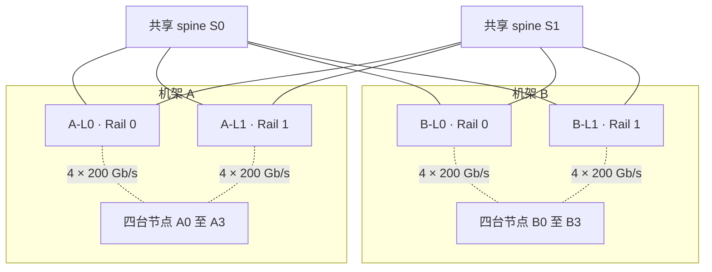

# Spine-Leaf 的容量怎样算，ECMP 怎样影响实际路径

同样标称 200 Gb/s 的端口，接在不同位置，约束的流量也不同。同一个 leaf 下的主机可以在本地交换。不同 leaf 下的主机要共享上行，一处上行也可能同时承载多条长流。算容量时先画出流量必须穿过的链路，再看转发是否用到了这些链路。 [NVIDIA HGX AI Factory，Spine-Leaf Networking](https://docs.nvidia.com/enterprise-reference-architectures/hgx-ai-factory-h100-h200-b200/latest/network-logical-architecture.html)

## 两层折叠 Clos 的路径

在两层 Spine-Leaf 中，节点接 leaf，每个 leaf 都连到每个 spine。同 leaf 流量可走 `节点 → leaf → 节点`，跨 leaf 流量走 `节点 → 源 leaf → 某台 spine → 目的 leaf → 节点`。上下行共用同一层 leaf，这是一种折叠 Clos。规模超出两层可覆盖的范围时，可以增加交换层。经过几层、哪些端口被共享，仍按具体设计判断。 [NVIDIA HGX AI Factory，Spine-Leaf Networking](https://docs.nvidia.com/enterprise-reference-architectures/hgx-ai-factory-h100-h200-b200/latest/network-logical-architecture.html) · [NVIDIA NVL72 AI Factory，Compute Fabric](https://docs.nvidia.com/enterprise-reference-architectures/nvl72-ai-factory/latest/network-logical-architecture.html)

以下为自拟 RoCEv2 教学网络。A、B 两个机架各有四台裸机。每台节点的两个单端口 NIC 分别接本机架的 Rail 0 leaf 和 Rail 1 leaf。每个 leaf 到两台共享 spine 各有一条上联。所有物理链路均为 200 Gb/s 全双工。图中节点组到 leaf 的虚线各汇总四条独立的物理链路，leaf 到 spine 的每条实线代表一条物理链路。

## 把收敛比和割面容量分开算

每台 leaf 有 `4 × 200 = 800 Gb/s` 的单向节点接入和 `2 × 200 = 400 Gb/s` 的单向上行。按下联容量比上联容量，收敛比是 `2:1`。当四个下联都要跨 leaf 满速发送时，400 Gb/s 的上行合计先达到上限。流量若主要在本 leaf 内转发，上行收敛比对这些流量的影响会小得多。

再画一个割面，把机架 A 的节点和两台 leaf 划在一边，把 spine 和机架 B 划在另一边。所有 A→B 的流量都要穿过 A 侧上联。假设 spine 内部交换能力充足，B 侧有足够的对应下行，且有足够多的流量可以分布到可用链路，得到以下结构上限。

| 状态 | A 侧穿过割面的上联 | A→B 单向上限 | 适用条件 |
| --- | --- | --- | --- |
| 链路齐全 | 两台 A 侧 leaf 各两条 | `4 × 200 = 800 Gb/s` | 两台 leaf 与两台 spine 都可承载相应流量 |
| `A-L0` 到 `S0` 的上联失效 | `A-L0` 剩一条，`A-L1` 仍有两条 | `3 × 200 = 600 Gb/s` | 失效下一跳已撤除，剩余路径可用 |
| 整台 `S0` 失效 | 两台 A 侧 leaf 各剩通往 `S1` 的一条 | `2 × 200 = 400 Gb/s` | 收敛已完成，`S1` 和 B 侧链路可用 |

正常时，若把两个方向的结构上限相加，可以写成 `800 + 800 = 1.6 Tb/s` 双向合计。A 单向发送仍按 `800 Gb/s` 计。二分带宽关心将端点均分为两组时，所有这种等分中最小的跨组容量。机架 A 与 B 的划分是其中一种。表中计算的是这个指定机架割面，没有用一个割面代替整个拓扑的二分分析。链路故障后的数字也只描述收敛后的容量。故障检测和下一跳更新期间，已经在途的流量仍可能丢失或需要重试。

## 两条等价路径可以同时存在，只有一条很忙

在三层 RoCEv2 网络里，假设 `A-L0` 去往 `B-L0` 下的目标网段有经 `S0` 和 `S1` 的两个等价下一跳。传统 ECMP（等价多路径）用报文头字段做散列，使同一流在路由和散列配置稳定时走同一下一跳。RoCEv2 的 UDP 源端口可为不同流增加散列输入，是否使用该字段看交换机配置。同一流通常只用一条路径，多条流也可能碰到同一下一跳。 [NVIDIA Cumulus Linux 5.11，Equal Cost Multipath Load Sharing](https://docs.nvidia.com/networking-ethernet-software/cumulus-linux-511/Layer-3/Routing/Equal-Cost-Multipath-Load-Sharing/) · [NVIDIA MLNX_OFED v24.10-0.7.0.0，RoCEv2 UDP 源端口](https://networking-docs.nvidia.com/mlnxofedswum/24100700/rdma-over-converged-ethernet-roce)

下面两行是自拟算例。`A0 → B0` 与 `A1 → B1` 各尝试向 `A-L0` 送入 180 Gb/s，均使用 Rail 0，B0、B1 有各自的接入链路。忽略其他流量，按反馈改变速率前的瞬间看需求。

| 散列结果 | `A-L0 → S0` 的流量需求 | `A-L0 → S1` 的流量需求 | 推断 |
| --- | --- | --- | --- |
| 两条流分开 | `180 Gb/s` | `180 Gb/s` | 两条上联都可承载各自的流 |
| 两条流落到 `S0` | `360 Gb/s` | `0 Gb/s` | S0 方向实际发出至多 `200 Gb/s`，在反馈生效前以 `160 Gb/s` 的净速率积压，直到速率回落或发生丢弃 |

路由表中列出两个下一跳，可以说明交换机具备两条可选路径。要判断有没有散列热点，需看两条上联在同一窗口的发送速率和队列占用，还要确认确实有多条流要求跨 leaf。IB 子网内默认从目的 LID 与交换机转发表理解转发。一些 IB 设备还支持由 SM 配置自适应路由组，允许交换机在特定路径上选择不同出口。是否使用以及怎样选择，按交换机能力和管理配置核对。 [NVIDIA Cumulus Linux 5.11，ECMP](https://docs.nvidia.com/networking-ethernet-software/cumulus-linux-511/Layer-3/Routing/Equal-Cost-Multipath-Load-Sharing/) · [NVIDIA InfiniBand Cluster Bring-up Procedure，LFT 与自适应路由](https://docs.nvidia.com/infiniband-cluster-bring-up-procedure.pdf)
