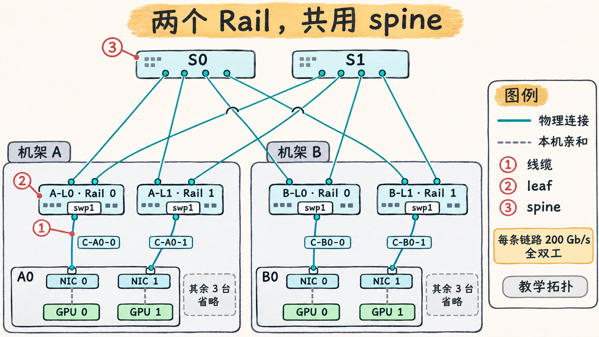

在 A0 上看到两个 200 Gb/s 网口时，先把作业用的 GPU 和网卡对应起来，再跟着线缆确认这两个口接入哪里。第 04 章用 GPU 与网卡的 PCIe 拓扑解释节点内的数据路径。本篇沿网卡的物理端口走出机箱，将节点内亲和关系与交换网络的故障范围接起来。

## 从 GPU 标识追到交换机端口

先用 `nvidia-smi --query-gpu=index,uuid,pci.bus_id --format=csv` 把当前 GPU 序号对回 UUID 和 PCI 地址。PCI 地址，也称 BDF，以 PCI 域、总线、设备和功能号定位硬件。用 `nvidia-smi topo -m` 查看 GPU 到网卡的拓扑类别。例如 `PIX` 表示路径经过单个 PCIe 交换机，`SYS` 表示经过 PCIe 和 NUMA 节点之间的系统互联。矩阵指出值得关注的节点内路径，进程实际绑定的 GPU 和所选网卡还要从运行记录核对。 [NVIDIA nvidia-smi，GPU Enumeration 与 Topology](https://docs.nvidia.com/deploy/nvidia-smi/index.html)

用 `/sys/class/infiniband/<设备>/device` 指向的 PCI 设备核对网卡 BDF，再用 `rdma link show` 核对 RDMA 端口和 RoCE 关联的 Linux 网络接口。以太网可在接入设备双方启用链路层发现协议（Link Layer Discovery Protocol，LLDP）后，查交换机本地物理端口的邻居系统与端口标识。原生 IB 则把 `ibstat` 的 `Port GUID` 与 fabric 拓扑工具的对应端口对齐。最后核对线缆两端标签，将交换设备看到的连接落实到可现场更换的部件。 [Linux v6.6，InfiniBand sysfs ABI](https://docs.kernel.org/6.6/admin-guide/abi-stable.html) · [iproute2 v6.12.0，rdma-link](https://github.com/iproute2/iproute2/blob/v6.12.0/man/man8/rdma-link.8) · [NVIDIA Cumulus Linux 5.11，LLDP](https://docs.nvidia.com/networking-ethernet-software/cumulus-linux-511/Layer-2/Link-Layer-Discovery-Protocol/) · [NVIDIA InfiniBand Cluster Bring-up Procedure](https://docs.nvidia.com/infiniband-cluster-bring-up-procedure.pdf)

下表是两机架 RoCEv2 教学拓扑的台账节录。A、B 各四台节点，表中展开 A0 和 B0。设备名、序号和 BDF 在所在主机内解释。UUID 和线缆编号为自拟值，UUID 用缩写。A0、B0 的 NIC 0 就是寻址例所用的 Rail 0 计算端口。

| 节点／NIC 槽位 | 就近 GPU／UUID／BDF | NIC BDF | RDMA 端口／netdev | 线缆 | 计划接入 |
| --- | --- | --- | --- | --- | --- |
| A0／NIC 0，槽位 3 | GPU 0／`GPU-…a001`／`0000:17:00.0` | `0000:18:00.0` | `mlx5_0/1`／`ens3f0` | `C-A0-0` | `A-L0 swp1`，Rail 0 |
| A0／NIC 1，槽位 7 | GPU 1／`GPU-…a002`／`0000:65:00.0` | `0000:66:00.0` | `mlx5_1/1`／`ens7f0` | `C-A0-1` | `A-L1 swp1`，Rail 1 |
| B0／NIC 0，槽位 3 | GPU 0／`GPU-…b001`／`0000:17:00.0` | `0000:18:00.0` | `mlx5_0/1`／`ens3f0` | `C-B0-0` | `B-L0 swp1`，Rail 0 |
| B0／NIC 1，槽位 7 | GPU 1／`GPU-…b002`／`0000:65:00.0` | `0000:66:00.0` | `mlx5_1/1`／`ens7f0` | `C-B0-1` | `B-L1 swp1`，Rail 1 |

设 A0 的 LLDP 代理公布节点名和接口名。`A-L0 swp1` 未发现预期邻居，`A-L1 swp9` 却记录了 `A0/ens3f0`。按表反查，这是 A0 的 Rail 0 计算口。再核对 `C-A0-0` 的两端，可验证实际接在哪个口，并与设计记录区分误接和台账过期。即使 `mlx5_0/1` 显示 `ACTIVE` 且协商为 200 Gb/s，也可能接到了另一台交换机。

## 双 Rail 的路径与共同依赖

Rail 描述端点与交换机接入的成组方式。在这套教学布线中，A0、A1 用 Rail 0 时共享 `A-L0`，A0 到 B0 用 Rail 0 时要经过两端 leaf 和某台 spine。如果路由允许，流量还可经共享 spine 走到另一 Rail 的 leaf，例如 `A-L0 → S1 → B-L1`。Rail 的具体组织按设计变化。例如在 DGX H100 SuperPOD 的 IB 参考架构内，同一可扩展单元的同 Rail 流量可以在对应 leaf 内交换，跨 Rail 会经过 spine。 [NVIDIA DGX H100 SuperPOD，Compute InfiniBand Fabric](https://docs.nvidia.com/dgx-superpod/reference-architecture-scalable-infrastructure-h100/latest/network-fabrics.html)

*图 07-05-01　恢复到计划布线后的双 Rail 教学拓扑。每机架展开一台节点的接入，另三台的下联省略。每条物理链路为 200 Gb/s 全双工。①、②、③ 分别对应下表的三次独立故障。*

| 独立故障 | 从图上划掉后的变化 | 对容量和恢复的影响 |
| --- | --- | --- |
| ① 线缆 `C-A0-0` 断开 | A0 的 Rail 0 口断开，A0 的 Rail 1 仍有物理通路 | 先查已有连接的状态，再判断应用能否换口并重建连接或恢复 |
| ② `A-L0` 故障 | A0 至 A3 的 Rail 0 接入都断开，A 侧 Rail 1 的两条上联仍在 | A→B 单向结构上界剩 `2 × 200 = 400 Gb/s`，前提是端点能经 Rail 1 使用幸存路径并有足够流量 |
| ③ `S0` 故障 | 四台 leaf 都失去一条上联，路由收敛后，两条 Rail 幸存的跨 leaf 路径都经 `S1`。同 leaf 物理路径仍在 | A→B 单向总上界也是 `400 Gb/s`，但只走 `A-L0` 的流量合计最多 `200 Gb/s` |

故障域是同一个部件失效时会一起受影响的设备和路径。图中的两条 Rail 有独立接入和共享 spine，③ 同时影响两条 Rail。若设计要求两套物理隔离的网络平面，要分别追踪端到端物理路径，检查交换机、模块、布线路由和供电等共同依赖。接入冗余、故障后的剩余容量以及应用能否继续工作的证据分别来自布线、路径和作业记录。 [NVIDIA NVL72 AI Factory，Dual-plane Compute Fabric](https://docs.nvidia.com/enterprise-reference-architectures/nvl72-ai-factory/latest/network-logical-architecture.html)
