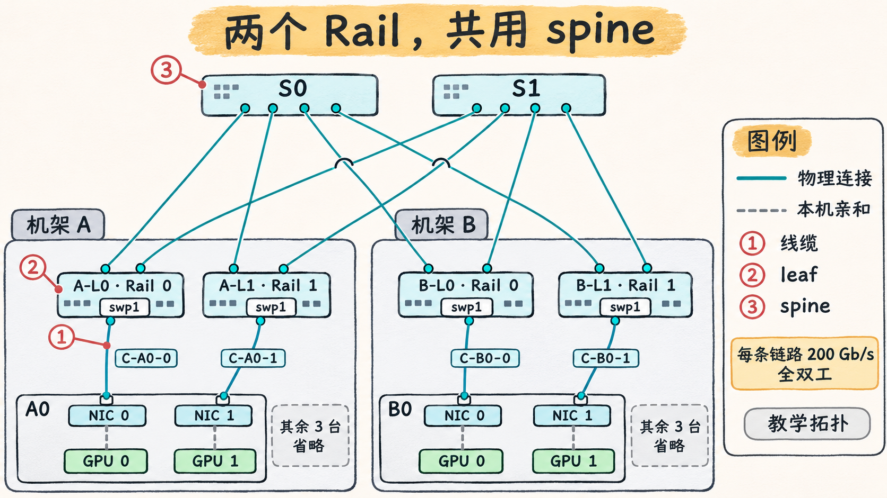

# 从 GPU 编号追到交换机端口，再判断 Rail 的故障域

一台服务器有两个计算网口，节点内的 PCIe 拓扑决定 GPU 到这两个 NIC 的距离。线缆另一端插在哪个交换机端口，决定它们在网络里经过哪些交换设备。评估这两条路径时，要把设备、接口、物理端口和交换机的记录接在一起。 [NVIDIA nvidia-smi，Topology](https://docs.nvidia.com/deploy/nvidia-smi/index.html) · [NVIDIA DGX H100 SuperPOD，Compute InfiniBand Fabric](https://docs.nvidia.com/dgx-superpod/reference-architecture-scalable-infrastructure-h100/latest/network-fabrics.html)

## 从 GPU 一直追到线缆的另一端

1. 用 `nvidia-smi --query-gpu=index,uuid,pci.bus_id --format=csv` 将当前 GPU 编号对应到 UUID 和 PCI BDF（域、总线、设备和功能号）。用 `nvidia-smi topo -m` 读 GPU 与 NIC 的拓扑关系。比如矩阵中的 `PIX` 表示经过单个 PCIe switch 的路径，`SYS` 表示经过 PCIe 和 NUMA 节点间的互联。拓扑距离有助于理解设备亲和，应用究竟选了哪个 NIC 要再看运行记录。 [NVIDIA nvidia-smi，GPU Enumeration 与 Topology](https://docs.nvidia.com/deploy/nvidia-smi/index.html)
2. 从 `/sys/class/infiniband/<设备>/device` 指向的 PCI 设备核对 NIC BDF，用 `rdma link show` 核对 RDMA 设备和端口。在 RoCE 网卡上继续对应到 netdev，在原生 IB 上可用 `ibstat` 的 `Port GUID` 对上 fabric 中的端口。设备名和索引按所在节点记录。 [Linux v6.6，InfiniBand sysfs ABI](https://docs.kernel.org/6.6/admin-guide/abi-stable.html) · [iproute2 v6.12.0，rdma-link](https://github.com/iproute2/iproute2/blob/v6.12.0/man/man8/rdma-link.8) · [rdma-core v57.0，ibstat](https://github.com/linux-rdma/rdma-core/blob/v57.0/infiniband-diags/ibstat.c)
3. 在启用了 LLDP 的以太网上，按交换机本地端口核对邻居系统和邻居端口标识，再查线缆两端的标签。IB 通过 fabric 拓扑工具和端口 GUID 核对对端。邻居或拓扑观测用于确认实际连接，线缆标签让现场人员能找到对应的物理对象。 [NVIDIA Cumulus Linux 5.11，LLDP](https://docs.nvidia.com/networking-ethernet-software/cumulus-linux-511/Layer-2/Link-Layer-Discovery-Protocol/) · [NVIDIA InfiniBand Cluster Bring-up Procedure](https://docs.nvidia.com/infiniband-cluster-bring-up-procedure.pdf)

下表是 RoCEv2 裸机节点的自拟台账，GPU UUID 为便于阅读的缩写，BDF 和线缆编号均为示例。拓扑包含机架 A、B 各四台节点，表中摘出 A0 与 B0。每节点的两个独立单端口 NIC 分别接本机架的 Rail 0 leaf 和 Rail 1 leaf。`A-L0`、`A-L1`、`B-L0`、`B-L1` 都分别连接共享 spine `S0` 和 `S1`。每条链路为 200 Gb/s 全双工。

| 机架／节点／NIC 槽位 | 就近 GPU UUID／BDF | NIC BDF | RDMA 端口／netdev | 线缆 | 计划接入 | Rail |
| --- | --- | --- | --- | --- | --- | --- |
| A／A0／槽位 3 | `GPU-…a001`／`0000:17:00.0` | `0000:18:00.0` | `mlx5_0/1`／`ens3f0` | `C-A0-0` | `A-L0 swp1` | 0 |
| A／A0／槽位 7 | `GPU-…a002`／`0000:65:00.0` | `0000:66:00.0` | `mlx5_1/1`／`ens7f0` | `C-A0-1` | `A-L1 swp1` | 1 |
| B／B0／槽位 3 | `GPU-…b001`／`0000:17:00.0` | `0000:18:00.0` | `mlx5_0/1`／`ens3f0` | `C-B0-0` | `B-L0 swp1` | 0 |
| B／B0／槽位 7 | `GPU-…b002`／`0000:65:00.0` | `0000:66:00.0` | `mlx5_1/1`／`ens7f0` | `C-B0-1` | `B-L1 swp1` | 1 |

假设 `A-L0 swp1` 没有发现预期邻居，而 `A-L1 swp9` 的 LLDP 记录指向 `A0/ens3f0`。这支持 A0 的 Rail 0 口实际接入 `A-L1` 的判断。再沿 `C-A0-0` 标签核对两端，才可区分误接与台账过时。仅从 `mlx5_0/1` 为 `ACTIVE` 或链路协商为 200 Gb/s，看不出线缆插在哪一台 leaf。

## 双 Rail 的路径与共享故障点

在这套教学网络中，Rail 是端点和交换机接入的组织方式。同机架同 Rail 的两个节点经对应 leaf 就可以交换流量，例如 `A0 Rail 0 → A-L0 → A1 Rail 0`。跨机架同 Rail 可以走 `A0 Rail 0 → A-L0 → S0 → B-L0 → B0 Rail 0`。若路由允许，也可以经共享 spine 到另一 Rail 的 leaf，例如 `A-L0 → S1 → B-L1`。真实布线可采用不同组织方式。DGX H100 SuperPOD 的 IB 参考设计就让一个可扩展单元内同 Rail 的流量只经一台 leaf，跨 Rail 时可经 spine。 [NVIDIA DGX H100 SuperPOD，Compute InfiniBand Fabric](https://docs.nvidia.com/dgx-superpod/reference-architecture-scalable-infrastructure-h100/latest/network-fabrics.html)

*图 07-05-01　RoCEv2 教学拓扑。每个机架有四台节点，图中只展开 A0 和 B0 的接入布线。四台 leaf 各有两条上联，分别连到两台共享 spine。三个编号对应三次独立的故障演练。*

把台账恢复到计划布线，再分别模拟下列故障。

| 故障 | 受影响的路径 | 还要确认什么 |
| --- | --- | --- |
| 线缆 `C-A0-0` 断开 | A0 的 Rail 0 NIC 失去接入，A0 的 Rail 1 仍有物理通路 | 应用能否使用另一端口、重建连接或恢复工作 |
| `A-L0` 故障 | A0 至 A3 的 Rail 0 接入全部断开。A 侧 Rail 1 仍可通过两台 spine 跨架 | A 侧单向跨架容量上限降到 `2 × 200 = 400 Gb/s`，前提是流量能迁到 Rail 1 并用到两条上联 |
| `S0` 故障 | 四台 leaf 都失去去 `S0` 的上联，两条 Rail 的跨 leaf 容量同时下降，同 leaf 路径仍可用 | 确认路由已经收敛到 `S1`，再看其剩余容量和排队 |
| 机架 A 的共享供电故障 | A 侧两条 Rail 的节点或 leaf 可能同时掉电 | 核对实际的电源、供电回路、设备接线和影响范围 |

物理独立双平面要分别追踪两条路径，看它们是否共用交换机、模块或布线路由，还要核对供电等共同依赖。独立 NIC 可以提供端口冗余，独立的交换路径可以缩小网络故障域，剩余带宽和作业能否继续则要分别验证。 [NVIDIA NVL72 AI Factory，Dual-plane Compute Fabric](https://docs.nvidia.com/enterprise-reference-architectures/nvl72-ai-factory/latest/network-logical-architecture.html)
