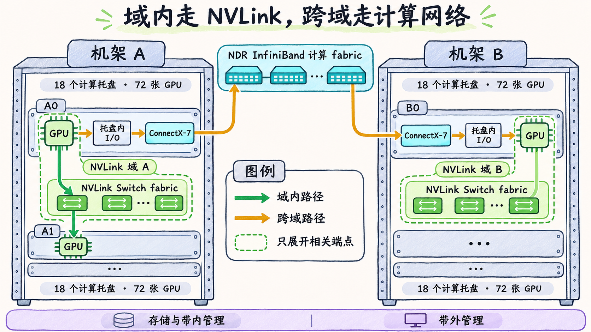

前面的跨架模型从网卡出发。要将它用于 GPU 通信，先判断这对 GPU 是否需要进入计算网。第 04 章用单机多卡说明了 NVLink 是 GPU 间的高速互联，NVLink Switch 将多条 NVLink 组织成交换网络。**NVLink 域**描述一组可通过同一 NVLink 互联网络通信的 GPU。主机或者计算托盘是设备组织边界，NVLink 域有时能跨过这一边界。 [NVIDIA GB200 NVL Multi-Node Tuning Guide，System Topology](https://docs.nvidia.com/multi-node-nvlink-systems/multi-node-tuning-guide/system.html)

本篇用 **Scale-up** 表示利用同一个 GPU 高速互联域扩大可直接协作的 GPU 范围，用 **Scale-out** 表示用计算网卡和外部交换网络把多个互联域或节点组成更大的系统。同一个作业可以同时用到两级互联。先按域划分找可用路径，再核对端口状态、软件支持和运行时选择。 [NVIDIA DSX，Data Center Architecture](https://docs.nvidia.com/dsx/ncp/software-reference-guide/data-center-architecture) · [NVIDIA GB200 NVL Multi-Node Tuning Guide](https://docs.nvidia.com/multi-node-nvlink-systems/multi-node-tuning-guide/overview.html)

## DGX GB200 NVL72 的同域与跨域通信

这是独立于双 Rail 教学网络的实物架构例。图中的 A0、A1、B0 是计算托盘。DGX GB200 NVL72 的一个机架含 18 个计算托盘，每个托盘 4 张 B200 GPU，共 72 张。参考架构还使用 9 个 NVLink 交换托盘，每个有 2 颗交换芯片。每张 GPU 分别连到 18 颗芯片，在完整配置下，机架内 72 张 GPU 处于同一个 NVLink 域。每个计算托盘还配有 4 张单端口 400 Gb/s 的 ConnectX-7 NIC，在该 SuperPOD 设计中接入 NDR（Next Data Rate）InfiniBand 计算网。存储与带内管理可共用另一套以太网 fabric，带外管理有自己的网络。 [NVIDIA DGX GB200 SuperPOD，Key Components](https://docs.nvidia.com/dgx-superpod/reference-architecture-scalable-infrastructure-gb200/latest/dgx-superpod-components.html) · [NVIDIA DGX GB200 SuperPOD，Network Fabrics](https://docs.nvidia.com/dgx-superpod/reference-architecture-scalable-infrastructure-gb200/latest/network-fabrics.html)

| 比较的 GPU 对 | 参考架构提供的候选路径 | 这条路径的条件 |
| --- | --- | --- |
| A0 的 GPU 与 A1 的 GPU | 源 GPU → 机架 A 的 NVLink Switch fabric → 目的 GPU | 两张卡都属于域 A，路径健康，驱动和通信软件能使用多节点 NVLink |
| A0 的 GPU 与 B0 的 GPU | 源 GPU → A0 托盘内 I/O → ConnectX-7 → 外部 NDR IB 计算网 → ConnectX-7 → B0 托盘内 I/O → 目的 GPU | 两张卡分属域 A、B，计算网可达且软件选用这对端口 |

*图 07-06-01　DGX GB200 NVL72 SuperPOD 参考架构的两条候选路径。示意图只展开相关设备。绿色箭头连接的 A0、A1 两端均属域 A，B0 属域 B。琥珀色箭头只列各托盘上本路径涉及的一张计算网卡。底部是另外的网络用途。*

第一对 GPU 虽分属不同托盘，但它们都连到域 A 的 NVLink Switch，载荷可走机架内的 NVLink。第二对的两端要经外部计算网交换。表里的托盘内 I/O 包含 GPU 缓冲区到计算 NIC 之间的搬运。是否可以由网卡直接访问显存，还要看第 06 章介绍的 GPUDirect RDMA 拓扑、注册与同步条件。若换成同机架但分属不同域的平台，按实际域成员名单和计算网布线重新找候选路径。 [NVIDIA DGX GB200 SuperPOD，NVLink Fabric 与 Compute Fabric](https://docs.nvidia.com/dgx-superpod/reference-architecture-scalable-infrastructure-gb200/latest/network-fabrics.html) · [NVIDIA GPUDirect RDMA，Supported Systems](https://docs.nvidia.com/cuda/gpudirect-rdma/index.html)

## 给候选路径选择正确的带宽口径

按这套配置为一个托盘估算跨域发送，如果四个 400 Gb/s 端口均可用且同时被用来发数据，端点单向端口速率之和为 `4 × 400 = 1600 Gb/s = 200 GB/s`。若实际只走图中的一口，端点侧相应上界为 `400 Gb/s = 50 GB/s`。还需考虑对端口数、交换网络割面、流量分布和封装开销。NVLink 的规格则可能给出一张 GPU 多条链路的双向聚合值。比较前先约定同一方向、同一汇总范围和同一类数据。对一次既有域内交换也有跨域交换的操作，只有后者的路径会占用外部计算网的端口和队列。 [NVIDIA DGX GB Rack Scale Systems User Guide，Hardware](https://docs.nvidia.com/dgx/dgxgb200-user-guide/hardware.html) · [NVIDIA DGX GB200 SuperPOD，Network Fabrics](https://docs.nvidia.com/dgx-superpod/reference-architecture-scalable-infrastructure-gb200/latest/network-fabrics.html)
