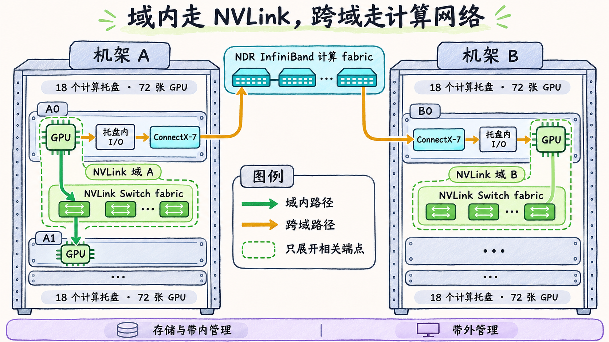

# NVLink 域跨了计算托盘，Scale-up 的边界在哪里

判断两张 GPU 的通信路径时，先查它们是否属于同一个高速互联域，再查节点和机架的位置。计算托盘给出主机及设备的组织边界。NVLink 域描述哪些 GPU 能通过该 NVLink fabric 互联。一个域可以覆盖多个托盘。 [NVIDIA GB200 NVL Multi-Node Tuning Guide，System Topology](https://docs.nvidia.com/multi-node-nvlink-systems/multi-node-tuning-guide/system.html)

这里用 **Scale-up** 表示在同一个 GPU 高速互联域内扩展，用 **Scale-out** 表示通过计算 NIC 和外部交换网络连接多个这样的域。两条路径都可能出现在同一个多机作业里。应用实际能使用哪条路径，还要看域的划分、驱动和通信软件的支持以及端口状态。 [NVIDIA DSX，Data Center Architecture](https://docs.nvidia.com/dsx/ncp/software-reference-guide/data-center-architecture) · [NVIDIA GB200 NVL Multi-Node Tuning Guide](https://docs.nvidia.com/multi-node-nvlink-systems/multi-node-tuning-guide/overview.html)

## 在同一平台上比较两对 GPU

以 DGX GB200 NVL72 SuperPOD 参考架构为例。一个 NVL72 机架有 18 个计算托盘，每托盘 4 张 B200 GPU，共 72 张。机架内的 NVLink Switch 托盘和 NVLink 布线把这些 GPU 连在一起。在参考架构的完整配置下，72 张 GPU 处于同一个 NVLink 域。每个计算托盘另有 4 张单端口 ConnectX-7 NIC，提供跨机架计算网所用的 400 Gb/s NDR InfiniBand 端口。带内管理和存储、带外管理各有各的接口和网络路径。 [NVIDIA DGX GB Rack Scale Systems User Guide，Hardware](https://docs.nvidia.com/dgx/dgxgb200-user-guide/hardware.html) · [NVIDIA DGX GB200 SuperPOD，Network Fabrics](https://docs.nvidia.com/dgx-superpod/reference-architecture-scalable-infrastructure-gb200/latest/network-fabrics.html)

| 两个 GPU 的位置 | 参考架构提供的候选路径 | 判定依据 |
| --- | --- | --- |
| 同一机架的不同计算托盘 | 源 GPU → 机架内 NVLink Switch fabric → 目的 GPU | 两端属于同一 NVLink 域，NVLink 路径对端点与软件可用 |
| 两个机架各自的 NVLink 域 | 源 GPU → 本端节点内 I/O 路径 → ConnectX-7 → 外部 IB 计算 fabric → 对端 ConnectX-7 → 对端节点内 I/O 路径 → 目的 GPU | 两端位于各自的 NVLink 域，外部计算 fabric 为本参考设计的跨域路径 |

*图 07-06-01　DGX GB200 NVL72 SuperPOD 参考架构的路径示意。每个机架有 18 个计算托盘，共 72 张 GPU。图中只展开相关端点。A0、A1 的 GPU 同属 NVLink 域 A，B0 的 GPU 属于域 B。绿色箭头表示域内路径，琥珀色箭头表示经两端计算 NIC 和外部 IB fabric 的跨域候选路径。*

对第一对 GPU，进程所在的主机不同，载荷仍可走 NVLink。对第二对 GPU，机架 A 的 NVLink Switch fabric 不会把机架 B 的 GPU 加入本域。跨域候选路径要经计算 NIC 和外部 IB 交换网络。表里的节点内 I/O 路径表示数据在 GPU 缓冲区与 NIC 间的移动，能否由 NIC 直接访问显存还取决于实际硬件和 GPUDirect RDMA 软件条件。 [NVIDIA DGX GB200 SuperPOD，NVLink Fabric 与 Compute Fabric](https://docs.nvidia.com/dgx-superpod/reference-architecture-scalable-infrastructure-gb200/latest/network-fabrics.html) · [NVIDIA GPUDirect RDMA，Supported Systems](https://docs.nvidia.com/cuda/gpudirect-rdma/index.html)

## 换一套域划分时重画边界

从硬件清单确定每个 GPU 接到哪套互联，再核对实际启用的 NVLink 域成员、计算 NIC 与交换网络布线。如果同机架设备被划入不同 NVLink 域，单凭机架位置无法推出它们有同域 NVLink 路径。此时要重新核对平台允许的跨域连接。看到架构图有一条路径，也应结合应用或通信库的运行信息确认本次传输是否使用了它。 [NVIDIA GB200 NVL Multi-Node Tuning Guide，System Topology](https://docs.nvidia.com/multi-node-nvlink-systems/multi-node-tuning-guide/system.html) · [NVIDIA DGX GB200 SuperPOD，Network Fabrics](https://docs.nvidia.com/dgx-superpod/reference-architecture-scalable-infrastructure-gb200/latest/network-fabrics.html)

比较容量时要先标出方向和汇总边界。资料可能给出某张 GPU 汇总多个 NVLink 链路后的双向值，也可能给出单个 NIC 端口的单向标称速率。评估某次跨域传输时，沿路径分别看两端能用的 NIC 数量、每口速率和跨交换网络的容量，再结合实际选路和流量分布。 [NVIDIA DGX GB Rack Scale Systems User Guide，Hardware](https://docs.nvidia.com/dgx/dgxgb200-user-guide/hardware.html) · [NVIDIA DGX GB200 SuperPOD，Network Fabrics](https://docs.nvidia.com/dgx-superpod/reference-architecture-scalable-infrastructure-gb200/latest/network-fabrics.html)
