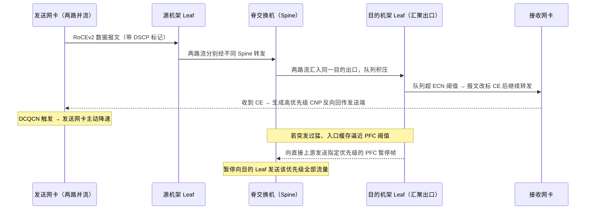

# RoCEv2 队列、ECN 与 PFC 的拥塞反馈

哪怕 ECMP 已经把两条高速数据流完美地分散到了两台不同的脊交换机上，拥堵依然可能在最后一公里爆发——**只要这两条流的目的地是同一台接收服务器的同一张网卡，它们最终还是会在目的机架接入交换机（Leaf）的同一个下行出口迎头相撞。**

这种“多路入流同时挤向一个出口”的现象被称为 **Incast（多对一汇聚）**，是训练集合通信与推理 KV Cache 迁移中最常见的拥塞源头。本篇定量拆解队列如何形成、RoCEv2 怎么靠 **ECN / CNP / DCQCN** 与 **PFC** 双管齐下压住拥塞，以及为何同一套流控机制在训练和推理上的代价截然不同。

## 一、多流汇聚如何把出口队列瞬间填满？

交换机收到报文后，会根据入口 QoS 信任规则将其归类到对应的内部优先级和出口队列。在以太网中，标记流量的抓手通常有两个：二层 VLAN 标签里的 **PCP（优先级代码点）**，以及 IP 头里的 **DSCP（差分服务代码点）**。跨三层路由时，以太网头每跳都会重建，因此大规模 RoCEv2 集群普遍优先采用端到端透传的 **DSCP** 作为分类依据。

为了建立微秒级排队直觉，我们做一个最简连续流量估算：假设两台发送网卡分别经不同脊交换机，同时以 `200 Gb/s` 满速向目的 Leaf 的同一个 `200 Gb/s` 出口灌入数据（初始队列为空，暂不计协议开销与流控反馈），持续 `40 µs`：

$$
R_{\text{净积压}} = R_{\text{到达}} - R_{\text{出口服务}} = 2 \times 200 - 200 = 200\text{ Gb/s}
$$

$$
Q_{\text{积压量}} = \frac{200 \times 10^{9}\text{ bit/s} \times 40 \times 10^{-6}\text{ s}}{8} = 1{,}000{,}000\text{ B} = 1\text{ MB}
$$

$$
T_{\text{队尾等待}} = \frac{1{,}000{,}000 \times 8\text{ bit}}{200 \times 10^{9}\text{ bit/s}} = 40\text{ }\mu\text{s}
$$

短短 `40 µs` 内，出口缓存就堆出了 **1 MB** 积压，紧跟在队尾的新报文光排队就要多等 **`40 µs`**。注意一个容易忽略的物理事实：**哪怕其中一路发送端立刻停发，剩下的一路以 `200 Gb/s` 贴着出口线速继续发，队列也只是“停止增长”而不会排空**；只有让总入流速率真正降到出口能力以下，积压才会开始消退。

## 二、两道防线：ECN/CNP 端到端降速 vs PFC 逐跳硬刹车

原生 InfiniBand 从链路层就内置了基于信用的逐跳流控，天生不会因缓存溢出而丢包。以太网本身没有这套基因，一旦缓存打满就会直接丢包，而早期 RDMA 协议对丢包极其敏感（一次丢包可能触发整窗重传，导致有效吞吐雪崩）。

为了让 RoCEv2 在以太网上实现接近无损的高效传输，工业界组合了两道协同防线：**ECN + CNP + DCQCN（主动柔刹车）** 与 **PFC（兜底急刹车）**。

### 1. 第一道防线：ECN、CNP 与 DCQCN（端到端闭环）

- **ECN（显式拥塞通知）**：复用 IP 头的 2 个比特位。当目的 Leaf 的出口队列长度跨过设定的水线时，交换机**不丢包**，而是把途经数据包的 ECN 位改标为 **`CE`（Congestion Experienced，经历拥塞）** 后继续放行。
- **CNP（拥塞通知报文）**：接收端网卡收到带 `CE` 标记的数据包后，立即构造一个高优先级的 **CNP** 控制包，反向发回给对应的发送网卡。
- **DCQCN（数据中心量化拥塞通知）**：运行在网卡硬件上的端到端速率控制算法。发送网卡一旦收到 CNP，立刻按比例下调该流的发送速率，让队列有喘息和排空的机会；若一段时间内不再收到 CNP，再按定时器逐步把速率抬升回去。

### 2. 第二道防线：PFC（逐跳按优先级暂停）

ECN 反馈需要走完一个端到端往返（RTT）才生效。如果突发流量太猛、发送端还来不及降速，目的 Leaf 入口缓存就要见底了，此时第二道防线 **PFC（Priority Flow Control，基于优先级的流控）** 介入兜底。

当目的 Leaf 面向某台脊交换机的入口缓存触及暂停水线时，它直接向**紧邻的上一跳（该脊交换机）** 发送指定优先级的 PFC 暂停帧。脊交换机收到后立刻暂停向该 Leaf 发送对应优先级的数据。如果脊交换机自己的缓存也随之积压，它就会继续向再上一跳（源机架 Leaf）发 PFC——这就是危险的**背压扩散（Backpressure Propagation）**。

下面这张时序图清晰标出了三条信号流截然不同的传播方向：**数据与 CE 标记向前走，CNP 端到端反向回传，PFC 只在相邻一跳之间反向喊停。**



*图 07-07-01：RoCEv2 拥塞反馈闭环与信号方向示意图（数据/CE 前向、CNP 端到端反向、PFC 逐跳反向）。*

### 3. 为什么 PFC 必须预留 Headroom（预留缓冲）？

PFC 喊停不是瞬间零延迟生效的。从目的 Leaf 发出暂停帧、电光信号传到上游、上游解析并停发，到原本已经在光纤里“飞在半路”的数据包全部落地，仍需要一段响应窗口（例如 `2 µs`）。交换机必须在触发 PFC 之后、缓存彻底耗尽之前预留一块 **Headroom** 来兜住这些在途报文：

$$
B_{\text{headroom}} = \frac{200 \times 10^{9}\text{ bit/s} \times 2 \times 10^{-6}\text{ s}}{8} = 50{,}000\text{ B} = 50\text{ kB}
$$

`50 kB` 揭示了高速链路下 Headroom 的基本量级；实际交换机配置还会叠加上最大报文长度（MTU）、光纤距离带来的传播延迟以及芯片内部缓存分配粒度。一旦 Headroom 算小了或优先级映射错配，就算开了 PFC 照样会丢包。

## 三、训推负载的拥塞分叉：为何推理极度害怕 PFC 误触发？

同样的拥塞控制参数，放到**分布式训练**与**在线推理**两类负载上，表现出的工程风险完全不同：

- **训练大象流（持续高压型）**：同步训练的梯度通信持续时间长（毫秒至数十毫秒）、单流带宽极高。ECN/DCQCN 有充足的往返时间把大象流平滑压回合理速率，PFC 只作为罕见突发下的安全气囊，避免丢包打断整步归约。
- **推理小消息与 PD 分离 KV 突发（微突发与尾延迟敏感型）**：在线推理的跨卡 TP/EP 消息体积极小，单次通信只需几微秒，根本来不及等 DCQCN 慢慢调速；而 PD 分离架构下多个 Prefill 实例同时向同一 Decode 实例灌入 KV Cache 时，又会制造极其剧烈的短时 Incast 微突发。

> [!warning] 常见误区：开启无损 PFC 就能高枕无忧？
> PFC 按**整个优先级队列**一刀切暂停，无法区分里面的单条流。在推理集群里，如果某条大块 KV 迁移流或异常节点触发了 PFC 暂停甚至背压扩散，**同一链路、同一优先级上其他所有无辜的在线推理请求都会被迫陪跑停顿（队头阻塞，Head-of-Line Blocking）**，瞬间打穿业务的 TTFT 与 TPOT P99 SLO；极端情况下甚至会诱发全网级“PFC 暂停风暴”或死锁。

## 四、无损 vs 有损模式与 Cumulus Linux 5.11 实战配置

面对 PFC 的双刃剑特性，主流以太网交换机操作系统（以全书基线 **Cumulus Linux 5.11** 为例）提供两种互斥的 RoCE 运行模式，分别对应不同的工程取舍：

| Cumulus Linux 5.11 NVUE 命令 | ECN 标记（端到端降速） | PFC 暂停（逐跳防丢包） | 典型适用考量 |
| --- | --- | --- | --- |
| `nv set qos roce mode lossless` | **启用** | **启用** | 经典无损方案，依赖精准的 ECN/PFC 水线调优与 PFC 看门狗防死锁 |
| `nv set qos roce mode lossy` | **启用** | **不启用** | 彻底消除 PFC 背压扩散风险，依赖极速 ECN 降速与现代网卡的选择性重传（SR）兜底 |

在 Cumulus Linux 5.11 中，默认预设将 RoCEv2 数据流量映射到交换机优先级与流量类（Traffic Class）**`3`**，将高优先级控制包 CNP 映射到 **`6`**（确保 CNP 永不被数据流自己堵死）。执行 `nv config apply` 生效后，运维常用以下 NVUE 命令核对全局策略与单端口队列状态：

```bash
# 1. 查看全局 RoCE 运行模式、信任依据与默认流量类映射
cumulus@leaf:~$ nv show qos roce
                 operational
---------------  -----------
state            enabled
mode             lossless              # lossless 同时启用 ECN 与 PFC；lossy 仅保留 ECN
trust            dscp                  # 跨三层路由优先信任 IP 头 DSCP
roce-tc          3                     # RoCE 数据进入流量类 3（优先级 3）
cnp-tc           6                     # CNP 进入高优先级流量类 6，免受数据拥塞拖累

# 2. 查看目标汇聚出口（如 swp1）的 RoCE 缓存占用与暂停计数
cumulus@leaf:~$ nv show interface swp1 qos roce counters
Traffic Class 3 (RoCE):
  tc-usage                   : 128 KB  # 读取时刻的瞬时队列占用
  tc-max-usage               : 1.8 MB  # 窗口内峰值积压，排查微突发的核心抓手
  unicast-no-buffer-discard  : 0       # 无损模式下应始终为 0；若增长说明缓存彻底击穿
  tx-pfc-stats.pause-packets : 0       # 本端口向上游发出的暂停帧数（本口是出口，通常在入向口观察）
  rx-pfc-stats.pause-packets : 0       # 对端发给本口的暂停帧数
```

> [!tip] 工程直觉：排障必须顺着“下游找根源，上游看扩散”
> 当发现某个端口发出大量 PFC 时，不要停在发暂停的端口原地打转。如果目的 Leaf 的主机下行口出现队列积压，导致它面向 Spine 的上行口发出了 PFC，你必须去 Spine 对接端口核对同优先级的 `rx-pfc-stats` 和发送速率变化；若只在更上游的源 Leaf 看到 PFC，说明你看到的往往只是下游背压传上来的连锁症状。

> [!summary] 核心结论
> RoCEv2 的队列治理遵循清晰的层级配合：**ECN + CNP + DCQCN** 是负责平滑压低发送速率的常态主角，**PFC** 是靠预留 Headroom 防止缓存溢出的最后兜底。配置是否真正起效，最终要靠同时间窗的队列峰值、CNP 收发与 PFC 方向计数交叉验真——这正是下一篇的主角。

> [!info]- 参考资料
> - **Cumulus Linux 5.11 RoCE QoS 与验证**：[NVIDIA Cumulus Linux 5.11 - RoCE Configuration & Verification](https://docs.nvidia.com/networking-ethernet-software/cumulus-linux-511/Layer-1-and-Switch-Ports/Quality-of-Service/RDMA-over-Converged-Ethernet-RoCE/)
> - **ECN 标准与 DCQCN 原始论文**：[IETF RFC 3168 §5 - ECN Field](https://www.rfc-editor.org/rfc/rfc3168#section-5)、[Zhu et al., SIGCOMM 2015 - Congestion Control for Large-Scale RDMA Deployments（DCQCN）](https://conferences.sigcomm.org/sigcomm/2015/pdf/papers/p523.pdf)
