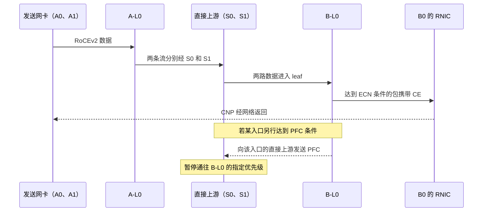

两条流即使在 spine 上分开，也可能在更靠近接收端的出口重新汇合。在两机架的 RoCEv2 教学网络中，仍从 A0、A1 的 Rail 0 发送，但把两条流的目标都改为 B0 的同一个计算口。假设两条流分别经 `S0`、`S1` 进入 `B-L0`，随后都向 `B-L0 swp1` 排队。这次瓶颈在通往 B0 的一条接入链路。

## 两路入流如何形成出口队列

交换机接收每个报文，确定出口和服务类别。如果多个入口同时要求同一出口发送，调度器只能按该出口可用的速率取包，其余暂存在缓存中。主机可用 IP 头的差分服务代码点（Differentiated Services Code Point，DSCP）标记流量，也可在带 VLAN 标签的以太帧中使用优先级代码点（Priority Code Point，PCP）。交换机按入口信任规则把所采纳的字段映射到内部优先级，再映射为流量类及对应的出口队列。队列调度决定各流量类如何分享出口。经过 IP 路由会重建以太网头，逐跳映射要分别核对。 [NVIDIA Cumulus Linux 5.11，RoCE 配置与验证](https://docs.nvidia.com/networking-ethernet-software/cumulus-linux-511/Layer-1-and-Switch-Ports/Quality-of-Service/RDMA-over-Converged-Ethernet-RoCE/)

令两条流进入同一流量类，初始队列为空，出口只有该流量类在用。用连续流量模型估算，40 µs 内两路分别以 200 Gb/s 进入，出口以 200 Gb/s 发送，暂不考虑报文开销和任何反馈。

- 到达速率为 `2 × 200 = 400 Gb/s`，净积压速率为 `400 − 200 = 200 Gb/s`。
- 40 µs 后积压 `200 × 10⁹ × 40 × 10⁻⁶ ÷ 8 = 1,000,000 B`，即十进制 1 MB。
- 若这时一个报文刚好排在这 1 MB 之后，且队列继续以 200 Gb/s 服务，仅等待前面的数据就需要约 `1,000,000 × 8 ÷ (200 × 10⁹) = 40 µs`。

这是用来解释延迟数量级的模型。实际交换机根据缓存结构和阈值标记或暂停，也可能在缓存耗尽时丢弃数据。若其中一路先停发，余下的 200 Gb/s 与出口速率相等，队列停止增长。要让积压消退，合计入流还需低于出口可用速率。

## ECN 与 CNP 沿端到端路径反馈

显式拥塞通知（Explicit Congestion Notification，ECN）使用 IP 头中的两位来传递拥塞信息。以这次写入为例，`B-L0` 的出口达到配置的标记条件时，可以把支持 ECN 的报文改标为 CE（Congestion Experienced，经历拥塞），然后继续转发。B0 网卡收到带 CE 的数据后，可向对应的发送网卡回送拥塞通知报文（Congestion Notification Packet，CNP）。支持并启用了相应拥塞控制的发送网卡收到反馈后降低发送速率，再按算法决定何时恢复。数据携带 CE 向 B0 走，CNP 从 B0 沿网络返回，正反向路径可以不同。DCQCN（Data Center Quantized Congestion Notification）是使用此反馈环的一种算法。 [IETF RFC 3168，§5](https://www.rfc-editor.org/rfc/rfc3168#section-5) · [Zhu 等，DCQCN 原始论文](https://conferences.sigcomm.org/sigcomm/2015/pdf/papers/p523.pdf) · [NVIDIA Cumulus Linux 5.11，RoCEv2 Congestion Management](https://docs.nvidia.com/networking-ethernet-software/cumulus-linux-511/Layer-1-and-Switch-Ports/Quality-of-Service/RDMA-over-Converged-Ethernet-RoCE/)

合计发送速率回落到出口能力以下时，积压才开始消退。若交换机有标记增量，发送端却收不到 CNP，要沿 B0 的 CE 接收、CNP 发出、返回路径到发送端接收逐段检查。看到发送端收到 CNP 后，再核对它的速率是否变化，才能判断反馈环是否对当前流量起作用。

## PFC 在相邻设备之间按优先级暂停

基于优先级的流控（Priority Flow Control，PFC）作用于一段以太网链路。若 `B-L0` 面向 `S0` 的入口在对应优先级上达到暂停条件，`B-L0` 向 `S0` 发 PFC。支持并启用接收处理的 `S0` 暂停朝 `B-L0` 发送该优先级的流量。面向 `S1` 的入口是否暂停，要看那一侧的缓存与配置。同一条链路上这个优先级的其他流也会受影响，即便它们的目的端不是 B0。若 `S0` 随后积压，它可以再向自己的上游发出另一条暂停，背压由此扩散。 [NVIDIA Cumulus Linux 5.11，RoCE lossless](https://docs.nvidia.com/networking-ethernet-software/cumulus-linux-511/Layer-1-and-Switch-Ports/Quality-of-Service/RDMA-over-Converged-Ethernet-RoCE/) · [Zhu 等，DCQCN 论文中的 PFC 分析](https://conferences.sigcomm.org/sigcomm/2015/pdf/papers/p523.pdf)

PFC 发出后，通知传播、上游处理和仍在途的帧都需要时间。为这段时间保留的缓冲称为 headroom。仅用速率估算，若发出暂停到该入口停止收到数据相隔 2 µs，按单入口 200 Gb/s 计算，期间还可能到达 `200 × 10⁹ × 2 × 10⁻⁶ ÷ 8 = 50,000 B`。这个 50 kB 只说明量级。真实配置还要考虑最大报文、线长、设备行为、缓冲共享和硬件分配粒度。优先级错配或剩余缓冲不足时，即使已有 PFC 也可能丢包。 [NVIDIA Cumulus Linux 5.11，RoCE 缓冲与模式](https://docs.nvidia.com/networking-ethernet-software/cumulus-linux-511/Layer-1-and-Switch-Ports/Quality-of-Service/RDMA-over-Converged-Ethernet-RoCE/)

## 有 PFC 与无 PFC 的部署条件

同一个突发放进两种配置，差别在于相邻链路是否能暂停。有 ECN 和 PFC 时，ECN 给端点提供降速信号，PFC 可在本跳缓存吃紧时暂缓继续入流，代价是同优先级流量也可能停顿。启用 ECN 而不启用 PFC 时，相邻链路继续发送，缓存耗尽后会丢弃。RC 传输可以在重试条件允许时恢复，但尾延迟和有效吞吐会受重试、端点恢复能力和流量特征影响。两种模式都要验证流量是否落入配置的队列，以及 CNP 是否能到达发送网卡并被处理。 [NVIDIA Cumulus Linux 5.11，RoCE Modes](https://docs.nvidia.com/networking-ethernet-software/cumulus-linux-511/Layer-1-and-Switch-Ports/Quality-of-Service/RDMA-over-Converged-Ethernet-RoCE/) · [Zhu 等，DCQCN 论文](https://conferences.sigcomm.org/sigcomm/2015/pdf/papers/p523.pdf)

| Cumulus Linux 5.11 的 NVUE 模式命令 | RoCE 数据类的 ECN | RoCE 数据优先级的 PFC |
| --- | --- | --- |
| `nv set qos roce mode lossless` | 启用 | 启用 |
| `nv set qos roce mode lossy` | 启用 | 不启用 |

表中为两种互斥模式的官方命令节录，文档在命令后使用 `nv config apply`，这里用它们辨认机制。5.11 的预设将 RoCE 数据映射到交换机优先级和流量类 3，将 CNP 映射到 6。可用 `nv show qos roce` 或 `nv show interface swp1 qos roce status` 核对模式、信任规则、映射、ECN 阈值和 PFC 优先级。用对应接口的 `qos roce counters` 观察收发暂停、缓存与丢弃字段。读实际设备时还要对照交换芯片能力与运行配置。 [NVIDIA Cumulus Linux 5.11，Verify RoCE Configuration](https://docs.nvidia.com/networking-ethernet-software/cumulus-linux-511/Layer-1-and-Switch-Ports/Quality-of-Service/RDMA-over-Converged-Ethernet-RoCE/)

取证时从最先积压的方向追踪。例如 `B-L0 swp1` 的出口有积压，`B-L0` 面向 `S0` 的口在同一时间段发出 PFC，则到 `S0` 对接端口看同优先级的 PFC 接收量和数据发送变化。若只在更上游看到暂停，可能已经看到背压传播的结果。补上实际路径、每跳队列与端点速率，才有材料区分局部容量耗尽和物理传输异常。
