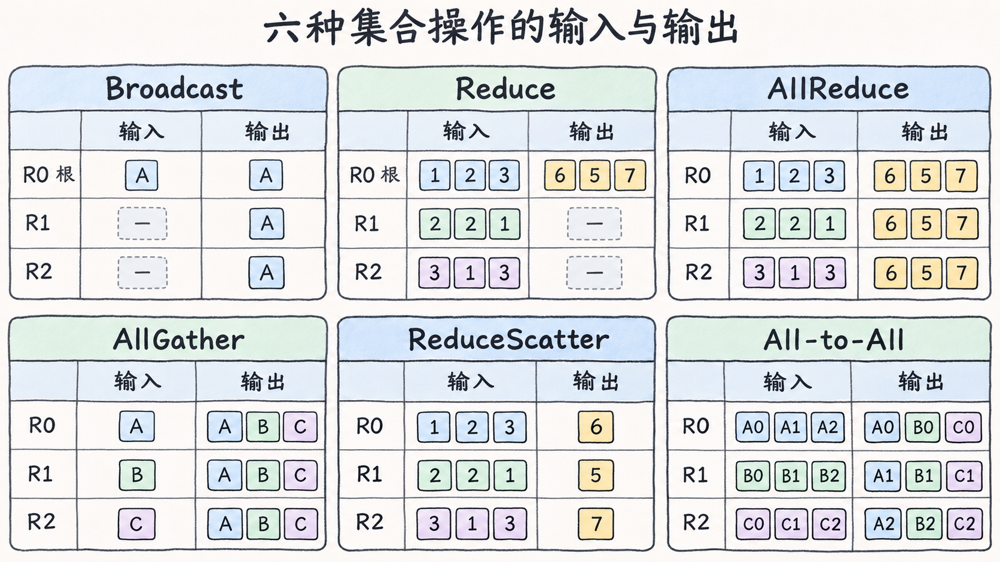

两张 GPU 各用一部分训练数据算出了梯度。要让两个模型副本做同一次更新，应用需要先把两份梯度按位置相加，再把完整的和交给两张卡。梯度已经在各自的显存里。如果应用自己实现这一步，就得决定由谁搬数据、在哪里求和，还要随机器上的互联条件调整搬运方式。应用可以把这部分工作交给 NCCL。它指定要交换哪些数据以及预期结果，NCCL 安排各 GPU 之间的搬运和归约。

NCCL（NVIDIA Collective Communications Library，NVIDIA 集合通信库）是面向 NVIDIA GPU 的通信库。它提供集合操作，即由一个通信组的所有成员共同完成的操作，也提供指定对端的点对点发送和接收。应用在单机多卡或多机上可以表达同一个操作，实际交换由 NCCL 根据可用的 GPU 互联和网络组织。 [NCCL 2.27.3 概览](https://docs.nvidia.com/deeplearning/nccl/archives/nccl_2273/user-guide/docs/overview.html)

## 两张 GPU 的一次 AllReduce

假设两张 GPU 已经加入同一个通信组。Rank 是成员在该组内的编号，从 0 开始。NCCL 用 communicator（通信组对象）记录本地设备以哪个 Rank 参加哪一个组。一个组的各成员持有各自的对象，同一张卡可以在不同组里使用不同 Rank。 [NCCL 通信组的创建](https://docs.nvidia.com/deeplearning/nccl/archives/nccl_2273/user-guide/docs/usage/communicators.html)

| 组内成员 | 求和前的本地输入 | 通信完成后的本地输出 |
| --- | --- | --- |
| Rank 0 | `[1, 2]` | `[4, 6]` |
| Rank 1 | `[3, 4]` | `[4, 6]` |

这里的归约（reduce）是把两张卡上相同位置的值合并。第一个位置得到 `1 + 3 = 4`，第二个位置得到 `2 + 4 = 6`。两张卡都交出两项输入，也都拿到两项完整结果，所以应用请求的是按求和归约的 AllReduce。库按请求的规则返回和；如果训练需要平均值，简单等权场景可以再由应用除以 2。 [NCCL AllReduce 的输入与输出](https://docs.nvidia.com/deeplearning/nccl/archives/nccl_2273/user-guide/docs/usage/collectives.html#allreduce)

| 层次 | 在这个例子里负责的工作 |
| --- | --- |
| 启动器 | 在约定的主机上拉起工作进程，例如由 MPI 启动器或 `torchrun` 启动。 |
| 应用或框架 | 选组和设备，产出梯度，决定何时请求求和以及何时消费结果。应用可以调用 C API，框架也可以通过 GPU 通信后端代为调用。 |
| NCCL | 建立成员之间的通信关系，为操作组织交换步骤、传输路径和 GPU 上的归约工作。 |
| CUDA 与驱动 | 提供设备选择、显存和 GPU 执行接口。NCCL 将工作提交到 CUDA Stream（GPU 工作的有序队列）。 |
| GPU 互联与网络 | 按已建立的路径承载实际传输。机内可用 PCIe 或 NVLink，跨机可用支持远程直接内存访问（RDMA）的网络，或经 TCP/IP 传输。 |

启动器、框架、通信库和硬件通过这些接口协作。梯度的含义由训练程序决定，NCCL 接到的是显存缓冲区、元素数、数据类型、归约方式以及执行所用的组和 Stream。 [NCCL 概览和 C API](https://docs.nvidia.com/deeplearning/nccl/archives/nccl_2273/user-guide/docs/overview.html) · [NCCL Stream 语义](https://docs.nvidia.com/deeplearning/nccl/archives/nccl_2273/user-guide/docs/usage/streams.html) · [PyTorch 2.9 通信后端](https://docs.pytorch.org/docs/2.9/distributed.html#backends)

## 结果放在哪里决定用哪种操作

如果只需要把一张卡上的初始参数发给全组，就用 Broadcast。只有一个成员要拿到归约结果时，用 Reduce。这两种操作中的 root（根）是组内编号。例如 `root=0` 选择组内 Rank 0，应用换绑设备后，它可以指向另一张物理 GPU。Reduce 的非根成员仍需提交输入。 [NCCL Broadcast 与 Reduce](https://docs.nvidia.com/deeplearning/nccl/archives/nccl_2273/user-guide/docs/usage/collectives.html#broadcast)

有些计算从分片开始。每个成员各有一段，所有成员都需要看见完整数组时，AllGather 以源 Rank 的顺序把各段拼齐；如果每个成员都有完整输入，却只需要归约结果的其中一段，ReduceScatter 先按位置合并，再按 Rank 交付等长结果片。以三张卡各提交三个元素为例，先算得 `[6, 5, 7]`，Rank 0/1/2 各持有一项。若紧接着对这三片做 AllGather，三张卡又都拿到完整结果。这个分解给出了 AllReduce 的一种实现思路。 [NCCL AllGather、ReduceScatter 与等价关系](https://docs.nvidia.com/deeplearning/nccl/archives/nccl_2273/user-guide/docs/usage/collectives.html#allgather)

*图 08-01-01　独立的三 Rank 对照。三种归约都用逐元素求和，Broadcast 与 Reduce 的根均为 Rank 0。短横线表示该 Rank 没有需要提供的输入或持有的结果。*

All-to-All 适合每个成员要向不同目的地交付不同数据块的情形。例如图中 Rank 1 留下自己的 `B1`，收到 Rank 0 的 `A1` 和 Rank 2 的 `C1`，按来源得到 `[A1, B1, C1]`。NCCL 2.27.3 的文档把这一模式写成一组配对的 `ncclSend`、`ncclRecv`，用 `ncclGroupStart/End` 将需要共同推进的调用一起提交。每对发送和接收须匹配元素数与类型。 [NCCL 2.27.3 点对点与 All-to-All 示例](https://docs.nvidia.com/deeplearning/nccl/archives/nccl_2273/user-guide/docs/usage/p2p.html#all-to-all)

接口的 count 以元素计。若组有 `P` 个 Rank，每片 `m` 个元素，AllGather 的 `sendcount=m`，每 Rank 输出 `P×m` 个元素；ReduceScatter 的 `recvcount=m`，每 Rank 输入 `P×m` 个元素。乘上元素的字节数，才得到应准备的缓冲区大小。后面估算链路流量时，还要按照交换步骤统计这些数据经过了哪些边。 [NCCL 2.27.3 缓冲区契约](https://github.com/NVIDIA/nccl/blob/v2.27.3-1/src/nccl.h.in#L339)
