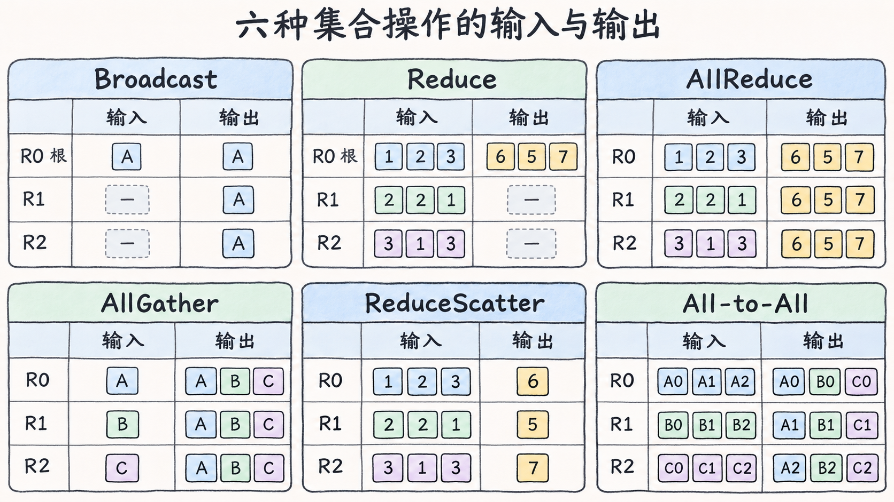
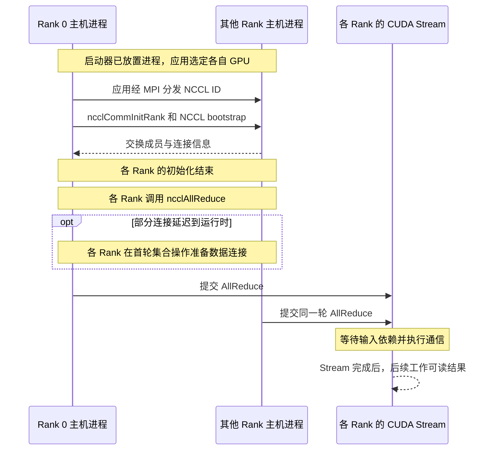

# 从作业进程到第一次完成 AllReduce

四个进程都启动了，为什么一次 AllReduce 还要等？进程先要认出彼此，给同一个通信组里的 GPU 编号。NCCL 随后建立这个组的通信关系，把一次集合操作提交到 CUDA Stream。进程启动、通信组就绪、数据可读分别有自己的完成条件。 [NCCL 2.27.3 概览](https://docs.nvidia.com/deeplearning/nccl/archives/nccl_2273/user-guide/docs/overview.html) · [Communicator 创建](https://docs.nvidia.com/deeplearning/nccl/archives/nccl_2273/user-guide/docs/usage/communicators.html)

## 先确定哪些设备参加

以两台裸机 Linux 服务器 `gpu-a` 和 `gpu-b` 为例，每台两张 GPU，每张 GPU 由一个 MPI 进程使用。两机用 `eno1` 做 NCCL 的 TCP 引导，跨节点 GPU 载荷走另一张网卡上的 200 Gb/s RoCEv2 端口 `mlx5_0:1`，对应 `enp129s0f0`。这是教学拓扑。版本相关行为以 NCCL 2.27.3 为准，CUDA 12.9 是该版本发行说明列出的组合。 [NCCL 2.27.3 发行说明](https://docs.nvidia.com/deeplearning/nccl/archives/nccl_2273/release-notes/rel_2-27-3.html)

MPI 启动器负责把进程放到指定主机上。应用读取进程在作业内的编号和节点内的编号，选定 CUDA device，再给参与这次通信的设备分配 NCCL Rank。下面只有一个通信组，所以 MPI 全局 Rank 和 NCCL Rank 恰好相同。若应用另建一个只包含两张 GPU 的组，新组的 Rank 会按它自己的成员重新编号。 [Open MPI 进程环境变量](https://docs.open-mpi.org/en/v5.0.6/tuning-apps/environment-var.html) · [NCCL Communicator 创建与拆分](https://docs.nvidia.com/deeplearning/nccl/archives/nccl_2273/user-guide/docs/usage/communicators.html)

| 主机 | MPI Rank / NCCL Rank | Local Rank | CUDA device | GPU PCI BDF |
| --- | ---: | ---: | ---: | --- |
| `gpu-a` | 0 | 0 | 0 | `0000:41:00.0` |
| `gpu-a` | 1 | 1 | 1 | `0000:61:00.0` |
| `gpu-b` | 2 | 0 | 0 | `0000:41:00.0` |
| `gpu-b` | 3 | 1 | 1 | `0000:61:00.0` |

表中假设两张 GPU 在每个进程里都可见，CUDA 枚举顺序一致，所以可以按 Local Rank 选卡。若每个进程通过 `CUDA_VISIBLE_DEVICES` 只看到分配给自己的 GPU，四个进程里选中的 CUDA device 都可以是 `0`。这时用主机名和 PCI BDF 才能确认是否为不同设备。同一 communicator 不能把同一个 CUDA device 当成两个 Rank。反过来，一个进程也可以管理多个设备，只要给各设备建立对应的 communicator 实例。 [CUDA 设备枚举与环境变量](https://docs.nvidia.com/cuda/archive/12.9.0/cuda-c-programming-guide/index.html#env-vars) · [NCCL Communicator 创建](https://docs.nvidia.com/deeplearning/nccl/archives/nccl_2273/user-guide/docs/usage/communicators.html)

## 让各 Rank 加入同一个通信组

在这个 MPI 例子里，四个进程先通过 MPI 获得成员信息。应用让一个成员调用 `ncclGetUniqueId`，用 `MPI_Bcast` 把同一个 ID 交给所有参与者。各进程选好 CUDA device 后，带着同一个 ID、`nranks=4` 和各自的 `rank` 调用 `ncclCommInitRank`。框架的 Rendezvous 承担成员发现和交换 ID 的角色，在本例中由应用与 MPI 完成。拿到 ID 后，NCCL 才能用自己的 bootstrap 交换成员和连接信息。 [NCCL Communicator 创建](https://docs.nvidia.com/deeplearning/nccl/archives/nccl_2273/user-guide/docs/usage/communicators.html) · [Bootstrap 源码](https://github.com/NVIDIA/nccl/blob/v2.27.3-1/src/bootstrap.cc)

默认引导用 TCP Socket，因此本例需要各节点的 `eno1` 在引导所需的地址和端口上可达，即使 RoCEv2 数据面已经就绪。NCCL 2.23 起，`NCCL_OOB_NET_ENABLE=1` 可让初始化中的 bootstrap AllGather 使用 NCCL NET 实现。NCCL 2.22 起还可由 `NCCL_RUNTIME_CONNECT` 将部分数据连接延迟到集合操作。2.27.3 默认启用该参数，源码还要求 `comm->cuMemSupport`。所以各 Rank 都记录了 `Init COMPLETE` 后，首次集合操作仍可能遇到新建数据连接的错误。 [NCCL 引导与运行时建连变量](https://docs.nvidia.com/deeplearning/nccl/archives/nccl_2273/user-guide/docs/env.html) · [运行时建连条件](https://github.com/NVIDIA/nccl/blob/v2.27.3-1/src/init.cc#L1148) · [首次使用算法时准备通道](https://github.com/NVIDIA/nccl/blob/v2.27.3-1/src/enqueue.cc#L463)

## 集合操作决定每个 Rank 拿到什么

集合通信以一个 communicator 为范围，组内每个 Rank 都参加。选操作时看数据如何处理，以及处理后由谁持有。比如归约按对应位置合并数据，结果可以交给一个 Rank，也可以交给每个 Rank 或按 Rank 分片。下面用独立的三 Rank 算例对照六种常见语义。括号里的三个位置依次对应 Rank 0、1、2，`—` 表示该 Rank 在这次操作中没有有效输入或结果。归约统一用求和。 [NCCL 2.27.3 集合操作](https://docs.nvidia.com/deeplearning/nccl/archives/nccl_2273/user-guide/docs/usage/collectives.html) · [NCCL 2.27.3 All-to-All 示例](https://docs.nvidia.com/deeplearning/nccl/archives/nccl_2273/user-guide/docs/usage/p2p.html#all-to-all)

| 操作 | 各 Rank 输入 | 各 Rank 输出 | 适用的数据需求 |
| --- | --- | --- | --- |
| Broadcast | `([A], —, —)` | `([A], [A], [A])` | 一个根 Rank 有数据，所有成员都需要一份副本，例如分发初始参数。 |
| Reduce | `([1,2,3], [2,2,1], [3,1,3])` | `([6,5,7], —, —)` | 每个 Rank 都有贡献，只有根 Rank 需要归约结果，例如汇总指标。 |
| AllReduce | `([1,2,3], [2,2,1], [3,1,3])` | `([6,5,7], [6,5,7], [6,5,7])` | 每个 Rank 都有贡献，并且都需要完整结果，例如同步数据并行梯度。 |
| AllGather | `([A], [B], [C])` | `([A,B,C], [A,B,C], [A,B,C])` | 数据原本按 Rank 分片，每个 Rank 都要按来源顺序拼出完整数组。 |
| ReduceScatter | `([1,2,3], [2,2,1], [3,1,3])` | `([6], [5], [7])` | 每个 Rank 都贡献完整数组，但后续各自只需要归约结果的一段。 |
| All-to-All | `([A0,A1,A2], [B0,B1,B2], [C0,C1,C2])` | `([A0,B0,C0], [A1,B1,C1], [A2,B2,C2])` | 每个 Rank 向各目的地发送不同的数据块，例如把 token 发往承载对应专家的 Rank。 |

*图 08-01-01｜六种独立的集合操作。Broadcast 和 Reduce 的根是 Rank 0，归约按元素求和。All-to-All 的输入按目的 Rank 排列，输出按来源 Rank 排列。短横线表示该 Rank 没有有效输入或结果。*

Broadcast 与 Reduce 的根都设为 `root=0`，指的是组内 Rank 0。Reduce 的其他 Rank 仍须参加并提交输入。AllGather 按源 Rank 拼接数据，ReduceScatter 则按目的 Rank 分配等长结果片。设组大小为 `P`、分片长度为 `m` 个元素，`ncclAllGather` 的 `sendcount=m`，每 Rank 输出 `P×m` 个元素。`ncclReduceScatter` 的 `recvcount=m`，每 Rank 输入 `P×m` 个元素。这里的 count 是元素数，乘上数据类型的字节数才得到缓冲区大小。 [NCCL 2.27.3 API 缓冲区契约](https://github.com/NVIDIA/nccl/blob/v2.27.3-1/src/nccl.h.in#L339)

All-to-All 例子里，输入块的数字后缀表示目的 Rank，输出按来源排列。以 Rank 1 为例，它留下自己的 `B1`，从 Rank 0、2 接收 `A1` 和 `C1`。每个 Rank 得到的数组都可以不同。对于本章采用的 NCCL 2.27.3，官方示例通过 `ncclGroupStart/End` 将匹配的 `ncclSend`、`ncclRecv` 组合成这一模式，每一对发送与接收要匹配元素数和类型。 [NCCL 2.27.3 点对点通信](https://docs.nvidia.com/deeplearning/nccl/archives/nccl_2273/user-guide/docs/usage/p2p.html#all-to-all)

从结果布局看，Reduce 后接 Broadcast，或 ReduceScatter 后接 AllGather，都能让各 Rank 得到完整归约结果。实际搬运可以用不同算法安排。这里的集合操作定义数据语义，Ring 和 Tree 决定这些数据如何分步交换。 [NCCL 集合操作及等价关系](https://docs.nvidia.com/deeplearning/nccl/archives/nccl_2273/user-guide/docs/usage/collectives.html)

## 从提交操作到读到结果

假设四张 GPU 上各有一份长度相同的 `float` 数组，应用调用 `ncclAllReduce` 做逐元素求和，每个 Rank 最终都得到完整的求和结果。各 Rank 必须对齐同一 communicator 上的集合调用顺序，每一轮的操作、元素数、数据类型与归约方式也要一致。一个 Rank 跳过这一轮或提交了另一种集合操作，其余成员即使都成功提交，也可能等不到匹配的通信。 [NCCL 集合操作契约](https://docs.nvidia.com/deeplearning/nccl/archives/nccl_2273/user-guide/docs/usage/collectives.html)

对本例采用的普通调用方式，`ncclAllReduce` 在工作已入队后可以返回，GPU 随后沿 Stream 执行。若生产输入、AllReduce 和消费结果都在同一条 Stream，队列顺序提供依赖。若分属不同 Stream，可在生产 Stream 记录 CUDA Event 供通信 Stream 等待，再在通信 Stream 记录完成 Event 供消费 Stream 等待。主机也可同步通信 Stream，确认该 Stream 上先前的操作完成。长时间等在同步处时，还应查其他 Rank 是否已提交同一轮，以及通信有没有异步错误。 [NCCL CUDA Stream 语义](https://docs.nvidia.com/deeplearning/nccl/archives/nccl_2273/user-guide/docs/usage/streams.html) · [NCCL 异步错误处理](https://docs.nvidia.com/deeplearning/nccl/archives/nccl_2273/user-guide/docs/usage/communicators.html#error-handling-and-communicator-abort)

初始化日志和 Stream 完成记录回答两个不同的问题。查不到某个 Rank 的初始化记录时，先查它有没有启动和选中设备。所有 Rank 都已初始化却没有结果时，再对齐首次建连、每个 Rank 的提交记录和 Stream 进度。
