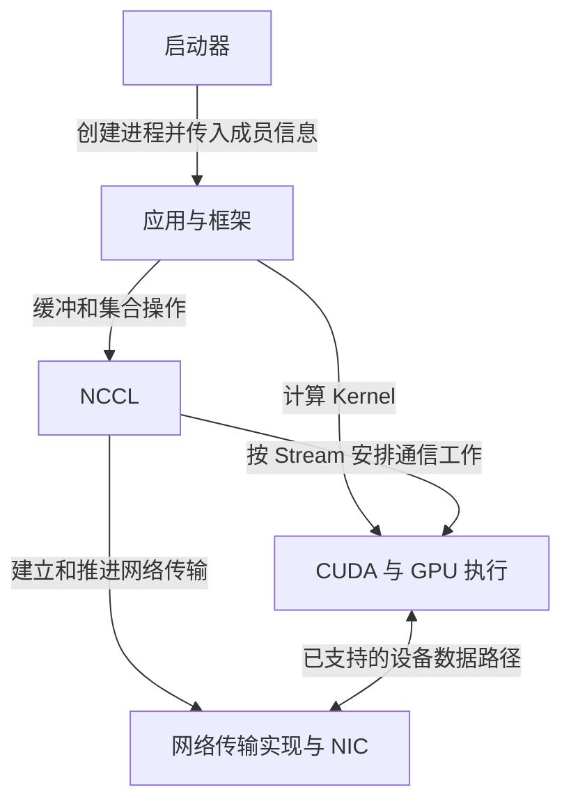

# 从应用调用走到通信完成

## NCCL 接住的是一个通信任务

框架已经决定四个成员需要求和，且每个成员都应得到完整结果。NCCL 接收本地缓冲地址、元素数、类型、归约操作、通信组和 CUDA Stream，把这件事组织为 GPU 间的数据交换与归约。它需要知道设备怎样连接，选择适用的算法与传输资源，并安排执行。

框架还要决定什么时候交换、交换哪些张量；启动器还要在机器上创建进程并传递成员信息。它们不能由一个 AllReduce 调用代替。下面是**职责与调用关系图**，箭头标签定义动作；框表示职责范围，不表示每个组件都是数据经过的一台设备。



| 层次 | 负责的决定或动作 | 应从哪里取证 |
| --- | --- | --- |
| 启动器，例如 MPI 启动器 | 进程在哪运行、规模多大、成员如何获知彼此 | 主机/PID、启动参数、进程环境 |
| 应用与框架 | 选择通信组、张量、操作与调用顺序，组织计算依赖 | 框架事件、张量形状、调用记录 |
| NCCL | 为组内设备组织通信、选择路径并推进操作 | 初始化、拓扑、传输和调用日志 |
| CUDA、驱动与互联 | 提供设备执行、内存访问和底层传输能力 | Stream 状态、设备与链路证据 |

NCCL 提供集合和点对点通信，支持单进程管理多卡、每卡一个进程等模式；它不是进程启动器。这里选择每进程一张卡，是为了清楚关联证据。定位参考 [NCCL 2.31.2 Overview](https://docs.nvidia.com/deeplearning/nccl/archives/nccl_2312/user-guide/docs/overview.html)。MPI 可以用于启动和分发初始化信息，正式 GPU 集合数据仍可由 NCCL 传输；NCCL 本身并不要求应用一定采用 MPI。

## 先把四个成员和设备固定下来

以下为 `job-08` 的**自拟身份表**。每个进程均可见本机两张 GPU，CUDA ordinal 0、1 与表内设备一致；UUID 只保留末尾代号用于阅读，`GPU-...a001` 不是可执行参数。

| W 中的 Rank | 主机 / PID | Local Rank | CUDA ordinal / NVML index | GPU UUID 简写 | PCI BDF |
| --- | --- | --- | --- | --- | --- |
| r0 | nccl-a / 4100 | 0 | 0 / 0 | GPU-...a001（A0） | 0000:41:00.0 |
| r1 | nccl-a / 4101 | 1 | 1 / 1 | GPU-...a002（A1） | 0000:42:00.0 |
| r2 | nccl-b / 5200 | 0 | 0 / 0 | GPU-...b001（B0） | 0000:41:00.0 |
| r3 | nccl-b / 5201 | 1 | 1 / 1 | GPU-...b002（B1） | 0000:42:00.0 |

Rank 是组 W 内的编号；Local Rank 是本机成员编号；CUDA ordinal 是当前进程可见设备列表里的编号；NVML index 属于管理接口。基线中后面三列恰好一致，不能把这种一致当作定义。若只让 r3 可见 B1，它的 CUDA ordinal 可以变成 0，W Rank 仍是 3，NVML index 和 UUID 应另行核对。跨主机 BDF 相同也不代表同一硬件。

**Communicator（通信器）**是 NCCL 中承载这次成员关系和设备关联的对象。每个成员持有自己的本地句柄；四个句柄共同对应组 W。给定的正常模型中，一张 CUDA 设备在 W 中只对应一个 Rank；两个进程误选同一卡会破坏此模型。可见两张卡并不等于 NCCL 已替应用选对一张。

## 初始化先解决“谁和谁一起工作”

按普通 `ncclCommInitRank` 路径，可以把建立过程拆成四个有依赖的动作：

1. 启动器和框架确定成员数 4、每人的 Rank 与本地 GPU。
2. 一个成员生成 `ncclUniqueId`，通过既有 CPU 通信机制分发给其他成员。该 ID 表示同一初始化会话，不是 GPU UUID。
3. 各进程选择本地设备，用共同 ID、相同组规模和各自唯一 Rank 创建本地通信器。
4. NCCL 交换必要信息，发现设备和拓扑，建立所需通信资源；准备完成后才能发起正常集合操作。

这是依赖顺序，不保证每个版本都在一个函数里一次性建立全部连接；部分连接可以延后建立。框架的 Rendezvous 成功表示进程会合条件已满足，不能替代第 3—4 步的成功。接口及单进程、多进程差别见 [Creating a Communicator](https://docs.nvidia.com/deeplearning/nccl/archives/nccl_2312/user-guide/docs/usage/communicators.html)。

NCCL 的 **Bootstrap** 指建立通信组时的早期协调。即使集合有效负载使用 RDMA，也需要交换端点和连接信息，因此日志可以先报告 IP Socket 相关接口，再报告 RDMA 网络传输。启动器的协调端口与 NCCL 后续打开的连接并非同一个概念。阅读日志时必须分清“框架找到成员”“NCCL 交换建链信息”“集合数据开始移动”。

## 操作相同，还必须轮次匹配

在本章四人 AllReduce 中，每人提供相同的 `count`、数据类型和归约操作；按照同一通信器上的共同顺序调用。`count` 以元素计数，`count × sizeof(datatype)` 才是本地消息字节数 M。四人各有 M 字节输入和 M 字节输出；求和结果无需先汇总到 CPU。

例如，r0—r3 的第 7 个调用都应是 1024 个 float 的 Sum AllReduce；若 r3 的第 7 个调用成了 Broadcast，其他三人不能靠重试链路修正它。两个张量即使形状相同，调用顺序互换也可能把逻辑上不同的数据归约在一起。库看到地址与操作，并不知道应用给张量取了什么业务名称。

基本参数见 [Collective Communication Functions：ncclAllReduce](https://docs.nvidia.com/deeplearning/nccl/archives/nccl_2312/user-guide/docs/api/colls.html#ncclallreduce)。调用次序约束见 [Group Operation Ordering Semantics](https://docs.nvidia.com/deeplearning/nccl/archives/nccl_2312/user-guide/docs/usage/groups.html#group-operation-ordering-semantics)。该约束还说明，`ncclGroupStart/End` 聚合调用不能自动修复跨成员的错序。

Group 还有一个实际用途：一个 CPU 线程管理多卡时，应把相应的多设备调用成组提交，否则第一个设备的调用可能等待尚未由该线程提交的其他成员。**调用组**是提交组织方式，**通信组 W**是成员关系；两者不是同一个对象。

## API 返回、设备执行和结果可用是三件事

以下是**正常、阻塞配置通信器的依赖伪代码**，不是完整可编译程序；假定已检查各 API 返回状态，省略分配、错误处理和初始化。这里“阻塞配置”不意味着 AllReduce 会等 GPU 计算完成才返回。

```text
Stream S：生产输入的 Kernel
          ncclAllReduce(input, output, count, float, Sum, W, S)
          消费 output 的 Kernel
CPU：     在以上工作提交后，cudaStreamSynchronize(S)
```

同一 Stream 的顺序把生产、通信与消费连接起来。普通调用成功返回，表示已将操作安排到指定 Stream，设备执行仍是异步的；CPU 要读取结果或回收缓冲，应等待相应完成。跨 Stream 使用结果时，要通过 Event/Wait 或其他明确同步建立依赖，不能仅凭主机调用先后推断设备已经完成。相关语义见 [CUDA Stream Semantics](https://docs.nvidia.com/deeplearning/nccl/archives/nccl_2312/user-guide/docs/usage/streams.html)。

成组提交有一个细节：组内调用返回时，工作可能还未入队，应先完成外层 `ncclGroupEnd`，再按 Stream 语义等待。显式采用非阻塞通信器时，还要按该 API 的 `ncclInProgress` 与异步状态规则确认提交/初始化状态；不能照搬上面的简化返回判断。

一次本地 Stream 完成说明本地依赖的结果已就绪；它没有替应用证明“所有成员的 CPU 都同时越过某一行代码”。AllReduce 的数据依赖会约束参与者，但它不是任意应用状态的通用 Barrier。

## 等待可能发生在数据移动之前

下面是**自拟的同一轮时间线**，四台时钟视为已对齐，单位 ms；本例独立给定：前序计算无未完成依赖，所有成员提交后固定需要 2 ms 完成通信，忽略主机提交开销。

| 成员 | 提交这一轮的时刻 | 本地结果就绪 | 等待区间包含什么 |
| --- | --- | --- | --- |
| r0 | 10 | 16 | 等 r3 的 4 ms，以及通信 2 ms |
| r1 | 10 | 16 | 同上 |
| r2 | 10 | 16 | 同上 |
| r3 | 14 | 16 | 通信 2 ms |

r0 测到的 6 ms 不能全部解释为链路搬运慢。r3 的 4 ms 迟到可能来自计算或数据供给；本题已知它晚提交，因此能明确指出等待来源。若实际材料只有一个 NCCL Kernel 持续很久，还需补齐各 Rank 的进入时刻和前序依赖，才能区分等待与传输。

接下来暂时给定所有成员都按时进入，专门研究那 2 ms 内部的通信怎样组织。

[上一篇：导读](00_导读.md) · [下一篇：把 AllReduce 展开成 Ring 与 Tree](02_把AllReduce展开成Ring与Tree.md)
