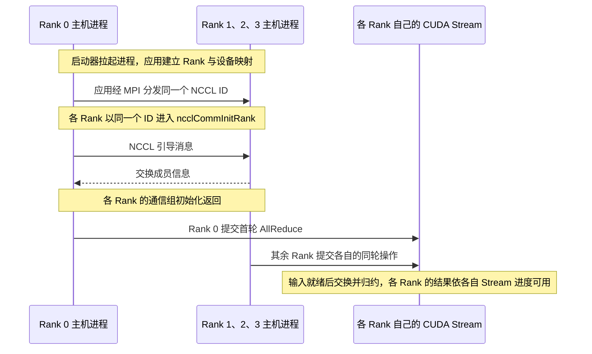

把两卡求和扩展到两台 Linux 服务器 `gpu-a` 和 `gpu-b`。每台有两张独立显存的 GPU，每个进程使用一张 GPU，由 Open MPI 启动和协调。MPI（Message Passing Interface，消息传递接口）是一套进程间通信接口，Open MPI 是其中一种实现。四个 Rank 各自用一段 `float` 数组贡献梯度，组内的目标是在每张卡上得到同一份逐元素求和结果。本例采用 NCCL 2.27.3 和发行说明列出的 CUDA 12.9，以下按普通阻塞式初始化和单次未分组的集合调用说明。通信组的建立与设备上完成一次集合操作分别有各自的进度。 [NCCL 2.27.3 发行说明](https://docs.nvidia.com/deeplearning/nccl/archives/nccl_2273/release-notes/rel_2-27-3.html) · [通信组创建](https://docs.nvidia.com/deeplearning/nccl/archives/nccl_2273/user-guide/docs/usage/communicators.html)

## 四个进程如何对应四张 GPU

启动器按主机和进程数拉起进程。应用读取作业内的进程编号（MPI Rank）和本机编号（Local Rank），为进程选卡，然后给同一 NCCL 组的每张参与设备指定唯一 Rank。本例只有一个组，故意让 MPI Rank 与 NCCL Rank 相同。假如另建只包含原 Rank 1 和 3 的组，新组内它们可分别编号为 0 和 1。 [Open MPI 5.0.6 进程环境变量](https://docs.open-mpi.org/en/v5.0.6/tuning-apps/environment-var.html) · [NCCL 组内设备和 Rank](https://docs.nvidia.com/deeplearning/nccl/archives/nccl_2273/user-guide/docs/usage/communicators.html)

| 主机 | MPI Rank / NCCL Rank | Local Rank | CUDA device | GPU PCI BDF |
| --- | ---: | ---: | ---: | --- |
| `gpu-a` | 0 | 0 | 0 | `0000:41:00.0` |
| `gpu-a` | 1 | 1 | 1 | `0000:61:00.0` |
| `gpu-b` | 2 | 0 | 0 | `0000:41:00.0` |
| `gpu-b` | 3 | 1 | 1 | `0000:61:00.0` |

表中每个进程都看到本机两张卡，设备枚举顺序一致，应用才可以把 Local Rank 直接当作 CUDA 序号。若每个进程经 `CUDA_VISIBLE_DEVICES` 只看到分配给自己的卡，四个进程都可能选中 `device 0`。此时用主机名和 PCI BDF（总线、设备、功能等组成的设备地址）对回物理卡。同一个 NCCL 组要为不同 Rank 使用不同 CUDA 设备。一个进程可以管理多个 Rank，每个 Rank 各有自己的设备和通信组对象。 [CUDA 12.9 可见设备与枚举](https://docs.nvidia.com/cuda/archive/12.9.0/cuda-c-programming-guide/index.html#env-vars) · [NCCL 通信组创建](https://docs.nvidia.com/deeplearning/nccl/archives/nccl_2273/user-guide/docs/usage/communicators.html)

## ID 分发与 NCCL 引导

四个进程怎样知道自己正在加入同一个组？先由 Rank 0 调用 `ncclGetUniqueId` 得到一份 ID，应用用 `MPI_Bcast` 把这些字节交给参与的四个进程。各进程选定自己的 CUDA 设备，调用 `ncclCommInitRank`，带上同一 ID、相同的 `nranks=4` 和自己唯一的组内 Rank。NCCL 据此开始 bootstrap（引导），交换内部建立通信关系所需的信息。框架中的 Rendezvous（会合）也可承担成员发现和交付 ID 的工作。在本例中，这些工作由应用与 MPI 完成。 [NCCL 通信组 API](https://docs.nvidia.com/deeplearning/nccl/archives/nccl_2273/user-guide/docs/usage/communicators.html) · [NCCL 引导源码](https://github.com/NVIDIA/nccl/blob/v2.27.3-1/src/bootstrap.cc)

本例的默认 NCCL 引导使用 `eno1` 上的 TCP Socket，建立联系需要引导地址和监听端口互通。GPU 载荷经另一张网卡和 RoCEv2 计算网传输。RoCEv2 在以太网上承载 RDMA。两条路径各有自己的可达性条件。 [NCCL 引导实现](https://github.com/NVIDIA/nccl/blob/v2.27.3-1/src/bootstrap.cc) · [NCCL 网络接口选项](https://docs.nvidia.com/deeplearning/nccl/archives/nccl_2273/user-guide/docs/env.html#nccl-socket-ifname)

## 集合提交、输入依赖与结果可用

设四个 Rank 的首轮输入依次为 `[1, 2]`、`[3, 4]`、`[5, 6]`、`[7, 8]`。每个 Rank 都请求同一组中的 `ncclAllReduce`，元素数为 2，数据类型为 `ncclFloat32`，操作为 `ncclSum`。两个位置分别累加，完成时每张卡得到 `[16, 20]`。如果接着还要做第二轮，全组必须以一致的顺序提交匹配的操作。某个 Rank 跳过第一轮、调用了另一种集合操作或使用了不同的元素数，都会破坏匹配条件，后果可能是挂起、报错或数据错误。 [NCCL 2.27.3 集合调用契约](https://docs.nvidia.com/deeplearning/nccl/archives/nccl_2273/user-guide/docs/usage/collectives.html) · [NCCL 调用顺序示例](https://docs.nvidia.com/deeplearning/nccl/archives/nccl_2273/user-guide/docs/usage/groups.html#group-operation-ordering-semantics)

`ncclAllReduce` 成功返回时，工作已经入队。CUDA 再让 GPU 按 Stream 依赖执行。如果输入生产、集合操作、结果消费都排在同一条 Stream 上，队列顺序提供这两个依赖。如果使用三条 Stream，就在生产 Stream 的写入之后记录 CUDA Event（可以由其他 Stream 等待的设备进度标记），通信 Stream 等它再开始；随后在通信 Stream 的 AllReduce 之后记录另一个 Event，消费 Stream 等到这个 Event 再读结果。主机若要等待本地设备工作完成，可以检查 Event 或同步相应 Stream。若操作迟迟未完成，还需结合其他 Rank 的进度和异步错误状态判断。 [NCCL CUDA Stream 语义](https://docs.nvidia.com/deeplearning/nccl/archives/nccl_2273/user-guide/docs/usage/streams.html) · [NCCL 异步错误处理](https://docs.nvidia.com/deeplearning/nccl/archives/nccl_2273/user-guide/docs/usage/communicators.html#error-handling-and-communicator-abort)

### 首轮可能还需要建数据连接

NCCL 从 2.22 起支持在运行时才连接部分对端。在 2.27.3 中，`NCCL_RUNTIME_CONNECT` 默认取 1，源码还检查 `comm->cuMemSupport`，即该组的 CUDA cuMem 支持状态。满足条件时，部分连接可在首次使用相应算法时才准备，因此 `Init COMPLETE` 之后仍可能遇到第一次数据建连失败。另有从 2.23 起提供的 `NCCL_OOB_NET_ENABLE=1`，它可以将初始化中收集全组信息的 bootstrap AllGather 改为用 NCCL NET 实现。本章主例保留默认 Socket 引导。 [NCCL 环境变量](https://docs.nvidia.com/deeplearning/nccl/archives/nccl_2273/user-guide/docs/env.html#nccl-runtime-connect) · [运行时连接开关](https://github.com/NVIDIA/nccl/blob/v2.27.3-1/src/init.cc#L1148) · [算法连接准备](https://github.com/NVIDIA/nccl/blob/v2.27.3-1/src/enqueue.cc#L463)

至此每个 Rank 都知道自己该拿到 `[16, 20]`，也知道何时能读。实际执行中，每份数据可以怎样分步抵达，取决于 NCCL 为操作选出的交换算法。
