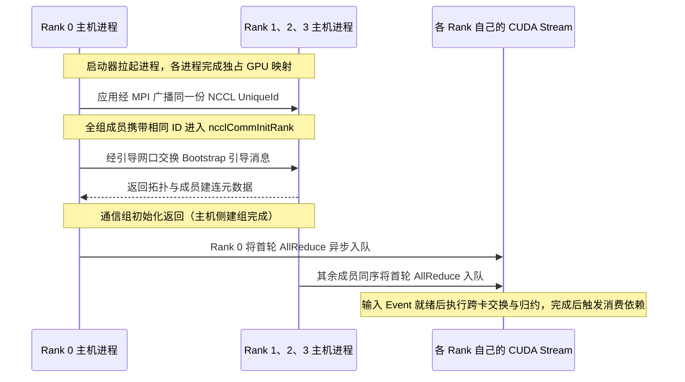

# NCCL 通信组初始化与 CUDA Stream 执行

多卡作业跑起来时，新手常撞上两个反直觉的现场：一是明明四张 GPU 都在线，程序却永远卡在初始化阶段；二是 `ncclAllReduce()` 早已返回成功，业务代码马上去读显存却读出了旧值。

要拆解这两个现象，必须把**主机侧建组进度**和**设备侧执行进度**彻底分开看。下面我们把上一篇的两卡场景扩展到两台 Linux 服务器 `gpu-a` 与 `gpu-b`，每台挂两张独立显存的 GPU，以一进程一卡的方式由 Open MPI 5.0.6 启动（MPI 是多进程并行通信标准，Open MPI 是其主流实现），沿标准阻塞式初始化完整走一遍生命周期。

## 进程、组内 Rank 与物理设备的对齐

启动器在两台主机上各拉起两个进程后，应用会先从环境变量读取全局进程号（MPI Rank）和本机局部编号（Local Rank），为当前进程选定一张独占的 GPU，再向 NCCL 申报自己在通信组内的 Rank。本场景仅建一个全局通信组，因此直接让 NCCL Rank 与 MPI Rank 保持一致：

| 主机名 | MPI Rank / NCCL Rank | Local Rank | 进程内 CUDA 序号 | 物理 GPU PCI BDF |
| --- | ---: | ---: | ---: | --- |
| `gpu-a` | 0 | 0 | 0 | `0000:41:00.0` |
| `gpu-a` | 1 | 1 | 1 | `0000:61:00.0` |
| `gpu-b` | 2 | 0 | 0 | `0000:41:00.0` |
| `gpu-b` | 3 | 1 | 1 | `0000:61:00.0` |

上表对应“每个进程都能看到本机全部两张卡且枚举顺序一致”的情形，因此可以直接用 `Local Rank` 作为 CUDA 设备号。如果调度层通过 `CUDA_VISIBLE_DEVICES` 给每个进程只暴露一张独占卡，那么四个进程在各自眼里看到的都会是 `device 0`——此时只能用**主机名 + PCI BDF（或 GPU UUID）** 把它们对回物理卡。

同一通信组内，不同 Rank 必须绑定不同的物理 GPU。单个进程虽然可以同时管理多个 Rank，但每个 Rank 仍须对应各自独立的物理设备与 Communicator 对象，避免多成员争抢同一张卡引发死锁或非法状态。

## UniqueId 分发与双网分离的 Bootstrap 引导

四个分布在不同服务器上的进程，一开始彼此互不相识，怎样才能确认“我们四个要拉成一个通信组”？核心依赖两步接力：

1. **带外分发凭证**：组内指定成员（通常为 Rank 0）调用 `ncclGetUniqueId` 生成一份包含引导监听地址与随机标识的唯一 ID，再由应用经 `MPI_Bcast`（或 PyTorch 弹性训练中的 Rendezvous 存储）分发给全部成员。
2. **Bootstrap 引导建组**：各进程绑定好自己的 CUDA 设备后，携带同一份 UniqueId、一致的总成员数（`nranks=4`）和各自唯一的 Rank 号调用 `ncclCommInitRank`。NCCL 据此启动 Bootstrap 引导协议，在成员间交换拓扑与建连元数据，最终返回可用的 Communicator。

```c
// 1. 仅由组内指定进程生成 UniqueId，再经 MPI/Rendezvous 广播给全部成员
ncclUniqueId id;
if (rank == 0) ncclGetUniqueId(&id);
MPI_Bcast(&id, sizeof(id), MPI_BYTE, 0, MPI_COMM_WORLD);

// 2. 各进程绑定独占 GPU 并进入引导初始化（需全组成员共同调用）
cudaSetDevice(local_rank);
ncclComm_t comm;
ncclCommInitRank(&comm, nranks, id, rank);

// 3. 在目标 CUDA Stream 上提交集合操作（异步入队，不代表设备已算完）
ncclAllReduce(sendbuff, recvbuff, count, ncclFloat32, ncclSum, comm, comm_stream);

// 4. 记录完成 Event，让后续消费 Stream 等待结果真正落盘到显存
cudaEventRecord(comm_done, comm_stream);
cudaStreamWaitEvent(compute_stream, comm_done, 0);
```

> [!warning] 常见误区：引导网通 ≠ 计算网通
> 默认配置下，NCCL 的 Bootstrap 引导走的是主机普通网口（本场景为 `eno1`）上的 TCP Socket，要求引导 IP 与临时监听端口互通；而真正的 GPU 张量载荷则走高速 RoCEv2 计算网。两条路径物理独立、路由各异：高速网卡链路灯亮不代表 TCP 引导不会卡死，反之 `Init COMPLETE` 也不代表高速数据面毫无隐患。

## 同序提交、Stream 异步与 Event 同步

建组完成后，四个 Rank 分别用长度为 2 的 `float32` 向量 `[1, 2]`、`[3, 4]`、`[5, 6]`、`[7, 8]` 发起首轮求和 `ncclAllReduce`。全组逐位累加后，每张卡的接收缓冲最终都会得到 `[16, 20]`。

集合通信有一条铁律：**同组全部成员必须以完全一致的顺序提交相互匹配的操作**。只要有一个成员因条件分支跳过了这一轮、错调了另一种集合原语、或者传入了不同的元素数量，就会破坏全组契约，轻则通信无限挂起，重则报错甚至静默算出错误数据。

更需要分清的是主机函数返回与设备执行完成的时间差。`ncclAllReduce` 在主机侧返回成功，**只说明该通信任务已经被排进对应的 CUDA Stream**，远端数据甚至可能还没开始搬运：

- **单 Stream 串行依赖**：如果输入生产 Kernel、集合通信调用和结果消费 Kernel 全都提交到同一条 CUDA Stream，队列自身的先进先出顺序就保证了“写完再传、传完再读”。
- **多 Stream 重叠依赖**：为了把通信和计算重叠起来，现代训练与推理框架往往拆分出计算 Stream 与通信 Stream。此时必须靠 **CUDA Event** 搭桥——生产侧在输入写完后记录 Event，通信 Stream 先等待该 Event 再启动传输；通信结束后再记录完成 Event，消费 Stream 等到它才能安全读取归约结果。
- **主机侧等待与异步排错**：若主机 CPU 需要确认本地 GPU 已经真正完成这轮通信，须查询对应 Event 或同步该 Stream；若长时间迟迟未就绪，则不能只盯本机，必须结合其余成员进度和 NCCL 异步错误状态综合判断。



*图 08-02-01：NCCL 通信组初始化与首轮集合操作在主机进程与 CUDA Stream 之间的时序分工。*

## 首轮集合为何还可能遭遇建连失败

很多工程师以为日志里打印出 `Init COMPLETE`，就说明所有跨机高速网络通道都已经建通了，这在现代 NCCL 版本里已经不再成立。

> [!note] 版本与平台说明：延迟建连与带外网络引导
> - **运行时延迟建连（`NCCL_RUNTIME_CONNECT`）**：自 NCCL 2.22 引入，在 NCCL 2.27.3 中默认值为 `1`（结合通信组的 `cuMemSupport` 生效）。为加速大集群启动，部分数据通道会推迟到**首次调用对应算法时**才按需建连——因此 `Init COMPLETE` 后的首轮集合仍可能爆出网卡 QP 建连失败。
> - **用高速网替代 Socket 引导（`NCCL_OOB_NET_ENABLE`）**：NCCL 2.23 起支持将 `NCCL_OOB_NET_ENABLE=1`，把初始化阶段用于汇总全组信息的 Bootstrap AllGather 改由 NCCL NET 后端承载。本章常规示例仍沿用默认 TCP Socket 引导。
> - **CUDA 兼容性说明**：全书统一以 `CUDA 13.2.1` 作为参考软件栈，NCCL 2.27.3 遵循 CUDA 主/次版本兼容机制配合运行。

至此，每个成员都知道自己该拿回 `[16, 20]`，也清楚什么时候才能安全消费结果。接下来最关键的问题浮出水面：这几张卡之间的数据块究竟按什么路线传递，才既不堵在单点，又能兼顾训练的大吞吐和推理的低延迟？下一篇我们直接拆解 Ring 与 Tree 两种经典算法。

> [!info]- 参考资料
> - **NCCL 通信组、调用顺序与 Stream 语义**：[NCCL 2.27.3 Release Notes](https://docs.nvidia.com/deeplearning/nccl/archives/nccl_2273/release-notes/rel_2-27-3.html)、[Creating a Communicator & Error Handling](https://docs.nvidia.com/deeplearning/nccl/archives/nccl_2273/user-guide/docs/usage/communicators.html#error-handling-and-communicator-abort)、[Collective Operations](https://docs.nvidia.com/deeplearning/nccl/archives/nccl_2273/user-guide/docs/usage/collectives.html)、[Group Operation Ordering Semantics](https://docs.nvidia.com/deeplearning/nccl/archives/nccl_2273/user-guide/docs/usage/groups.html#group-operation-ordering-semantics)、[CUDA Stream Semantics](https://docs.nvidia.com/deeplearning/nccl/archives/nccl_2273/user-guide/docs/usage/streams.html)
> - **NCCL 环境变量与内部实现**：[NCCL 2.27.3 `NCCL_SOCKET_IFNAME` / `NCCL_RUNTIME_CONNECT`](https://docs.nvidia.com/deeplearning/nccl/archives/nccl_2273/user-guide/docs/env.html#nccl-runtime-connect)、[`src/bootstrap.cc`](https://github.com/NVIDIA/nccl/blob/v2.27.3-1/src/bootstrap.cc)、[`src/init.cc#L1148`](https://github.com/NVIDIA/nccl/blob/v2.27.3-1/src/init.cc#L1148)、[`src/enqueue.cc#L463`](https://github.com/NVIDIA/nccl/blob/v2.27.3-1/src/enqueue.cc#L463)
> - **Open MPI 与 CUDA 设备枚举**：[Open MPI 5.0.6 Environment Variables](https://docs.open-mpi.org/en/v5.0.6/tuning-apps/environment-var.html)、[CUDA 13.2.1 Programming Guide](https://docs.nvidia.com/cuda/archive/13.2.1/cuda-programming-guide/)
