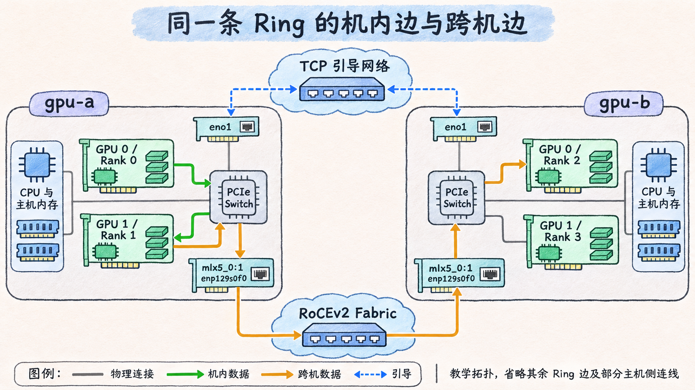

# 从设备拓扑到 P2P、SHM 和 NET

两台机器各有两张 GPU 和一个已激活的 RoCEv2 端口。对 NCCL 而言，还要知道哪张卡属于哪个 Rank、同机的 GPU 能否直接访问彼此、哪张 NIC 能访问哪些 GPU 的显存。读路径时，把一条逻辑边的两个 Rank 先对回设备，再确认该边所用的传输。

## 给通道里的每条边找物理路径

在 NCCL 2.27.3 中，初始化会建立本地拓扑并计算设备间路径，搜索 Ring、Tree 等通信图，再把多节点信息合成为各 Rank 的通道关系。一个通道承载集合操作的一部分工作，有自己的邻居关系。比如某条 Ring 通道采用 `0 → 1 → 2 → 3 → 0`，且 Rank 0、1 在 `gpu-a`，Rank 2、3 在 `gpu-b`，那么 `0 → 1` 是同机边，`1 → 2` 是跨机边。普通数据连接按方向尝试 P2P、SHM、NET 等候选。每个传输实现会检查自己能否连接给定端点，图搜索、设备放置和可用性会一起改变实际路径。 [NCCL 拓扑初始化源码](https://github.com/NVIDIA/nccl/blob/v2.27.3-1/src/init.cc#L814) · [传输选择源码](https://github.com/NVIDIA/nccl/blob/v2.27.3-1/src/transport.cc#L14)

| 边与条件 | 载荷经过的主要位置 |
| --- | --- |
| 同机，GPU P2P 可用且被选中 | 一张 GPU 经 PCIe 或 NVLink 访问对端 GPU 显存。两张卡仍各有独立显存。 |
| 同机，选用 SHM | 两端通过主机共享缓冲交换数据。SHM 可使用 CUDA 的 cuMem host allocation 或 `/dev/shm` 实现。 |
| 跨机，选用内置 IB Verbs，且该方向选用 GDR | 网卡直接 DMA 访问注册的 GPU 缓冲区。本例数据经 RoCEv2 以太网到达对端网卡。 |
| 跨机，选用内置 IB Verbs，该端该方向用主机缓冲 | GPU 与主机缓冲之间仍要搬运一次，NIC 对注册的主机缓冲执行 RDMA。 |
| 跨机，选用内置 Socket | 数据经主机缓冲和 TCP/IP Socket 发送，实际 IP 网口取决于 Socket 接口选择。 |

SHM 的实现会影响排障方向。NCCL 2.24 起，在驱动暴露的 CUDA 版本至少为 12.6、CUDA Runtime 至少为 12.2 且支持 cuMem host allocation 时，默认使用该分配机制。NCCL 2.26.5 起会检查它是否正常，并在需要时改用 `/dev/shm`。因而同样是共享缓冲初始化问题，可能需要核对 NUMA 支持，也可能需要检查 `/dev/shm` 的空间和权限。 [NCCL 共享内存排障](https://docs.nvidia.com/deeplearning/nccl/archives/nccl_2273/user-guide/docs/troubleshooting.html#cuMem-host-allocations) · [NCCL SHM 实现](https://github.com/NVIDIA/nccl/blob/v2.27.3-1/src/transport/shm.cc)

GPUDirect RDMA（GDR）描述的是 GPU 与 NIC 之间的 DMA 路径。它需要支持的 GPU、NIC、PCIe 路径与显存注册机制，例如平台支持的 DMA-BUF 或 `nvidia-peermem`。它可以在一条边的接收端启用，而发送端仍用主机缓冲。对发送端而言，`NCCL_NET_GDR_READ` 影响 NIC 是否直接读 GPU 缓冲。2.27.3 的源码还根据 GPU 架构、本地其他 GPU、NVLink 和距离判断自动值，排查时要结合版本和方向看。 [NCCL GPU Direct 排障](https://docs.nvidia.com/deeplearning/nccl/archives/nccl_2273/user-guide/docs/troubleshooting.html#gpu-direct) · [GDR 选择源码](https://github.com/NVIDIA/nccl/blob/v2.27.3-1/src/graph/paths.cc#L388)

## 把 RDMA 端口、网络接口和 GID 对齐

先用 `nvidia-smi topo -m` 和 GPU 的 PCI BDF 核对 GPU–NIC 亲和关系，再用 `rdma link show mlx5_0/1` 把 RDMA 端口对回 netdev。`ibv_devinfo -d mlx5_0 -i 1` 可查看该端口的链路层、状态和活动 MTU。在本例，两节点名称相同，地址分别如下。 [NVIDIA SMI 拓扑选项](https://docs.nvidia.com/deploy/nvidia-smi/index.html) · [rdma-link 手册](https://github.com/iproute2/iproute2/blob/v6.12.0/man/man8/rdma-link.8) · [ibv_devinfo 手册](https://github.com/linux-rdma/rdma-core/blob/v57.0/libibverbs/man/ibv_devinfo.1)

| 角色 | 标识 | `gpu-a` | `gpu-b` |
| --- | --- | --- | --- |
| TCP 引导 | `eno1` | `192.0.2.11` | `192.0.2.12` |
| RoCEv2 载荷 | `mlx5_0:1` / `enp129s0f0` | `198.51.100.11` | `198.51.100.12` |

GID 是 RDMA 端口上用来寻址的标识。RoCEv2 把 RDMA 传输封装在 UDP/IP 上，使用 UDP 目的端口 4791。用 IPv4 时，GID 表里可见对应的 IPv4 映射地址。对每个本地索引 `i`，检查 `/sys/class/infiniband/mlx5_0/ports/1/` 下的 `gids/i`、`gid_attrs/types/i` 和 `gid_attrs/ndevs/i`。例如在 `gpu-a` 看到值 `::ffff:198.51.100.11`、类型 `RoCE v2`、接口 `enp129s0f0`，才把这个索引与表中的 RoCEv2 地址对应起来。索引是本地表项位置，两端可不同。NCCL 把内置 Verbs 后端命名为 `IB`。它在 Ethernet 链路上也能运行，所以 `NET/IB` 需要结合端口链路层与 GID 类型判读。 [NVIDIA MLNX_OFED 的 RoCE 与 GID 表](https://docs.nvidia.com/networking/display/nvidia-mlnx-ofed-documentation-v24-07-0-6-1-0.0.pdf) · [NCCL 网络后端名称](https://docs.nvidia.com/deeplearning/nccl/archives/nccl_2273/user-guide/docs/env.html#nccl-net)

在上述教学地址和网口都成立的环境中，可以把引导和数据候选范围写清楚。shell 值开头的 `=` 表示精确匹配，避免把 `mlx5_0` 的名字当作前缀使用。 [NCCL 接口与 GID 环境变量](https://docs.nvidia.com/deeplearning/nccl/archives/nccl_2273/user-guide/docs/env.html)

```bash
export NCCL_SOCKET_IFNAME='=eno1'
export NCCL_IB_HCA='=mlx5_0:1'
export NCCL_IB_ADDR_FAMILY=AF_INET
export NCCL_IB_ADDR_RANGE=198.51.100.0/24
export NCCL_IB_ROCE_VERSION_NUM=2
```

`NCCL_SOCKET_IFNAME` 筛选 IP 接口，默认 bootstrap 和内置 Socket 后端都会受它影响。`NCCL_IB_HCA` 筛选内置 Verbs 的设备和端口。NCCL 2.21 起默认动态选择 RoCE GID，2.27.3 可用后三项变量限定地址族、范围和 RoCE 版本，使用时让 `NCCL_IB_GID_INDEX` 保持未设置。较旧版本遇到 GID 选择问题时才需要按每台机器的表核对固定索引。配置限定的是选择条件，通道日志和 QP 实际使用的索引才是选路证据。 [NCCL RoCE 排障](https://docs.nvidia.com/deeplearning/nccl/archives/nccl_2273/user-guide/docs/troubleshooting.html#rdma-over-converged-ethernet-roce) · [GID 选择源码](https://github.com/NVIDIA/nccl/blob/v2.27.3-1/src/transport/net_ib.cc#L419)

## 一条 Ring 可以同时用两种互联

把 `0 → 1` 和 `1 → 2` 画在同一张拓扑图上。前一条边在 `gpu-a` 机内，经 PCIe 在两张 GPU 之间移动数据。后一条边离开 `gpu-a`，经两端 PCIe、两张 RoCE NIC 和以太网 Fabric 到达 `gpu-b`。如果后一条边两端都用 GDR，载荷可从发送 GPU 的缓冲区交给发送 NIC，再由接收 NIC 写入接收 GPU 的缓冲区。若只有接收端用 GDR，把发送 GPU 和 NIC 之间改画成经过主机缓冲即可。引导流量另走 `eno1`。



*图 08-02-01｜同一条 Ring 的两条边。绿色是 Rank 0 → 1 的机内 PCIe P2P。橙色是 Rank 1 → 2 的 RoCEv2 数据路径，假设收发两端都选用 GDR。蓝色虚线表示 TCP 引导。图中省略了其余 Ring 边和部分主机侧连线。*

装有外部网络插件或处在跨节点 NVLink 域时，候选路径会变化。若每台有多张 NIC，`NCCL_CROSS_NIC` 控制 NCCL 是否允许同一 Ring 或 Tree 在不同节点使用不同 NIC。它影响选口，交换网络上的 ECMP、拥塞和实际转发路径仍需从 Fabric 侧验证。本例只有一个 RoCE 端口。 [NCCL 网络插件、Multi-Node NVLink 与跨 NIC 选项](https://docs.nvidia.com/deeplearning/nccl/archives/nccl_2273/user-guide/docs/env.html)
