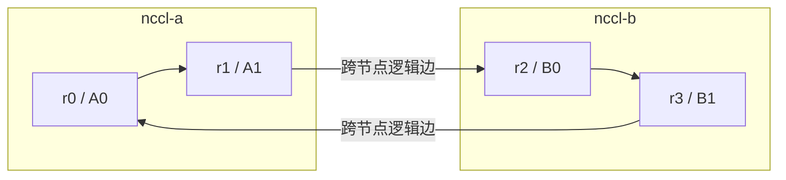

# 把 AllReduce 展开成 Ring 与 Tree

## 相同结果允许不同交换顺序

四个输入相加、每人得到一份完整和，是 AllReduce 的语义；数据先经谁、在哪相加，是算法决定的实现过程。本篇给出一个完整 Ring 教学算法，再与树形依赖比较。它们帮助推导通信量和等待，不能用来反推每次 NCCL 调用必然采用的实现。

以下为**自拟的逻辑通信图**。箭头表示下一跳成员，不表示物理直连；范围框只表示同主机。先固定一条环 r0→r1→r2→r3→r0。



## 用四个分块手算一次 Ring

将每个输入等分成 c0—c3 四块。为便于逐步检查，先让每块只含一个整数；真实分块可含大量元素，归约逐元素进行。初值为：

| Rank | c0 | c1 | c2 | c3 |
| --- | --- | --- | --- | --- |
| r0 | 1 | 2 | 3 | 4 |
| r1 | 10 | 20 | 30 | 40 |
| r2 | 100 | 200 | 300 | 400 |
| r3 | 1000 | 2000 | 3000 | 4000 |
| 目标和 | 1111 | 2222 | 3333 | 4444 |

第一阶段让每一块沿环移动并相加，直到每块都含四人的贡献，但四块的完整和暂时分散在不同成员。这个过程对应 **ReduceScatter 的“归约并分散”思想**。

每轮所有成员同时向后继发送一个块；发送内容取自本轮开始前，接收后加上本地该块的当前值。下表列出**接收后的新部分和**，没写出的块不参与本轮更新。

| 轮次 | r0 收到并相加 | r1 收到并相加 | r2 收到并相加 | r3 收到并相加 |
| --- | --- | --- | --- | --- |
| RS1 | c3：4000+4=4004 | c0：1+10=11 | c1：20+200=220 | c2：300+3000=3300 |
| RS2 | c2：3300+3=3303 | c3：4004+40=4044 | c0：11+100=111 | c1：220+2000=2220 |
| RS3 | c1：2220+2=2222 | c2：3303+30=3333 | c3：4044+400=4444 | c0：111+1000=1111 |

例如 c0 沿 r0→r1→r2→r3 依次变成 1、11、111、1111。结束时，完整 c0 在 r3、c1 在 r0、c2 在 r1、c3 在 r2。

**这只是 AllReduce 内部分块的拥有者安排**。单独调用公开 `ncclReduceScatter` 时，输出必须按接口语义交给对应 Rank；本例的偏移安排不改变公开接口，也不能拿它去预测接口输出位置。为最终得到完整 AllReduce 结果，下一阶段只需把这些块继续转发，内部此时由谁暂存不影响最终完整输出。

第二阶段不再相加，只传播完整块，形成 AllGather 的“收集全部结果”思想：

| 轮次 | 本轮收到完整块的 r0 | r1 | r2 | r3 |
| --- | --- | --- | --- | --- |
| AG1 | c0=1111 | c1=2222 | c2=3333 | c3=4444 |
| AG2 | c3=4444 | c0=1111 | c1=2222 | c2=3333 |
| AG3 | c2=3333 | c3=4444 | c0=1111 | c1=2222 |

加上各自 RS3 已拥有的块，四人最终均得到 `[1111,2222,3333,4444]`。检查时既要看结果，也要确认每一块只累计每个成员一次。实际 NCCL 可以流水切片、融合归约与传输，不需要在六轮之间各插入一次全局 Barrier。

## 从分块过程推出流量

令 N 为成员数，M 为**每 Rank 完整输入**的字节数，均分成 N 块。不考虑元数据、协议标志和重传：

- 第一阶段 N−1 轮，每轮每人发 M/N 字节。
- 第二阶段同样 N−1 轮，每轮每人发 M/N 字节。
- 因此每 Rank 发送 `2(N−1)M/N`，接收同样多。

N=4 时，每 Rank 发送 1.5M、接收 1.5M。全组发送量是 6M；若另把接收量也加起来得到 12M，会把同一份在线传输按两端计两次。对全双工链路，发送与接收可以同时推进，不能不加条件地把二者相加后除以单向带宽。

若 M=256 MiB，每块 64 MiB；每 Rank 两阶段共发 384 MiB、收 384 MiB，全组共发 1536 MiB。**其中哪些字节真正跨 NIC，要继续将逻辑边映射到物理路径**；每 Rank 流量不等于该 Rank 独享一条 NIC 的流量。本环只有 r1→r2 与 r3→r0 跨机。

## Tree 缩短的首先是依赖深度

考虑另一种自拟安排：r1 向 r0 归约，r3 向 r2 归约，再由 r2 向 r0 归约；r0 得到完整和后按相反层次广播。归约两层、广播两层，每层都处理完整向量。同层两组传输并行，层与层串行。

对于 N 为 2 的幂，依赖深度是 `2 log2(N)`，比 Ring 的 `2(N−1)` 轮增长慢。代价是这份**未分片、逐层传完整向量的教学树**沿关键路径要处理 `2 log2(N) × M` 字节，根侧和父节点的带宽分担也需评估。

为了只比较这两个依赖模型，另给如下理想条件：每个通信轮固定开销 α；本层有效带宽 B 已包括父节点并发分担；成员均准时；没有额外共享瓶颈；不跨轮流水、不重叠计算和通信。

```text
Ring：T ≈ 2(N−1)α + [2(N−1)/N] × M/B
教学树：T ≈ 2log2(N)α + 2log2(N) × M/B
```

取 N=4、α=5 μs、B=20 GB/s：

| M | Ring | 教学树 | 在题设中谁更快 |
| --- | --- | --- | --- |
| 1024 B | 30.0768 μs | 20.2048 μs | 教学树，固定轮次开销占主导 |
| 256 MiB | 20.1626592 ms | 53.7070912 ms | Ring，教学树的完整向量搬运较多 |

这里 B 是额外给定的**算法轮次有效预算**，不由导读的 NIC 数量直接推得。不能拿这两个结果作为真实节点的基准或 NCCL 的切换阈值。

NCCL 的 Tree 不能简化为上表那一棵未分片树。NCCL 2.4 引入的双二叉树将数据分给互补的树，让父节点职责得到分担，兼顾带宽与对数级依赖深度；它并不必然付出教学树的 `2log2(N)M/B` 时间。该设计的原始说明见 [NVIDIA：NCCL 2.4，Double binary trees](https://developer.nvidia.com/blog/massively-scale-deep-learning-training-nccl-2-4/)。本文使用其结构动机，不沿用文章所测平台的性能数字。

## 算法选择为何还需要消息大小和机器条件

小消息时，分块后每块更小，启动、协调与可见性开销会突出；大消息时，更关心能否流水并持续占用高带宽路径。增加 N 一方面增加 Ring 轮数，另一方面也改变树的深度、节点内外边的比例以及每个 NIC 的负载。于是“Ring 大消息好，Tree 小消息好”只能作为观察上述模型的起点，不能成为无条件选择规则。

实际选择还要看集合类型、GPU 和 NIC 拓扑、可用协议、通道数、平台加速能力与估计成本。版本固定后的成本模型可追溯到 [NCCL v2.31.2-1 的 tuning 实现](https://github.com/NVIDIA/nccl/blob/v2.31.2-1/src/tuning/tuning.cc)。其他算法与硬件路径，例如 NVLS、CollNet，在适用环境下会改变通信组织；它们不在本章普通 PCIe/RDMA 模型里。浮点加法顺序随算法变化时，末位结果也可能变化，应使用适合数据类型的正确性判据。

现在已有完整逻辑过程。下一步要回答：同一条 r1→r2 的逻辑边，显存数据究竟经过哪些设备？

[上一篇：从应用调用走到通信完成](01_从应用调用走到通信完成.md) · [下一篇：把逻辑通信放回设备路径](03_把逻辑通信放回设备路径.md)
