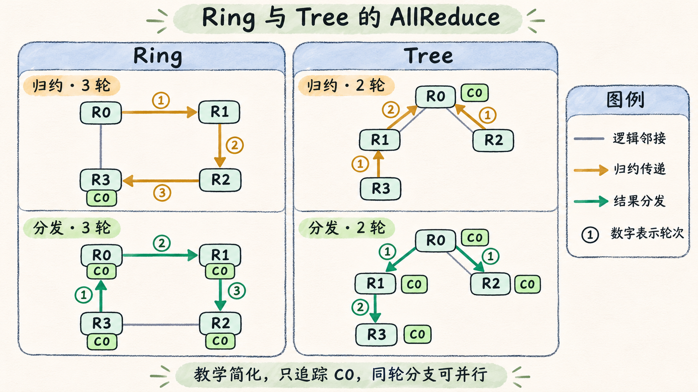

AllReduce 要让每个 Rank 得到相同的完整归约结果。以求和为例，某段结果只有在合并了全组对这个位置的贡献后才能分发。Ring（环）和 Tree（树）都满足这一条件，区别在于部分和由谁积累、每个阶段有多少次依赖，以及带宽消耗分布在哪些边上。先按四 Rank 的逻辑连接推导，随后再将这些边落到设备。 [NCCL AllReduce 语义](https://docs.nvidia.com/deeplearning/nccl/archives/nccl_2273/user-guide/docs/usage/collectives.html#allreduce) · [NVIDIA 对 Ring 与 Tree 的说明](https://developer.nvidia.com/blog/massively-scale-deep-learning-training-nccl-2-4/)

## Ring 同时归约不同的数据块

设四个 Rank 的逻辑环为 `0 → 1 → 2 → 3 → 0`，每 Rank 输入 4 MiB，按相同的数组位置切成 `C0` 至 `C3` 四个 1 MiB 块。每个 Rank 都有这四块的本地贡献。第一个阶段让不同块从不同 Rank 出发，使四条环边在同一轮都有数据可发。接收方把收到的部分和加上自己对应块的贡献，下一轮再向前传。第二个阶段传播已归约的块，各接收方保存副本。 [nccl-tests 对 Ring 传输步骤的推导](https://github.com/NVIDIA/nccl-tests/blob/v2.17.9/doc/PERFORMANCE.md#allreduce)

| 阶段与轮次 | 0 → 1 | 1 → 2 | 2 → 3 | 3 → 0 |
| --- | --- | --- | --- | --- |
| ReduceScatter 1 | **C0** | C1 | C2 | C3 |
| ReduceScatter 2 | C3 | **C0** | C1 | C2 |
| ReduceScatter 3 | C2 | C3 | **C0** | C1 |
| AllGather 1 | C1 | C2 | C3 | **C0** |
| AllGather 2 | **C0** | C1 | C2 | C3 |
| AllGather 3 | C3 | **C0** | C1 | C2 |

跟着 `C0` 看第一阶段。Rank 0 先发出自己的贡献。到 Rank 1 时有两份，到 Rank 2 时有三份，到 Rank 3 时四份齐全。其它块同时沿环前进，最终 Rank 0/1/2/3 各持有完整的 `C1/C2/C3/C0`。这是本例 AllReduce 的内部布局，独立调用 `ncclReduceScatter` 时按组内 Rank 的索引交付结果片。传播阶段从 Rank 3 已完成的 `C0` 出发，再走三跳，让另外三张卡各留一份。每个 Rank 把收到的完整块写到它在数组中的原位置。 [NCCL ReduceScatter 输出顺序](https://docs.nvidia.com/deeplearning/nccl/archives/nccl_2273/user-guide/docs/usage/collectives.html#reducescatter)

单一环中，归约块需经过 `P−1` 跳才能合并全部 `P` 份贡献，完整块再走 `P−1` 跳交付另外的成员。每轮每 Rank 发出、收到各一个块。设每 Rank 输入为 `S` 字节，能等分成 `P` 块，模型中每个 Rank 的发送量为 `2(P−1) × S/P`，接收量相同。四 Rank、4 MiB 的例子共六轮，每 Rank 发 6 MiB、收 6 MiB。两个方向分别计量，流量只含算法载荷。 [nccl-tests AllReduce 字节量](https://github.com/NVIDIA/nccl-tests/blob/v2.17.9/doc/PERFORMANCE.md#allreduce)

## Tree 让不同分支同时向根汇总

换成一棵教学树。Rank 0 是根，Rank 1、2 是它的子节点，Rank 3 挂在 Rank 1 下。仍跟踪 `C0`。第一轮，Rank 3 把贡献给 Rank 1，Rank 2 把贡献给 Rank 0。第二轮，Rank 1 合并自己与 Rank 3 的贡献后送到 Rank 0，根再把两边的部分和并成全局结果。广播沿反向树边，第一轮从 0 给 1 和 2，第二轮从 1 给 3。假设同轮分支可并行，归约和广播各需两轮，由最深的两跳路径决定。

*图 08-03-01　只追踪数据块 C0。橙色是归约传递，绿色是结果分发。环的两个阶段各三轮，树的两个阶段各两轮，均按图中的逻辑依赖和并行假设计数。*

一棵平衡的树可以让最长依赖路径随 Rank 数按对数增长。处在树内部的节点会负责合并与转发，若多条边共享它的收发资源，并行传输仍会竞争带宽。NCCL 2.4 引入双二叉树，将数据分给两棵互补的树。一个 Rank 至多在其中一棵担任内部节点，转发职责因此能分摊到更多 Rank。实际算法也可以让不同的数据块在不同的层次同时推进。 [NVIDIA 双二叉树设计](https://developer.nvidia.com/blog/massively-scale-deep-learning-training-nccl-2-4/)

## 轮数与带宽怎样共同决定耗时

另取一个八 Rank 算例。假设链路同质，每轮固定开销为 `α = 2 µs`，并行通信对各有 `B = 25 GB/s` 的单向有效带宽，收发可以重叠，忽略归约计算、协议开销和共享争用。下面的树用无分块的二项树调度，每阶段 `log₂(P)` 轮，关键路径上每轮传完整的 `S` 字节，`P=8`。环每轮传 `S/P` 字节。

| 模型 | 时间估算 | 4 KiB | 4 MiB |
| --- | --- | ---: | ---: |
| 分块 Ring | `2(P−1) × (α + S/(P×B))` | 28.29 µs | 321.60 µs |
| 无分块二项树 | `2 log₂(P) × (α + S/B)` | 12.98 µs | 1018.63 µs |

在 4 KiB 一列，环的十四轮固定开销已占 28 µs，传数据只需约 0.29 µs。树只有六轮，固定开销占 12 µs，即使每轮传完整输入，也先完成。换到 4 MiB，环的关键路径共传 `1.75S`，无分块树传 `6S`，字节量开始主导。令两个式子相等，得到 `8α = 4.25S/B`，交点约 92 KiB。若带宽不变而每轮开销翻倍，模型交点也翻倍。实际 NCCL 双树会分块流水，机器还会有机内、机间和共享链路，交点只适用于这两个简化模型。

## NCCL 怎样组合算法、协议与通道

Ring 或 Tree 是**算法**，规定成员之间如何交换。**通道**是 NCCL 组织一部分通信工作的逻辑路径，可以有自己的环顺序或树关系。不同通道能处理不同块，也可能共用一个网口。**协议**是 NCCL 内部搬运、分块和同步的方式，例如 `Simple`、`LL`、`LL128`。每条逻辑边还需要一个**传输实现**来搬运数据，例如机内显存直达或网络后端。知道算法，只确定了其中一层。 [NCCL 算法与协议选项](https://docs.nvidia.com/deeplearning/nccl/archives/nccl_2273/user-guide/docs/env.html#nccl-algo) · [NCCL 2.27.3 调优模型源码](https://github.com/NVIDIA/nccl/blob/v2.27.3-1/src/graph/tuning.cc)

在 2.27.3 中，NCCL 根据操作、消息大小、硬件能力与拓扑筛选候选，并利用估计的延迟和带宽选择算法与协议。适用的 NVSwitch 域可能支持 NVLink SHARP（NVLS，在互联中加速集合处理），CollNet 则依赖集合网络插件和操作支持。两套系统的候选和成本不同，算法也可能不同。 [NCCL 2.27.3 选择实现](https://github.com/NVIDIA/nccl/blob/v2.27.3-1/src/enqueue.cc) · [NVLS 与 CollNet 条件](https://docs.nvidia.com/deeplearning/nccl/archives/nccl_2273/user-guide/docs/env.html#nccl-nvls-enable)

做诊断对照时，可保留一轮自动选择，再短时设置 `NCCL_ALGO=Ring` 或 `NCCL_ALGO=Tree`。固定绑定、后端、消息和数据类型，用单独的 `NCCL_DEBUG=INFO`、`NCCL_DEBUG_SUBSYS=TUNING` 诊断轮，在组内 Rank 0 的日志中核对 `Algo`、`proto` 和通道范围。协议仍自动选择时，比较的是算法与各自所选协议的组合。2.27.3 中，若允许列表不含 Ring 且无法选出有效算法，调用会失败。 [NCCL 算法白名单规则](https://docs.nvidia.com/deeplearning/nccl/archives/nccl_2273/user-guide/docs/env.html#nccl-algo) · [TUNING 日志源码](https://github.com/NVIDIA/nccl/blob/v2.27.3-1/src/enqueue.cc#L748)

回到四 Rank 环，`0 → 1` 和 `1 → 2` 在算法里各承担一次同样大小的发送。把 Rank 对回主机，前者留在机内，后者必须跨机。它们实际能否同时按模型推进，要到设备路径上判断。
