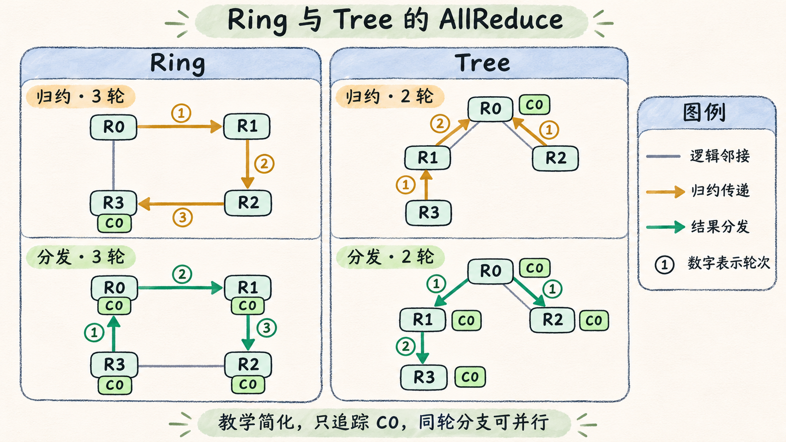

# 同一次 AllReduce 为何选择 Ring 或 Tree

同样是给四张 GPU 求和，NCCL 可以让相邻 Rank 一轮轮交换数据，也可以沿树形关系先归约再分发。结果都要回到每个 Rank，但一块数据经过的步骤、各条边承担的流量和可以并行的程度不同。 [NCCL 集合操作定义](https://docs.nvidia.com/deeplearning/nccl/archives/nccl_2273/user-guide/docs/usage/collectives.html)

## 跟着一块数据走完 Ring

假设四个 Rank 组成 `0 → 1 → 2 → 3 → 0` 的单一逻辑环。每个 Rank 有 4 MiB 输入，按相同的数组位置切成 `C0` 至 `C3` 四块。每个块都要汇集四个 Rank 的贡献。先看 `C0` 在 ReduceScatter 阶段如何走，其他三块同时从各自的起始 Rank 出发。 [NVIDIA Ring 与 Tree 说明](https://developer.nvidia.com/blog/massively-scale-deep-learning-training-nccl-2-4/) · [nccl-tests 的 AllReduce 传输量推导](https://github.com/NVIDIA/nccl-tests/blob/v2.17.9/doc/PERFORMANCE.md#allreduce)

| 阶段 | 轮次 | `C0` 的发送方向 | 接收方持有的 `C0` |
| --- | ---: | --- | --- |
| ReduceScatter | 1 | 0 → 1 | Rank 0、1 的贡献之和 |
| ReduceScatter | 2 | 1 → 2 | Rank 0、1、2 的贡献之和 |
| ReduceScatter | 3 | 2 → 3 | 四个 Rank 的完整归约结果 |
| AllGather | 1 | 3 → 0 | 完整归约结果的副本 |
| AllGather | 2 | 0 → 1 | 完整归约结果的副本 |
| AllGather | 3 | 1 → 2 | 完整归约结果的副本 |

归约阶段结束时，Rank 0、1、2、3 分别握有 `C1`、`C2`、`C3`、`C0` 的完整归约结果。这是本例 Ring 在 AllReduce 内部安排的中间布局，独立调用 `ncclReduceScatter` 时则按 Rank 索引交付对应片。AllGather 阶段继续传递已经完成的块，各 Rank 将它们写到输出数组的对应位置。每轮每 Rank 发 1 MiB、收 1 MiB，两个阶段各三轮，总共发 6 MiB、收 6 MiB。把每 Rank 的输入大小记为 `S`、Rank 数记为 `P`，每个方向的数据量是 `2(P−1)S/P`。这个推导数的是抽象环中的载荷，没有计入协议开销。 [NCCL ReduceScatter 输出顺序](https://docs.nvidia.com/deeplearning/nccl/archives/nccl_2273/user-guide/docs/usage/collectives.html#reducescatter)

如果 Rank 0、1 同在 `gpu-a`，Rank 2、3 同在 `gpu-b`，这个环的 `0 → 1` 和 `2 → 3` 可走机内 PCIe P2P，`1 → 2` 和 `3 → 0` 则要跨 RoCEv2 网络。改变 Rank 放置或通道顺序，会改变哪条边占用网卡，也可能改变多个通道是否争用同一端口。

## 用轮数和传输量解释大小消息的差异

树形归约让叶子向父节点递交结果，父节点合并子树的部分和并继续向上。得到全局结果后，广播沿反方向传回叶子。用同样四个 Rank 跟踪 `C0`。在这棵教学树中，Rank 0 为根，Rank 1、2 是它的子节点，Rank 3 挂在 Rank 1 下。

| 阶段 | 第 1 轮 | 第 2 轮 | 完成后的 `C0` |
| --- | --- | --- | --- |
| 向根归约 | `3 → 1`、`2 → 0` | `1 → 0` | Rank 0 收齐四个 Rank 的贡献。 |
| 向下广播 | `0 → 1`、`0 → 2` | `1 → 3` | 四个 Rank 都得到完整结果。 |

这棵树的最深路径只有两跳。在同轮分支可并行的假设下，归约和广播各需两轮。对照前面的 Ring，`C0` 的归约和分发各走三轮，但同轮还有其他数据块沿环交换。两种算法最终都把 `C0` 送到每个 Rank，差异在于关键路径的长度和流量如何分布。平衡树的关键路径随规模按对数增长，环在简化模型中每阶段需要 `P−1` 轮。NCCL 2.4 引入双二叉树，把数据分给两棵互补的树。一个 Rank 至多在其中一棵树充当内部节点，因而可以分摊转发负载。实际实现也能分块流水化，降低单树内部节点的带宽压力。 [NVIDIA 双二叉树说明](https://developer.nvidia.com/blog/massively-scale-deep-learning-training-nccl-2-4/)

*图 08-03-01｜只追踪数据块 C0。教学 Ring 的归约和分发各用三轮。教学 Tree 在同轮分支可并行时各用两轮。图中箭头表示逻辑传递，轮数用于比较关键路径。*

下面用独立的八 Rank 算例隔离两个量。假设每轮固定开销 `α = 2 µs`，每组并行通信对的单方向有效带宽 `B = 25 GB/s`，链路同质、收发可重叠，忽略计算开销和共享争用。简化 Ring 每轮发一个 `S/P` 分块。简化二项树的归约和广播各用 `log₂(P)` 轮，每个关键轮次传完整 `S`。后一个模型用于对比轮数和传输量，NCCL 的双树还会分块和流水化。

| 模型 | 时间估算 | `S = 4 KiB` | `S = 4 MiB` |
| --- | --- | ---: | ---: |
| 分块 Ring | `2(P−1)α + 2(P−1)S/(PB)` | 28.29 µs | 321.60 µs |
| 无切块二项树 | `2 log₂(P)(α + S/B)` | 12.98 µs | 1018.63 µs |

代入 `P=8` 和 `S=4096 B`，Ring 的十四轮固定开销已经占 `28 µs`，数据项只占 `0.28672 µs`。换成 `4 MiB`，传输项足以超过固定开销，且两种模型在关键路径上传输的总量不同。在真实拓扑里，带宽和延迟取决于哪条边跨机器、哪条边共享链路，以及多条通道能否同时工作，算例中的数值不能用来设置算法切换阈值。

## 从调优结果读出算法、协议和通道

可以把 NCCL 的选择拆成三层。**算法**安排 Rank 之间的交换关系，例如 Ring 或 Tree。**传输**决定一条边通过 P2P、SHM 或某种网络后端实现。**协议**是 NCCL 的 GPU 通信实现选项，例如 `Simple`、`LL`、`LL128`，影响如何分块、处理数据和同步。通道提供并行工作路径。几个通道可以落到同一个物理端口，增加通道也可能增加对同一瓶颈的竞争。 [NCCL 环境变量中的算法与协议](https://docs.nvidia.com/deeplearning/nccl/archives/nccl_2273/user-guide/docs/env.html#nccl-algo) · [NCCL 调优模型](https://github.com/NVIDIA/nccl/blob/v2.27.3-1/src/graph/tuning.cc)

2.27.3 对候选算法和协议估算延迟及带宽成本，再根据集合类型、消息大小、拓扑、通道和支持条件选择。例如支持 NVLink SHARP 的 GPU 与 NVSwitch 域可以出现 NVLS 候选。CollNet 则还取决于集合网络插件与操作支持。这些条件改变了候选集，也解释了为何两台系统在相同消息大小上可能选不同算法。 [NCCL 候选过滤与代价选择](https://github.com/NVIDIA/nccl/blob/v2.27.3-1/src/enqueue.cc#L1754) · [NCCL NVLS 条件](https://docs.nvidia.com/deeplearning/nccl/archives/nccl_2273/user-guide/docs/env.html#nccl-nvls-enable)

要在同一套机器上验证，可以先跑默认选择，再分别以 `NCCL_ALGO=Ring` 和 `NCCL_ALGO=Tree` 做短时对照。保持 Rank 放置、后端、数据类型和消息大小扫描一致，单独开一轮 `NCCL_DEBUG=INFO` 与 `NCCL_DEBUG_SUBSYS=TUNING`，用 Rank 0 的 `Algo`、`proto` 和通道范围核对实际选择。允许 NCCL 自动选协议时，这个对照反映的是各算法及其可用协议的组合。NCCL 2.24 起，如果允许的列表不含 Ring 且没有可用算法，调用会失败。 [算法白名单规则](https://docs.nvidia.com/deeplearning/nccl/archives/nccl_2273/user-guide/docs/env.html#nccl-algo) · [2.27.3 TUNING 日志源码](https://github.com/NVIDIA/nccl/blob/v2.27.3-1/src/enqueue.cc#L748)
