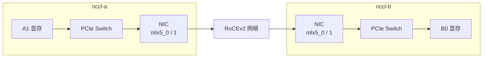

# 把逻辑通信放回设备路径

## 算法、协议与传输各决定一件事

Ring 规定了谁把分块交给谁，但没有规定分块一定走 NVLink 或 RDMA。读日志前，先把三个选择分开：

| 层次 | 回答的问题 | 本章例子 |
| --- | --- | --- |
| 算法 | 哪些成员以怎样的顺序交换、归约 | Ring、Tree |
| 通信协议 | 分块用怎样的粒度与就绪标志推进，怎样在开销和吞吐间取舍 | Simple、LL、LL128 |
| 传输与设备路径 | 两个端点通过什么资源搬数据 | P2P、SHM、NET，以及选中的 GPU/NIC |

一个数据片尚未写完时，下一端不能提前把它归约，因此需要就绪标记、检查与访问顺序。细粒度推进可以让已经就绪的部分更早交给下一端，同时会增加标记与检查的开销。协议的取舍就在这些机制中，不能只按字节数选择。

这里的 NCCL **协议**不是 TCP、RoCEv2 或 InfiniBand 链路协议。LL 系列围绕较细粒度的数据就绪与传递降低延迟，Simple 更偏向以较大数据片推进；实现所需的平台保证和有效负载开销不同。不能把 `LL128` 理解成“使用 128 Gb/s 网卡”，也不能只凭协议名字宣布它对所有消息最快。具体就绪与分片机制可对照同版 [LL](https://github.com/NVIDIA/nccl/blob/v2.31.2-1/src/device/prims_ll.h)、[LL128](https://github.com/NVIDIA/nccl/blob/v2.31.2-1/src/device/prims_ll128.h) 与 [Simple](https://github.com/NVIDIA/nccl/blob/v2.31.2-1/src/device/prims_simple.h) 实现；阅读本章不要求掌握这些源码。

**Channel（通道）**是 NCCL 把工作分开推进的一种逻辑执行组织。同一集合可以让多个通道处理不同数据片，采用各自的成员顺序或连接。通道不是新的物理 NIC；四个通道走同一端口时仍共享端口容量。更多通道可能增加并发，也会使用更多执行和连接资源，不能按通道数成倍放大硬件上限。

## 本机边可以直达，也可以经过主机内存

对于环上的 r0→r1，端点是同机 A0 与 A1。给定二者 CUDA P2P 可用，NCCL 可以通过 GPU 间直接访问完成交换；本章没有 NVLink，因此物理路径经过本地 PCIe Switch。多进程还需共享受支持的设备内存句柄，不是把另一个进程的普通指针直接当作本进程地址。

若设备间 P2P 不可用，主机共享内存可以作为本机传输的一种候选：一端 GPU 把数据送到主机可共享的缓冲，另一端 GPU 再取得数据。SHM 指进程间可共享的主机存储，不是两张 GPU 突然拥有同一块 HBM；这种路径会消耗 PCIe 与 DRAM 带宽。跨进程 P2P 的句柄共享也不等于采用 SHM 主机缓冲路径。

当前 NCCL 的共享主机缓冲可由 `/dev/shm` 或受支持的 cuMem host 分配机制实现；具体选择取决于版本与环境。不能看到 `/dev/shm` 空闲很多，就排除所有主机内存分配、NUMA 或共享失败。机制和版本差异见 [Runtime and MPI issues：Shared memory / cuMem host allocations](https://docs.nvidia.com/deeplearning/nccl/archives/nccl_2312/user-guide/docs/troubleshooting/runtime_and_mpi_issues.html#memory-issues)。本章不要求修改容器启动参数。

P2P、SHM、NET 是需要解释的路径类别，不能视为每个版本、每个平台严格逐级回退的固定列表。同机也可能选择网络路径；某资源创建失败可能直接导致初始化失败，不保证自动换一种方式成功。真正选了什么，需要结合该次连接日志判断。

## 跨机边要分清网络和 GPU—NIC 两段

每机的数据端口为 `mlx5_0` 的端口 1，对应以太网接口 `ens6f0np0`；管理接口为 `eno1`。前者的 RDMA 名称和以太网名称描述同一端口的不同软件视角，数字 0、1 不能直接与 GPU ordinal 对齐。

对 r1→r2，**基线已给定双端 GPUDirect RDMA 可用**。下面是该边 A→B 的有效负载物理路径图；范围框表示宿主机，箭头表示本轮负载方向。网络内部交换机聚合为一个节点，CPU 控制、主机 DRAM 和反向数据另行说明，未画入此负载路径。



假如 NCCL 使用 RDMA，但 GPU 缓冲未通过受支持方式注册，另一种可实现路径是：

```text
A1 → PCIe → A 的主机缓冲 → NIC-A → RDMA 网络
   → NIC-B → B 的主机缓冲 → PCIe → B0
```

因此，**RDMA 网络传输**与**GPUDirect RDMA 显存直达**要分别确认；只有一端直达时，只省掉该端中转。`NET/IB` 是 NCCL 的 Verbs 网络传输名称，也用于 RoCE，不能由它判断物理链路是 InfiniBand。IB 与 RoCE 需要用端口 Link Layer、接口和网络配置区分。分层测试读法见 [Networking Troubleshooting](https://docs.nvidia.com/deeplearning/nccl/archives/nccl_2312/user-guide/docs/troubleshooting/networking_troubleshooting.html)。

采用 Socket 网络传输时，跨机有效负载通过 IP Socket 路径搬运；在本文模型里，这会涉及主机侧缓冲与 GPU 数据交接。CPU 协助线程、NUMA 和 TCP 网络状态都会影响性能。反过来，即使使用 GPUDirect RDMA，CPU 仍可负责提交、代理推进、连接和错误处理；直达并不意味着全程没有 CPU 活动。

## 发现能力、建立路径和实际执行逐步增加证据

NCCL 可读取系统暴露的 PCIe、GPU、NIC 等信息，结合设备能力、用户约束和平台条件建立通信图与连接。以 r1 为例，先将它关联到 A1，再判断本机 A0 的可访问能力、到 NIC 的路径和注册条件，结合其他成员的信息组织候选图；发起具体操作时再按操作、消息等条件选择执行方案。发现设备、建立连接和选择一次调用的算法，因此不是同一个状态。系统拓扑视图要求见 [GPU troubleshooting：Topology detection](https://docs.nvidia.com/deeplearning/nccl/archives/nccl_2312/user-guide/docs/troubleshooting/gpu_troubleshooting.html)。读者应把证据放在对应层次：

| 证据 | 能建立的认识 | 下一步需要对应什么 |
| --- | --- | --- |
| 拓扑和设备可见 | 候选路径和设备身份 | 本机 P2P、显存注册等所需能力 |
| DMA-BUF 等能力可用 | 存在一种可用注册机制 | 这次连接/缓冲是否使用该机制 |
| 某边报告 GDRDMA | 该侧连接按显存直达方式准备 | 对端对应边、实际调用完成和校验 |
| 操作完成且校验通过 | 给定规模、缓冲和调用下功能成立 | 同条件下耗时与资源利用 |

自动选择也依赖系统信息是否正确暴露。虚拟化或容器中若拓扑视图、设备访问和共享资源与真实硬件不一致，库无法仅凭产品型号补全缺失信息；接入细节留给第 10、13 章。

## 用一条共享 NIC 复算预算

以下为**独立给定有效容量的教学计算**：每机端口标称 200 Gb/s，即标称 25 GB/s；本题实用单向有效预算设为 20 GB/s，发送与接收可同时各用这个预算。两张 GPU 共用该端口，其 PCIe/本机边在本例中更快，CPU 和归约不构成瓶颈。

第二篇的单环在每个阶段有一条 A→B 边 r1→r2、一条 B→A 边 r3→r0。M=256 MiB 时，每条边在完整 AllReduce 中承载 384 MiB，所以 A 的 NIC 发 384 MiB、收 384 MiB，B 同理。仅按网络字节预算，耗时下界为：

```text
384 × 2^20 B / (20 × 10^9 B/s) = 20.1326592 ms
```

这个下界忽略轮次开销；若再采用第二篇相同的 α=5 μs 六轮模型，就加上 30 μs。这里全双工允许两方向并行，不能把收发相加后得出 40.2653184 ms。

现在**只改变逻辑顺序**为 r0→r2→r1→r3→r0，四条边全都跨机。A 同时有两条出边，各承担 384 MiB，A 的发送总量变成 768 MiB；B 同理。因此网络字节预算的下界增至 40.2653184 ms。卡数、消息、算法名和端口速率都没变，只因逻辑顺序增加了跨节点流量。两个环也可能由多通道分摊不同数据，必须按实际字节分配计算，不能把同一份 M 重复算给每个通道。

这个例子说明拓扑感知选择的价值：先看谁共享哪段，再计算字节是否过得去。实际 Ring 顺序由 NCCL 选择，不保证等于 Rank 数值顺序。

[上一篇：把 AllReduce 展开成 Ring 与 Tree](02_把AllReduce展开成Ring与Tree.md) · [下一篇：沿阶段阅读 NCCL 日志](04_沿阶段阅读NCCL日志.md)
