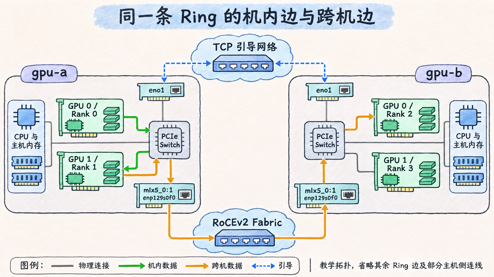

四 Rank 分属两台 Linux 服务器，Rank 0、1 在 `gpu-a`，Rank 2、3 在 `gpu-b`。假设一条 Ring 通道的顺序是 `0 → 1 → 2 → 3 → 0`。画出它的物理路径需要回答两件事。同机的 GPU 能否直接访问对方的显存？跨机时，两端网卡又如何接触到各自 GPU 的数据？

## 从设备拓扑到通道连接

NCCL 2.27.3 初始化时建立本地设备拓扑，计算设备间的候选路径，搜索 Ring、Tree 等通信图，再合并各节点的信息，为通道安排各 Rank 的邻居。建立普通通道连接时，按收发方向检查各传输实现能否服务这对端点。下面是本章涉及的几类选择。相同的逻辑边，实际可用路径要由设备、配置和后端一起判定。 [NCCL 拓扑初始化](https://github.com/NVIDIA/nccl/blob/v2.27.3-1/src/init.cc) · [传输选择实现](https://github.com/NVIDIA/nccl/blob/v2.27.3-1/src/transport.cc#L14)

| 传输条件 | 载荷在哪里移动 |
| --- | --- |
| 同机，选用 P2P（Peer-to-Peer） | 一张 GPU 经 PCIe 或 NVLink 访问对端显存，两张卡各自保有自己的显存。 |
| 同机，选用 SHM（Shared Memory） | 两端通过主机内存中的共享缓冲交换数据。 |
| 跨机，NET 选用内置 `IB`，该端启用 GPUDirect RDMA | 网卡直接对注册过的设备缓冲做 DMA（Direct Memory Access，直接内存访问）。 |
| 跨机，NET 选用内置 `IB`，该端使用主机缓冲 | 网卡对注册的主机缓冲执行 RDMA，显存与主机缓冲之间还需要搬运。 |
| 跨机，NET 选用内置 `Socket` | 数据经主机缓冲和 TCP/IP Socket 传送，使用对应的 IP 接口。 |

第 01 篇的点对点 API 描述哪些 Rank 互为发送与接收端。上表的 P2P 则是一种访问对端显存的传输实现，集合操作的机内边也可以用它。

NET 指 NCCL 的网络传输实现。内置后端名为 `IB` 时，它走 Verbs 接口驱动支持 RDMA（Remote Direct Memory Access，远程直接内存访问）的网卡，可以承载原生 InfiniBand，也可以承载 RoCE（RDMA over Converged Ethernet）。本例的 RoCEv2 载荷走 UDP/IP 封装的以太网。GPU 到网卡的显存直达称为 GPUDirect RDMA，简称 GDR，它还需要当前的 GPU、NIC、PCIe 路径和内存注册机制共同支持。例如 DMA-BUF 或 `nvidia-peermem` 可在相应平台提供显存映射。 [NCCL 网络后端说明](https://docs.nvidia.com/deeplearning/nccl/archives/nccl_2273/user-guide/docs/env.html#nccl-net) · [NCCL GPUDirect 排障](https://docs.nvidia.com/deeplearning/nccl/archives/nccl_2273/user-guide/docs/troubleshooting.html#gpu-direct) · [NVIDIA RoCE 协议与 GID 表](https://docs.nvidia.com/networking/display/nvidia-mlnx-ofed-documentation-v24-07-0-6-1-0.0.pdf)

## 同一条 Ring 上的机内边和跨机边

`0 → 1` 在 `gpu-a` 内部，假设选中 PCIe P2P，载荷经同一 PCIe Switch 在两张 GPU 间移动。`1 → 2` 从 Rank 1 的 GPU 显存出发，经本地 PCIe Switch 到 `gpu-a` 的网卡，再经 RoCEv2 交换网络到对端网卡，最后经对端 PCIe Switch 到 Rank 2 的 GPU。图中假定这一方向的收发两端均选用 GDR。NCCL 的 TCP 引导另走两端的 `eno1`。



*图 08-04-01　同一条 Ring 的两条边。绿色是机内 PCIe P2P 载荷，橙色是跨机 RoCEv2 载荷，蓝色虚线是双向 TCP 引导。图中省略了其余 Ring 边和部分主机连线。*

若发送侧改用主机中转，而接收侧继续使用 GDR，只需改画 A 节点内的那一段。Rank 1 的显存先交到 A 的主机缓冲，再由 A 的网卡从主机缓冲取数。B 的网卡仍能直接将载荷写进 Rank 2 侧的设备缓冲。同一条边的两端可以分别作选择，需分别查看发送和接收记录。2.27.3 中 `NCCL_NET_GDR_READ` 影响发送 NIC 能否直接从 GPU 读取，自动选择还要结合 GPU 架构、NVLink 和拓扑距离。 [GDR 收发连接实现](https://github.com/NVIDIA/nccl/blob/v2.27.3-1/src/transport/net.cc) · [GDR 路径选择](https://github.com/NVIDIA/nccl/blob/v2.27.3-1/src/graph/paths.cc#L388)

### 环顺序如何改变端口负载

现在把消息改为每 Rank 64 MiB，Rank 仍是四个，采用单通道、等分块 Ring 模型。每条有向环边在一次 AllReduce 中发 `2 × (4−1)/4 × 64 = 96 MiB`。A、B 各只有一个 200 Gb/s 全双工 RoCEv2 端口，单方向名义速率为 `200 ÷ 8 = 25 GB/s`。同方向的两条逻辑边共用一个发送端口时，它们的字节要加起来。反向可以全双工并行，两个方向分别受端口限制。 [nccl-tests 的 AllReduce 字节量模型](https://github.com/NVIDIA/nccl-tests/blob/v2.17.9/doc/PERFORMANCE.md#allreduce)

| 通道顺序 | A → B 的环边 | B → A 的环边 | 单方向端口载荷 | 按名义线速推得的时间下界 |
| --- | --- | --- | ---: | ---: |
| `0 → 1 → 2 → 3 → 0` | 1 → 2 | 3 → 0 | 96 MiB | 4.03 ms |
| `0 → 2 → 1 → 3 → 0` | 0 → 2、1 → 3 | 2 → 1、3 → 0 | 192 MiB | 8.05 ms |

例如交错环的 A 端每次要发 `192 × 2²⁰` 字节，除以 `25 × 10⁹ B/s` 得到约 8.05 ms。表中保持 GPU 放置不变，只更换通道邻居关系。模型只按端口载荷与名义线速求下界。实际传输还受协议、串行依赖、分块分配、机内路径和共享争用影响。有多个通道时，先找出各通道承担的数据量，再按实际端口和方向累计。

## 对齐设备、端口与 RoCEv2 GID

先用 `nvidia-smi topo -m` 和各 GPU 的 PCI BDF 核对 GPU 与网卡的拓扑关系。用 `rdma link show mlx5_0/1` 将 RDMA 端口对回 Linux 网络接口，用 `ibv_devinfo -d mlx5_0 -i 1` 查看端口状态、链路层和活动 MTU（最大传输单元）。同名设备分属不同主机，记录地址和本地索引时应带上主机名。 [NVIDIA SMI 拓扑选项](https://docs.nvidia.com/deploy/nvidia-smi/index.html) · [rdma-link 设备与端口](https://github.com/iproute2/iproute2/blob/v6.12.0/man/man8/rdma-link.8) · [ibv_devinfo 参数](https://github.com/linux-rdma/rdma-core/blob/v57.0/libibverbs/man/ibv_devinfo.1)

| 用途 | 接口或端口 | `gpu-a` | `gpu-b` |
| --- | --- | --- | --- |
| 默认 TCP 引导 | `eno1` | `192.0.2.11` | `192.0.2.12` |
| RoCEv2 载荷 | `mlx5_0:1`，对应 `enp129s0f0` | `198.51.100.11` | `198.51.100.12` |

GID（Global Identifier）是 RDMA 端口的寻址标识。对本地索引 `i`，在 `/sys/class/infiniband/mlx5_0/ports/1/` 下查看 `gids/i`、`gid_attrs/types/i` 和 `gid_attrs/ndevs/i`。在 `gpu-a` 应把 GID 值 `::ffff:198.51.100.11`、类型 `RoCE v2` 和接口 `enp129s0f0` 对到同一个表项。另一端按自己的地址和本地表查，索引可以不同。NCCL 2.21 起可动态选 RoCE GID。2.27.3 的教学设置如下，假定 `NCCL_IB_GID_INDEX` 未设置，地址和端口均已核对。 [NVIDIA RoCE GID 表](https://docs.nvidia.com/networking/display/nvidia-mlnx-ofed-documentation-v24-07-0-6-1-0.0.pdf) · [NCCL RoCE 排障与环境变量](https://docs.nvidia.com/deeplearning/nccl/archives/nccl_2273/user-guide/docs/troubleshooting.html#rdma-over-converged-ethernet-roce) · [NCCL 2.27.3 GID 选择参数](https://docs.nvidia.com/deeplearning/nccl/archives/nccl_2273/user-guide/docs/env.html#nccl-ib-gid-index)

```bash
export NCCL_SOCKET_IFNAME='=eno1'
export NCCL_IB_HCA='=mlx5_0:1'
export NCCL_IB_ADDR_FAMILY=AF_INET
export NCCL_IB_ADDR_RANGE=198.51.100.0/24
export NCCL_IB_ROCE_VERSION_NUM=2
```

值前面的 `=` 用于精确匹配。第一项筛选默认引导和内置 Socket 后端使用的 IP 接口。第二项筛选内置 Verbs 后端的 HCA（Host Channel Adapter，即这里的 RDMA 网卡）及端口，后三项约束动态 GID 候选。实际后端、通道端点、GID 和 GDR 选择要从运行记录核实。 [NCCL IP 接口与 HCA 选择](https://docs.nvidia.com/deeplearning/nccl/archives/nccl_2273/user-guide/docs/env.html#nccl-socket-ifname)

若同机选用 SHM，主机共享缓冲可能由 CUDA 的 cuMem host allocation 或 `/dev/shm` 提供。2.24 起在支持 cuMem host allocation、驱动提供的 CUDA 版本至少为 12.6、Runtime 至少为 12.2 时默认选前者。2.26.5 起 NCCL 会检查这种分配机制并在需要时回退到 `/dev/shm`。在有外部网络插件或跨节点 NVLink 域的机器上，跨机候选也会变；多网口时，`NCCL_CROSS_NIC` 会影响同一 Ring 或 Tree 能否在不同节点用不同 NIC，交换网络的实际路径仍取决于 Fabric 侧配置和负载。 [NCCL 共享内存排障](https://docs.nvidia.com/deeplearning/nccl/archives/nccl_2273/user-guide/docs/troubleshooting.html#cumem-host-allocations) · [NCCL 网络与跨 NIC 选项](https://docs.nvidia.com/deeplearning/nccl/archives/nccl_2273/user-guide/docs/env.html#nccl-cross-nic)
