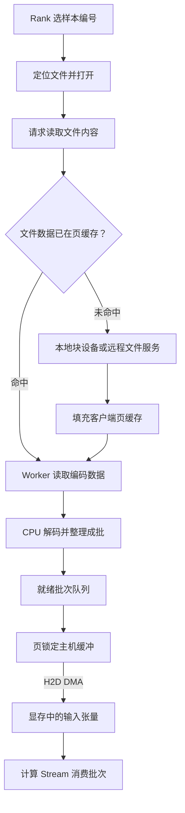

# 一批样本怎样到达 GPU

训练进程请求下一批样本时，存储里通常只有编码过的数据。以图像训练为例，一张压缩图像经过读取、解码和批整理，才变成模型能消费的张量。即使文件早已在内存中，GPU 也要等主机处理完这批样本，并把张量传到显存。

## 从样本编号到显存地址

设两台训练节点各有两张 GPU。节点 A 上的 Rank 0、1 和节点 B 上的 Rank 2、3 各对应一个训练进程及一张 GPU。这里用可按索引访问的 PyTorch 2.9 数据集。每个 Rank 的采样器交出本轮要处理的样本编号，数据集实现再把编号映射到文件名，或映射到文件中的偏移。算例假设四个 Rank 的编号互不重叠。实际用 `DistributedSampler` 时，还要看数据集大小是否能被 Rank 数整除。默认的 `drop_last=False` 可能通过补充索引使各 Rank 取得等量样本。 [PyTorch 2.9 数据集、采样器和分布式采样](https://docs.pytorch.org/docs/2.9/data.html)

一次普通缓冲读可以沿以下路径追踪。图中的内核页缓存、worker 缓冲和页锁定缓冲都占主机内存，分别服务于文件读取、CPU 处理和设备搬运。

打开文件先走路径查找、权限和文件状态检查。随后读取文件内容时，Linux 的普通缓冲 I/O 使用页缓存。冷读本地文件，所需数据由文件系统向块设备请求。读远程挂载时，客户端可能向存储服务发出请求，服务端也可能从自己的缓存返回。热读在客户端页缓存命中时可以省下本次后端数据读取。文件数据和目录项、属性有各自的缓存与有效性条件，重复读到文件内容时仍可能有元数据操作。 [Linux 页缓存](https://docs.kernel.org/6.18/mm/page_cache.html) · [Linux NFS 客户端缓存](https://man7.org/linux/man-pages/man5/nfs.5.html)

开启多进程加载后，worker 负责数据集访问、变换和 `collate_fn` 批整理。比如它先读压缩图像，再解码、调整尺寸，把同一批的张量堆叠起来。启用 `pin_memory=True` 时，DataLoader 会在返回标准 CPU 张量批次前将其置于页锁定主机内存。图中的队列表示批次在交付前的等待，页锁定阶段也可以有等待中的批次。页锁定使 DMA 期间的主机页面保持可用。之后由训练进程发起 H2D，把张量搬进目标 GPU 的显存。同一 Stream 中，后续 Kernel 按序消费。分属不同 Stream 时，计算 Stream 需要等待拷贝完成事件。 [PyTorch 2.9 数据加载与内存锁页](https://docs.pytorch.org/docs/2.9/data.html) · [CUDA 12.9 异步执行与 Stream](https://docs.nvidia.com/cuda/archive/12.9.1/cuda-c-programming-guide/index.html#asynchronous-concurrent-execution)

## 从步时反推数据供给

**算例。** 两节点共四个 Rank，每 Rank 每步 32 个样本。假设数据已就绪时，一步计算和通信的目标节奏为 125 ms，即每秒八步。每个样本在文件中平均占 256 KiB，解码和整理后的输入张量占 1 MiB。每个样本读一次并搬到本 Rank 的 GPU。冷读按有效载荷计算，忽略索引、协议、预读放大和重复读取。

| 口径 | 每 Rank 每步 | 每 Rank 每秒 | 每节点每秒 | 全作业每秒 |
| --- | ---: | ---: | ---: | ---: |
| 样本数 | 32 | 256 | 512 | 1,024 |
| 存储编码数据 | 8 MiB | 64 MiB | 128 MiB | 256 MiB |
| H2D 输入张量 | 32 MiB | 256 MiB | 512 MiB | 1 GiB |

单 Rank 的存储需求是 `32 × 256 KiB ÷ 0.125 s = 64 MiB/s`。主机到显存的需求以解码后字节数计算，为 `32 × 1 MiB ÷ 0.125 s = 256 MiB/s`。最后一列是四张 GPU 或两台存储客户端的合计。如果两节点从同一存储服务冷读，服务要为该作业供给合计 256 MiB/s 的数据载荷。如果各读本地盘，每台机器承担 128 MiB/s。每节点的 H2D 数字还要结合两张 GPU 的实际 PCIe 路径，看各自的拷贝是否经过同一段共享链路。

这组数值给出维持目标步时所需的平均供给。只要一个 Rank 的批次晚于消费时刻，那个 Rank 就会推迟本步计算，也可能晚到后面的集合操作。即使平均吞吐已达标，也要看有多少批次赶不上消费时刻，以及它们在文件读取、CPU 处理、队列还是 H2D 阶段变慢。
