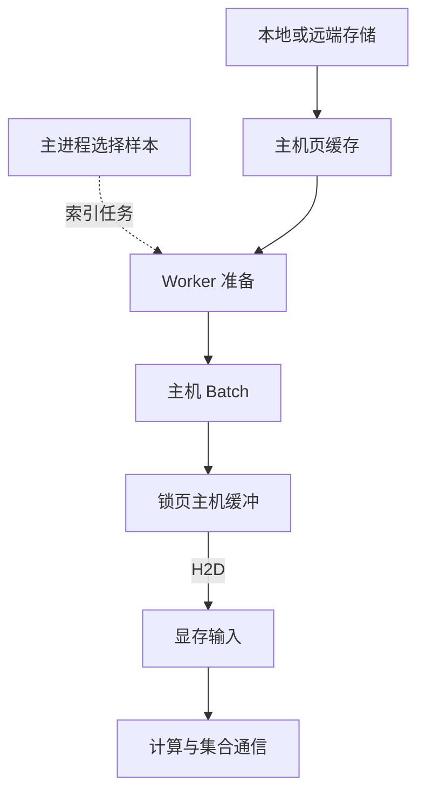

# 从存储中的样本走到显存

## GPU 消费的是一批已经准备好的数据

训练进程通常先选样本，再读取其字节，解码或解压，执行必要变换，把若干样本拼成一个 Batch，最后交给 GPU。Batch 是一次处理的样本集合；它在文件里未必已经连续摆好。DataLoader 是组织读取与准备工作的加载器，Worker 是为它执行这些工作的子进程。读取成功与 GPU 输入就绪之间，还有多道工序。

以本章压缩样本为例，存储保存编码字节，CPU 把它还原成可计算的张量。张量是带形状和数据类型的数组；1 MiB 的解码结果不等于压缩文件大小。以下是**普通缓冲读取的教学流程图**：实线箭头表示有效负载的处理/交接方向，虚线表示主进程发出的控制；各框是逻辑阶段，未画 PCIe 器件。



远端存储的数据先经存储网络和客户端进入主机，图中的“存储→页缓存”聚合了这段路径。页缓存命中时可直接从已有页供给，未命中才访问后端。Worker 读取到的用户缓冲与内核页缓存是不同对象，普通 `read` 往往还包含两者间的复制；`mmap` 等方式可以改变复制和缺页行为。图只描述本章采用的缓冲读取方案，不能据此说所有 I/O 必经页缓存。

锁页缓冲是页被固定、适合 DMA 使用的主机内存，仍然占 DRAM；它不在显存里。H2D 是 Host to Device，即主机到 GPU 的复制。具体分配和锁页过程由框架与驱动完成；`pin_memory=True` 只准备了这一环，未使文件直接写入显存。锁页与复制重叠的作用在下一篇展开。

## 先统一样本与字节的口径

`job-09` 每 Rank 需要在 80 ms GPU 工作段之后接上下一批。要达到这个节奏，每 Rank 的供给要求为：

```text
样本：64 / 0.08 = 800 样本/s
存储编码字节：800 × 256 KiB = 200 MiB/s
H2D 解码字节：800 × 1 MiB = 800 MiB/s
```

每节点两 Rank，所以需要 1,600 样本/s、400 MiB/s 存储读取、1,600 MiB/s H2D；两节点全作业为 3,200 样本/s、800 MiB/s 存储读取。这里各 Rank 读不同样本，没有重复访问和缓存命中，忽略元数据与协议额外字节。

因此不能把“存储每秒读了 800 MiB”直接与单 GPU 的 H2D 比较。前者若为全作业编码字节，后者若为单卡解码字节，即使数字相同也代表不同供给量。实际压缩比随样本变化时，应统计同一批的编码字节、解码字节和样本数，再做换算。

把各阶段都换成样本/s 后，稳定供给上限是各环最小值。对单 Rank，可写成：

```text
R ≤ min(读取有效字节率 / 每样本编码字节,
        CPU 准备样本率,
        H2D 有效字节率 / 每样本张量字节,
        GPU 每步样本数 / GPU 工作段耗时)
```

同一资源被多个 Rank 共享时，要先在节点或服务层合计需求。单 Rank 看到 4 GiB/s 并不意味着 32 个并发客户端都能各得 4 GiB/s。这个最小值也是上界：排队、时延波动和不能重叠的依赖还会降低实际速率。

## 一批的延迟与连续出批的间隔不同

给一份**自拟单 Rank 阶段记录**：读一批编码字节需 10 ms，一个 Worker 解码 64 个样本需 160 ms，H2D 需 5 ms，GPU 工作段需 80 ms。假定四段完全串行，单步从开始读取到完成需：

```text
10 + 160 + 5 + 80 = 255 ms
```

流水线则允许 GPU 算第 k 批时，CPU 准备后续批。只有一个 Worker 时，解码每 160 ms 才能产出一批，预取再深也无法长期满足 80 ms 的需求。改成四个独立 Worker，且读取、解码等资源均够用、调度均匀时，解码阶段的理想平均出批间隔为 `160/4 = 40 ms`。这不意味着一个样本批的解码延迟变成了 40 ms；四个 Worker 可以分别处理不同批次。

实际让每 Worker 顺序承担 10 ms 读取和 160 ms 解码，其合计平均出批间隔为 `170/4 = 42.5 ms`。如果各 Worker 的准备、H2D 和 GPU 工作段可以对不同批次充分重叠，稳态的理想完成间隔为：

```text
max(42.5, 5, 80) = 80 ms
```

首批启动、尾部排空和队列波动另计；框架没有安排复制重叠时，H2D 仍可能额外占用 5 ms，使间隔至少为 85 ms。必须先看实际依赖，才能使用 `max` 模型。

## 同步作业由最迟就绪的成员牵制

四 Rank 需要共同完成集合通信。假如 r2 的 CPU 尚未给出下一批，r0 可能已经做完自己的计算并停在集合操作里。r0 的等待表面上出现在 NCCL 范围内，起因却是 r2 的输入晚到。第 08 章说明通信成员必须相互匹配；本章新增的问题是：**每个成员是在什么时候拿到本轮输入、开始计算并提交相同通信的？**

所以数据加载性能要同时看供给均值与慢批次。一个加载器平均 900 样本/s，高于需求 800，并不能保证不会因偶发 300 ms 空窗耗尽队列。下一篇用队列和内存预算解释怎样吸收这种波动。

[返回导读](00_导读.md) · [下一篇：用并发缓存与预取维持供给](02_用并发缓存与预取维持供给.md)
