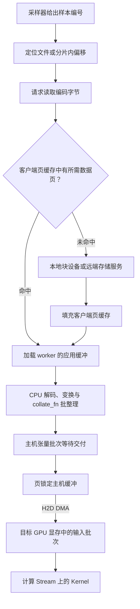

第 08 章解释了 GPU 之间怎样交换通信缓冲。本章转向另一条输入依赖：训练进程开始一步计算前，存储中的样本怎样变成显存里的批次。以压缩图像为例，文件字节不能直接当作模型输入；它还要经过解码、预处理和批整理。即使文件已经在主机内存中，这些处理与主机到设备的拷贝也不会自动消失。

本章主例沿用两台节点、四个 Rank 的形状：节点 `gpu-a` 上是 Rank 0、1，节点 `gpu-b` 上是 Rank 2、3，每个 Rank 对应一个训练进程和一张 GPU。这里只沿用进程与设备的映射，不继承第 08 章的网口和接线。存储流量与集合流量是否共用物理链路，在相关算例中另行说明。

## 一个样本怎样变成一批设备输入

先把三种容易混称为“数据”的对象分开。下表中的大小是本章教学设定，不是所有图像格式的固定比例。

| 对象 | 所在位置与形态 | 在主例中的大小 | 下一步由谁处理 |
| --- | --- | ---: | --- |
| 编码样本 | 文件或对象中的压缩图像字节 | 平均 256 KiB/样本 | 数据集实现读取，CPU 解码与变换 |
| 主机输入张量 | 加载进程整理出的 CPU 张量，随后可放入页锁定缓冲 | 1 MiB/样本 | 训练进程提交 H2D 拷贝 |
| 设备输入张量 | 目标 GPU 显存中的输入 | 1 MiB/样本，忽略对齐等额外占用 | 计算 Stream 上的 Kernel 消费 |

**张量（tensor）** 在这里是按模型约定排列的多维数值数组。把 32 个样本沿批次维堆叠，才得到每 Rank 每步的一份输入。编码、解码和批处理由应用的数据管线决定；存储只负责提供文件或对象字节，CUDA 与驱动负责设备内存及拷贝，二者都不能替代 CPU 图像解码。

在 PyTorch 2.9 的可按索引访问数据集中，采样器先给出样本编号，数据集实现再把编号映射到文件路径，或映射到一个分片内的记录偏移。四个 Rank 的编号在本章主例中互不重叠。实际使用 `DistributedSampler` 时，默认 `drop_last=False` 在数据集大小不能整除 Rank 数的情况下会重复已有索引来补齐，使各 Rank 获得等量样本；一旦发生这种 padding，主例的“编号互不重叠、每样本只读一次”就不再成立，必须按实际索引重算读取量。因此“逻辑数据集大小”“本 epoch 实际取样数”和“存储去重后的不同对象数”不能混为一项。 [PyTorch 2.9 数据集、采样器与 DistributedSampler](https://docs.pytorch.org/docs/2.9/data.html) · [v2.9.0 采样器补索引实现](https://github.com/pytorch/pytorch/blob/v2.9.0/torch/utils/data/distributed.py#L92-L132)

## 普通缓冲读取经过哪些缓冲区

下图跟踪一个 Rank 的一批样本。为便于先走通主路径，图中使用普通缓冲文件读取，并把多 worker、预取队列和异步拷贝留到第 03 篇展开。图里的“加载 worker”先泛指加载侧执行者：`num_workers=0` 时这些工作由训练进程同步完成，多进程加载时才由独立加载子进程承担。

打开文件涉及路径查找、权限与文件状态等检查；读取文件内容则关心所需字节在哪里。Linux 的普通缓冲 I/O 使用**页缓存（page cache）**，即以主机内存页保存文件数据。冷读本地文件时，文件系统需要向块设备请求数据；读取远端挂载时，客户端可能向存储服务发出请求，服务端还可能有自己的缓存。客户端页缓存命中可以省去本次后端数据读取，却不保证目录项、属性或打开操作也全部在本地完成。 [Linux 页缓存](https://docs.kernel.org/6.18/mm/page_cache.html) · [Linux NFS 客户端缓存](https://man7.org/linux/man-pages/man5/nfs.5.html)

这条路径上的主机内存不是可互换的一份大缓冲。分清它们的职责，才能判断缓存命中究竟省掉了什么。

| 缓冲区或队列 | 保存什么 | 为什么需要它 |
| --- | --- | --- |
| 页缓存 | 文件数据页 | 复用最近读取的文件内容，命中时减少后端 I/O；容量与回收由内核管理 |
| 加载 worker 的应用缓冲 | 编码字节、解码中间态和整理中的张量 | 供 CPU 执行应用的数据集变换与 `collate_fn` |
| 就绪批次队列 | 已生产、等待训练进程取用的主机批次 | 把批次生产与消费解耦，吸收短时抖动；第 03 篇计算其深度与代价 |
| 页锁定主机缓冲 | 准备交给 DMA 的主机张量 | 使相关页在 DMA 期间保持可供设备访问；锁页不等于已经搬入显存 |
| GPU 显存缓冲 | 设备输入张量 | 供后续 Kernel 按 Stream 依赖读取 |

启用多进程加载后，**加载 worker** 是 DataLoader 创建的子进程，不要与第 05 章指代训练进程的 Worker 混淆。加载 worker 执行数据集访问、变换和批整理。`pin_memory=True` 时，DataLoader 会在返回标准 CPU 张量批次前将其复制到页锁定内存；图中的“页锁定主机缓冲”因此是数据形态相同、DMA 属性不同的另一次主机侧准备。 [PyTorch 2.9 多进程加载与锁页](https://docs.pytorch.org/docs/2.9/data.html)

训练进程随后发起 **H2D（Host to Device，主机到设备）** 拷贝。若 H2D 和 Kernel 在同一 CUDA Stream，流内顺序保证 Kernel 在拷贝之后执行；若分属不同 Stream，计算 Stream 必须等待对应的拷贝完成事件。主机调用已经返回，只说明提交或调用契约规定的动作已发生，不能单独证明设备输入已可消费。 [CUDA 12.9 异步执行与 Stream](https://docs.nvidia.com/cuda/archive/12.9.1/cuda-c-programming-guide/index.html#asynchronous-concurrent-execution)

因此，页缓存热命中只缩短“后端存储 → 客户端页缓存”这一段。编码字节的 CPU 处理、批次整理、必要的锁页复制、H2D 以及设备依赖仍需完成。这是判断“文件都在内存里，GPU 为什么还等输入”的第一条边界。

## 用目标步时反推每层供给量

现在把一个 Rank 的路径扩为四 Rank 作业。定义：

- `R = 4`：Rank 数；每节点有两个 Rank。
- `b = 32`：每 Rank 每步样本数。
- `T = 0.125 s`：数据就绪时，计算与通信要达到的目标步时。
- `s_file = 256 KiB`：存储中每样本的平均编码字节数。
- `s_input = 1 MiB`：每样本整理后的输入张量字节数。

先算全作业每秒需要多少样本：

`样本速率 = R × b ÷ T = 4 × 32 ÷ 0.125 = 1,024 样本/s`。

再分别乘两种数据形态的大小。假设每个样本从存储读取一次，冷读不计索引、协议、预读放大和重复拉取：

- 存储有效载荷：`1,024 × 256 KiB/s = 256 MiB/s`。
- 全作业 H2D 输入量：`1,024 × 1 MiB/s = 1,024 MiB/s = 1 GiB/s`。

| 口径 | 每 Rank 每步 | 每 Rank 每秒 | 每节点每秒 | 全作业每秒 |
| --- | ---: | ---: | ---: | ---: |
| 样本数 | 32 | 256 | 512 | 1,024 |
| 存储编码数据 | 8 MiB | 64 MiB | 128 MiB | 256 MiB |
| H2D 输入张量 | 32 MiB | 256 MiB | 512 MiB | 1 GiB |

两种速率不能共用同一份字节预算。若两节点都从同一存储服务冷读，服务端需要为该作业提供合计 256 MiB/s 的有效载荷；若各读本地盘，每台承担 128 MiB/s。每节点 512 MiB/s 的 H2D 则发生在本机，还要按两张 GPU 的实际 PCIe 路径检查是否共享同向链路。这里的 MiB/s 是 `2²⁰ B/s`，不是存储设备规格中常见的十进制 MB/s。

这些是维持目标节奏所需的**平均有效载荷**，不是任何存储测试的峰值保证。若目标步时从 125 ms 放宽到 250 ms，且每步样本数不变，两项平均需求都减半；但单批仍要读取 8 MiB、向每张 GPU 搬入 32 MiB，单次请求的突发和尾延迟不会因平均值下降而自动消失。

字节预算还回答不了“要打开多少文件、发多少请求”。下一篇因此把同一批样本分别放进小文件和分片，再沿四种存储路径检查操作率、缓存与共享点。
