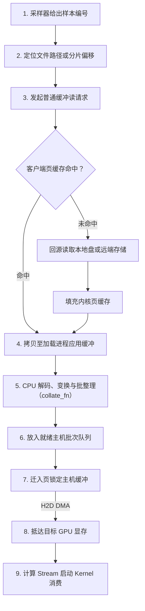

# 训练样本的数据通路与供给速率

GPU 算力已经就位，多机通信也已经打通。可训练监控里，GPU 利用率却经常掉坑。很多时候，卡住算力的并不是芯片太慢，而是喂给 GPU 的数据断流了。

在 AI 集群里，存储扛着两类截然不同的任务。在线推理看重百 GB 只读权重的秒级冷启动，以及 KV Cache 的多级缓存换入换出（第 07 篇展开）。分布式训练则必须守住另一条底线：把海量训练样本源源不断地送进显存。本篇用一批压缩图像走通这条数据通路，把每一层的缓冲区和字节速率算清楚。

## 一、同一份样本，在路上会变三次身

估算供给吞吐时，最容易犯的错是把磁盘文件体积直接当成显存张量体积。实际上，一份样本从磁盘走进计算单元，至少要经历三次形态转换。

| 数据形态 | 所在位置与内容 | 典型尺寸 | 下一步交给谁 |
| --- | --- | ---: | --- |
| **编码样本** | 文件或对象里的压缩图像字节（如 JPEG） | 平均 `256 KiB/样本` | 加载子进程读取，交给 CPU 解码与增强 |
| **主机输入张量** | 解码、裁剪、归一化并按批堆叠后的 CPU 数组 | `1 MiB/样本` | 训练进程迁入锁页缓冲，发起 H2D 搬运 |
| **设备输入张量** | 落在目标 GPU 显存里的标准输入批次 | `1 MiB/样本` | 计算 Stream 上的算子直接消费 |

**张量（Tensor）** 是按模型约定维度排布的多维数值数组。把 32 个解码后的样本沿批次维堆叠，才构成单个训练进程一步的输入批次。

这里有一条清晰的分工界线。存储系统只管交付原始编码字节，CUDA 与驱动只管搬运现成张量。至于把压缩图解成浮点数组、再拼成规整批次，全都要靠 CPU 上的数据管线完成。

> [!warning] 常见误区：样本总数 ≠ 磁盘不重复读数
> 在 PyTorch 2.9 中，采样器先为各 Rank 分配样本编号，数据集再把编号映射为文件路径或分片偏移。使用 `DistributedSampler` 时，默认 `drop_last=False`。一旦总样本数不能整除 Rank 数，它会重复补齐已有索引，让各 Rank 拿到等量样本。因此，“去重样本数”“单轮实际取样数”与“存储实际读取字节”三者可能不同，发生补齐时须按实际取样量重算。

## 二、页缓存、锁页缓冲与 H2D 数据通路

一条标准的训练数据通路，会依次穿过操作系统内核缓存、应用进程内存，最后经 PCIe 总线抵达 GPU 显存。下图画出单个训练进程的完整主线。

*图 09-01-01：普通缓冲 I/O 下的训练样本数据通路。加载阶段可由训练主进程同步执行，也可交给多进程加载子进程异步完成。*

在这条通路上，有两个贯穿全章的基础概念需要先立住：

- **Page Cache（页缓存）**：Linux 内核利用空闲主机内存缓存文件数据页。冷读时，内核须向本地盘或远端存储拉取数据并填入页缓存。再次读取同一数据页时，内核直接从内存返回，省去后端 I/O。
- **H2D / D2H**：主机内存与 GPU 显存之间的双向搬运方向。**H2D（Host to Device）** 负责把输入张量、模型权重或换入的 KV Cache 送进显存。**D2H（Device to Host）** 则反向把训练快照、统计量或换出的 KV Cache 搬回主机内存。

路径上的主机内存并非一块可互换的大池子。每一段缓冲区各司其职，缺一不可：

| 缓冲区或队列 | 存放的数据 | 核心职责与代价 |
| --- | --- | --- |
| **内核页缓存** | 原始文件数据页 | 命中时省去后端读盘或拉网；受系统空闲内存与内核回收支配 |
| **加载应用缓冲** | 编码字节、解码中间图与临时张量 | 承载 CPU 解码、增强变换与 `collate_fn` 批整理 |
| **就绪批次队列** | 已整理好的 CPU 张量批次 | 解耦生产与消费节奏，吸收短时波动（第 03 篇量化其内存账本） |
| **页锁定主机缓冲** | 待 DMA 搬运的主机张量 | 锁定物理页防止换出，供 GPU 拷贝引擎高速异步 H2D |
| **GPU 显存缓冲** | 设备输入张量 | 供计算 Stream 上的前向算子直接读取 |

开启多进程加载后，负责读文件、解码和批整理的子进程称为**加载 worker**（注意区分前文指代训练节点的 Worker 进程）。若开启 `pin_memory=True`，主进程侧的锁页线程会把标准 CPU 张量拷入页锁定内存，为高速 H2D 铺路。

> [!tip] 工程直觉：文件全在内存里，为什么 GPU 依然会挨饿？
> 页缓存热命中，省掉的仅仅是“后端存储 → 内核页缓存”这一段磁盘或网络读取。目录属性校验、CPU 图像解码、批整理、锁页拷贝以及 PCIe 上的 H2D 搬运，一步都不会少。此外，训练进程提交 H2D 后调用立刻返回，只表示指令入了队。计算算子仍须依靠同流顺序或跨流 Event，等到显存数据落稳才能开算。

## 三、用目标步时反推各层供给账本

看懂形态变化后，就能给多卡作业算出精确的供给门槛。以双节点四卡训练为例，先明确进程与设备映射：

| 节点与进程角色 | 节点标识 | 进程与设备映射 | 每步样本数 $b$ |
| --- | --- | --- | ---: |
| 主节点训练进程 | `gpu-a` | `Rank 0` → 卡 0；`Rank 1` → 卡 1 | 各 32 样本 |
| 辅节点训练进程 | `gpu-b` | `Rank 2` → 卡 0；`Rank 3` → 卡 1 | 各 32 样本 |

假定每个 Rank 的计算与通信目标步时为 $T = 0.125\text{ s}$（`125 ms`）。四份样本分片互不重叠，冷读各取一次，暂不计索引、协议头与预读放大。已知条件如下：
- Rank 总数 $R = 4$，每 Rank 每步样本数 $b = 32$；
- 单样本编码大小为 $s_{\text{file}} = 256\text{ KiB}$（`0.25 MiB`）；
- 解码整理后的输入张量为 $s_{\text{input}} = 1\text{ MiB}$。

先算全作业每秒必须供给多少个样本：

$$\text{全作业样本速率} = \frac{R \times b}{T} = \frac{4 \times 32}{0.125\text{ s}} = 1{,}024\text{ 样本/s}$$

把样本速率分别乘以编码字节与张量字节，即可拆出存储侧与主机搬运侧两本账单：

$$\text{存储冷读有效载荷} = 1{,}024\text{ 样本/s} \times 256\text{ KiB/样本} = 256\text{ MiB/s}$$

$$\text{全作业 H2D 吞吐需求} = 1{,}024\text{ 样本/s} \times 1\text{ MiB/样本} = 1{,}024\text{ MiB/s} = 1\text{ GiB/s}$$

按每步、每 Rank、每节点与全作业展开，得到整套作业的基础供给账本：

| 统计口径 | 每 Rank 每步 | 每 Rank 每秒 | 每节点每秒（2 Rank） | 全作业每秒（4 Rank） |
| --- | ---: | ---: | ---: | ---: |
| **样本数** | 32 | 256 | 512 | 1,024 |
| **存储编码有效载荷** | `8 MiB` | `64 MiB/s` | `128 MiB/s` | `256 MiB/s` |
| **H2D 输入张量** | `32 MiB` | `256 MiB/s` | `512 MiB/s` | `1 GiB/s` |

这两行预算不能混用，它们落脚的物理位置截然不同：
- **存储有效载荷（`256 MiB/s`）**：两节点共用远端存储时，服务端须持续输出 `256 MiB/s`。各自读取本地 NVMe 时，每台节点分担 `128 MiB/s`。
- **H2D 吞吐（每节点 `512 MiB/s`）**：完全发生在节点内部的主机内存与 GPU 之间。核算时应回到第 04 章的 PCIe 拓扑，核对两张卡是否共用上行链路或跨 NUMA 访问。

> [!summary] 核心结论：别被“平均值”和“十进制单位”迷惑
> 1. **单位对齐**：上表采用二进制单位（`1 MiB/s = 2²⁰ B/s ≈ 1.049 MB/s`）。对照磁盘或网卡标称的十进制 `MB/s`、`GB/s` 时，务必先换算。
> 2. **平均速率 ≠ 瞬时突发**：即便把目标步时放宽到 `250 ms`，平均需求确实减半。但单批仍要一次性拉取 `8 MiB` 编码数据，并向每张 GPU 搬入 `32 MiB` 张量。单次存储抖动与尾延迟不会因平均值下降而消失。

算清“每秒搬多少字节”还不够。同样是 `256 MiB/s` 的有效载荷，存成十万个零碎小文件，还是打包成几百个大文件分片，存储压力天差地别。下一篇我们把“每秒操作数”搬上同一张账本。

> [!info]- 参考资料
> - **PyTorch 数据加载与分布式采样器**：[PyTorch 2.9 · Datasets & DataLoaders](https://docs.pytorch.org/docs/2.9/data.html)、[PyTorch v2.9.0 · `DistributedSampler` 源码](https://github.com/pytorch/pytorch/blob/v2.9.0/torch/utils/data/distributed.py#L92-L132)
> - **Linux 页缓存与远端文件缓存**：[Linux Kernel · Page Cache](https://docs.kernel.org/6.18/mm/page_cache.html)、[Linux man-pages · `nfs(5)`](https://man7.org/linux/man-pages/man5/nfs.5.html)
> - **CUDA 异步执行与 Stream 语义**：[CUDA 13.2.1 · Asynchronous Execution](https://docs.nvidia.com/cuda/archive/13.2.1/cuda-programming-guide/02-basics/asynchronous-execution.html)
