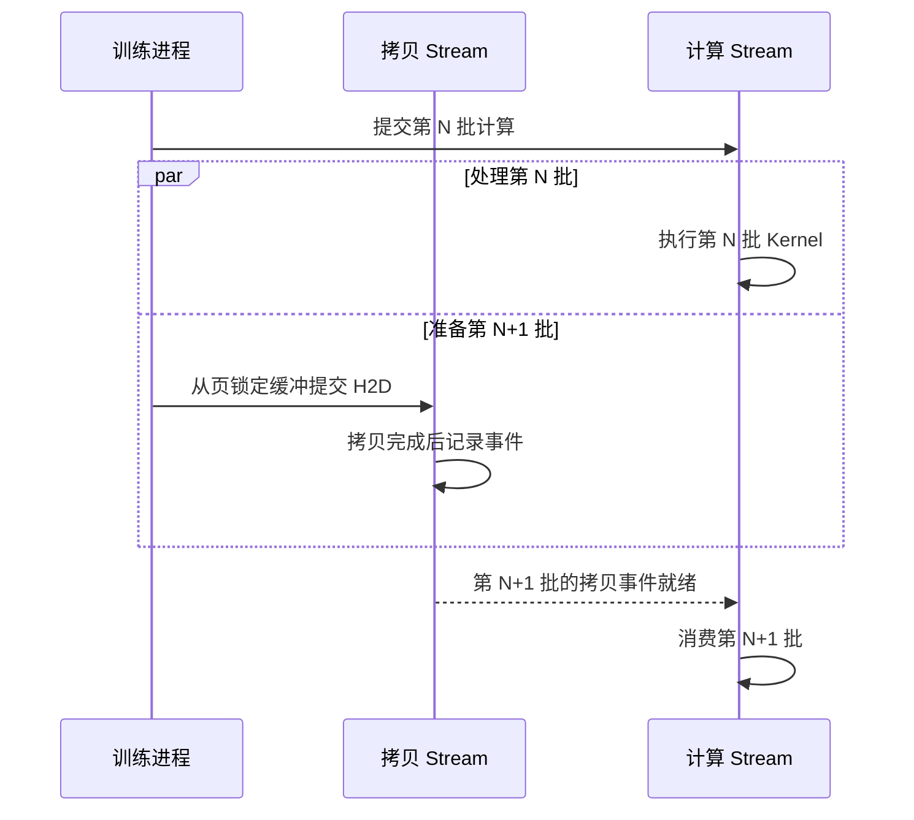

# 数据加载的并发与预取

每一步开始时才读文件、解码、拷贝并计算，GPU 就要承担前面各阶段的等待。跨批流水线可以在 GPU 处理第 N 批时准备第 N+1 批。流水线能吸收多少抖动，取决于有多少批已经就绪。它能长期供给多快，则取决于各阶段的持续处理能力。

## 三层预取解决不同的等待

| 层次 | 提前准备什么 | 可覆盖的等待 | 容易触及的约束 |
| --- | --- | --- | --- |
| 文件预读 | 文件的后续数据页 | 顺序消费下一段文件时的 I/O | 随机读取命中少，额外读入的页占带宽和页缓存 |
| DataLoader 预取 | worker 读取、处理和整理的批次 | 训练进程取下一批时的主机等待 | CPU、共享存储和 worker 间传递批次的内存 |
| 设备拷贝流水线 | 下一批的 GPU 输入张量 | 计算 Stream 等待 H2D 的时间 | 拷贝引擎、互联、页锁定主机内存和预留显存 |

文件预读把可能很快要访问的数据放进页缓存。即使一段文件页已就绪，CPU 解码和张量整理仍需执行。DataLoader 批次预取把这两步也提前，训练进程收到的是主机张量。再往后一层，训练进程可以提前提交 H2D，等设备上的事件表明对应张量可用后再交给 Kernel。 [Linux 页缓存与预读 API](https://man7.org/linux/man-pages/man2/readahead.2.html) · [PyTorch 2.9 DataLoader](https://docs.pytorch.org/docs/2.9/data.html) · [CUDA 12.9 拷贝与计算重叠](https://docs.nvidia.com/cuda/archive/12.9.1/cuda-c-programming-guide/index.html#overlap-of-data-transfer-and-kernel-execution)

**算例。** 假设每批读取 50 ms，CPU 处理 90 ms，H2D 8 ms，计算与通信 125 ms。完全串行时每 273 ms 完成一批。如果四个阶段都能独立处理不同批次，缓冲足够且没有共享资源争用，流水线填满后理想间隔为 `max(50, 90, 8, 125) = 125 ms`。如果每个 worker 串行完成读和处理，且每 Rank 只有一个 worker，这段生产路径单批就要 140 ms，增加缓冲也无法长期供上每 125 ms 一批的节奏。

假设刚消费完一批，队列里另有两批已就绪，接下来每隔 125 ms 消费一批。这两批可覆盖之后两个消费点，合计 250 ms 的消费量。生产若经常跟不上消费，队列最终会空。这个差别可以用取批等待的时间序列来判断。偶尔的空队列和持续的空队列需要分别看生产抖动与平均生产速率。

## 用 worker 数量和队列深度做对照

以 PyTorch 2.9 为例，以下是传给每个 Rank 的 `DataLoader` 的教学配置。使用固定批大小、采样和 `collate_fn`，从第一行到第二行测试多 worker，在启用多 worker 时使用默认的两批预取，再分别测试锁页和更深的队列。

```python
# 依次将一组参数作为 DataLoader 的关键字参数
dict(num_workers=0, prefetch_factor=None, pin_memory=False)
dict(num_workers=4, prefetch_factor=2, pin_memory=False)
dict(num_workers=4, prefetch_factor=2, pin_memory=True)
dict(num_workers=4, prefetch_factor=4, pin_memory=True)
```

`num_workers=0` 时由训练进程加载数据。设为 4 时，每个 Rank 启动四个加载进程。读请求常在等待、CPU 仍有余量时，多个 worker 可以让一部分读取和其他批次的解码并行。若 CPU 核已被解码及其线程池用满，加 worker 会增加排队。若多个 Rank 已把共享存储推到吞吐平台，进一步增加读请求也可能主要拉长尾延迟。比较时同时看取批等待、worker CPU 时间、后端吞吐及读延迟。 [PyTorch 2.9 多进程数据加载](https://docs.pytorch.org/docs/2.9/data.html#multi-process-data-loading)

**内存算例。** 两节点四 Rank 共 16 个 worker。每 Rank 的 `num_workers=4`、`prefetch_factor=2` 对应约八批在途的预取规模。假设每批 CPU 张量占 32 MiB，按八批都已物化估算是 256 MiB/Rank。这部分预算只对应预取批次的张量体积。解码中间态、进程间传递和锁页过程中同时存在的副本、正在消费的批次和 worker 持有的数据集元数据分别计入。加载进程如果用共享内存传递张量，还要看 `/dev/shm` 的实际用量。 [PyTorch 2.9 预取参数和多进程内存说明](https://docs.pytorch.org/docs/2.9/data.html) · [PyTorch 多进程共享策略](https://docs.pytorch.org/docs/2.9/multiprocessing.html#sharing-strategies)

## 把 H2D 放到前一批计算期间

`pin_memory=True` 准备页锁定的主机张量。`.to(device, non_blocking=True)` 请求主机侧异步提交。要让 GPU 上的拷贝与 Kernel 真正并发，还需要硬件支持、有可用的拷贝引擎、不同批次的数据互不依赖，并在独立的 Stream 上提交。下一批的计算在设备端等待其 H2D 事件。应用在拷贝完成前应保留源缓冲且避免改写，目标缓冲也要等消费结束才复用。 [CUDA 12.9 拷贝与 Kernel 重叠](https://docs.nvidia.com/cuda/archive/12.9.1/cuda-c-programming-guide/index.html#overlap-of-data-transfer-and-kernel-execution) · [PyTorch 锁页与非阻塞拷贝](https://docs.pytorch.org/tutorials/intermediate/pinmem_nonblock.html)



验证时在 CPU/CUDA 时间线中对照主机提交、设备 H2D 和 Kernel 三个区间。只有 H2D 的设备区间与上一批的 Kernel 区间相交，才能确认出现了设备侧重叠。若一台双路节点上的 H2D 反复变慢，核对源缓冲落在哪个 NUMA 节点、GPU 连接在哪一侧。主机缓冲位于远端时，搬运可能还要经过处理器间互联。 [PyTorch 2.9 Profiler](https://docs.pytorch.org/docs/2.9/profiler.html) · [NVIDIA NUMA 与 GPU 互联说明](https://docs.nvidia.com/cuda/archive/12.9.1/cuda-c-best-practices-guide/index.html#numa-best-practices)
