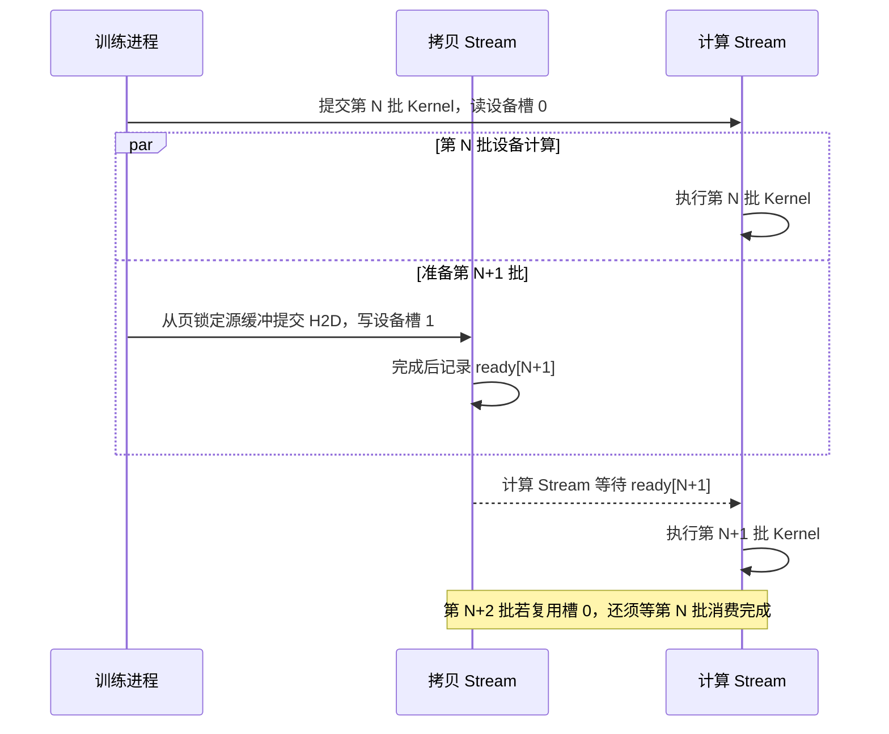

前两篇已经知道一批数据要经过哪些阶段，以及存储为何可能晚交付。连续训练还有另一条优化空间：GPU 处理第 N 批时，主机可以准备第 N+1 批。这样的流水线能把某些等待移出关键路径，却不会消除读取、解码和拷贝本身。判断它是否有效，要分别看**持续生产能力、队列中的余量和跨批依赖**。

## 三层预取提前完成不同的工作

“预取”在不同层次指不同动作，不能用一个开关概括。

| 层次 | 提前准备什么 | 可以隐藏哪段等待 | 主要代价与限制 |
| --- | --- | --- | --- |
| 文件预读 | 预计即将访问的文件数据页 | 后续读取等待后端 I/O 的时间 | 随机访问可能命中少；无用预读消耗后端带宽和页缓存 |
| DataLoader 批次预取 | 加载 worker 已读取、解码并整理的主机批次 | 训练进程取下一批时的主机生产等待 | 消耗 CPU、共享存储请求、进程间传递和主机内存 |
| 设备拷贝流水线 | 已提交或已完成 H2D 的下一批设备输入 | 计算 Stream 等待 H2D 的时间 | 需要页锁定源缓冲、拷贝资源、独立目标槽位和正确的 Stream/Event 依赖 |

文件页已经预读，只说明后端字节可能更接近应用；CPU 解码和批整理仍要执行。DataLoader 预取把主机批次也提前做好，训练进程拿到的是 CPU 张量。再向后，训练进程提前提交 H2D，才有机会让下一批拷贝与前一批设备计算重叠。 [Linux readahead](https://man7.org/linux/man-pages/man2/readahead.2.html) · [PyTorch 2.9 DataLoader](https://docs.pytorch.org/docs/2.9/data.html) · [CUDA 12.9 拷贝与计算重叠](https://docs.nvidia.com/cuda/archive/12.9.1/cuda-c-programming-guide/index.html#overlap-of-data-transfer-and-kernel-execution)

## 从串行、单 worker 到双 worker 推导稳态间隔

下面是一个独立的**时间算例**，仍使用每 Rank 每步一批、目标设备阶段 125 ms 的主例。设每批：

- 文件读取 `R = 50 ms`；
- CPU 解码与批整理 `P = 90 ms`；
- H2D `H = 8 ms`；
- GPU 计算与通信 `G = 125 ms`。

忽略主机提交开销，缓冲充足，H2D 和设备计算使用可独立推进的资源。先不考虑多 worker 之间的 CPU 或存储争用。

### 完全串行：每批都从头等到尾

如果同一批依次完成读取、处理、H2D 和计算，且不同批次之间不重叠，出批间隔为：

`T_serial = R + P + H + G = 50 + 90 + 8 + 125 = 273 ms`。

第一批结果也在 273 ms 时完成。这个数描述没有跨批重叠的基线，不是任何 DataLoader 配置的固定延迟。

### 单 worker 流水：读取与处理不能拆成两个独立阶段

一个加载 worker 串行完成一批的读取和处理，主机生产阶段就是 `R + P = 140 ms`。虽然下一批主机生产可以与前一批 H2D 或 GPU 工作重叠，但稳态出批间隔仍不能短于最慢阶段：

`T_1worker = max(R + P, H, G) = max(140, 8, 125) = 140 ms`。

这说明不能直接写成 `max(50, 90, 8, 125)`：该写法暗含读取与解码能同时处理不同批次，而单 worker 串行执行时并不满足。把队列加深只能暂时存放提前生产的批次，不能把长期平均生产间隔从 140 ms 降到 125 ms。

### 双 worker 流水：用两路生产提高主机阶段容量

改为每 Rank 两个加载 worker。假定两路能并行处理不同批次，存储和 CPU 资源足以让每批仍分别保持 50 ms 与 90 ms，且交付顺序不形成额外阻塞。每个 worker 平均 140 ms 生产一批，两路合计的理想平均生产间隔为：

`T_host,2 = (R + P) ÷ 2 = 70 ms`。

于是整条流水线的理想稳态间隔为：

`T_2workers = max(70, 8, 125) = 125 ms`。

| 方式 | 主机生产能力 | 理想稳态出批间隔 | 限制因素 |
| --- | --- | ---: | --- |
| 无跨批重叠 | 一批完成后才处理下一批 | 273 ms | 所有阶段串行相加 |
| 单 worker 跨批流水 | 每 140 ms 一批 | 140 ms | 单路读取加处理 |
| 双 worker 跨批流水 | 理想平均每 70 ms 一批 | 125 ms | GPU 计算与通信 |

双 worker 的第一份结果仍需经过完整的读取、处理、H2D 和计算，启动延迟不会因稳态间隔缩短而等比例下降。实际框架还可能按采样顺序交付批次；若前一批特别慢，后面已完成的批次也可能等待交付。

再改变一个条件：若两个 worker 争用 CPU，使每批处理从 90 ms 拉长到 220 ms，读取仍为 50 ms，则两路理想平均生产间隔变为 `(50 + 220) ÷ 2 = 135 ms`，稳态间隔至少回到 135 ms。worker 数翻倍并没有违反资源约束，真正需要核对的是并发后各阶段的实际时长和合计能力。

## 队列深度决定能吸收多少短时波动

假设刚消费完一批，队列里另有两批已就绪，之后每 125 ms 消费一批。如果生产暂时停止，这两批分别覆盖 125 ms 和 250 ms 的消费点；到 375 ms 的第三个消费点时，还需要新批次已经到达。

所以“有两批余量”描述的是可覆盖的消费点数，不是对所有故障都提供固定的 250 ms 免疫期。若长期平均生产速率低于消费速率，再深的队列最终也会耗尽；若平均产能足够，队列才有机会吸收短抖动。

观察时应把两类现象分开：

- 偶发 `next_batch_wait` 尖峰，随后队列恢复：优先检查短时存储时延、CPU 调度或交付抖动。
- 队列持续变空、取批等待反复出现：先比较长期生产与消费速率，再定位最慢阶段。

## DataLoader 参数对照与在途内存预算

以下是传给**每个 Rank** 的 PyTorch 2.9 DataLoader 教学参数。固定批大小、采样器和 `collate_fn`。前两组比较同步加载与多进程预取，并按接口要求连带设置 `prefetch_factor`；后两组则分别只改变页锁定和预取深度。它们用于设计对照，不表示四组配置已在同一环境实测。

```python
# 依次将一组字典展开为 DataLoader 的关键字参数
dict(num_workers=0, prefetch_factor=None, pin_memory=False)
dict(num_workers=4, prefetch_factor=2, pin_memory=False)
dict(num_workers=4, prefetch_factor=2, pin_memory=True)
dict(num_workers=4, prefetch_factor=4, pin_memory=True)
```

`num_workers=0` 表示由训练进程同步加载；此时 `prefetch_factor` 必须为 `None`。`num_workers=4` 表示每 Rank 使用四个加载子进程，它们在每次创建 DataLoader 迭代器时启动；只有设置 `persistent_workers=True` 才会在迭代结束后保留、供下一轮复用。`prefetch_factor=2` 表示每个 worker 预取两批，即全部 worker 合计 `4 × 2 = 8` 批的目标预取规模。多进程让一路等待存储时另一路可以继续处理，但 CPU 核、解码线程池、共享存储或进程间传递饱和后，增加 worker 也会增加排队。 [PyTorch 2.9 多进程加载、prefetch_factor 与 persistent_workers](https://docs.pytorch.org/docs/2.9/data.html#multi-process-data-loading)

**内存算例。** 四个 Rank 共 `4 × 4 = 16` 个加载 worker。按每 Rank 八批预取都已物化、每批 CPU 张量 32 MiB 估算：

- 每 Rank：`8 × 32 MiB = 256 MiB`；
- 每节点两个 Rank：512 MiB；
- 全作业四个 Rank：1 GiB。

这只是预取批次张量本身的部分预算，不是 DataLoader 总内存承诺。解码中间态、正在交付和消费的批次、页锁定复制期间可能同时存在的副本、进程地址空间与数据集元数据都要另计。加载进程通过共享内存传递张量时，还要检查 `/dev/shm` 的实际占用和限制。把 `prefetch_factor` 从 2 调为 4，在其他条件相同的理想估算下，每 Rank 预取张量部分从 256 MiB 增到 512 MiB。 [PyTorch 2.9 多进程内存说明](https://docs.pytorch.org/docs/2.9/multiprocessing.html#sharing-strategies)

## 页锁定、异步提交与真正的设备重叠

`pin_memory=True` 让返回的主机张量位于页锁定内存。`.to(device, non_blocking=True)` 则请求尽可能异步地提交拷贝；两者结合提供了重叠机会，但并不保证设备上一定并行。还需要：

1. 源缓冲确实适合异步 DMA，设备有可用的拷贝引擎，实际传输与计算资源允许并发。
2. 下一批 H2D 在拷贝 Stream 提交，其计算在另一 Stream 上通过 Event 等待对应拷贝完成。
3. 不同批次使用独立的目标槽位，或等上一批消费者完成后才复用同一槽位。
4. 主机在拷贝完成前不改写或释放源缓冲；设备目标缓冲也要等最后一个消费者完成才复用。



图中的 Event 建立的是设备工作依赖，不是让主机空等。`.to()` 返回、H2D 在设备上完成、Kernel 开始执行是三个不同观测点。验证重叠时，应在 CPU/CUDA 时间线中对照主机提交、设备 H2D 区间和上一批 Kernel 区间；只有两个**设备区间实际相交**，才能确认发生了拷贝与计算重叠。 [CUDA 12.9 拷贝与计算重叠](https://docs.nvidia.com/cuda/archive/12.9.1/cuda-c-programming-guide/index.html#overlap-of-data-transfer-and-kernel-execution) · [PyTorch 2.9 Tensor.to 的 non_blocking 契约](https://docs.pytorch.org/docs/2.9/generated/torch.Tensor.to.html) · [PyTorch 2.9 Profiler](https://docs.pytorch.org/docs/2.9/profiler.html)

若 H2D 在双路节点上反复变慢，还要回到第 04 章的拓扑：源缓冲实际页位于哪个 NUMA 节点，目标 GPU 接在哪一侧，两个 Rank 是否共享同向 PCIe 上行。至此，持续输入的读取、生产、缓冲和设备交接已经连成一条流水线。下一篇转向方向相反、突发更强的 Checkpoint 写出与恢复。
