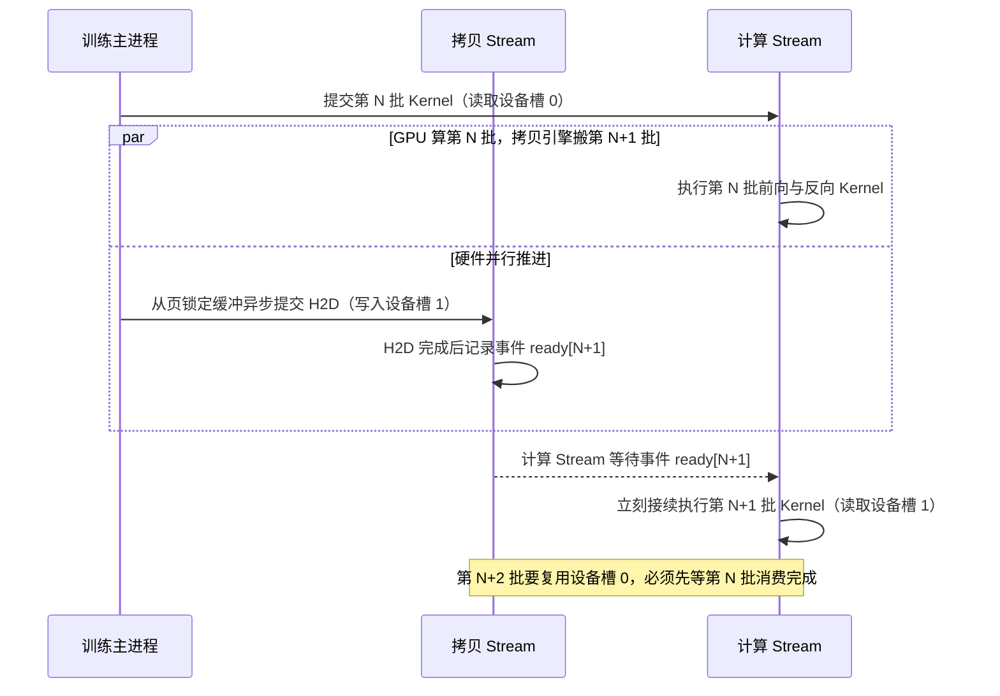

# DataLoader 并发、批次预取与 H2D 流水线

每一步训练若都死等“读文件 → 解码 → 拷显存 → 开算”排成直线，GPU 大半时间都在晒太阳。连续训练的提速诀窍，在于把这几个阶段错开做流水：GPU 算第 $N$ 批时，主机已经把第 $N+1$ 批备好了。

可工程里常碰到两类怪现象。一是把 `prefetch_factor` 调得老高，GPU 照样干等数据。二是把 `num_workers` 翻倍，训练步反而更慢，甚至把容器内存撑爆。要彻底看透原因，必须把**持续生产能力、队列缓冲余量和设备真重叠条件**拆开算。

## 一、三层“预取”，各管一段等待

大家口头常说的“预取”，在操作系统、框架和 CUDA 里其实是三件不同的事。每一层只管隐藏自己那一段等待，谁也替代不了谁。

| 预取层次 | 提前准备什么 | 能隐藏哪一段等待 | 主要代价与上限 |
| --- | --- | --- | --- |
| **内核文件预读** | 预测即将读取的连续文件页（`readahead`） | 后续读盘等待后端存储 I/O 的时间 | 随机读命中率低；无效预读白耗后端带宽与页缓存 |
| **DataLoader 批次预取** | 由加载 worker 提前读完、解码并整理好的 CPU 张量批次 | 训练主进程取批时的主机生产等待 | 消耗 CPU 核、共享存储并发、IPC 传递与主机内存 |
| **设备拷贝流水线** | 提前提交给拷贝 Stream 的下一批 H2D 显存输入 | 计算 Stream 等待 H2D 搬运完成的时间 | 依赖页锁定内存、拷贝引擎、双缓冲槽位与 Event 同步 |

内核预读把文件页拉进了内存，但图片还没解码。DataLoader 预取把 CPU 张量排进了队，但数据还没过 PCIe。只有把第三层异步 H2D 也接上，GPU 才真正不断流。

## 二、从完全串行到双 worker：推导稳态出批间隔

拿一组清晰的耗时参数算笔流水账。沿用单步目标 `125 ms` 的训练场景，设单批各阶段耗时为：
- 存储读取 $R = 50\text{ ms}$；
- CPU 解码与批整理 $P = 90\text{ ms}$；
- H2D 拷贝 $H = 8\text{ ms}$；
- GPU 计算与通信 $G = 125\text{ ms}$。

这里忽略主机提交开销，假设缓冲充足，且 H2D 与 GPU 计算可在独立硬件引擎上并行推进。

### 1. 完全串行：批批死等

不做任何跨批重叠时，每一批都从头跑到尾才开下一批，出批间隔直接相加：

$$T_{\text{serial}} = R + P + H + G = 50 + 90 + 8 + 125 = 273\text{ ms}$$

在这种模式下，GPU 超过一半的时间都在等主机备料。

### 2. 单 worker 流水：读取与解码绑在同一进程里

开启 1 个加载 worker 异步生产下一批。单个 worker 必须先读完本批、再解码本批，无法把 $R$ 和 $P$ 拆给两份批次同时执行。因此，主机生产阶段绑定为 $R + P = 140\text{ ms}$。

整条流水线的稳态节奏受限于最慢的那一环：

$$T_{\text{1worker}} = \max(R + P,\; H,\; G) = \max(140,\; 8,\; 125) = 140\text{ ms}$$

> [!warning] 常见误区：别把单 worker 错算成 $\max(50, 90, 8, 125)$
> 写成 $\max(50, 90, 8, 125) = 125\text{ ms}$，暗含的前提是读文件与解码能同时处理不同批次。单个同步 worker 做不到这一点。此时哪怕把预取队列加到 100 批，长期出批间隔依然卡死在 `140 ms`——因为每生产一批就要 `140 ms`，队列早晚被 `125 ms` 的消费节奏抽干。

### 3. 双 worker 流水：用并发把主机产能拉过 GPU 红线

改为每 Rank 启 2 个加载 worker。若 CPU 核与存储带宽富余、两路互不拖累，每个进程仍需 `140 ms` 产出一批，合起来的平均间隔减半：

$$T_{\text{host},2} = \frac{R + P}{2} = \frac{50 + 90}{2} = 70\text{ ms}$$

此时主机产能（`70 ms/批`）终于跑赢 GPU 消化速度（`125 ms/批`），稳态间隔回到了 GPU 自身：

$$T_{\text{2workers}} = \max(70,\; 8,\; 125) = 125\text{ ms}$$

| 流水组织方式 | 主机侧生产能力 | 理想稳态出批间隔 | 决定节奏的瓶颈 |
| --- | --- | ---: | --- |
| **完全串行** | 一批全跑完才启动下一批 | `273 ms` | 四段耗时串行相加 |
| **单 worker 跨批流水** | 每 `140 ms` 产出一批 | `140 ms` | 单路“读取 + 解码”产能 |
| **双 worker 跨批流水** | 理想平均每 `70 ms` 产出一批 | `125 ms` | GPU 计算与集合通信 |

落地时还要盯紧两个边界条件：
- **首批冷启动不提速**：多 worker 改善的是稳态吞吐，第 1 批结果依然要完整走完 `273 ms`。若框架按采样顺序严格交付，前面某批偶发卡顿也会拦住后面已做好的批次。
- **过度并发反噬产能**：假如 CPU 核紧张，开 2 个 worker 引发严重争抢，每批解码从 `90 ms` 拉长到 `220 ms`。此时主机平均产能反倒退回：

$$T_{\text{host,争用}} = \frac{50 + 220}{2} = 135\text{ ms} > 125\text{ ms}$$

给 `num_workers` 加码前，务必实测并发后的单批耗时，别拿理想除法盲推。

## 三、队列深度用来“扛抖动”，不是“变魔术”

假设刚消费完当前批次，就绪队列里另有 2 个成品批次，消费节奏为每 `125 ms` 一批。后端存储若突然暂停，这 2 批余量可顶住 `125 ms` 和 `250 ms` 两个消费点。到了 `375 ms` 的第三个消费点，新批次就必须接上了。

据此看取批等待（`next_batch_wait`），一眼就能分清两类病因：
- **偶发尖峰后迅速恢复**：平均产能达标，队列只是被短时抖动打穿。适当留足少量队列余量，或排查瞬时抖动即可缓解。
- **队列常年见底、步步等待**：长期产能低于消费速度。加再深的队列也只是多撑几秒，必须给存储或 CPU 解码扩容。

## 四、PyTorch 2.9 DataLoader 关键参数与内存预算

在 PyTorch 2.9 中，控制加载流水线主要靠下面四个核心参数。调优时建议按单变量递进对照，把同步基线、多进程、锁页与预取深度的影响拆开看：

```python
from torch.utils.data import DataLoader

# 典型生产配置：固定批大小与采样器，逐项核对并发、预取与锁页开关
loader = DataLoader(
    dataset,
    batch_size=32,
    sampler=sampler,
    num_workers=4,           # 每 Rank 启动 4 个独立加载子进程；设为 0 时主进程同步加载
    prefetch_factor=2,       # 每个 worker 最多预取 2 批（num_workers=0 时必须为 None）
    pin_memory=True,         # 将返回给主进程的 CPU 批次拷贝至页锁定内存，供异步 H2D 使用
    persistent_workers=True, # epoch 结束后保留子进程常驻，避免每轮重建进程与缓存冷启动
)
```

多进程预取很爽，但内存账单涨得极快。用双节点四卡作业算笔账：每 Rank 配 `num_workers = 4`、`prefetch_factor = 2`，每批解码后 CPU 张量大小为 `32 MiB`。

先算全作业的总加载进程数与每 Rank 的目标预取批次数：

$$N_{\text{workers,总}} = 4\text{ Rank} \times 4\text{ worker/Rank} = 16\text{ 个加载进程}$$

$$B_{\text{prefetch,单Rank}} = 4\text{ worker} \times 2\text{ 批/worker} = 8\text{ 批}$$

假设预取队列填满，仅**在途成品张量**本身就要吃掉的主机内存为：

$$M_{\text{单Rank}} = 8 \times 32\text{ MiB} = 256\text{ MiB}$$

$$M_{\text{单节点(2 Rank)}} = 2 \times 256\text{ MiB} = 512\text{ MiB}, \qquad M_{\text{全作业(4 Rank)}} = 4 \times 256\text{ MiB} = 1\text{ GiB}$$

若顺手把 `prefetch_factor` 从 `2` 调成 `4`，每 Rank 仅预取成品张量就翻倍到 **512 MiB**（单节点 `1 GiB`）。

> [!warning] 常见误区：别忘了“隐形内存”与 `/dev/shm` 上限
> 上面算的只是预取成品张量的底价，远非 DataLoader 的真实内存峰值。解码中间态、正在消费的当前批次、`pin_memory` 复制瞬间并存的双份副本，以及 16 个 Python 进程的解释器与数据集索引，都会层层叠加。容器默认 `/dev/shm` 往往只有 `64 MiB`。PyTorch 多进程借共享内存传张量时，一旦在途批次撑破配额，作业会直接报 `Bus error` 崩掉。

## 五、页锁定、异步提交与真正的拷贝计算重叠

把 `pin_memory=True` 和 `.to(device, non_blocking=True)` 都加上，H2D 拷贝就会自动和 GPU 计算重叠吗？未必。这两个开关只算拿到入场券，想让硬件引擎真并行，还得凑齐四个条件：

1. **源缓冲适合异步 DMA**：源张量落在页锁定内存，且 GPU 具备独立的拷贝引擎与可用带宽；
2. **双流配合 Event 依赖**：下一批 H2D 提交到专门的拷贝 Stream，计算 Stream 通过 Event 等它落稳后再开算；
3. **独立双缓冲槽位**：第 $N+1$ 批写进独立的显存槽位（槽 0 与槽 1 轮换），不覆盖正在算的第 $N$ 批；
4. **守住缓冲生命周期**：H2D 完成前不改写或释放主机源缓冲，旧批次算完前也不提前复用旧显存槽位。



*图 09-03-01：基于双缓冲槽位与跨流 Event 的 H2D / 计算重叠时序。Event 建立 GPU 侧硬件依赖，不阻塞 CPU 继续发单。*

> [!summary] 核心结论：验证重叠，只认设备时间线相交
> 代码里 `.to(..., non_blocking=True)` 瞬间返回，仅说明主机入队完毕。数据何时拷完、拷贝和计算是否真正重叠，都要看 PyTorch Profiler 或 Nsight Systems 时间线。只有设备侧 H2D 区间与上一批 Kernel 区间在横轴上实际相交，重叠才算落地。若双路节点上 H2D 依然偏慢，请回到第 04 章排查锁页缓冲是否跨了 NUMA，或两张卡是否挤在同一条 PCIe 上行上。

到这里，持续喂数的整条输入流水线就打通了。下一篇我们把数据流向彻底反转：训练跑得好好的，为什么一保存 Checkpoint，存储压力就瞬间暴涨几十倍？

> [!info]- 参考资料
> - **Linux 预读与 PyTorch DataLoader**：[Linux man-pages · `readahead(2)`](https://man7.org/linux/man-pages/man2/readahead.2.html)、[PyTorch 2.9 · Multi-process Data Loading](https://docs.pytorch.org/docs/2.9/data.html#multi-process-data-loading)、[PyTorch 2.9 · Multiprocessing Sharing Strategies](https://docs.pytorch.org/docs/2.9/multiprocessing.html#sharing-strategies)
> - **异步拷贝、重叠与性能追踪**：[PyTorch 2.9 · `Tensor.to` 异步语义](https://docs.pytorch.org/docs/2.9/generated/torch.Tensor.to.html)、[PyTorch 2.9 · Profiler](https://docs.pytorch.org/docs/2.9/profiler.html)、[CUDA 13.2.1 Best Practices · Overlapping Transfers with Computation](https://docs.nvidia.com/cuda/archive/13.2.1/cuda-c-best-practices-guide/index.html#asynchronous-and-overlapping-transfers-with-computation)
