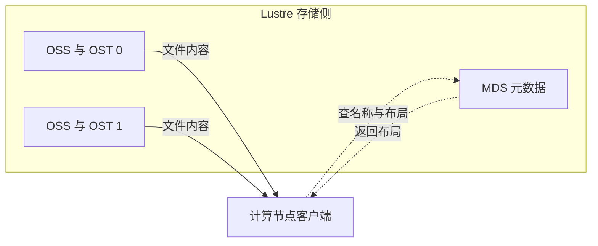

# 按访问模式理解存储与瓶颈

## 存储的位置、接口与实现是不同维度

本地 NVMe 说明设备位置和介质；共享文件系统说明多个客户端访问同一命名空间；并行文件系统说明文件数据或服务如何跨多个存储目标并发组织。它们不是完全互斥的产品分类。对象存储则以 Bucket、Key 和对象请求提供数据，应用可通过 SDK 读取，也可借助额外的文件接口层。

| 形态与架构例子 | 客户端怎样访问 | 在 GPU 作业中的角色与代价 |
| --- | --- | --- |
| 本地 NVMe + XFS/ext4 | 本机文件路径，经本地块设备 | 暂存数据、解压缓存、短期 Checkpoint；低延迟但副本分散，重新放置可能要重新预热 |
| NFS 共享文件系统 | 挂载后使用文件/目录接口 | 统一数据入口；能力受服务端、网络、并发与缓存影响，不能从协议名推断性能 |
| Lustre 等并行文件系统 | 文件接口，客户端按布局访问多个目标 | 承接多客户端、大文件和并发流；布局、目标分布与元数据能力共同约束效果 |
| S3 接口的对象存储 | 对 Key 发 GET/PUT，可按字节范围读取 | 数据集来源、长期状态仓库；需组织请求、索引、重试和本地缓存，不能预设 POSIX 语义 |

普通 S3 Bucket 中，`datasets/v3/shard-0001` 是对象 Key，斜杠可以帮助呈现层级，但不因此产生传统文件系统目录。这里专指普通对象键语义，不概括所有产品的新型目录或文件接口，见 [Amazon S3 对象命名](https://docs.aws.amazon.com/AmazonS3/latest/userguide/object-keys.html)。对象存储也可以有明确的一致性保证；本章不把“对象接口”误写成“必然最终一致”。

一种可行的数据组织是：共享/对象后端保存版本化原始分片，作业将需要的分片预热到 `/scratch`，Worker 读取本地副本。预热必须记录数据版本、完整性和覆盖范围，再发布可用标记；缓存未齐就启动所有 Rank，会把下载延迟带入训练。节点重新调度或本地盘丢失时，要有重新获取来源。权威副本与可丢弃缓存的职责要先确定。

本章每节点本地空间仅给定为 2 TiB。若缓存完整的 2 TiB 编码数据集，就没有空间再同时保留索引、临时下载与 Checkpoint。按 Rank 分片只缓存本节点所需数据，或按工作集淘汰，是容量设计的组成部分；“盘容量等于数据集大小”不足以证明方案能运行。

## 一次读取先找到文件，再取回内容

元数据描述文件名称、权限、位置、布局等信息。读取海量独立小文件时，查找和打开可能比传内容更费时；数据带宽很空闲也会产生 GPU 等待。

以下是 **Lustre 普通分离布局的教学架构图**：实线表示文件内容流向客户端，虚线表示查询/返回布局；范围框包含存储侧服务，不把元数据服务画成所有文件字节的必经中间站。MDS 是元数据服务，OSS 是对象存储服务，OST 是后者管理的数据目标。



普通文件可按 Stripe（条带）把连续区间轮流放到多个 OST。Stripe Size 决定一次连续区间大小，Stripe Count 决定参与布局的条带数量；这与训练数据集切成多个 Shard（分片文件）是两个层次。Lustre 也有 Data-on-MDT 等布局，上图不表示每种布局；这里只用分离布局解释元数据与内容各自的资源。参见 [Lustre Internals：文件条带与目录分布](https://wiki.lustre.org/Understanding_Lustre_Internals)及 [Lustre Metadata Service](https://wiki.lustre.org/Lustre_Metadata_Service_%28MDS%29)。

设独立教学布局为 Stripe Size=4 MiB、Count=2，条带先后落在 OST 0、1。则文件 `[0,4 MiB)` 在 0，`[4,8 MiB)` 在 1，`[8,12 MiB)` 回到 0。大范围并发读取可以动用两个目标；一个 256 KiB 读取若只落在首个区间，不会自动同时获得两倍带宽。实际布局可更复杂，增加条带还会增加参与服务与操作开销，不应把所有小文件都条带到全部目标。产品条件下的说明可对照 [FSx for Lustre：文件布局与条带](https://docs.aws.amazon.com/fsx/latest/LustreGuide/performance.html)。

## 小文件可以先耗尽元数据能力

给定一个**自拟稳态模型**：四 Rank 每秒需 3,200 个样本，每样本一个文件；服务端将一次样本访问折算为两次“元数据服务操作”，服务能力为 4,000 操作/s，客户端未命中相关元数据缓存，内容读取能力足够。这里的操作是题设计费单位，不声称 Linux 的一个 `open` 必定产生两次 RPC。

```text
元数据需求：3,200 × 2 = 6,400 操作/s
供给上限：4,000 / 2 = 2,000 样本/s（全作业）
对应编码字节：2,000 × 256 KiB = 500 MiB/s
```

即使大文件带宽基准有 8 GiB/s，仍无法满足本作业的 3,200 样本/s。现在把 256 个样本顺序装入一个 64 MiB 分片，并假定每分片只产生两次同口径元数据操作、客户端利用索引连续读取、不重复打开，则需求降为 `3,200/256 × 2 = 25 操作/s`。改变的是单位样本需要多少次服务操作。

分片并不保证所有问题消失。若压缩格式不支持所需随机定位，取一个样本可能要读解码整片；若每 Worker 仍频繁重新打开同一文件，元数据下降也达不到模型值。分片过大还会减少可并发任务或放大重试；要一起设计索引、样本打散、Worker 分工和缓存。这里说明基础设施代价，不讨论训练采样效果。

## IOPS、时延与吞吐要结合请求大小

IOPS 是每秒完成的 I/O 请求数，单请求大小为 S、完成速率为 I 时，数据吞吐为 `I × S`。一个教学随机读取能力若为 20,000 IOPS、请求 4 KiB，只有 `20,000 × 4 KiB = 78.125 MiB/s`。这与顺序大块读取的 6 GiB/s 不冲突，它们测的是不同访问模式。

并发是隐藏时延的一种手段。稳定状态下，平均在途请求数约为 `完成 IOPS × 平均请求时延`。例如每请求 1 MiB、平均 2 ms、希望完成 4 GiB/s，需要 4,096 IOPS，平均约 `4,096 × 0.002 = 8.192` 个在途请求。至少要具备相应并发余量，但不能据此保证发九个请求就达到目标：队列加深可能使时延上升，热点或共享带宽也会先限制吞吐。

对象 GET 同样有请求固定成本，可以用并行连接和合适的 Range 读取减少小请求/串行等待。可定位的格式与索引仍是前提；不要每读一个小样本就拉完整个大对象。机制参见 [S3 性能指引：并发连接和 Byte-range fetches](https://docs.aws.amazon.com/AmazonS3/latest/userguide/optimizing-performance-guidelines.html)。本章不引用该服务的默认性能数字推断其他对象产品。

## 最后核对全服务与所有客户端

本章共享服务的聚合读取预算为 8 GiB/s，每节点上限 4 GiB/s。两节点各需 400 MiB/s，合计 800 MiB/s，在带宽维度满足；元数据与 CPU 条件还要分别满足。

若改为 **32 个同等需求的节点**，按均分且无其他负载的教学条件，每节点只能获 `8/32 = 0.25 GiB/s = 256 MiB/s`，低于 400 MiB/s，总需求为 12.5 GiB/s。此时单客户端测出的 4 GiB/s 不能替代并发预算。本地缓存、错峰预热或提高后端供给都针对这一差额，但要同时核对容量和数据复用。

读基准结果时至少保留访问接口、文件/对象大小、请求大小、随机或顺序、并发客户端及 Worker 数、缓存层状态、读写方向和有效计时区间。大文件单流、海量小文件和完整加载器分别回答不同问题。下一篇加入写流量，检查训练读取以外的突发压力。

[上一篇：用并发缓存与预取维持供给](02_用并发缓存与预取维持供给.md) · [下一篇：把检查点写入与恢复放进预算](04_把检查点写入与恢复放进预算.md)
