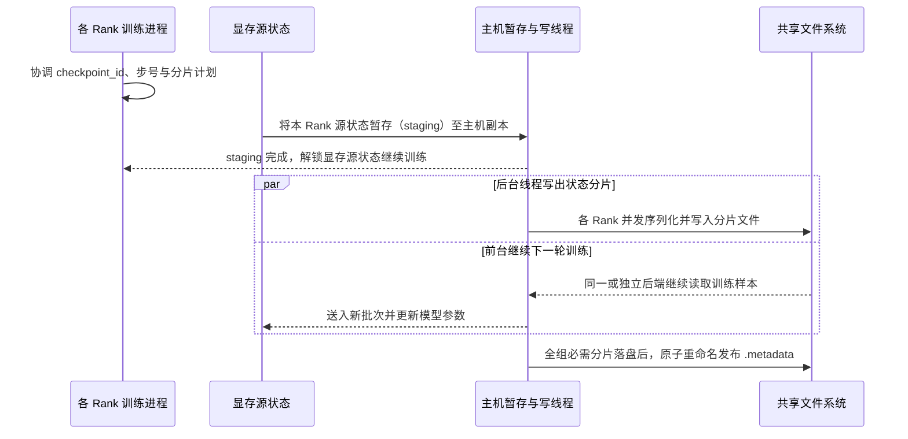

# Checkpoint 的一致快照、写入与恢复

训练已经跑了十几个小时。万一突然掉卡或节点重启，没有落盘的进度就会瞬间归零。**Checkpoint（检查点 / 保存点）** 把某一逻辑步号的训练状态持久化下来，是大规模训练的生命线。

与持续读样本相反，Checkpoint 把 I/O 方向反转为**短时爆发式大规模写出**。它还多出一道硬门槛：故障重启时，恢复进程面对满目录分片，必须辨认出哪几份凑在一起才是完整、一致、可装载的版本。

## 一、一份可恢复状态装什么，由谁写出

估算 Checkpoint 体积时，绝不能只按模型参数量算账。一份能续训的完整状态，通常包含三类内容：
- **模型参数**：各层权重张量；
- **优化器状态**：例如 AdamW 的一阶/二阶动量与 FP32 主权重，体积常是模型权重的数倍；
- **训练进度与随机状态**：全局步号、学习率调度器、随机数种子以及数据加载游标。

分布式场景下，“同一逻辑保存点”不会因各进程同时写文件就自动成立。参与保存的各 Rank 须先对齐步号与状态清单。在显存源张量被下一步反向传播改写前，还必须建好与计算隔离的稳定副本。

把分散在各卡的状态落盘，主要有两种组织形态：

| 写入组织方式 | 数据汇聚形态 | 核心优势 | 关键约束 |
| --- | --- | --- | --- |
| **单写端汇总** | 先经集合通信把全组状态收齐到单一 Rank，再统一落盘 | 文件数量少，版本管理简单 | 汇聚通信开销大、单机内存承压、单客户端写带宽成死穴 |
| **多 Rank 分片写入** | 各 Rank 各自写出本卡持有的状态分片，最后汇总发布版本 | 搬运与写盘并发度高，适合大模型 | 整体进度受最慢分片拖累；多写入者仍可能挤爆共享存储后端 |

分片写入不能把单客户端写速直接乘以 Rank 数。多个写入者在服务端、磁盘或网卡处仍共享物理通道。整份快照何时完成，永远由最慢那个必需分片决定。

## 二、从稳定副本到版本发布：PyTorch DCP 流程

以 **PyTorch 2.9 Distributed Checkpoint（DCP）** 的共享文件系统后端为例，跟踪一次带后台写入的保存过程。这里的 **staging（暂存）** 指为待保存状态建立隔离副本：源在显存时通常表现为 D2H 拷贝，源本就在主机内存时，则表现为主机侧复制或序列化准备。



*图 09-04-01：多 Rank 分片异步保存时序。后台写与下一轮训练重叠，若共用存储后端、网卡或 PCIe 通道，读写会直接争用。*

在 PyTorch 2.9 的 `FileSystemWriter` 默认协调路径下，各 Rank 先把本卡状态写成独立分片。开启 `single_file_per_rank=True` 时，单写线程下通常合并为每 Rank 一份文件。待全部分片落盘后，协调端把索引写入临时元数据，再重命名为正式的 `.metadata`。

若关闭默认协调（`use_collectives=False`），各 Rank 会写出各自的 `__<rank>.metadata`，完整性判定口径也随之变化。无论哪种模式，目录里出现分片文件只说明写入开始了。只有最终元数据发布且必需分片齐全，新版本才真正对外可读。

### 四个完成时点，各自回答一个问题

排查“日志明明说保存成功，重启却读出残缺快照”，关键是把四个层面的完成信号拆干净：

| 完成时点 | 确切含义与可做的决定 | 尚未覆盖的风险边界 |
| --- | --- | --- |
| **staging 完成** | 本地已建好隔离副本，训练线程可安全继续更新显存里的源参数 | 后台还没写盘，此刻进程崩溃会丢掉这份快照 |
| **框架保存完成** | Writer 已完成全部分片写出并发布了最终 `.metadata` | 遇到节点断电时，持久性还取决于底层同步与挂载契约 |
| **后端持久性确认** | 数据与命名变更已按文件系统 `fsync` 或 NFS `COMMIT` 落稳 | 仍需确认逻辑状态完整且与目标恢复拓扑匹配 |
| **恢复就绪** | 新拉起的全部必需 Rank 已识别有效版本、读齐状态并装入 GPU | 这是故障重启后训练重新开跑的真正起点 |

> [!warning] 常见误区：开启 `sync_files=True` 仍要看清目录与协议边界
> 普通缓冲写返回时，数据往往还留在客户端页缓存里。PyTorch 2.9 的 `FileSystemWriter(sync_files=True)` 会对分片与临时元数据调用 `fsync`，随后重命名元数据，但并未额外对父目录调用 `fsync`。对本地文件系统来说，文件数据落盘与目录项持久化是两回事。远端 NFSv4.1 则还要服从服务端的 `WRITE`/`COMMIT` 持久性契约。

## 三、异步保存、背压控制与关键配置

同步保存会让训练线程干等写盘结束。常规 `async_save` 把写盘甩给后台，主线程仍要等完同步 staging。PyTorch 2.9 引入 `async_stager` 后，连 staging 也能异步化，并返回含两枚完成信号的 `AsyncSaveResponse`：
- `staging_completion`：只表示**本 Rank** 的隔离副本已就绪，并非全组同步点。在此之前，优化器绝不能改写仍在暂存的显存源张量。
- `upload_completion`：表示全组后台分片写出与最终元数据发布彻底完成。

下面是一段展示异步保存、CPU 后端前提与背压控制的精简示例：

```python
import torch.distributed as dist
import torch.distributed.checkpoint as dcp

# 1. PyTorch 2.9 分布式 async_save 要求进程组具备 CPU 后端（如 cpu:gloo,cuda:nccl）
dist.init_process_group(backend="cpu:gloo,cuda:nccl")

writer = dcp.FileSystemWriter(
    path="/mnt/shared-ckpt/step_10000",
    single_file_per_rank=True,  # 合并本 Rank 张量项，减少小文件元数据冲击
    sync_files=True,            # 写完分片与临时元数据后调用 fsync 再重命名
)

pending_upload = None

# 2. 提交新一轮保存前先做背压检查，避免未落盘副本把主机内存和存储队列打爆
if pending_upload is not None:
    pending_upload.result()     # 限制在途上传份数：必须等上一轮 upload_completion

# 3. 发起异步保存，并按 checkpoint_id / stage_ms / write_ms / publish_ms 埋点观测
resp = dcp.async_save(state_dict, storage_writer=writer)
pending_upload = resp.upload_completion  # 若为传统同步 staging 路径，resp 本身即 Future
```

异步化只是把等待移出了关键路径，并没有少写一个字节。若保存周期比后台落盘还短，又不加背压限制，多份暂存副本和未完成上传很快就会撑爆主机内存与存储队列。

## 四、用完成窗口核算突发带宽与容量

规划 Checkpoint 存储带宽，最致命的坑是拿“长期平均速率”去对标硬件指标。

来看双节点四卡算例。每份完整快照有效载荷为 **64 GiB**（4 个 Rank 各写 `16 GiB`），每 `600 s` 保存一次，要求在 **20 s** 窗口内写完载荷。目录常驻保留 **3 份**完整版本，新版完整发布后才删最旧版。暂不计元数据、后端副本与重试开销：

$$\text{长期平均写速率} = \frac{64\text{ GiB}}{600\text{ s}} \approx 0.107\text{ GiB/s}$$

$$\text{单作业 20 s 突发写带宽} = \frac{64\text{ GiB}}{20\text{ s}} = 3.2\text{ GiB/s}$$

$$\text{三作业窗口完全重叠时聚合带宽} = 3 \times 3.2\text{ GiB/s} = 9.6\text{ GiB/s}$$

$$\text{版本切换期最低逻辑容量} = (3 + 1) \times 64\text{ GiB} = 256\text{ GiB}$$

四笔账摆在一张表里，反差非常直观：

| 规划维度 | 算式 | 最低需求 | 工程含义 |
| --- | --- | ---: | --- |
| **长期平均速率** | `64 GiB ÷ 600 s` | `0.107 GiB/s` | 只反映总数据量，对带宽选型几乎没有指导意义 |
| **单作业突发窗口** | `64 GiB ÷ 20 s` | `3.2 GiB/s` | 若 20 s 还含 staging 与发布，净写速要求更高 |
| **三作业撞窗峰值** | `3 × 3.2 GiB/s` | `9.6 GiB/s` | 共享后端须为同窗训练读另留余量，或错峰保存 |
| **切换期逻辑容量** | `(3 + 1) × 64 GiB` | `256 GiB` | 新版落稳前旧版不能删，底层副本与临时文件另计 |

> [!tip] 工程直觉：错开保存步号，是最便宜的存储扩容
> 共享并行文件系统的多个训练作业，若习惯在整百步或整点同时保存，写峰值就会线性叠加（本例从 `3.2 GiB/s` 暴涨至 `9.6 GiB/s`）。在框架或调度脚本里加一点随机错峰偏移，不花一分钱就能削平尖峰。

## 五、故障恢复时间：下界与最慢 Rank

作业掉卡重启后，恢复流程与保存镜像对称：
1. 扫描目录，锁定最新一份元数据完整、校验通过的版本；
2. 由 DCP 按当前 Rank 数与目标分片布局，规划每个 Rank 需读取的字节范围；
3. 各 Rank 并发读取、反序列化并经 H2D 装入目标 GPU；
4. 等全部必需 Rank 上报 `restore_ready_ms` 就绪，同步训练再迈出第一步。

DCP 支持恢复重分片（Resharding）。扩容或缩容改变 Rank 数后，各卡按新布局只取所需切片，因此必须按实际读取计划重算负载，不能沿用旧的单卡 `16 GiB` 假定。

设四卡恢复合计需读取 `64 GiB`，存储有效聚合读速为 `2 GiB/s`，则仅读取阶段的耗时下界为：

$$T_{\text{read}} \ge \frac{64\text{ GiB}}{2\text{ GiB/s}} = 32\text{ s}$$

元数据解析、反序列化、H2D 搬运和最晚到齐的慢 Rank 还会继续叠加，实际恢复就绪时间只会高于 `32 s`。

> [!summary] 核心结论：训练恢复与推理冷启动同源而异构
> 训练恢复要读带优化器状态的读写型 Checkpoint。在线推理弹性扩容时，面对的则是动辄 140–800 GB 的只读模型权重（第 07 篇详解）。两者都绕不开一道核心物理问题：数据从存储进显存，能不能少绕主机内存一圈？下一篇我们拆解 **GPUDirect Storage（GDS）** 的直达路径。

> [!info]- 参考资料
> - **PyTorch 分布式检查点与源码**：[PyTorch 2.9 · Distributed Checkpoint (DCP)](https://docs.pytorch.org/docs/2.9/distributed.checkpoint.html)、[`filesystem.py` 写入与元数据发布源码](https://github.com/pytorch/pytorch/blob/v2.9.0/torch/distributed/checkpoint/filesystem.py#L754-L786)、[`state_dict_saver.py` 异步保存返回值源码](https://github.com/pytorch/pytorch/blob/v2.9.0/torch/distributed/checkpoint/state_dict_saver.py#L203-L214)、[`state_dict_saver.py` CPU 后端校验源码](https://github.com/pytorch/pytorch/blob/v2.9.0/torch/distributed/checkpoint/state_dict_saver.py#L293-L299)
> - **文件系统与远端持久性契约**：[Linux man-pages · `fsync(2)`](https://man7.org/linux/man-pages/man2/fsync.2.html)、[RFC 8881 · NFSv4.1 WRITE](https://www.rfc-editor.org/rfc/rfc8881.html#section-18.32)、[RFC 8881 · NFSv4.1 COMMIT](https://www.rfc-editor.org/rfc/rfc8881.html#section-18.3)
