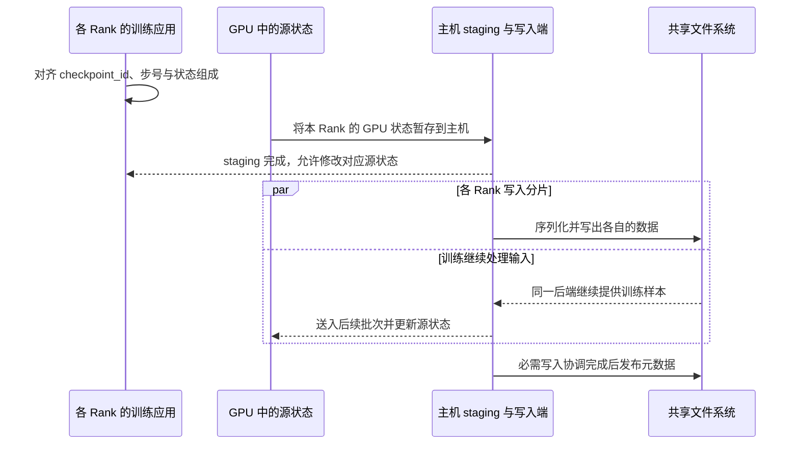

训练输入是持续的小批读取，**Checkpoint（保存点）** 则把某一逻辑保存点的训练状态集中写出，以便故障或重启后恢复。它改变了 I/O 的方向和时间形状，也增加了一个输入读取没有的要求：恢复时不能只见若干文件，还必须能辨认哪些分片属于同一份完整、可装载的状态。

本章不讨论作业调度器如何重启进程。第 05 章已经说明启动器与应用的恢复分工，这里集中解释应用状态怎样写出、何时算保存完成，以及存储压力怎样估算。

## 先确定要恢复什么、由谁写出

一份可恢复状态通常包括模型参数、优化器状态和训练进度。若要求从同一数据位置继续、复现后续随机序列，还可能需要学习率调度器、随机数生成器状态、采样器或数据游标。容量必须从实际序列化结果估算，不能只按模型参数个数推断。

“同一保存点”也是应用需要建立的逻辑条件。保存方应让参与保存的 Rank 对步号、状态组成和保存顺序达成一致，并在源状态仍会被优化器或设备 Kernel 修改时，先建立适当的同步或稳定副本。仅同时调用一个写文件接口，不会自动把任意在途更新变成一致快照。

| 写入组织 | 数据怎样集中 | 主要优势 | 关键约束 |
| --- | --- | --- | --- |
| 单 Rank 或单写端汇总 | 先收齐分散在各 Rank 的状态，再由一个写入者输出 | 文件与版本组织较集中 | 汇聚通信、主机缓冲、单客户端带宽和单点完成时间 |
| 多 Rank 分片写入 | 各 Rank 写出自己负责的状态分片，再共同形成一份保存点 | 可并行承担搬运和写入 | 必需分片与慢写入者、共享后端容量、元数据协调和恢复布局 |

分片写入不能把单客户端实测带宽简单乘以 Rank 数。多个写入者可能共享服务端、磁盘、网络或节点内路径；完整版本仍受最慢必需分片和最终协调约束。

## 从稳定状态到可发现的完整版本

以 PyTorch 2.9 的 Distributed Checkpoint（DCP）为例。下图假定含 GPU 状态、采用 Rank 间协调、各 Rank 分片写入共享文件系统，并允许后台保存。**staging（暂存）** 是指为待保存状态建立与源状态分离的稳定副本；若源在显存，本例包含 D2H，若源已在主机，则可能表现为主机侧复制或序列化准备，不能一概写成 D2H。

图中训练与后台写并行，所以保存开销不只在调用保存接口时出现。若训练样本和 Checkpoint 使用同一后端，读写可能争用存储服务、磁盘或客户端网络；即使分用后端和网络，也仍可能争用主机内存、CPU 序列化或 PCIe 路径。

DCP 的 `FileSystemWriter` 在 `single_file_per_rank=True` 时合并本 Rank 的写入项；在默认单写线程等条件下，每 Rank 的数据通常写成一份文件，实际文件数还受线程数和写计划影响。`sync_files=True` 时，2.9.0 实现会对数据文件和临时元数据执行 `fsync`，然后再重命名元数据；这段实现本身没有完成目录 `fsync`。默认协调实现会汇集写入结果，先把数据位置等元数据写入临时文件，再重命名为最终的 `.metadata`。若改用 `use_collectives=False`，则写出的是每 Rank 的 `__<rank>.metadata`，不能套用单一 `.metadata` 的发布描述。分片文件已经存在只证明部分写入出现；最终元数据描述了怎样找到并组织整份状态。每次保存使用独立目录，并让恢复端只选择满足完整性条件的版本。 [PyTorch 2.9 DCP](https://docs.pytorch.org/docs/2.9/distributed.checkpoint.html) · [DCP 2.9.0 文件写入与元数据实现](https://github.com/pytorch/pytorch/blob/v2.9.0/torch/distributed/checkpoint/filesystem.py#L754-L786)

### 四个时点回答四个不同问题

| 时点 | 能支持的判断 | 不能据此直接推断什么 |
| --- | --- | --- |
| staging 完成 | 保存端已有可独立使用的状态副本，对应源状态可按该实现契约继续修改 | 后端已经写完，或重启后已经能够恢复 |
| 框架保存完成 | 该 writer 已按实现完成数据写入和元数据发布 | 任意断电故障下都已持久化，或新进程已经装载成功 |
| 后端持久性得到确认 | 按具体文件系统、同步调用和服务契约，相关数据与命名变化达到约定持久状态 | 应用状态一定完整，恢复布局一定匹配 |
| 恢复就绪 | 新 Rank 已找到完整版本、读齐所需状态并装载到目标设备 | 之前某次后台写的具体耗时，或训练已重新达到稳态 |

普通缓冲写返回时，数据可能仍在客户端缓存。框架完成后能否经受某类故障，要结合 `sync_files`、目录项处理、挂载协议和服务端持久性语义判断。以本地 Linux 文件系统为例，文件数据的 `fsync` 与包含该文件的目录项持久化不是同一个动作；远端文件系统和对象存储也应按各自提交与故障恢复契约解释，不能套用单盘结论。 [Linux fsync 手册](https://man7.org/linux/man-pages/man2/fsync.2.html) · [NFSv4.1 WRITE](https://www.rfc-editor.org/rfc/rfc8881.html#section-18.32) · [NFSv4.1 COMMIT](https://www.rfc-editor.org/rfc/rfc8881.html#section-18.3)

## 异步保存把哪段工作移出调用线程

同步保存让调用方等待保存结束。常规 `async_save` 先完成 staging，再由后台继续保存，因此调用方虽然能较早继续训练，仍要承担同步 staging 的时间。

PyTorch 2.9 的 `async_stager` 路径允许把 staging 也异步化。当 stager 返回 Future 时，`async_save` 返回 `AsyncSaveResponse`：

- `staging_completion` 表示**本 Rank** 的本地稳定副本已经就绪，不是全 Rank 同步点；在此之前，优化器或其他操作不能破坏仍用于 staging 的源状态。
- `upload_completion` 表示后续保存过程完成。

传统的同步 staging 路径返回单个保存 Future，不要把两种返回类型和等待方式混写。另一个版本条件是：PyTorch 2.9.0 在分布式已经初始化时，`async_save` 要求所用 process group 含 CPU 后端，例如 `cpu:gloo,cuda:nccl`；这不改变上述两个阶段的意义，但属于使用该接口前需要满足的配置条件。异步化改变的是工作发生在哪里、调用方等待什么，并不减少需要复制和写出的字节。 [DCP 2.9.0 保存返回值与 staging 实现](https://github.com/pytorch/pytorch/blob/v2.9.0/torch/distributed/checkpoint/state_dict_saver.py#L203-L214) · [CPU 后端条件](https://github.com/pytorch/pytorch/blob/v2.9.0/torch/distributed/checkpoint/state_dict_saver.py#L293-L299)

如果上一份仍在写入就继续提交下一份，可能同时积累暂存副本、序列化缓冲、存储队列和未发布版本。需要限制内存或后端积压时，可以在下次提交前检查上一次的完成信号，形成背压：传统路径等待返回的保存 Future；若拿到的是 `AsyncSaveResponse`，限制“仍在上传的保存份数”应等待 `upload_completion`，不能只等本 Rank 的 `staging_completion`。测量记录可带 `checkpoint_id`、`rank`、`step`、`bytes`、`stage_ms`、`write_ms` 和 `publish_ms`；这些是应用自定义字段，应按同一时间窗对照训练读、后台写和集合通信。

## 用完成窗口计算写入压力

**容量与带宽算例。** 两节点四 Rank，每份完整 Checkpoint 的有效载荷为 64 GiB，四个 Rank 各写一个 16 GiB 等量分片。忽略元数据、协议、后端副本和重试。

| 条件 | 换算 | 结果与含义 |
| --- | --- | --- |
| 每 600 s 保存一份 | `64 GiB ÷ 600 s` | 长期平均约 0.107 GiB/s |
| 每份要求在 20 s 内写完载荷 | `64 GiB ÷ 20 s` | 窗口内合计至少 3.2 GiB/s |
| 三个作业的这些窗口完全重叠 | `3 × 3.2 GiB/s` | 共享路径合计至少 9.6 GiB/s |
| 始终保留三份完整版本，新一份完整后才删除最旧一份 | `(3 + 1) × 64 GiB` | 转换期间逻辑容量至少 256 GiB |

长期平均 0.107 GiB/s 不能用来判断 20 s 窗口是否达标。若 20 s 还包括 staging、序列化和元数据发布，真正可用于数据写入的时间更短，所需写速率更高。若三个作业的窗口错开，峰值只按实际重叠的作业计算；同窗训练读也需要保留带宽。256 GiB 同样只是应用有效载荷，文件系统开销、后端副本、临时文件和失败版本另计。

## 恢复时间由完整版本和最慢 Rank 决定

恢复过程可以沿下面的顺序跟踪：

1. 识别一份满足完整性条件的保存点，读取其元数据。
2. 按当前 Rank 与目标分片布局规划读取，取得各自需要的字节。
3. 反序列化并装载到主机或目标 GPU，建立后续训练所需的状态。
4. 所有必需 Rank 都就绪后，同步训练才能继续。

DCP 能按目标布局规划读取；对支持的分片张量，可以只取本 Rank 需要的部分。因此，改变 Rank 数或分片布局后，不能默认每个 Rank 都读取原先那一个 16 GiB 文件，也不能默认总读取量和并发度不变，应记录实际读取计划。 [PyTorch 2.9 DCP 加载语义](https://docs.pytorch.org/docs/2.9/distributed.checkpoint.html)

**恢复算例。** 设四个 Rank 合计需要读取 64 GiB，有效聚合读速率为 2 GiB/s，则仅读取阶段的模型下界是：

`T_read ≥ 64 GiB ÷ (2 GiB/s) = 32 s`。

元数据、反序列化和 H2D 可能部分重叠，也可能落在关键路径上；同步训练要等最晚恢复的 Rank，所以 32 s 不是完整恢复时长承诺。各 Rank 的 `restore_ready_ms` 应从同一恢复起点计时。推理服务冷启动也会读取并装载模型，但状态组成和“服务就绪”的条件由服务自身定义。

无论是训练输入还是 Checkpoint，前面讨论的都是存储与主机、显存之间怎样交接。下一篇改变其中一段物理搬运方式：在受支持的文件与平台上，让 GDS 将文件载荷直接送入 GPU 缓冲；保存点的一致性和完整性要求并不会因此改变。
