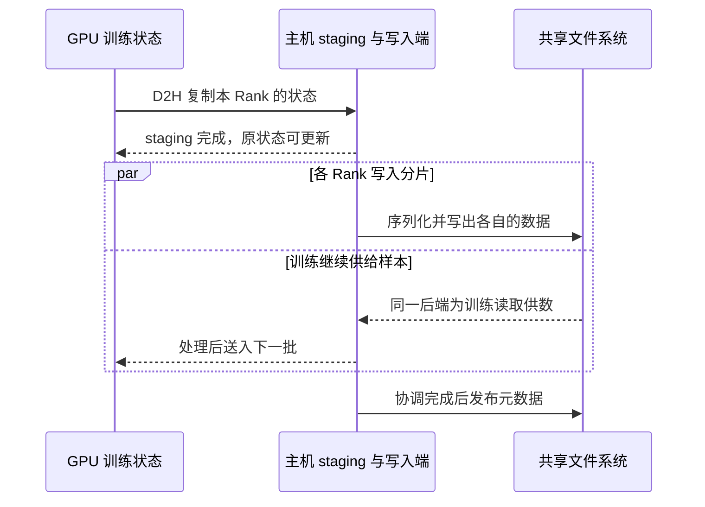

# Checkpoint 怎样写出与恢复

训练输入通常持续读取，Checkpoint 则把同一步的模型、优化器和训练进度集中写出。根据恢复要求，还可能保存学习率调度器、随机数生成器或数据游标等状态。估算存储容量时，从一份完整 Checkpoint 的实际序列化大小开始。

## 从训练状态到可恢复版本

单 Rank 写入时，若所需状态分散在各 Rank，写入者得先收齐状态，汇聚、主机缓冲和单客户端写带宽都可能拉长保存时间。分片写入可以让多个 Rank 并行承担搬运和写入，仍要等必需的分片写好才能发布完整版本。多个写入者共用一个存储后端时，单个写入者的带宽无法简单乘以 Rank 数。

以 PyTorch 2.9 的 Distributed Checkpoint（DCP）为例，下面展示有 GPU 状态需要暂存到主机、默认使用 Rank 间协调、异步保存到共享文件系统的简化路径。每个 Rank 可在主机暂存副本稳定后继续会修改原状态的操作。后端写和最终发布可以继续进行。

这里假设训练样本和 Checkpoint 放在同一共享后端，读写重叠时可能争用服务端、磁盘或客户端网络。若两类数据分用后端和网络，仍可核对节点内的主机内存带宽、CPU 序列化和 PCIe 路径。写入后台化后，压力随实际重叠窗口出现。

`FileSystemWriter` 的 `single_file_per_rank=True` 将本 Rank 的写入项合并。默认单写线程时，写入该 Rank 数据的文件通常为一份。实际文件数还取决于线程和写计划。`sync_files=True` 会在写入路径执行同步。默认协调模式下，writer 汇集写入结果，将数据位置等信息写入临时元数据文件，再重命名为 `.metadata`。给每次保存用独立目录，恢复时根据写入完成状态选择版本。分片文件存在只说明部分写入已经出现，发布的元数据才描述如何找到整份状态。 [PyTorch 2.9 DCP](https://docs.pytorch.org/docs/2.9/distributed.checkpoint.html) · [DCP 2.9.0 文件写入及完成阶段](https://github.com/pytorch/pytorch/blob/v2.9.0/torch/distributed/checkpoint/filesystem.py)

这里有三个时间点需要分别记录。

| 时间点 | 能据此判断什么 |
| --- | --- |
| staging 完成 | 保存端持有可以独立使用的状态副本，训练可以修改对应源状态 |
| 框架保存完成 | 该 writer 已按其实现写完数据并完成元数据发布 |
| 恢复可用 | 重启后的 Rank 能看到并读全所需状态，且能装载到目标设备 |

普通缓冲写返回时，数据可能还在客户端缓存里。框架完成后的持久性要结合 `sync_files`、挂载协议和服务端的持久性语义来判断。以本地 Linux 文件系统为例，文件 `fsync` 与包含该文件的目录项持久化是两个步骤。远程文件系统和对象存储应按各自的提交与故障恢复契约解释。 [Linux fsync 手册](https://man7.org/linux/man-pages/man2/fsync.2.html) · [NFSv4.1 WRITE 与 COMMIT](https://www.rfc-editor.org/rfc/rfc8881.html)

## 异步可以重叠哪段时间

同步保存让调用方等待保存结束。常规 `async_save` 先做 staging，再由后台继续保存。调用方可以在该副本就绪后继续计算，仍会承担同步 staging 的时间。PyTorch 2.9 引入 `async_stager`，可以把 staging 也放到后台。当 stager 返回 Future 时，`async_save` 返回 `AsyncSaveResponse`，其中 `staging_completion` 表示副本就绪，`upload_completion` 表示保存结束。传统同步 staging 路径返回单个保存 Future。异步 staging 时，在优化器或其他操作写回源状态之前，要确保副本已经就绪。 [DCP 2.9.0 保存返回值和 staging 实现](https://github.com/pytorch/pytorch/blob/v2.9.0/torch/distributed/checkpoint/state_dict_saver.py) · [PyTorch 异步 Checkpoint 示例](https://docs.pytorch.org/tutorials/recipes/distributed_async_checkpoint_recipe.html)

上一份还在写时继续提交，可能增加暂存副本、序列化缓冲、存储队列和待提交版本。若应用只允许一份保存处于进行中，可以在下次提交前检查保存 Future。测量时给各 Rank 的记录带上 `checkpoint_id`、`rank`、`step` 和 `bytes`，另记录 `stage_ms`、`write_ms` 和发布端的 `publish_ms`。这些是应用自行定义的字段。用共同的时间窗和读写方向对照训练读、后台写及集合通信。

## 用完成窗口算压力，再算恢复时间

**算例。** 两节点四 Rank，每份完整 Checkpoint 的有效载荷为 64 GiB，各 Rank 写一个 16 GiB 等量分片。忽略序列化元数据、协议、后端副本和额外重试。

| 条件 | 换算 | 结果 |
| --- | --- | ---: |
| 每 600 s 保存一份 | `64 ÷ 600` | 平均约 0.107 GiB/s |
| 20 s 内写完载荷 | `64 ÷ 20` | 合计至少 3.2 GiB/s |
| 三个作业同窗写入 | `3 × 3.2` | 合计至少 9.6 GiB/s |
| 保留三份，新版完成后删除最旧一份 | `(3 + 1) × 64` | 峰值至少 256 GiB 逻辑容量 |

若 20 s 是从触发保存到元数据发布的总预算，staging、串行化或发布在关键路径上占去的时间会压缩实际写入窗口。如果三个作业的窗口错开，共享后端承受的峰值按实际重叠数计算。带宽还要给同窗的训练读取留出空间。

恢复先识别一个完整版本，读取元数据，按当前 Rank 的分片布局取得所需数据，再反序列化并装入目标设备。DCP 可按目标布局规划读取，支持的分片张量通常只取本 Rank 所需部分。改变 Rank 数、分片布局或并发作业数后，要重新测实际读取量与最慢完成者。设四个 Rank 合计读取 64 GiB，有效聚合读速率为 2 GiB/s，则读取阶段至少 32 s。反序列化和 H2D 与读取可部分重叠，各 Rank 的 `restore_ready_ms` 以同一恢复起点计时。同步训练要等最晚就绪的 Rank。推理服务冷启动也会读模型并装载到设备，但其状态组成和就绪条件由服务本身定义。 [PyTorch 2.9 DCP 加载语义](https://docs.pytorch.org/docs/2.9/distributed.checkpoint.html)
