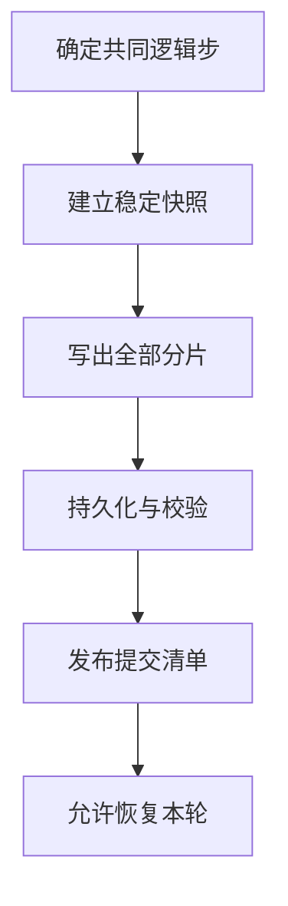

# 把检查点写入与恢复放进预算

## 要保存的是可以共同恢复的一份状态

Checkpoint（检查点）是在约定位置保存的应用状态，用于从已经完成的进度恢复。继续训练往往还需要优化器状态、步数、随机状态与数据进度；只保存模型权重未必能够继续同一过程。哪些状态必须保存由应用定义，基础设施负责容纳、传输、持久化和重新读取它们，不能从 GPU 数或参数文件大小直接猜出完整检查点大小。

分布式检查点可以由不同 Rank 保存不同分片。所有分片必须属于同一个逻辑快照，恢复器还需知道分片布局、格式与完整性。若 r0 保存第 100 步、r1 保存第 101 步，单个文件都能打开也不代表能共同恢复。PyTorch DCP 提供多 Rank 的并行保存/加载与部分重分片能力，具体支持受状态表达和版本约束，见 [PyTorch 2.9 Distributed Checkpoint](https://docs.pytorch.org/docs/2.9/distributed.checkpoint.html)。本章不假定任意格式都能随意改变 World Size。

对 `job-09` **另给检查点条件**：每次完整载荷为 256 GiB，四 Rank 各产生不同的 64 GiB，合计每节点 128 GiB，无额外全量副本。本题载荷均需从 GPU 暂存到主机，已给定源状态和训练显存容量足够；这不是从每步 64 MiB 输入推算出的状态大小。GPU→主机 D2H 每节点聚合有效速率为 16 GiB/s；共享存储在此写入模式下为全作业聚合 4 GiB/s。串行写出全部载荷后，另有 2 s 用于完成题设要求的持久化确认、校验信息核对和小型清单发布。数据校验值在写出中累积，不假定这 2 s 还足够重新读完 256 GiB；实际系统需单独测量这些阶段。

## 快照完成、写完和可恢复是不同状态

以下是**同步保存的教学状态图**。箭头表示先后依赖，分片文件可在“写出”阶段内部并发；不是某个框架固定的 API 调用顺序。



普通缓冲 `write` 返回，可能只表示数据进入内核缓存；文件名已经可见，也不保证相应文件内容在故障后保留。`fsync` 用于等待文件状态同步到存储；新建或改名涉及目录项时，还要按文件系统语义考虑目录的同步。参见 [Linux fsync(2)](https://man7.org/linux/man-pages/man2/fsync.2.html)。对共享或对象后端，持久性和故障域还应按服务协议判断，不能用一个客户端系统调用替代全部保证。

本章用“分片写入→确认和校验→最后发布提交清单”的教学协议解释完成点。清单包含 step、预期分片、大小、校验信息与格式版本；恢复器只读已提交清单并核对其分片。同文件系统的原子改名可作为发布机制的一部分，但它没有把此前未持久化的数据变成持久化数据。对象后端应使用其支持的提交方式，不套用目录改名语义。

假设 `step-100` 四份分片均已确认，清单已提交；`step-200` 只有三份分片，未提交。此时应选择 100。不能挑文件时间最新的那三个，再从旧轮补一份。失败分片可以重试，但应用仍需确保来自原逻辑快照且内容未在重试期间改变。

## 同步暂停怎样进入训练时间

两节点并行 D2H，每节点复制 128 GiB 用 `128/16 = 8 s`；写出全作业 256 GiB 用 `256/4 = 64 s`。若这两阶段与最后确认完全串行，同步暂停为：

```text
8 + 64 + 2 = 74 s
```

设每 300 s **墙钟时间**发起一轮快照，即起点在 t=0、300、600 s，且没有其他停顿。则一个间隔里同步暂停占 `74/300 ≈ 24.67%`，剩 226 s 可推进训练。若策略改为“每完成 300 s 有效训练后再保存”，分母就变为 374 s；不要混用两种间隔。

同一组 256 GiB 检查点的平均写入需求为 `256/300 ≈ 0.8533 GiB/s`，却在写出阶段占满 4 GiB/s 达 64 s。后端“长期平均还空闲”不能排除训练读取在这些窗口受影响。读写常共享目标、网络与队列；本章没有给定混合负载曲线，不能把 8 GiB/s 读能力和 4 GiB/s 写能力直接相加承诺同时达到。

可以用一个**独立替换的混合负载模型**看清竞争：假定某服务读写合计只有 4 GiB/s，每读或写 1 B 都扣减同一份字节预算，且先保障全作业训练读取 800 MiB/s，即 0.78125 GiB/s。异步检查点便只剩 `4 - 0.78125 = 3.21875 GiB/s`，写出至少要 `256/3.21875 ≈ 79.53 s`。它解释了“后台保存占用了谁的余量”；这个人为模型不能由前面的独立读、写上限自动推出。

## 异步保存把工作移到后台，也保留完成义务

异步保存先取得不会再被训练改写的副本，再后台序列化和写入；训练可以在安全快照建立后继续。若只把指针交给后台而训练立刻改写原数据，可能把不同时间的状态混进一轮。PyTorch 的 AsyncStager 明确要求建立不受后续训练修改影响的表示，见 [PyTorch 2.9 AsyncStager](https://docs.pytorch.org/docs/2.9/distributed.checkpoint.html#torch.distributed.checkpoint.staging.AsyncStager)。

本教学方案仍让 D2H 快照阻塞 8 s，后台写入和确认耗 66 s，期间与训练重叠，训练只在快照阶段暂停。若资源争用不降低训练速度，则暂停占 `8/300 ≈ 2.67%`；本轮直到起点后 74 s 才变为可恢复。这里给的是明确同步点下的方案，不能把它写成所有 `async_save` 的固定返回行为；不同实现还可异步暂存，必须等待相应阶段完成并收取错误。

每节点多保留的快照载荷为 128 GiB。若按第二篇的加载内存 3.125 GiB、其他不可重叠对象 48 GiB、计划保留页缓存 32 GiB 计算，总量为 `128 + 3.125 + 48 + 32 = 211.125 GiB`，相对 256 GiB 剩 44.875 GiB。此处各项明确不重复，仍须给库、临时序列化与锁页额度留余量；不可据载荷大小就宣称实际峰值必定低于 256 GiB。若同时保留两轮 128 GiB 快照，仅载荷已经耗尽 256 GiB。

更深的队列也解决不了后台长期过载。如果每 30 s 产生 256 GiB，平均需求为 8.5333 GiB/s，超过 4 GiB/s。理想后台在 30 s 最多写出 120 GiB，积压至少增加 136 GiB/轮；额外确认开销只会更差。工程上可以限制在途轮数、等待、合并或跳过某轮，但应同时明确允许损失多少训练进度，不能一边无限排队一边宣称检查点始终最新。

## 保留与恢复也需要单独预算

若保留三轮已提交状态，并允许新一轮尚未完成时不删除旧轮，峰值载荷至少为 `4 × 256 = 1,024 GiB = 1 TiB`，还要加清单、临时文件和空间管理余量。提前删旧轮可以降低容量，却会改变新轮失败时的恢复选择。本地 NVMe 暂存可以缩短前台等待，但复制到远端完成前，整轮仍可能依赖原节点；本地写入快不等于能承受节点丢失。

恢复时，重新读入的字节、并发规模和初始化都会影响停顿。设一次恢复要读取这 256 GiB，两节点并行各读 128 GiB，仍满足每节点 4 GiB/s、聚合 8 GiB/s；读取完成后，每节点再以聚合 16 GiB/s H2D，最后初始化/协调共 10 s，三段串行：

```text
读取：max(128/4, 256/8) = 32 s
H2D：128/16 = 8 s（两节点并行）
到作业可继续：32 + 8 + 10 = 50 s
```

若两个同样的作业一起恢复，并均分相同的 8 GiB/s 后端，则每作业读取 64 s，到可继续为 82 s。文件已下载仍不表示数据已装入正确设备、状态格式兼容或成员已会合。本章计算数据与串行阶段的成本，重新调度、软件兼容和完整恢复流程归后续章节。

[上一篇：按访问模式理解存储与瓶颈](03_按访问模式理解存储与瓶颈.md) · [下一篇：GPUDirect Storage 改变哪段路径](05_GPUDirectStorage改变哪段路径.md)
