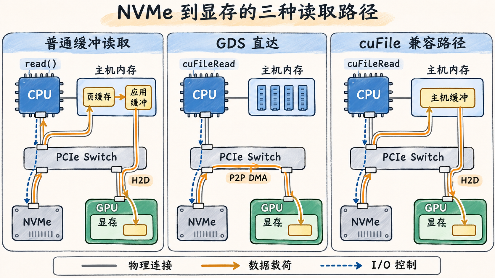

普通文件读取先把数据交给主机，再由训练进程把输入张量搬到 GPU。**GPUDirect Storage（GDS）** 提供另一条受支持的文件 I/O 路径：CPU 上的应用通过 cuFile 接口提交文件偏移、长度和目标 GPU 缓冲，符合条件的存储设备可以把文件载荷直接 DMA 到显存。它改变的是数据搬运路径，不负责选择样本、解码图像或决定 Rank 怎样通信。 [NVIDIA GDS 架构](https://docs.nvidia.com/gpudirect-storage/overview-guide/index.html)

为了隔离这段路径，本篇改用一个独立主例：同一节点的 NVMe 上保存已经预处理好的定长张量记录，应用可以把这些记录直接交给 GPU 消费或继续处理。它不再使用第 01 篇需要 CPU 解码的压缩图像，避免把预处理位置变化误算成 GDS 的 I/O 收益。

## 普通读取、GDS 直达与兼容路径的差别

最小正常请求需要四类输入：一个已打开并注册的文件句柄、文件内偏移与长度、目标 GPU 缓冲地址及缓冲内偏移、足够的平台与挂载支持。CPU 仍负责打开文件、注册句柄、提交 cuFile I/O 和处理完成状态；直达指的是**有效载荷不经过应用的主机数据缓冲和随后的 H2D**，不是“不再需要 CPU 或软件栈”。



*图 09-05-01｜同一台节点上的三种 NVMe 读取路径。橙色箭头表示载荷，蓝色虚线表示 I/O 控制。左右两栏的 H2D 箭头概括搬运起点和终点，实际路径经 CPU 侧 PCIe 根端口和 Switch。中栏假定设备拓扑、文件请求和目标缓冲满足直达条件。*

| 路径 | 载荷怎样到达 GPU | 主机数据缓冲与 H2D | 判断重点 |
| --- | --- | --- | --- |
| 普通缓冲读取 | NVMe → 页缓存 → 应用缓冲 → 页锁定/暂存缓冲 → GPU | 需要 | 热页缓存可省后端读，但不能省主机处理和 H2D |
| GDS 直达 | NVMe 经可用的 PCIe 路径 → GPU 缓冲 | 省去这条应用主机数据路径 | 文件、请求、设备、驱动与挂载均须满足实际后端条件 |
| cuFile 兼容路径 | cuFile 通过支持的主机/POSIX 路径取得数据，再交给 GPU | 仍有主机侧阶段 | 是否经过页缓存取决于打开方式和实选路径，不能统称为直达 |

图中直接路径是一种逻辑简化。在未显式注册目标缓冲的某些情形或其他请求条件下，cuFile 还可能先使用内部 GPU 缓冲，再在 GPU 内搬到用户缓冲；这类设备内部中转与“经主机内存”不是一回事。具体请求也可能因不对齐、文件系统或后端不支持而采用内部缓冲、转兼容路径或返回错误，须按当时 API 返回和路径记录判断。 [GDS 缓冲注册与最佳实践](https://docs.nvidia.com/gpudirect-storage/pdf/best-practices-guide.pdf)

受支持的远端文件系统也能提供 GDS 候选路径：客户端仍解析文件与存储协议，受支持的 RDMA 存储路径可由 NIC 把载荷送入 GPU 可访问的缓冲。这里要求文件系统、客户端、服务端与网络栈共同支持。第 06 章的 **GPUDirect RDMA（GDR）** 说明 NIC 能访问已映射 GPU 内存，NCCL 日志中的 GDR 选择也只覆盖通信路径；它们都不能替代 cuFile 对本次文件 I/O 的验证。本地 NVMe GDS 则不需要因为名称中有 GPUDirect 就额外加入一张 RDMA NIC。 [GDS 本地及远程存储路径](https://docs.nvidia.com/gpudirect-storage/overview-guide/index.html)

## 文件、缓冲与软件栈共同决定候选路径

### 文件句柄与 O_DIRECT 不是同一个判断

应用通过 `cuFileHandleRegister` 注册已打开文件，再向 `cuFileRead` 提供目标 GPU 缓冲、文件偏移、缓冲偏移和长度。挂载与文件系统必须支持所选后端。

CUDA 12.2 / GDS 1.7 起，cuFile 也接受未使用 `O_DIRECT` 打开的文件描述符；有可用直接路径时，这类请求仍可能走 GDS，否则在允许兼容模式时可经兼容路径并使用页缓存。`O_DIRECT` 表达的是绕过主机页缓存的直接 I/O 要求，并不指定 DMA 的目的地一定是显存。因此，看到该标志既不能单独证明 GDS，也不能把没有该标志一概判为普通读取。 [GDS O_DIRECT 指南](https://docs.nvidia.com/gpudirect-storage/o-direct-guide/index.html) · [cuFile API](https://docs.nvidia.com/gpudirect-storage/api-reference-guide/)

### 缓冲、偏移与长度决定请求能否直接处理

需要核对 GPU 地址是否有效、缓冲偏移与文件偏移怎样对齐、请求长度是否满足所选文件系统和后端要求。教学对照可以使用 4 KiB 对齐的 GPU 缓冲、4 KiB 整倍数的文件与缓冲偏移，并完整读取一条 1 MiB 记录；这是为了减少特殊分支而设的示例，不是所有后端的统一最低要求。

复用缓冲时可用 `cuFileBufRegister` 显式注册，以避免某些路径的内部 GPU 中转。若请求不对齐或文件不受当前后端支持，应查实际返回值和统计，区分内部中转、POSIX 兼容与错误，不能把“调用有数据返回”当成路径证明。 [GDS API 使用与对齐建议](https://docs.nvidia.com/gpudirect-storage/pdf/best-practices-guide.pdf)

### PCI P2PDMA 是特定版本与平台上的直接后端

传统 GDS 本地 NVMe 路径依赖 `nvidia-fs` 等组件。CUDA 12.8 / GDS 1.13 起，受支持的 Linux x86_64 NVMe 组合可以使用上游内核 **PCI P2PDMA（PCI Peer-to-Peer DMA）**，从而避开传统路径对 `nvidia-fs` 和定制 NVMe 驱动补丁的依赖。

本篇版本对照限定为 CUDA 12.9 Update 1、cuFile 1.14.1.1、H100、单盘 XFS、Linux x86_64。若选择 Ubuntu 22.04，GDS 历史发行条目列出的内核条件为 6.2 或以上。NVIDIA 软件架构概览对该 P2PDMA 路径列出 OpenRM R570 或以上，另一 NVMe 部署指南列出 OpenRM 565.47 或以上；两处官方口径不同，本篇不合并成无条件的统一最低版本。CUDA 12.9 Update 1 发行说明列出的 Linux 驱动为 575.57.08，可作为同时满足上述两个条件的 R575 OpenRM 候选，但仍须按实际路径启用相应设置。RHEL 9.4 的 5.14 内核条目说明发行版可能回移植能力，不能只按主版本号推断功能。单盘条件也避开了该上游路径的 RAID 与 NVMe 多路径限制。 [GDS 软件架构与 P2PDMA 条件](https://docs.nvidia.com/gpudirect-storage/overview-guide/software-architecture.html) · [NVMe P2PDMA 部署前置条件](https://docs.nvidia.com/deploy/gds-support-for-nvme/latest/pre-installation-steps.html) · [GDS 发行说明的历史 v1.13/v1.14 条目](https://docs.nvidia.com/gpudirect-storage/release-notes/new-features-and-changes.html) · [CUDA 12.9 Update 1 组件版本](https://docs.nvidia.com/cuda/archive/12.9.1/cuda-toolkit-release-notes/index.html)

这些条件共同描述一个待核验的文档示例，不表示上述组件已经在本章环境中联合运行。还要在实际机器上确认内核 PCI P2PDMA 能力、GPU 与 NVMe 的 PCIe 可达性、目标文件所在挂载和当前后端。其他文件系统、远程挂载与 RAID 组合应查对应支持矩阵，而不是从单盘 XFS 外推。

## 从平台能力到本次请求的实走证据

下面是一份**教学配置节录**，用于说明需要观察的开关；使用时应合并进已安装版本实际读取的 `/etc/cufile.json`，省略项保持该版本默认或既有配置，不是一份已执行的完整文件。两个 `use_pci_p2pdma` 分别位于通用属性和 NVMe 块设备属性中，选择该上游 P2PDMA 路径时须同时启用。允许兼容路径后，条件不满足时应用仍可能成功读回数据，所以成功返回并不证明直达。 [GDS NVMe P2PDMA 的 cufile.json 设置](https://docs.nvidia.com/gpudirect-storage/troubleshooting-guide/nvme-p2pdma-troubleshooting.html#cufile-json-settings) · [GDS 兼容模式诊断](https://docs.nvidia.com/gpudirect-storage/troubleshooting-guide/advanced-troubleshooting.html#gds-and-compatibility-mode)

```json
{
  "properties": {
    "allow_compat_mode": true,
    "use_pci_p2pdma": true
  },
  "block": {
    "nvme": {
      "use_pci_p2pdma": true
    }
  },
  "profile": {
    "cufile_stats": 3
  }
}
```

验证要分三层取证。

1. **平台有哪些候选能力。** 用 `findmnt -T /path/to/records.bin` 确认目标文件实际位于哪个挂载，用 `lspci -t` 核对 GPU 与 NVMe 的层级，再运行安装版本附带的 `gdscheck -p` 查看候选模式。若输出 `NVMe: p2pdma, compat`，说明工具报告两类候选，不说明某个请求已经选择前者。
2. **本次请求走了哪类 I/O。** 用 `gds_stats -p <pid> -l 3` 查看活动进程统计，并按目标版本核对每 GPU 的请求计数 `n`、POSIX 计数 `posix`、不对齐计数 `unalign` 和数据量 `MiB`。在单独的短诊断轮次开启 `logging.level=TRACE`，若对应请求记录 `cufile IO mode: POSIX`，可确认该请求经过兼容路径。TRACE 会增加开销，不应混入性能计时。 [gds_stats 示例](https://docs.nvidia.com/gpudirect-storage/troubleshooting-guide/gds-library-tracing.html#example-displaying-sample-user-level-statistics-for-each-gds-process) · [用户态计数字段](https://docs.nvidia.com/gpudirect-storage/troubleshooting-guide/user-space-counters-in-gpudirect-storage.html#distribution-of-io-usage-in-each-gpu) · [兼容模式日志](https://docs.nvidia.com/gpudirect-storage/troubleshooting-guide/advanced-troubleshooting.html#gds-and-compatibility-mode)
3. **直接请求使用哪个后端。** 结合该版本暴露的 P2PDMA 统计与后端选择记录判断。`/proc/driver/nvidia-fs/stats` 只覆盖 `nvidia-fs` 模块处理的请求，缺少其计数既可能是走了上游 P2PDMA，也可能是走了兼容路径，必须结合前两层证据。若统计把两种直接后端合并，可在只启用一种直接后端的隔离环境中做对照。 [P2PDMA 与 nvidia-fs 的统计边界](https://docs.nvidia.com/gpudirect-storage/troubleshooting-guide/nvme-p2pdma-troubleshooting.html#statistics) · [nvidia-fs 驱动统计](https://docs.nvidia.com/gpudirect-storage/troubleshooting-guide/displaying-gds-nvidia-fs-driver-statistics.html)

工具字段与输出随版本变化，上述命令和字段是文档对照，实际目标文件、请求和性能均需在目标 Linux GPU 节点核实。 [GDS 1.14 用户态统计变更](https://docs.nvidia.com/gpudirect-storage/pdf/release-notes.pdf)

## 端到端收益取决于这段 I/O 是否在关键路径上

性能对照应保持文件、偏移、请求大小、目标缓冲、并发和处理位置一致。先运行已经核实为 P2PDMA 的直接路径，再用 `CUFILE_FORCE_COMPAT_MODE=true` 运行同一程序，分别记录实际模式、缓存状态、I/O 完成时间、CPU 成本和批次可用时刻。普通缓冲读取的热页缓存基线应另列，因为“直达与兼容”和“冷读与热读”是两个不同变量。 [GDS 配置与基准指南](https://docs.nvidia.com/gpudirect-storage/configuration-guide/index.html) · [GDS 环境变量](https://docs.nvidia.com/gpudirect-storage/troubleshooting-guide/installing-gpudirect-storage.html#environment-variables-used-by-gpudirect-storage)

假设一次直接读取比兼容路径少 6 ms，但这段读取原本完全藏在前一批 125 ms 的计算期间，队列始终有下一批可用，那么局部 I/O 提前 6 ms 而稳态步时可以不变。CPU 时间、主机内存路径占用与缓冲余量是否改善，应分别测量；相同记录的有效载荷字节也不会仅因直达而减少。若批次经常因这段 I/O 晚到，且没有更下游的共享瓶颈，提早完成才可能缩短步时。对仍需 CPU 解码的压缩图像，还必须重新设计预处理在哪里发生，不能只替换读取 API 就宣称整条数据管线加速。

下一篇把这种“局部缩短是否传到整步”的判断放进多 Rank 时间线，并与存储、CPU、H2D、通信和显存证据一起分析。
